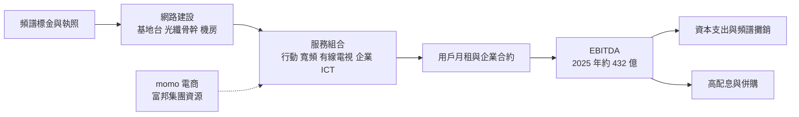
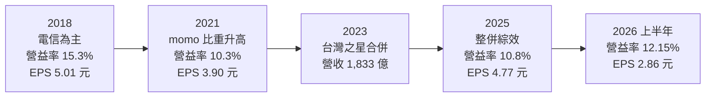
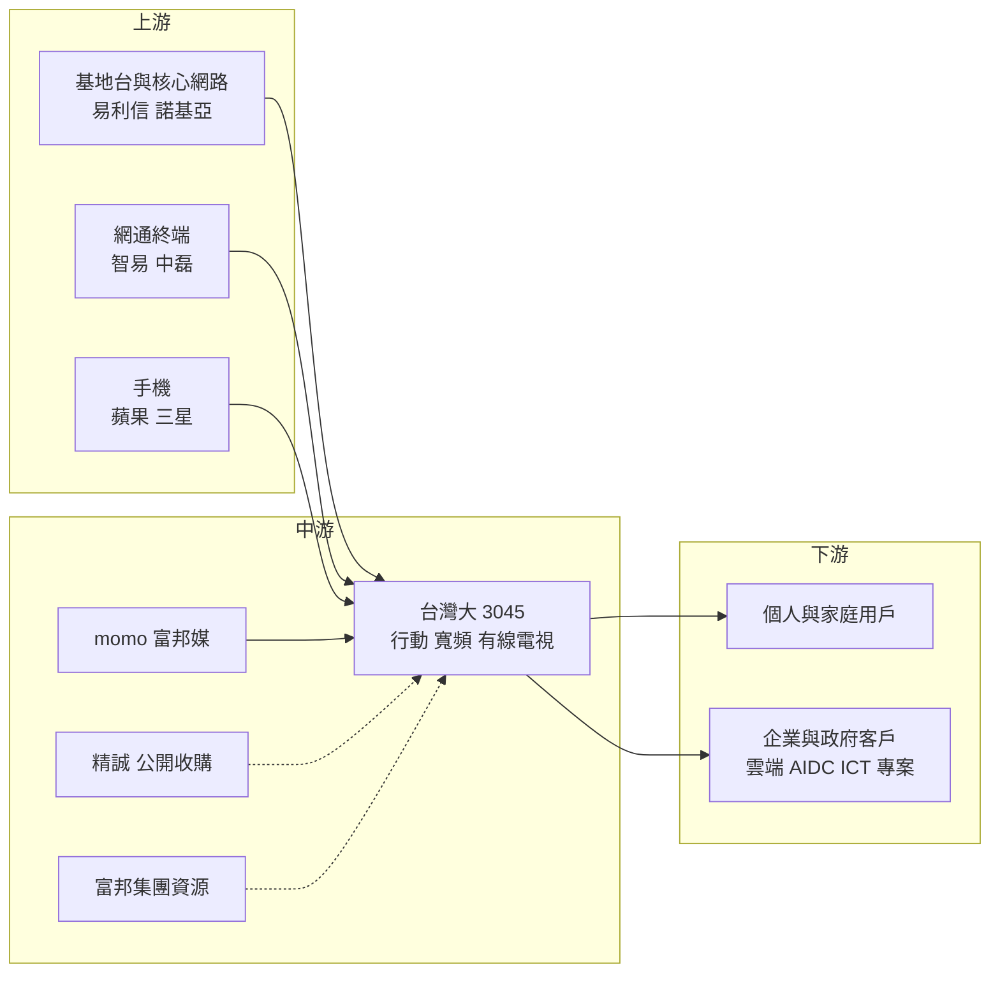

# 3045 台灣大

> 上市｜[[產業索引-通信網路業|通信網路業]]｜上市（櫃）日期 2002/08/26

# 第一章：企業模式與商業藍圖

> [!info] 撰寫說明
> 本文由 Claude 依公開資料整理，架構比照 [[2330台積電]] 的四章研究，資料截至 2026-10-08。財務數字來源：證交所開放資料快照（基本資料、2026 年第二季綜合損益與資產負債、2025 年度股利）、Goodinfo 經營績效頁與股利政策頁（2015 至 2025 年）、MoneyDJ 季資產負債表與年度現金流量表、優分析台灣大 2025 年第四季法說會與精誠公開收購報導、工商時報 2026 年 8 月精誠收購報導；產業描述為整理性內容，尚未逐條比對原始文件。#待校對

在評估一家公司的長期投資價值時，第一步是看懂它靠什麼賺錢、為什麼能一直賺下去。本章針對台灣大哥大（股票代號：3045，以下簡稱台灣大）的商業模式進行定性分析，說明一家電信公司如何以「電信加值」的架構，把行動通訊、寬頻、有線電視、電商與企業資訊服務串成同一個集團，以及這種結構為什麼能長期支撐穩定的現金股利。

## 一、核心定位：三雄寡占市場中的「電信＋」集團

台灣大成立於 1997 年 2 月 25 日，2002 年 8 月上市，董事長為富邦集團的蔡明忠、總經理為林之晨（證交所資料），是台灣三大電信業者之一。它的核心生意是行動通訊：先向政府標得[[頻譜]]與執照，建設全台基地台與光纖骨幹，再以月租費向數百萬用戶收費。

電信業的商業模式很像收費公路。前期投入極大，包括頻譜標金與網路建設；但網路建好之後，多服務一位用戶的邊際成本很低，每個月的月租收入則相當穩定。因此電信公司的價值，取決於三件事：市場上有幾家競爭者、每位用戶每月貢獻多少錢（[[ARPU]]）、用戶流失得有多快（[[退租率]]）。

台灣大在這三件事上都處在有利位置：

- **市場結構收斂為三雄[[寡占]]：** 台灣大於 2023 年底完成合併台灣之星，遠傳也合併了亞太電信，台灣行動通訊市場從五家收斂為中華電、台灣大、遠傳三家。競爭者減少後，資費戰的強度明顯下降，這是 2024 年之後電信業獲利改善的結構性原因。
- **5G 升級帶動 ARPU：** 依優分析整理的 2025 年第四季法說會資料，台灣大 [[5G]] 用戶滲透率約 44%，用戶升級 5G 後月租費平均成長約 53%，智慧型手機 ARPU 達 687 元。仍有過半用戶尚未升級，是未來數年 ARPU 成長的來源。
- **用戶黏著度高：** 同一資料顯示，2025 年第四季退租率降到約 0.59%，為歷史低點。退租率愈低，代表取得一位用戶的成本可以攤在更長的使用期間。

## 二、終端應用與產品板塊：電信核心、企業服務、電商與新科技

本次未查得各事業精確的營收比重，因此不畫比重圖。台灣大的業務可以分成四個板塊，各自扮演不同角色：

- **行動與家用電信：** 行動通訊仍是最大的獲利與現金來源，家用寬頻與有線電視則透過自有及合作的有線電視系統提供。依 2025 年法說會資料，寬頻服務營收年增約 5%，300Mbps 以上方案的訂戶占約 48%。電信本業的特色是穩定，成長主要來自 5G 升級與高速寬頻方案。
- **企業服務：** 企業數據專線、雲端、資安與 AI 資料中心（[[AIDC]]）專案。依法說會資料，2025 年企業服務營收年增約 26%，是成長最快的電信相關板塊。企業客戶合約期長、黏著度高，但也需要較多系統整合能力，這是台灣大後來收購精誠的背景。
- **電商（momo）：** 台灣大持有 [[8454富邦媒]] 並納入合併報表。momo 是台灣主要綜合電商平台之一，貢獻大量營收，但電商的利潤率遠低於電信，且面臨蝦皮、酷澎等對手的價格與物流競爭。依法說會資料，商家自營的「mo 店+」與[[零售媒體]]廣告服務是 momo 近年發展重點。
- **新科技事業：** 支付、遊戲與數位內容等服務，用來把電信會員、電商會員與富邦集團的金融服務串連起來，形成交叉銷售的生態系。

## 三、資本轉化邏輯：先投網路，再收月租

台灣大把現金流分成兩個用途：一部分投回網路與頻譜，維持服務品質；其餘大部分以現金股利發還股東，或用於併購擴張。這個邏輯有三個關鍵環節：

- **頻譜是最大的一次性投入：** 2020 年台灣大取得無形資產約 298.9 億元（MoneyDJ 年度現金流量表），主要是 5G 頻譜標金。頻譜在執照期間內逐年攤銷，會壓低帳面獲利，但不影響每年的現金流，因此電信業習慣用 [[EBITDA]] 衡量本業的現金獲利能力。依優分析整理，2025 年 EBITDA 約 431.7 億元。
- **網路建設有明顯的高峰期：** 新世代網路剛推出時資本支出大增，之後逐步回落。台灣大 2018 至 2025 年購置不動產廠房設備每年約 68 億至 116 億元，5G 建設高峰已過，資本支出占營收比例逐漸下降。
- **併購是成長的主要手段：** 台灣市場人口與門號數已飽和，自然成長有限，台灣大過去十年的營收成長大多來自併購與合併 momo、台灣之星等。這代表台灣大的長期價值，很大程度取決於管理層併購的價格與整合能力。

## 四、企業長期藍圖：從電信商走向科技電信集團

- **電信本業提高獲利率：** 合併台灣之星後的網路整併、5G 升級與資費結構調整，是電信本業利潤率改善的主要來源。公司表示合併綜效已在 2025 年獲利中體現。
- **企業 ICT 與 AI：** 2024 年台灣大以約 40 億元取得 [[6214精誠]] 約 11.86% 股權。2026 年 8 月 12 日再宣布透過子公司台信電訊公開收購精誠 39% 至 58% 股權，每股 184.5 元，總對價上限約 291 億元，以現金加換股進行，目標持股過半（工商時報、優分析）。截至撰寫時，公開收購的最終結果未查得。若收購完成，台灣大將從電信商延伸為兼具系統整合能力的企業資訊服務集團。
- **電商與數位生態系：** momo 與電信會員、支付、遊戲串連，加上富邦集團的金融資源，形成「電信＋電商＋金融」的生態系。這個生態系的價值在於降低取得客戶的成本，並提高用戶轉換的麻煩程度。

# 第二章：護城河深度與競爭優勢

在長期價值投資中，「護城河」指企業抵禦競爭、維持超額利潤的保護機制。本章分析台灣大的護城河構成、主要競爭對手，以及這些優勢在三雄寡占的市場中能守住多少。

## 一、護城河的核心組成要素

台灣大的護城河屬於「寬但淺」的公用事業型護城河：別人很難進來，但自己也很難大幅成長。它由四個要素組成：

- **1. 頻譜與執照：** 行動通訊必須取得政府標售的頻譜與特許執照，數量有限、標金高昂，新業者幾乎無法進入。台灣之星與亞太電信被併購後，市場只剩三家主要業者，這種寡占結構是台灣大最根本的護城河。
- **2. 網路基礎建設的沉沒成本：** 全台基地台、光纖骨幹與機房是二十多年累積的投資，任何新進者都要花費數千億元與多年時間才能複製，實際上不可能發生。
- **3. 用戶轉換成本：** 合約綁約、家庭方案、手機分期、寬頻與電視組合，讓用戶更換電信商的麻煩程度提高。退租率降到約 0.59% 的歷史低點，就是這種轉換成本的證據。
- **4. 生態系與集團資源：** momo 電商、有線電視、富邦集團的金融服務與會員資源，讓台灣大比單純的電信公司多了交叉銷售的管道。這一項的護城河效果比前三項弱，但能提高用戶的整體黏著度。

## 二、全球主要競爭對手格局

| 對手 | 定位 | 對台灣大的威脅 |
|---|---|---|
| [[2412中華電]] | 台灣最大電信業者，固網與光纖寬頻具壓倒性優勢 | 資本實力最強、網路涵蓋最完整，在企業與家用寬頻市場難以撼動 |
| [[4904遠傳]] | 合併亞太電信後規模與台灣大接近 | 在 5G、企業 ICT 與資料中心積極追趕，是最直接的對手 |
| 蝦皮、[[8044網家]]、酷澎 | 電商平台 | 以價格與物流與 momo 競爭，壓縮電商利潤 |
| 大型系統整合商 | 企業 ICT | 在企業資訊服務與雲端專案與台灣大競爭 |
| 低軌衛星與 OTT 業者 | 替代型服務 | 長期可能分食部分通訊與影音需求 |

## 三、優勢轉化：哪些市場守得住、哪些守不住

- **守得住：** 行動通訊本業。三雄寡占讓資費戰趨緩，5G 升級與台灣之星整併後的成本下降，支撐電信本業的利潤率。只要沒有新業者進入、法規不大幅改變，這塊業務可以長期維持穩定的現金流。
- **守不住：** 家用固網與電商的領導地位。中華電在光纖寬頻的優勢難以撼動，台灣大的家用寬頻主要依靠有線電視系統；momo 面對電商同業與跨國平台的低價競爭，營收成長放緩、利潤率偏低。
- **觀察重點：** 第一，5G 滲透率與 ARPU 能否持續提升。第二，精誠收購能否完成，以及企業 ICT 與 AIDC 能否成為新的獲利來源，而不只是營收規模。第三，momo 能否透過零售媒體等高毛利服務改善利潤率。第四，併購後的財務槓桿與股利政策能否維持平衡。

# 第三章：財務體質與盈利規模

資料日期：2026-10-08。數字取自 Goodinfo 經營績效頁與股利政策頁、證交所開放資料快照與 MoneyDJ 季資產負債表、年度現金流量表，表格是撰寫當時的快照；最新月營收、毛利率、累計 EPS 由自動排程寫在本筆記的屬性欄位（月營收、毛利率、累計EPS 等）。#待校對

財務報表是檢驗護城河是否真實存在的最終標準。電信業折舊與攤銷龐大，除了一般的三率之外，本章也搭配 EBITDA、自由現金流與資本報酬，檢視台灣大在市場飽和、靠併購成長的環境下的獲利品質。

## 一、獲利能力的基石：三率

| 年度 | 營收（億元） | [[毛利率]] | [[營業利益率]] | EPS（元） | [[ROE]] |
|---|---|---|---|---|---|
| 2018 | 1,187 | 29.0% | 15.3% | 5.01 | 21.7% |
| 2019 | 1,244 | 26.4% | 13.8% | 4.51 | 18.7% |
| 2020 | 1,329 | 23.7% | 12.1% | 4.01 | 17.0% |
| 2021 | 1,561 | 20.1% | 10.3% | 3.90 | 17.7% |
| 2022 | 1,722 | 19.3% | 9.81% | 3.91 | 17.8% |
| 2023 | 1,833 | 19.0% | 9.57% | 4.33 | 17.2% |
| 2024 | 1,994 | 19.9% | 10.2% | 4.57 | 16.9% |
| 2025 | 1,988 | 20.6% | 10.8% | 4.77 | 17.2% |

（來源：Goodinfo 經營績效頁，合併報表。2026 年上半年依證交所資料，營收 992.1 億元、毛利率 21.86%、營業利益率 12.15%、EPS 2.86 元。）

- **毛利率下降是結構變化，不是本業惡化：** 2016 至 2023 年毛利率從約 32.5% 降到 19.0%，營業利益率從約 17.2% 降到 9.57%（Goodinfo）。主因是低毛利的 momo 電商營收快速成長，在合併營收中的比重提高，稀釋了整體利潤率。評估電信本業時，不能只看合併三率，否則會誤以為台灣大的競爭力下降。
- **2024 年後利潤率回升：** 營業利益率從 2023 年的 9.57% 回升到 2025 年的 10.8%，2026 年上半年再升到 12.15%（證交所資料）。這反映台灣之星整併後的網路成本下降、5G 升級帶動 ARPU，以及三雄寡占下的資費紀律。
- **營收成長靠併購：** 2020 至 2025 年營收年複合成長率約 8.4%（推算，1,329 億元到 1,988 億元），大部分來自 momo 擴張與合併台灣之星，電信本業的自然成長有限。EPS 則從 2018 年的 5.01 元降到 2021 年的 3.90 元後，才逐步回升到 2025 年的 4.77 元，說明合併營收變大，不一定代表每股獲利同步成長。

## 二、[[ROE]]：資本效率

台灣大 2021 至 2025 年平均 ROE 約 17.4%（推算），每年都在 16.9% 到 17.8% 之間，穩定度在台灣上市公司中相當罕見。這個 ROE 的特點是「中等的利潤率、偏低的資產周轉、偏高的財務槓桿」：電信資產龐大、周轉慢，但台灣大長期以舉債支應資本支出與併購，同時把大部分盈餘配發出去，讓股東權益不會持續膨脹。

另一個需要了解的細節是，台灣大有大量母公司股票由子公司持有，2026 年第二季帳上庫藏股票約 282.1 億元、子公司持有母公司股數約 6.63 億股（證交所資料）。這部分股票在計算 EPS 時不列入流通股數，也會降低帳面股東權益，因此會推高 ROE 與 EPS。2026 年第二季歸屬母公司權益約 844.8 億元，每股參考淨值約 27.61 元。

## 三、資本支出、自由現金流與股利

- **[[CapEx]]：** 2018 至 2025 年購置不動產廠房設備每年約 68 億至 116 億元，2024 年約 116.2 億元、2025 年約 107.4 億元（MoneyDJ 年度現金流量表）。2020 年另有約 298.9 億元的無形資產取得，主要是 5G 頻譜。電信業的資本支出有明顯的世代週期，未來 6G 或新頻段釋出時，會再出現一次大額投入。
- **[[自由現金流]]：** 2018 至 2025 年營業現金流每年約 291 億至 375 億元，扣除購置不動產廠房設備後，自由現金流每年約 193 億至 268 億元，八年全部為正（MoneyDJ 資料推算）。若把 2020 年的頻譜支出也算進去，該年自由現金流約為負 94 億元（推算），可見頻譜標售年份會讓現金流明顯下降，但其他年份的穩定現金流足以彌補。這是台灣大能長期維持高股利的根本原因。
- **股利穩定度：** 2015 至 2018 年度每年配發約 5.55 至 5.6 元現金股利，2019 年度起因獲利下滑降到 4.3 至 4.75 元，2024 年度 4.5 元，2025 年度 4.8 元（其中約 3.98 元來自盈餘、約 0.82 元來自資本公積，證交所資料）。以當年 EPS 計算，2021 至 2025 年度配發率約 98% 至 110%（推算），也就是幾乎把全部盈餘、有時還加上資本公積發給股東。這種政策的前提是自由現金流穩定且高於帳面盈餘，但也代表公司保留的資金很少，大型併購需要靠舉債或換股。

## 四、[[ROIC]] 與 [[WACC]]：價值創造利差

- **ROIC（推算）：** 以 2025 年營收 1,988 億元乘以營業利益率 10.8%，營業利益約 214.7 億元，扣除 20% 稅率後稅後營業利益約 171.8 億元。投入資本以 2025 年底權益約 945.5 億元，加上有息負債約 964.0 億元（短期借款 112.0 億、應付商業本票 68.9 億、一年內到期長期負債 36.1 億、應付公司債 389.2 億、長期銀行借款 224.9 億、租賃負債 132.9 億），合計約 1,909.5 億元，ROIC 約 9.0%（推算）。以 2026 年上半年營業利益 120.5 億元年化，稅後約 192.8 億元，除以 2026 年第二季權益 920.6 億元加有息負債約 870.6 億元，投入資本約 1,791 億元，ROIC 約 10.8%（推算）。投入資本中包含約 965 億元的商譽與無形資產（含頻譜特許權），代表併購與頻譜的代價已經反映在分母裡。
- **WACC（推算）：** 以 [[CAPM]] 估算股東權益成本：無風險利率取台灣 10 年期公債約 1.75%，市場風險溢酬 6%，β 假設 0.4（台灣電信股常見值 0.3 至 0.5，未查得台灣大實際數字），權益成本約 4.15%。稅前負債成本假設 1.8%（以國內公司債與銀行借款為主），稅率 20%，稅後約 1.44%。以帳面價值計算，權益與有息負債各約占一半，WACC 約 2.8%；若改用市值權重（股價淨值比約 4.45 倍，權益約占 81%），WACC 約 3.6%（推算）。即使把 β 提高到 0.7，權益成本約 5.95%，WACC 也只有約 5% 左右。
- **價值創造判斷：** 台灣大的 ROIC 約 9% 至 11%，比 3% 至 5% 的資金成本高出約 5 至 7 個百分點，代表它長期穩定地創造超額價值。這個利差不大，卻非常穩定，是典型公用事業型企業的特徵。精誠收購若以換股方式進行，分母會增加；只有在企業 ICT 業務的報酬率不低於現有水準時，整體利差才不會被稀釋。

# 第四章：總體風險與地緣政治

任何企業都無法脫離宏觀環境獨立存在。本章分析台灣大未來必須面對的地緣政治、產業結構、營運與法規風險。

## 一、地緣政治

- **關鍵基礎設施的安全風險：** 電信網路屬於國家關鍵基礎設施。兩岸關係緊張時，網路攻擊、海底電纜中斷與基地台破壞都是實際風險，近年台灣周邊海纜多次受損，備援與衛星通訊已成為政策重點。這類事件不一定造成大額損失，但會增加資安與備援投資。
- **設備供應商選擇受限：** 台灣電信業者的核心網路設備避開中國供應商，主要採用歐洲廠商，可選擇的供應商較少，議價空間有限。
- **集團治理：** 台灣大屬於富邦集團，與集團內金融、媒體事業的關係交易與資源分配，是長期需要留意的治理議題。

## 二、產業週期與市場結構

- **市場飽和：** 台灣手機門號普及率早已超過人口數，用戶數幾乎沒有成長空間。營收成長只能依賴 ARPU 提升、企業服務與併購。
- **資費紀律的延續性：** 三雄寡占讓價格戰趨緩，但如果有業者為搶 5G 用戶或企業客戶發動低價方案，ARPU 可能被壓抑。寡占結構的價值，取決於三家業者是否都維持理性競爭。
- **電商週期：** momo 營收與消費景氣、平台競爭高度相關，波動大於電信本業，會讓合併營收與獲利出現與電信無關的起伏。

## 三、營運環境的隱性風險

- **併購整合：** 精誠收購金額大，涉及換股與被收購公司的經營獨立性。若整合效益不如預期，或企業 ICT 業務的利潤率偏低，會稀釋整體報酬率；換股也會稀釋既有股東持股。
- **財務槓桿與股利：** 配發率長期接近或超過 100%，加上併購需求，台灣大需要持續發債與借款。利率上升時，利息成本與再融資風險會增加，股利政策也可能需要調整。
- **頻譜與網路的週期性投入：** 每一個新世代網路都需要再投入大筆頻譜標金與建設成本，投入期間自由現金流會明顯下降。

## 四、科技或法規演進

- **監理政策：** 國家通訊傳播委員會對併購、資費、有線電視與頻譜分配的規範，直接影響台灣大的擴張與定價空間。
- **替代技術：** [[低軌衛星]]通訊、Wi-Fi 與 [[OTT]] 通訊軟體持續替代傳統語音、簡訊與部分數據服務；年輕族群轉向串流平台，有線電視訂戶可能持續流失。
- **新世代網路：** 6G 與新頻段的商用時程若提前，資本支出會再次上升；若新技術的商業模式不清楚，投資回收期也會拉長。

# 專有名詞解析

## 金融

- **[[EBITDA]]**：稅前息前折舊攤銷前利潤，電信業折舊攤銷龐大，常用它衡量本業現金獲利能力。
- **[[ARPU]]**：每用戶平均月營收，電信業衡量用戶價值的核心指標，5G 升級與加值服務可推升 ARPU。
- **[[退租率]]**：每月停止使用服務的用戶占總用戶比例，愈低代表用戶黏著度愈高。
- **[[ROIC]]**：投入資本報酬率，稅後營業利益除以股東權益加有息負債，衡量本業運用資本的效率。
- **[[WACC]]**：加權平均資金成本，依股東權益與負債的比重，加權計算公司取得資金的平均成本。
- **[[CAPM]]**：資本資產定價模型，以無風險利率加上 β 乘以市場風險溢酬，估算股東要求的報酬率。
- **[[自由現金流]]**：營業活動現金流減去資本支出，代表企業可自由用於配息、還債或併購的現金。

## 產業

- **[[5G]]**：第五代行動通訊，速度與容量高於 4G，電信商以升級資費提高 ARPU。
- **[[頻譜]]**：無線通訊使用的電波頻率範圍，由政府標售或分配，是電信業者最重要的特許資產。
- **[[寡占]]**：市場由少數業者主導的結構，台灣行動通訊在併購後收斂為中華電、台灣大、遠傳三雄。
- **[[AIDC]]**：AI 資料中心，提供 AI 運算所需的機房、電力與網路，是電信商企業服務的新成長來源。
- **[[零售媒體]]**：電商或通路利用自家消費資料向品牌商販售廣告版位的服務（Retail Media Network）。
- **[[低軌衛星]]**：在數百至兩千公里高度運行的通訊衛星群，可提供偏遠地區與災難備援的網路連線。
- **[[OTT]]**：透過網際網路直接提供影音或通訊服務的業者，例如串流平台與通訊軟體，會替代傳統電視與語音。

# 核心供應鏈

## 1. 上游：網路設備與終端
- 基地台與核心網路：Ericsson（易利信）、Nokia（諾基亞）
- 寬頻與網通終端設備：[[3596智易]]、[[5388中磊]]
- 手機與終端：[[AAPL蘋果]]、[[005930三星電子]]

## 2. 中游：台灣大本身與集團資源
- 電商子公司：[[8454富邦媒]]
- 資訊服務（2026 年 8 月宣布公開收購）：[[6214精誠]]
- 集團金融資源：[[2881富邦金]]

## 3. 下游：客戶
- 個人與家庭用戶：行動通訊、寬頻與有線電視
- 企業與政府客戶：數據專線、雲端、AI 資料中心與 ICT 專案

## 4. 同業與競爭者
- 電信：[[2412中華電]]、[[4904遠傳]]
- 電商：蝦皮、[[8044網家]]、酷澎

## 最新新聞
<!-- news:start（自動產生，請勿手動編輯此範圍） -->
- 2026-10-21 🏛️ 重訊 14:54｜代重要子公司台信電訊(股)公司公告公平交易委員會 不禁止台灣大哥大(股)公司透過台信電訊(股)公司取得 精誠資訊(股)公司結合案｜[觀測站](https://mops.twse.com.tw/mops/#/web/t05st01)
- 2026-10-13 📰 媒體 10:00｜電信三雄獲利王換人！台灣大前9月EPS險勝中華電，遠傳靠5G追趕｜[鉅亨網](https://news.cnyes.com/news/id/6629211)
- 2026-10-12 🏛️ 重訊 17:07｜公告本公司115年9月份營運成績｜[觀測站](https://mops.twse.com.tw/mops/#/web/t05st01)
- 2026-10-12 🏛️ 重訊 17:07｜本公司將於115年11月12日召開電話會議說明115年第3季營運情形｜[觀測站](https://mops.twse.com.tw/mops/#/web/t05st01)
- 2026-10-07 🏛️ 重訊 17:09｜代子公司台灣固網(股)公司公告取得台灣大哥大(股)公司一筆使用權資產｜[觀測站](https://mops.twse.com.tw/mops/#/web/t05st01)

完整紀錄：[[3045台灣大 新聞]]
<!-- news:end -->

## 相關連結
- [公開資訊觀測站](https://mopsov.twse.com.tw/mops/web/t05st03?step=1&firstin=1&co_id=3045)
- [Goodinfo](https://goodinfo.tw/tw/StockDetail.asp?STOCK_ID=3045)
- [Yahoo 股市](https://tw.stock.yahoo.com/quote/3045)
- [鉅亨網新聞](https://www.cnyes.com/twstock/3045/news)
