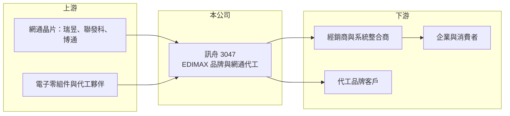

# 3047 訊舟

> 上市｜[[產業索引-通信網路業|通信網路業]]｜上市（櫃）日期 2002/08/26

# 第一章：企業模式與商業藍圖

> [!info] 撰寫說明
> 精簡版，由 Claude 依公開資料整理，架構比照 [[2330台積電]] 的四章研究，資料截至 2026-10-08。來源：證交所開放資料（基本資料、綜合損益、資產負債、營益分析、股利、每月營收）、Goodinfo 年度經營績效。公開資料有限，本次未取得產品別資料，業務描述多依記憶整理，需逐條比對原始文件。#待校對

本章說明訊舟科技（股票代號：3047，品牌 EDIMAX，以下簡稱訊舟）的商業模式：同時經營[[自有品牌]]與代工的台灣網通廠。

- **核心業務：** 訊舟成立於 1986 年，2002 年在台灣證券交易所上市，總部位於台北市內湖區。訊舟以 EDIMAX 品牌銷售無線網卡、無線路由器、[[交換器]]、網路攝影機等網通產品，並以 EDIMAX Pro 經營企業級無線基地台與網管方案，同時也以 [[ODM]] 方式替其他品牌代工（待校對）。這種「品牌加代工」的雙軌模式，讓公司可以用代工訂單撐住產能，再以品牌產品賺取較高毛利。
- **營收結構：** 公開資料本次未取得產品別營收比重。依產品性質推估，消費性網通周邊（網卡、路由器）占營收大宗，企業網路產品比重較小但毛利較高（推估）。營收在 2024 年跳升到 68.2 億元、2025 年回落到 36.5 億元，顯示部分代工或專案訂單波動很大，原因本次未查得。
- **營運據點：** 總部位於台北內湖，海外以品牌行銷據點與通路經營歐洲、亞太等市場，生產據點細節本次未查得（待校對）。
- **長期方向：** 網通產業的長期升級方向是 Wi-Fi 7、多 Gbps 交換器與雲端網管。消費性網卡與路由器價格持續下滑，訊舟的長期課題是提高企業網路與雲端管理產品的比重，降低對低毛利消費品與單一代工客戶的依賴。

# 第二章：護城河深度與競爭優勢

本章評估訊舟在網通市場的護城河。從營業利益率長期在正負 6% 之間擺盪來看，訊舟的護城河很窄。

- **競爭優勢：** 訊舟的優勢在於產品線完整與品牌經營經驗：從網卡、路由器到交換器與攝影機都能提供，對中小型通路與系統整合商而言是方便的一站式供應商。毛利率長期維持在 22% 至 28%，高於純代工廠，說明品牌仍帶來一定的附加價值。但產品同質化高，價格由市場領導品牌決定，議價能力有限。
- **主要對手：** 消費與中小企業網通市場的對手包括 TP-Link、[[2332友訊]]、Netgear、[[2357華碩]]；代工市場則有 [[6285啟碁]]、[[3380明泰]]、[[4906正文]] 等（對手名單為產業常識整理，待校對）。
- **觀察重點：** 第一，營收能否擺脫大起大落、恢復穩定成長。第二，營業費用能否隨營收調整，讓營業利益率回到正值。第三，企業網路產品比重是否提升。

# 第三章：財務體質與盈利規模

資料日期：2026-10-08。數字取自 Goodinfo 年度經營績效與證交所開放資料，表格是撰寫當時的快照；最新月營收、毛利率、累計 EPS 由自動排程寫在本筆記的屬性欄位（月營收、毛利率、累計EPS 等）。#待校對

訊舟的財務數字顯示營收波動大、毛利率穩定，但營業利益率在零附近擺盪。

| 年度 | 營收（新台幣） | [[毛利率]] | [[營業利益率]] | EPS（元） | [[ROE]] |
|---|---|---|---|---|---|
| 2020 | 63.1 億 | 25.7% | 5.87% | 0.56 | 8.17% |
| 2021 | 52.5 億 | 22.4% | -0.72% | -0.29 | -2.44% |
| 2022 | 59.6 億 | 24.4% | 2.60% | 1.30 | 8.33% |
| 2023 | 42.6 億 | 24.8% | -5.66% | -0.15 | -8.21% |
| 2024 | 68.2 億 | 27.4% | 5.19% | 0.51 | 約 4.2%（推算） |
| 2025 | 36.5 億 | 27.6% | -7.46% | -0.90 | -9.94% |
| 2026 上半年 | 15.43 億 | 25.22% | -9.96% | -0.31 | 未查得 |

註：2020 至 2025 年取自 Goodinfo 合併報表。Goodinfo 2024 年 ROE 列為 13.2%，與 EPS 0.51 元、每股淨值 12.27 元不一致，改以 EPS 除以每股淨值推算約 4.2%；其他年度 ROE 與 EPS 的對應也有落差（例如 2023 年），可能涉及非控制權益或口徑差異，待校對。2026 上半年取自證交所開放資料。

- **營收規模：** 2020 至 2025 年營收年複合成長率約 -10.4%（推算），但年度間落差極大，2024 年 68.2 億元、2025 年僅 36.5 億元。2026 年 1 至 8 月累計營收 20.64 億元，較去年同期的 27.09 億元減少約 24%。
- **獲利：** 毛利率穩定在 22% 至 28%，但營業利益率在 -7.5% 到 5.9% 之間擺盪，顯示營業費用對營收規模高度敏感。2021 至 2025 年 EPS 合計約 0.47 元，五年平均每年不到 0.1 元。2025 年稅後淨損 2.01 億元，2026 上半年歸屬母公司淨損 0.69 億元。
- **財務特色：** 依證交所資料，2026 年第二季底資產總計 63.6 億元、負債 32.8 億元（其中非流動負債 16.9 億元）、歸屬母公司權益 24.6 億元，每股淨值 11.01 元，保留盈餘為 -1.37 億元。非流動負債占比偏高，可能包含長期借款，財務槓桿高於多數網通同業（推估）。2025 年度未配發股利。
- **[[ROIC]] 與 [[WACC]]：** 以 2026 上半年營業損失 1.54 億元年化約 -3.07 億元（虧損不計稅盾），投入資本以歸屬母公司權益 24.6 億元加非流動負債 16.9 億元（代替有息負債）約 41.5 億元計算，ROIC 約 -7.4%（推算）；即使以 2024 年營業利益約 3.54 億元扣稅後計算，ROIC 也只有約 6.8%（推算，資本以近期數字代替）。WACC 以 CAPM 推估：無風險利率 1.75%、市場風險溢酬 6%、β 取 1.1（推估，中小型網通股常見值），權益成本約 8.35%；稅前負債成本假設 2.5%，以帳面約六比四的權益與負債比重加權，WACC 約 5.5% 至 6%（推算）。ROIC 只在少數好年度接近或略高於 WACC，長期平均低於資金成本，代表訊舟尚未建立能持續創造價值的商業模式。

# 第四章：總體風險與地緣政治

本章整理訊舟面對的長期風險，主要來自營收波動與財務槓桿。

- **產業週期：** 網通產品需求跟隨 PC、消費電子與企業 IT 支出的週期，2022 年缺料期間出貨與價格上揚，2023 年庫存調整時營收大幅下滑，呈現明顯的[[長鞭效應]]。
- **營運風險：** 營收高度依賴少數大型訂單，訂單結束時營收可能腰斬，2025 年營收較 2024 年減少近一半即是例子。品牌營運需要固定的行銷與研發費用，營收縮小時虧損率會放大。
- **其他風險：** 非流動負債偏高，持續虧損下財務彈性下降，若需籌資可能稀釋股權。美國與歐洲對網通設備的資安規範與關稅政策會增加合規與生產成本。產品以美元、歐元計價，匯率波動影響獲利。

# 專有名詞解析

## 金融

- **[[長鞭效應]]**：終端需求的小幅變動，沿供應鏈往上游傳遞時被逐級放大，造成上游庫存與訂單劇烈波動。
- **[[ROIC]]**：投入資本報酬率，稅後營業利益除以股東權益與有息負債的合計，衡量本業對所有資金提供者的報酬。
- **[[WACC]]**：加權平均資金成本，依股東權益與負債的比重加權計算的資金成本，ROIC 高於它才代表創造價值。

## 產業

- **[[自有品牌]]**：企業以自己的商標設計、行銷與銷售產品，掌握定價與通路，毛利通常高於代工。
- **[[ODM]]**：原廠委託設計製造，代工廠可提出設計方案並負責生產，與客戶綁定較深，議價能力較高。
- **[[交換器]]**：在資料中心或企業網路中轉送資料封包的網路設備，AI 資料中心需要 800G、1.6T 等高速規格。

# 核心供應鏈

- 上游：網通晶片 [[2379瑞昱]]、[[2454聯發科]]、[[AVGO博通]]，電子零組件（實際供應比重未公開，待校對）。
- 下游／客戶：全球經銷商、系統整合商與代工品牌客戶，終端為企業與消費者；客戶名稱本次未查得。
- 同業：TP-Link、[[2332友訊]]、[[2357華碩]]、[[6285啟碁]]、[[3380明泰]]、[[4906正文]]、[[2444兆勁]]。

## 最新新聞
<!-- news:start -->
<!-- news:end -->

## 相關連結
- [公開資訊觀測站](https://mopsov.twse.com.tw/mops/web/t05st03?step=1&firstin=1&co_id=3047)
- [Goodinfo](https://goodinfo.tw/tw/StockDetail.asp?STOCK_ID=3047)
- [Yahoo 股市](https://tw.stock.yahoo.com/quote/3047)
- [鉅亨網新聞](https://www.cnyes.com/twstock/3047/news)
