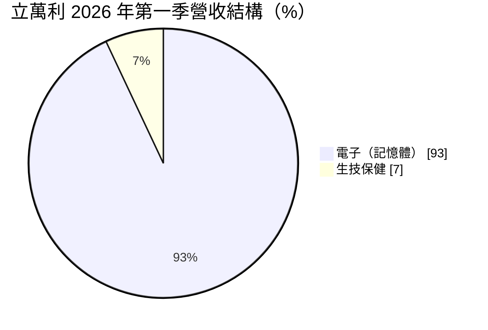
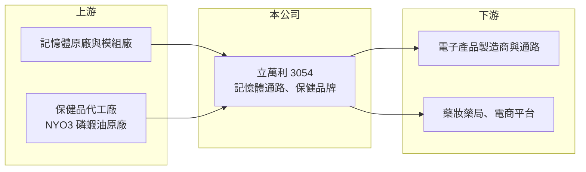

# 3054 立萬利

> 上市｜[[產業索引-食品工業|食品工業]]｜上市（櫃）日期 2002/11/18

# 第一章：企業模式與商業藍圖

> [!info] 撰寫說明
> 精簡版，由 Claude 依公開資料整理，架構比照 [[2330台積電]]，資料截至 2026-10-08。來源：證交所開放資料快照（基本資料、2026 年上半年資產負債與綜合損益、股利）、Goodinfo 歷年經營績效、富果 2026 年 6 月法說會摘要（AI 整理，非公司原始文件）。公開資料有限，證交所產業別為電子通路業，並非食品股。#待校對

立萬利是一家同時經營記憶體買賣與保健品牌的小型公司，營收主要來自波動很大的電子通路，保健事業規模小但較穩定，理解它要把兩條業務分開看。

- **核心業務：** 公司成立於 1991 年，2002 年上市，證交所歸類為電子通路業。目前主要營收來自記憶體產品的採購與銷售，屬於貿易型態，依記憶體供需與價格靈活調整進貨量。2017 年起切入生技保健，經營威客維（Well-Care）保健品、滴滴鮮滴雞精與膠原飲等品牌，並代理挪威 NYO3 磷蝦油。
- **營收結構：** 依法說會資料，2026 年第一季電子（記憶體）約占營收 93%，生技保健約 7%。電子通路營收隨記憶體價格起落，可能一年內成長數倍，也可能大幅萎縮；保健事業營收規模小，但有品牌與通路累積。
- **營運據點：** 公司位於台北內湖，法說會未提及自有工廠，保健品以委外生產為主，正在探索 OEM／ODM 合作。保健品透過康是美、大樹、藥師、美康等藥妝藥局與 momo、蝦皮、PChome 等電商銷售，銷售點超過 3,000 個。
- **長期方向：** 公司定位為「電子與生技雙軌」，保健事業目標每季推出一項新品並拓展海外。長期價值取決於保健品牌能否成長到足以平衡記憶體通路的景氣波動。

# 第二章：護城河深度與競爭優勢

立萬利的兩項業務都屬於門檻不高的競爭市場，護城河很窄，競爭力主要來自通路關係與庫存操作的時機判斷。

- **競爭優勢：** 記憶體通路的優勢在於取得貨源與判斷價格週期，在報價上升前備貨就能賺取價差，但這屬於操作能力而非結構性壁壘。保健事業則有 SNQ 國家品質標章與通路據點，品牌累積需要時間，是相對可延續的資產。
- **主要對手：** 記憶體方面，[[3260威剛]]、[[4967十銓]]、[[2451創見]] 等模組廠規模遠大於立萬利，掌握原廠貨源與品牌；保健方面，台灣保健品牌眾多，從大型食品集團到電商新品牌都在競爭，價格與行銷戰激烈。
- **觀察重點：** 保健事業占營收比重能否逐年提升、毛利率是否穩定，是判斷轉型是否成功的指標。記憶體通路獲利則應視為景氣性收益，不宜用單一年度推估長期獲利。

# 第三章：財務體質與盈利規模

資料日期：2026-10-08，表格是撰寫當時的快照；最新月營收、毛利率、累計 EPS 由自動排程寫在本筆記的屬性欄位（月營收、毛利率、累計EPS 等）。#待校對

立萬利的財務特色是營收極不穩定、本業長期虧損，獲利經常來自業外的金融資產評價，閱讀數字時要先區分本業與業外。

| 年度 | 營收（億元） | [[毛利率]] | [[營業利益率]] | EPS（元） | [[ROE]] |
|---|---|---|---|---|---|
| 2020 | 2.77 | -9.07% | -37.3% | -0.16 | -1.43% |
| 2021 | 0.48 | 15.8% | -102% | 0.55 | 4.97% |
| 2022 | 0.34 | 33.5% | -118% | -1.50 | -14.5% |
| 2023 | 0.39 | 38.8% | -102% | 0.06 | 0.66% |
| 2024 | 0.99 | 21.0% | -37.7% | -0.40 | -4.18% |
| 2025 | 1.26 | 31.2% | -56.4% | 1.96 | 17.5% |
| 2026 上半年 | 3.39 | 53.9% | 38.0% | 2.90 | 未查得 |

資料來源：Goodinfo 歷年經營績效；2026 上半年取自證交所開放資料。

- **營收規模：** 營收在 0.3 億元到 3 億元之間大幅擺動，沒有穩定的成長趨勢。2026 年上半年營收約 3.4 億元，已超過過去任何一個完整年度，主要來自記憶體價格上漲帶動的電子通路出貨。
- **獲利：** 2020 至 2025 年營業利益率全為負值，2025 年 EPS 1.96 元主要來自業外收益。2026 年上半年本業轉為大幅獲利，營業利益約 1.29 億元，但稅後淨利約 2.34 億元仍明顯高於營業利益，業外的金融資產評價貢獻很大。近 5 年（2021 至 2025）平均 ROE 不到 1%（推算）。
- **財務特色：** 2026 年第二季底權益約 15.4 億元、負債僅約 2.0 億元，幾乎沒有借款，其他權益項目約 4.1 億元，顯示持有相當規模的金融資產。2025 年度配發現金股利 0.8 元。
- **[[ROIC]] 與 [[WACC]]：** 2025 年營業利益約 -0.71 億元（1.26 億 × -56.4%），ROIC 為負，約 -3.7%（推算，以權益 15.4 億元、有息負債視為零）。2026 年上半年營業利益年化約 2.6 億元，稅後約 2.1 億元，ROIC 約 13%（推算），但高度依賴記憶體價格。WACC 以無風險利率 1.75%、市場風險溢酬 6%、β 取電子通路常見值 1.0，幾乎無負債，WACC 約 7.8%（推算）。長期平均來看本業 ROIC 低於 WACC，公司價值主要來自資產負債表上的現金與投資，而非本業創造的超額報酬。

# 第四章：總體風險與地緣政治

立萬利的風險在於本業獲利高度依賴記憶體價格，以及業外投資的評價波動。

- **產業週期：** 記憶體價格具有明顯的景氣循環，供給緊縮時價格可在數季內翻倍，供過於求時又會快速崩跌。貿易商持有庫存，在價格反轉時可能出現跌價損失，獲利常在一兩年內由盛轉衰。
- **營運風險：** 公司規模小，貨源取得依賴上游原廠與大型通路商，議價能力有限。保健事業雖較穩定，但品牌行銷費用高、競爭激烈，短期內難以撐起整體獲利。
- **其他風險：** 業外的金融資產評價受股市影響，可能放大或吞噬年度獲利；保健食品面對廣告標示與食品安全法規，違規可能影響品牌形象；記憶體交易也受美元匯率與國際貿易政策影響。

# 專有名詞解析

## 金融

- **[[業外收益]]**：本業營運以外的收入，例如投資評價利益、股利與處分資產利益，通常不具持續性。
- **[[ROIC]]**：投入資本報酬率，稅後營業利益除以股東權益加有息負債，用來衡量公司運用所有資本的獲利能力。
- **[[WACC]]**：加權平均資金成本，股東權益成本與稅後負債成本依資本結構加權，ROIC 高於它才代表創造價值。

## 產業

- **[[記憶體通路]]**：向原廠或模組廠採購 DRAM、快閃記憶體等產品再轉售的貿易業務，獲利主要來自價差與庫存操作。
- **[[ODM]]**：原廠委託設計製造，代工廠提供配方與設計，品牌商貼牌銷售。

# 核心供應鏈

- 上游：記憶體原廠與模組廠（公司未揭露具體貨源）、保健品委託代工廠、挪威 NYO3 原廠。
- 下游／客戶：電子製造與通路客戶；康是美、大樹等藥妝藥局與 momo、蝦皮、PChome 等電商。
- 同業：記憶體方面 [[3260威剛]]、[[4967十銓]]、[[2451創見]]；保健品牌方面 [[7780大研生醫]]。

## 最新新聞
<!-- news:start（自動產生，請勿手動編輯此範圍） -->
- 2026-10-06 📰 媒體 18:50｜營收速報 - 立萬利(3054)9月營收3,742萬元年增率高達214.58％｜[鉅亨網](https://news.cnyes.com/news/id/6622879)

完整紀錄：[[3054立萬利 新聞]]
<!-- news:end -->

## 相關連結
- [公開資訊觀測站](https://mopsov.twse.com.tw/mops/web/t05st03?step=1&firstin=1&co_id=3054)
- [Goodinfo](https://goodinfo.tw/tw/StockDetail.asp?STOCK_ID=3054)
- [Yahoo 股市](https://tw.stock.yahoo.com/quote/3054)
- [鉅亨網新聞](https://www.cnyes.com/twstock/3054/news)
