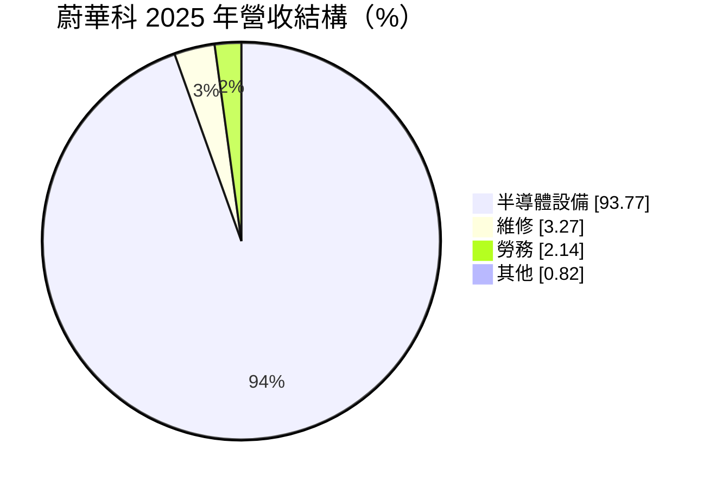
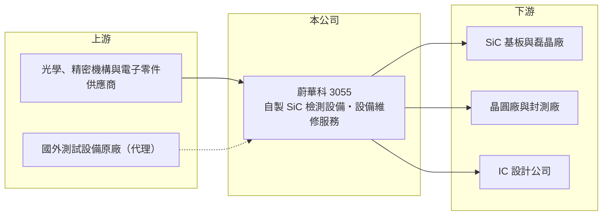

# 3055 蔚華科

> 上市｜[[產業索引-電子通路業|電子通路業]]｜上市（櫃）日期 2002/12/12

# 第一章：企業模式與商業藍圖

> [!info] 撰寫說明
> 精簡版，由 Claude 依公開資料整理，架構比照 [[2330台積電]]，資料截至 2026-10-08。來源：證交所開放資料快照（基本資料、2026 年第二季資產負債與損益、股利）、Goodinfo 經營績效頁、富邦 MoneyDJ 公司基本資料（2025 年營收比重）、蕃薯藤與方格子文章標題。公開資料有限。#待校對

蔚華科技（以下簡稱蔚華科）是一家正在轉型的半導體設備公司，理解它的關鍵在於：公司過去以代理國外測試設備為主，近年主動縮減代理、改做自有的檢測設備，營收因此大幅下降，目前仍處於轉型的虧損期。

- **核心業務：** 蔚華科成立於 1987 年，總部在新竹，2002 年上市。公司長期提供 IC 測試與量測設備的銷售、安裝與維修，客戶是晶圓廠、封測廠與 IC 設計公司。2025 年營收約 94% 來自半導體設備，維修與勞務合計約 5%。設備公司的營收按出貨與驗收認列，單筆金額大，因此季度波動明顯。
- **營收結構：** 依 2025 年 12 月法說會筆記的標題，公司定位為「從代理走向自製」。代理設備的毛利率低、又受原廠策略左右，自製設備毛利率較高但需要研發投入與時間，營收在轉換期會先縮小。2021 年營收 26.5 億元，2025 年只剩 4.59 億元，反映的就是代理業務退出的速度快於自製業務成長的速度。
- **營運據點：** 公司以新竹為研發與服務中心，服務台灣與中國的半導體客戶（海外據點明細未查得）。設備業需要就近提供安裝與維修，因此服務據點跟著客戶的晶圓廠與封測廠分布。
- **長期方向：** 自製產品的主軸是[[碳化矽]]（SiC）晶圓的[[非破壞性檢測]]。依 2023 年 11 月報導，蔚華科與南方科技合作推出非破壞性 SiC 缺陷檢測系統，主打可在晶圓階段找出缺陷、減少後段浪費。SiC 是電動車與綠能逆變器使用的[[功率半導體]]材料，晶圓缺陷率高、價格昂貴，檢測需求具長期性，但市場規模與競爭態勢仍在形成中。

# 第二章：護城河深度與競爭優勢

蔚華科目前的護城河尚未成形，競爭力取決於自製檢測技術能否被量產客戶採用。

- **競爭優勢：** 公司累積三十多年的半導體設備服務經驗，熟悉客戶的驗證流程與工廠環境，這對新設備打入產線有幫助。SiC 缺陷檢測屬於利基市場，若能在少數 SiC 基板與磊晶廠完成驗證並成為標準流程的一部分，就能形成轉換成本。但這個優勢目前仍是「潛力」而非已實現的獲利。
- **主要對手：** 半導體量測與檢測的國際大廠如 [[KLAC科磊]] 也提供 SiC 缺陷檢測方案，資源與客戶基礎遠大於蔚華科。台灣本地則有其他自動光學檢測與測試介面業者在不同環節競爭，例如 [[6223旺矽]]、[[6515穎崴]]（偏測試介面，非直接對手）。
- **觀察重點：** 長期要觀察自製設備營收能否連續成長、[[毛利率]]能否穩定在三成以上，以及營業虧損何時收斂。2026 年上半年毛利率約 31.8%，高於 2025 年的 16.1%，方向正確，但營業費用仍遠大於毛利。

# 第三章：財務體質與盈利規模

資料日期：2026-10-08，表格是撰寫當時的快照；最新月營收、毛利率、累計 EPS 由自動排程寫在本筆記的屬性欄位（月營收、毛利率、累計EPS 等）。#待校對

蔚華科的財務呈現「轉型期設備公司」的樣貌：營收連年下滑、本業虧損，但資產負債表乾淨、負債很少。

| 年度 | 營收（億元） | [[毛利率]] | [[營業利益率]] | EPS（元） | [[ROE]] |
|---|---|---|---|---|---|
| 2021 | 26.5 | 11.5% | -13.4% | -3.70 | -14.6% |
| 2022 | 19.1 | 8.97% | -21.7% | 2.14 | 9.37% |
| 2023 | 13.4 | 17.8% | -14.3% | -0.49 | -2.03% |
| 2024 | 6.73 | 20.5% | -39.8% | -2.23 | -11.7% |
| 2025 | 4.59 | 16.1% | -65.9% | -2.68 | -17.0% |

（來源：Goodinfo 經營績效頁；2020 年營收 20.2 億元、EPS -0.48 元。）

- **營收規模：** 2020 至 2025 年營收年複合成長率約 -25.6%（推算），是代理業務退出的結果。2026 年上半年營收約 2.47 億元，營業虧損約 1.27 億元，但[[業外收入]]約 1.13 億元抵銷大部分虧損，EPS -0.03 元。
- **獲利：** 2021 至 2025 年本業每年都虧損，平均 ROE 約 -7.2%（推算）。2022 年 EPS 2.14 元是業外收益所致，不代表本業轉好。在自製設備放量前，營業費用（研發與人事）是固定支出，營收越小，虧損率越高。
- **財務特色：** 2026 年第二季總資產約 19.7 億元、負債僅約 3.2 億元、股東權益約 16.4 億元，每股淨值約 14.4 元，幾乎沒有財務壓力。2025 年度以資本公積發放每股 0.5 元現金，並非來自當年盈餘。自由現金流在轉型期為負（推估）。
- **[[ROIC]] 與 [[WACC]]：** 2025 年營業虧損約 3.0 億元（4.59 億元 × -65.9%），稅後約 -2.4 億元（推算，虧損未必有稅盾）。投入資本以股東權益約 16.4 億元到「權益加全部負債」約 19.7 億元為區間，ROIC 約 -12% 至 -15%（推算）。WACC 以 [[CAPM]] 推估：無風險利率 1.75%、市場風險溢酬 6%、β 假設 1.2（半導體設備股常見值），權益成本約 9%；幾乎無有息負債，WACC 約 9%（推算）。ROIC 遠低於 WACC，代表目前持續消耗股東資本；轉型能否成功，要看自製設備是否能把 ROIC 拉回正值。

# 第四章：總體風險與地緣政治

蔚華科的風險集中在轉型執行與新市場的不確定性。

- **產業週期：** 半導體設備需求跟著晶圓廠擴產週期大起大落。SiC 市場在 2024 至 2025 年經歷電動車需求放緩與價格下跌，基板廠擴產趨於保守，檢測設備的採購可能延後。
- **營運風險：** 自製設備需要長時間驗證，若主要客戶遲遲不量產採用，虧損會持續侵蝕股東權益。營收規模小，少數訂單的遞延或取消就會讓單季營收大幅波動。
- **其他風險：** SiC 供應鏈中國產能快速擴張，價格競爭可能壓低設備投資意願。研發人才集中在新竹，與大型半導體廠搶人，人力成本高。本業虧損期間依賴業外收益與資本公積配息，不具持續性。

# 專有名詞解析

## 半導體

- **[[碳化矽]]**：由矽與碳組成的化合物半導體材料，耐高壓、高溫，用於電動車與綠能的功率元件，晶圓製作難度高。
- **[[功率半導體]]**：負責電能轉換與開關的半導體元件，例如 MOSFET、IGBT，用於電源、馬達與逆變器。
- **[[非破壞性檢測]]**：在不切割、不損壞晶圓的情況下找出內部缺陷的檢測方式，可在早期剔除不良品。

## 金融

- **[[業外收入]]**：本業以外的收益，例如投資收益、處分利益與利息收入，通常不具持續性。
- **[[CAPM]]**：資本資產定價模型，以無風險利率加上 β 乘以市場風險溢酬，推估股東要求的報酬率。

# 核心供應鏈

- 上游：光學元件、精密機構與控制電子零件供應商；過去代理的國外測試設備原廠（名單未查得）。#待校對
- 下游／客戶：SiC 基板與磊晶廠（如 [[6488環球晶]]、[[3016嘉晶]]、[[3707漢磊]] 等產業代表廠商，非公司揭露客戶）、晶圓廠、封測廠與 IC 設計公司。#待校對
- 同業：[[KLAC科磊]]（量測檢測國際大廠）。

## 最新新聞
<!-- news:start -->
<!-- news:end -->

## 相關連結
- [公開資訊觀測站](https://mopsov.twse.com.tw/mops/web/t05st03?step=1&firstin=1&co_id=3055)
- [Goodinfo](https://goodinfo.tw/tw/StockDetail.asp?STOCK_ID=3055)
- [Yahoo 股市](https://tw.stock.yahoo.com/quote/3055)
- [鉅亨網新聞](https://www.cnyes.com/twstock/3055/news)
