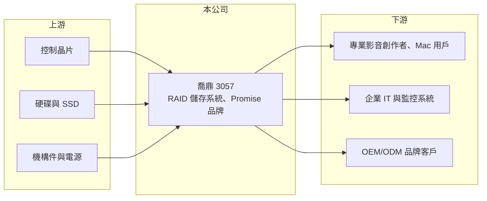

# 3057 喬鼎

> 上市｜[[產業索引-電腦及週邊設備業|電腦及週邊設備業]]｜上市（櫃）日期 2002/12/18

# 第一章：企業模式與商業藍圖

> [!info] 撰寫說明
> 精簡版，由 Claude 依公開資料整理，架構比照 [[2330台積電]]，資料截至 2026-10-08。來源：證交所開放資料快照（基本資料、2026 年上半年財報、股利）、Goodinfo 經營績效年度表、股感 2017 年公司介紹。公開資料有限，近年產品別營收比重未查得，業務描述多取自較舊資料。#待校對

喬鼎是台灣少數經營自有品牌的儲存設備廠，本章說明它從儲存晶片起家、轉向 [[RAID]] 儲存系統的商業模式。

- **核心業務：** 喬鼎成立於 1991 年，2002 年上市，英文品牌為 Promise。公司早期做硬碟用的儲存晶片與介面卡，2003 年起跨入儲存設備，發展出 RAID 控制器與磁碟陣列機櫃。RAID 是把多顆硬碟組合成一個邏輯磁碟的技術，可以同時提升速度與資料安全，是企業與專業影音工作者保存資料的基本工具。
- **營收結構：** 依 2017 年的介紹，產品分為雲端與企業 IT 儲存、多媒體儲存（Pegasus 等系列）、監控影像儲存與消費性產品，自有品牌與 [[OEM]]/[[ODM]] 出貨約各半，約一半銷往美洲。Pegasus 系列是最早取得 [[AAPL蘋果]] 認證並在 Apple Store 銷售的同類外接儲存產品，讓喬鼎在 Mac 創作者市場有一定知名度。近年的產品比重未查得。
- **營運據點：** 總部位於新竹科學園區一帶（總機區碼 03），銷售以美洲為主要市場。生產據點與海外子公司的細節未查得。
- **長期方向：** 2013 年起公司從賣單一硬體轉向提供完整儲存方案，並嘗試監控儲存與個人雲端產品，但消費性產品銷售不如預期。2026 年上半年毛利率回升到約 44%，顯示產品組合往較高毛利的品牌與專業產品移動，能否轉為本業獲利仍待觀察。

# 第二章：護城河深度與競爭優勢

儲存設備市場由國際大廠主導，喬鼎規模小，本章分析它還保有哪些利基。

- **競爭優勢：** 喬鼎累積了三十年的 RAID 控制技術與韌體經驗，並在蘋果生態系的專業影音儲存建立品牌。專業剪輯、後製工作者選購儲存設備時，相容性與穩定性比價格重要，這是小型品牌可以存活的市場。毛利率長期維持在三成以上，代表產品仍有一定定價能力。
- **主要對手：** 企業儲存有 Dell EMC、NetApp、HPE 等國際大廠，中國有華為、浪潮、中科曙光等低價競爭者；台灣同業有 [[2495普安]]、[[6179亞通]]。國際大廠掌握企業客戶與完整服務體系，中國廠商以價格搶市，喬鼎夾在中間，規模劣勢明顯。
- **觀察重點：** 長期要看營業費用能否與營收規模匹配。喬鼎毛利率不低，但營收從 2019 年 12.5 億元縮小到 2025 年 5.8 億元後，研發與行銷費用占比過高，造成連年營業虧損。公司能否找到可放大規模的產品線，或進一步縮減費用，是轉虧為盈的關鍵。

# 第三章：財務體質與盈利規模

資料日期：2026-10-08，表格是撰寫當時的快照；最新月營收、毛利率、累計 EPS 由自動排程寫在本筆記的屬性欄位（月營收、毛利率、累計EPS 等）。#待校對

喬鼎近七年只有 2021 至 2022 年小幅獲利，其餘年度皆為營業虧損，財務的重點在於虧損何時收斂。

| 年度 | 營收（億元） | [[毛利率]] | [[營業利益率]] | EPS（元） | [[ROE]] |
|---|---|---|---|---|---|
| 2019 | 12.5 | 30.4% | -22.6% | -2.02 | -31.6% |
| 2020 | 9.63 | 32.0% | -16.1% | -0.69 | -5.69% |
| 2021 | 9.49 | 36.3% | -0.51% | 0.01 | 0.06% |
| 2022 | 8.90 | 36.3% | -1.61% | 0.03 | 0.33% |
| 2023 | 5.85 | 34.6% | -21.0% | -1.55 | -17.8% |
| 2024 | 5.73 | 34.6% | -20.8% | -1.64 | -22.8% |
| 2025 | 5.84 | 33.1% | -23.0% | -0.88 | -9.27% |

- **營收規模：** 營收從 2020 年 9.63 億元降到 2025 年 5.84 億元，五年年複合成長率約 -9.5%（推算）。2026 年上半年營收 2.92 億元、毛利率 44.2%、營業利益率 -9.9%、EPS -0.46 元，虧損幅度較前幾年縮小。
- **獲利：** 近五年（2021 至 2025 年）平均 ROE 約 -9.9%（推算）。毛利率始終在 30% 以上，虧損來源是營業費用相對營收過高，屬於規模不足的問題，而不是產品賠錢賣。
- **財務特色：** 2026 年第二季末總資產 8.86 億元、總負債 2.62 億元、股東權益 6.24 億元，負債比約 30%，每股淨值 9.19 元，已低於面額。實收資本額 6.79 億元，其中有約 1,303 萬股私募股。2025 年度虧損約 5,337 萬元，未配發股利。
- **[[ROIC]] 與 [[WACC]]：** 2026 年上半年營業損失 0.29 億元，年化約 -0.58 億元；以股東權益 6.24 億元計 ROIC 約 -9.3%，含全部負債 8.86 億元計約 -6.6%（推算，虧損不計稅盾）。WACC 以 CAPM 推估：無風險利率 1.75%、市場風險溢酬 6%、β 取小型電腦周邊股常見值 1.0，股東權益成本約 7.75%；負債多為營運負債，有息負債比重假設 5%、成本 2.5%，WACC 約 7.5%（推算）。ROIC 長期為負且低於 WACC，代表公司目前在消耗股東資本，必須先恢復本業獲利才談得上創造價值。

# 第四章：總體風險與地緣政治

喬鼎的主要風險來自規模不足與市場被大廠及中國廠商夾擊，本章整理相關風險。

- **產業週期：** 外接儲存與企業儲存的需求跟著企業 IT 預算與硬碟價格起伏，雲端儲存普及後，中小企業自建儲存設備的需求長期被雲端服務取代一部分。這是結構性的逆風，不只是景氣循環。
- **營運風險：** 連續多年營業虧損使淨值降到面額以下，若虧損持續，公司可能需要再增資或私募，稀釋既有股東。對蘋果生態系的依賴也意味著，蘋果若改變介面規格或自家儲存策略，產品就得重新設計。
- **其他風險：** 營收約一半在美洲，以美元計價，新台幣升值會壓縮台幣計算的營收與毛利。硬碟、快閃記憶體等關鍵零件價格波動也會影響成本。

# 專有名詞解析

## 金融

- **[[ROIC]]**：投入資本報酬率，稅後營業利益除以股東權益加有息負債，衡量本業運用資本的效率。
- **[[WACC]]**：加權平均資金成本，股東權益成本與負債成本依資本結構加權，是 ROIC 必須超越的門檻。

## 產業

- **[[RAID]]**：把多顆硬碟組成一個邏輯磁碟的技術，可提升讀寫速度並在單顆硬碟損壞時保護資料。
- **[[OEM]]**：代工廠依品牌商提供的設計生產產品，品牌商負責設計與銷售。
- **[[ODM]]**：原廠委託設計製造，代工廠負責產品設計與生產，品牌商負責銷售。

# 核心供應鏈

- 上游：儲存控制晶片、硬碟與固態硬碟、機殼與電源等零組件。
- 下游／客戶：專業影音創作者與 Mac 用戶（透過 [[AAPL蘋果]] 通路）、企業 IT 與監控系統整合商、OEM/ODM 品牌客戶。
- 同業：[[2495普安]]、[[6179亞通]]；國外有 Dell EMC、NetApp、HPE，中國有華為、浪潮、中科曙光。

## 最新新聞
<!-- news:start -->
<!-- news:end -->

## 相關連結
- [公開資訊觀測站](https://mopsov.twse.com.tw/mops/web/t05st03?step=1&firstin=1&co_id=3057)
- [Goodinfo](https://goodinfo.tw/tw/StockDetail.asp?STOCK_ID=3057)
- [Yahoo 股市](https://tw.stock.yahoo.com/quote/3057)
- [鉅亨網新聞](https://www.cnyes.com/twstock/3057/news)
