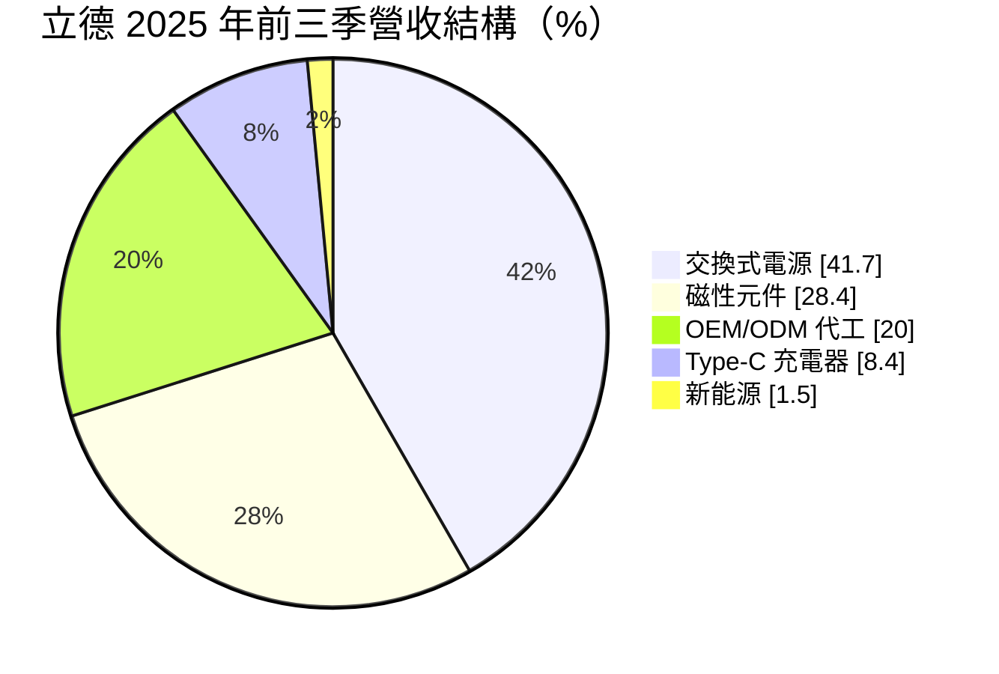
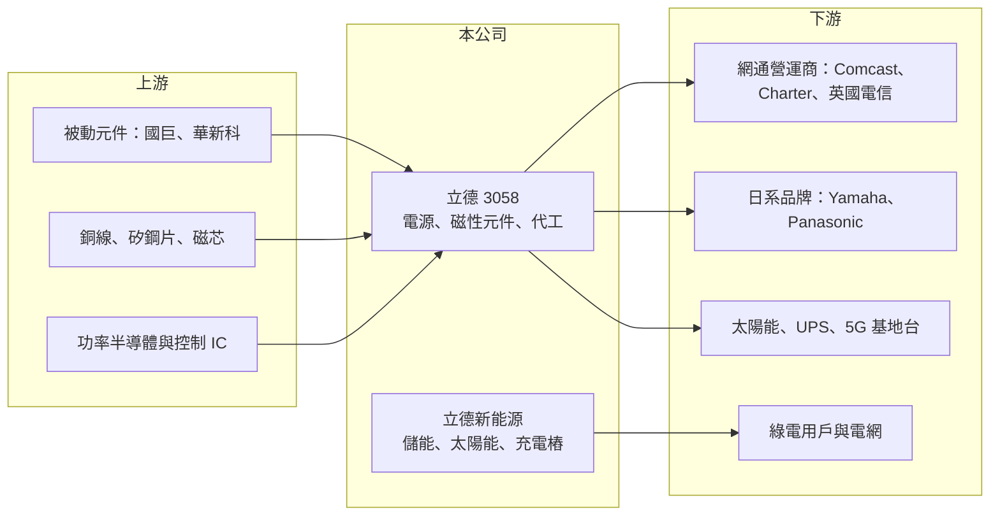

# 3058 立德

> 上市｜[[產業索引-電子零組件業|電子零組件業]]｜上市（櫃）日期 2002/12/09

# 第一章：企業模式與商業藍圖

> [!info] 撰寫說明
> 精簡版，由 Claude 依公開資料整理，架構比照 [[2330台積電]] 的四章研究，資料截至 2026-10-08。來源：證交所開放資料快照（基本資料、2026 年第二季資產負債與損益、股利）、富果研究 2025 年 12 月法說會摘要、Goodinfo 經營績效年度表。富果摘要為 AI 整理的法說內容，非公司官方文件。#待校對

立德電子（以下簡稱立德）是一家成立超過半世紀的電源與電子零組件製造商，本章說明它靠什麼產品賺錢、工廠設在哪裡，以及近年為何把資源往新能源移動。

- **核心業務：** 立德成立於 1970 年，以變壓器、電感等[[磁性元件]]起家，後來延伸到[[交換式電源供應器]]、[[USB Type-C]] 充電器與電子產品代工。它的角色是替品牌客戶設計並生產電源相關的零組件與模組，產品被裝進網通設備、家電、工業設備與太陽能系統裡。由於電源是所有電子產品都需要、但單價與技術門檻差異很大的零件，立德的獲利高度取決於能否從一般型電源往高功率、工業級產品移動。
- **營收結構：** 依 2025 年前三季的法說資料，交換式電源約占 41.7%，磁性元件約 28.4%，[[OEM]]／[[ODM]] 代工約 20.0%，Type-C 充電器約 8.4%，新能源相關約 1.5%。電源與磁性元件合計約七成，是公司的基本盤；代工業務以 PC 電源、智慧家居與對講機為主，近年受惠客戶把產能移出中國。新能源目前營收占比很小，但吸走不少資本與管理資源。
- **營運據點：** 研發總部在台灣新北市新店，生產基地在中國東莞與菲律賓，並在美國、歐洲與亞洲設有銷售與後勤據點。菲律賓廠近年持續擴充，並取得 RBA 白金級認證，是承接「中國以外產能」訂單的主力。客戶包含北美有線電視營運商 Comcast、Charter，日本的 Yamaha、Panasonic，以及英國電信，顯示其產品大量用在寬頻與網通終端設備。
- **長期方向：** 立德的長期策略是「電源本業加新能源」雙軸。本業端主攻 1000W 至 1600W 的高功率工業與基地台電源，其中 1000W 產品已供應 5G 基地台、1600W 預計 2026 年量產用於 AI 伺服器散熱。新能源端在 2025 年 3 月把相關部門分割成立持股約 87% 的子公司「立德新能源」，經營[[儲能系統]]、太陽能案場、[[充電樁]]與[[綠電]]售電；法說資料顯示有 3.5MW 儲能已商轉，40MW 案場規劃在 2026 年底上線。

# 第二章：護城河深度與競爭優勢

護城河是公司長期維持超額利潤的能力。本章評估立德在高度競爭的電源產業裡有哪些優勢、面對哪些對手，以及為何這些優勢至今還沒反映在獲利上。

- **競爭優勢：** 立德最主要的優勢是長期累積的客戶認證與多國製造能力。網通營運商與日系品牌對電源的安全規範與可靠度要求嚴格，一旦通過認證，供應商通常可以維持多年合作，這是它能和北美電信商、日本品牌往來的原因。此外，公司自製變壓器與 DC 線材等零組件，供應集團內部的電源生產，具備一定的垂直整合；菲律賓廠則讓它在客戶要求分散產地時有接單籌碼。
- **優勢的侷限：** 然而這些優勢屬於「窄護城河」甚至更弱。一般消費性與網通電源技術成熟，客戶可以在多家供應商之間比價，立德的規模又遠小於產業龍頭，在採購議價與自動化投資上都吃虧。這也是它連續多年[[毛利率]]只在 1 成上下、營業利益長期為負的根本原因：有接單能力，但缺乏定價能力。
- **主要對手：** 電源領域的大型對手包括 [[2308台達電]]、[[2301光寶科]]、[[6282康舒]]、[[3015全漢]]、[[6412群電]]，它們在伺服器與高功率電源有更大的規模與研發投入；在充電器與轉接器領域則有 [[2457飛宏]] 等同業。磁性元件與網通電源方面，大陸廠商以成本優勢競爭激烈。新能源方面，案場開發與儲能整合的對手包括 [[6806森崴能源]]、[[6869雲豹能源]] 等專業綠能業者。
- **觀察重點：** 判斷立德能否建立更強的護城河，要看三件事：高功率工業電源（1000W、1600W）能否成為穩定的新產品線並拉高毛利率；菲律賓廠擴產後能否靠產能利用率改善固定成本分攤；以及新能源案場能否從燒錢階段走到穩定的電費收入。2026 年 10 月公司公告董事長異動，新經營團隊的資本配置方向也值得追蹤。

# 第三章：財務體質與盈利規模

資料日期：2026-10-08，表格是撰寫當時的快照；最新月營收、毛利率、累計 EPS 由自動排程寫在本筆記的屬性欄位（月營收、毛利率、累計EPS 等）。#待校對

財務報表是檢驗競爭力最直接的證據。本章用多年度數字說明立德近年營收萎縮、持續虧損的狀況，並估算它的資本報酬與資金成本。

| 年度 | 營收（億元） | [[毛利率]] | [[營業利益率]] | EPS（元） | [[ROE]] |
|---|---|---|---|---|---|
| 2020 | 41.6 | 11.7% | -3.5% | -0.76 | -6.2% |
| 2021 | 47.2 | 7.6% | -6.7% | -2.06 | -19.2% |
| 2022 | 45.4 | 11.0% | -2.3% | -1.01 | -10.9% |
| 2023 | 37.7 | 14.5% | -1.8% | 0.28 | 2.8% |
| 2024 | 31.3 | 14.3% | -12.1% | -2.02 | -21.6% |
| 2025 | 31.5 | 9.3% | -11.7% | -1.44 | -16.2% |

資料來源：Goodinfo 經營績效頁；2025 年 EPS 與證交所股利資料的本期淨損 2.88 億元相符。

- **營收規模：** 營收從 2021 年的 47.2 億元高點下滑到 2024、2025 年的約 31 億元，2020 至 2025 年營收年複合成長率約 -5.4%（推算）。下滑原因包括 2024 年關閉部分工廠、歐洲太陽能政策轉變使磁性元件需求轉弱，以及代工訂單的調整。2026 年上半年營收 16.4 億元，前 8 月累計年增約 7%，顯示營收規模大致止穩在 30 億元出頭。
- **獲利：** 六年中只有 2023 年小幅獲利，其餘年度營業利益皆為負，近五年（2021 至 2025）平均 ROE 約 -13%（推算）。2024 年虧損擴大，部分來自停廠的資遣與資產報廢，以及約 6,000 多萬元儲能應收帳款的呆帳提列，屬於一次性損失；但 2025 年毛利率再降到 9.3%，代表本業的成本結構問題並未解決。2026 年上半年毛利率 13.4%、營業利益率 -5.0%、EPS -0.14 元，虧損幅度較前兩年收斂。
- **財務特色：** 2026 年第二季底股東權益約 16.8 億元，負債總計約 34.9 億元，保留盈餘為 -3.26 億元，每股淨值 7.81 元，低於 10 元面額。公司章程規定可分配盈餘提撥不低於五成發放，但因累積虧損，2025 年度未配發股利，短期內也難以恢復配息。新能源案場屬於前期投入大、回收期長的資產，會持續占用資金。
- **[[ROIC]] 與 [[WACC]]：** 以 2025 年營業虧損約 3.7 億元（營收 31.5 億元 × 營業利益率 -11.7%）計算，虧損年度不計稅，投入資本以股東權益 16.8 億元加上有息負債估算；有息負債金額未查得，若以 0 至 17 億元（約負債總額一半）的區間推算，ROIC 約在 -22% 至 -11% 之間（推算）。WACC 以 CAPM 推估：無風險利率 1.75%、市場風險溢酬 6%、β 假設 1.0（中小型電子零組件股常見值），股東權益成本約 7.75%；負債成本假設 3%、稅後 2.4%，負債占資本約 40%，WACC 約 5.5%（推算）。ROIC 遠低於 WACC，代表立德近年在持續消耗股東價值，轉型能否讓營業利益轉正，是價值能否回升的前提。

# 第四章：總體風險與地緣政治

任何企業都會受到產業景氣與外部環境影響。本章整理立德長期需要面對的產業週期、營運與政策風險。

- **產業週期：** 立德的電源與磁性元件需求跟著網通、家電、太陽能的拉貨週期起伏。網通營運商的設備採購常隨寬頻升級世代集中發生，太陽能需求則受歐洲補貼與電價政策左右，兩者都會讓訂單出現大幅波動。公司規模小、固定成本占比高，營收一旦下滑就容易從小賺轉為大虧，這種放大效果在 2024、2025 年已經出現。
- **營運風險：** 長期低毛利代表公司在原物料（銅、矽鋼片、電子零件）上漲時缺乏轉嫁能力，成本波動會直接侵蝕利潤。新能源事業需要大額前期資本，案場開發又牽涉土地、併網與審查時程，2024 年的儲能應收帳款呆帳顯示這塊業務也有收款風險。此外，2026 年 10 月董事長異動、總經理由人暫代，經營層交接期間的策略連續性需要觀察。
- **其他風險：** 生產集中在中國東莞與菲律賓，兩地分別面臨美中關稅與地緣政治、以及當地勞動與基礎建設風險。營收以外銷為主，新台幣與美元、日圓、披索的匯率變動會影響毛利率。綠能業務則高度依賴台灣的再生能源與售電政策，政策方向或電價機制若改變，案場收益會受影響。

# 專有名詞解析

## 半導體

- **[[USB Type-C]]**：新一代 USB 接頭規格，正反面皆可插入，搭配快充協定可傳輸百瓦以上電力。

## 應用

- **[[儲能系統]]**：以電池儲存電力並在需要時放電的設備，用於電網調頻、削峰填谷與搭配再生能源。

## 產業

- **[[磁性元件]]**：變壓器、電感等利用電磁感應轉換電壓與濾波的被動元件，是電源與太陽能逆變器的基本零件。
- **[[交換式電源供應器]]**：以高頻開關切換方式轉換電壓的電源，體積小、效率高，是電子產品最常見的電源架構。
- **[[OEM]]**：代工生產，依客戶提供的設計製造產品，掛客戶品牌出貨。
- **[[ODM]]**：原廠委託設計，由代工廠負責設計與生產，再掛客戶品牌出貨。
- **[[充電樁]]**：供電動車充電的設備，分為交流慢充與直流快充兩大類。
- **[[綠電]]**：太陽能、風力等再生能源所產生的電力，可透過憑證或轉供方式賣給用電企業。

# 核心供應鏈

- 上游：被動元件 [[2327國巨]]、[[2492華新科]]；銅線、矽鋼片與磁芯等原料；功率半導體與電源控制 IC。立德自製變壓器與 DC 線材，部分零組件內部供應。
- 下游／客戶：北美有線電視與寬頻營運商 Comcast、Charter，日本 Yamaha、Panasonic，英國電信；太陽能、UPS 與微電網設備商；5G 基地台與 AI 伺服器散熱設備；新能源子公司的售電對象為企業綠電用戶。
- 同業：電源 [[2308台達電]]、[[2301光寶科]]、[[6282康舒]]、[[3015全漢]]、[[6412群電]]、[[2457飛宏]]；綠能開發 [[6806森崴能源]]、[[6869雲豹能源]]。

## 最新新聞
<!-- news:start（自動產生，請勿手動編輯此範圍） -->
- 2026-10-08 🏛️ 重訊 17:41｜公告本公司申請股票上市所出具之承諾事項暨其後續執行情形｜[觀測站](https://mops.twse.com.tw/mops/#/web/t05st01)

完整紀錄：[[3058立德 新聞]]
<!-- news:end -->

## 相關連結
- [公開資訊觀測站](https://mopsov.twse.com.tw/mops/web/t05st03?step=1&firstin=1&co_id=3058)
- [Goodinfo](https://goodinfo.tw/tw/StockDetail.asp?STOCK_ID=3058)
- [Yahoo 股市](https://tw.stock.yahoo.com/quote/3058)
- [鉅亨網新聞](https://www.cnyes.com/twstock/3058/news)
