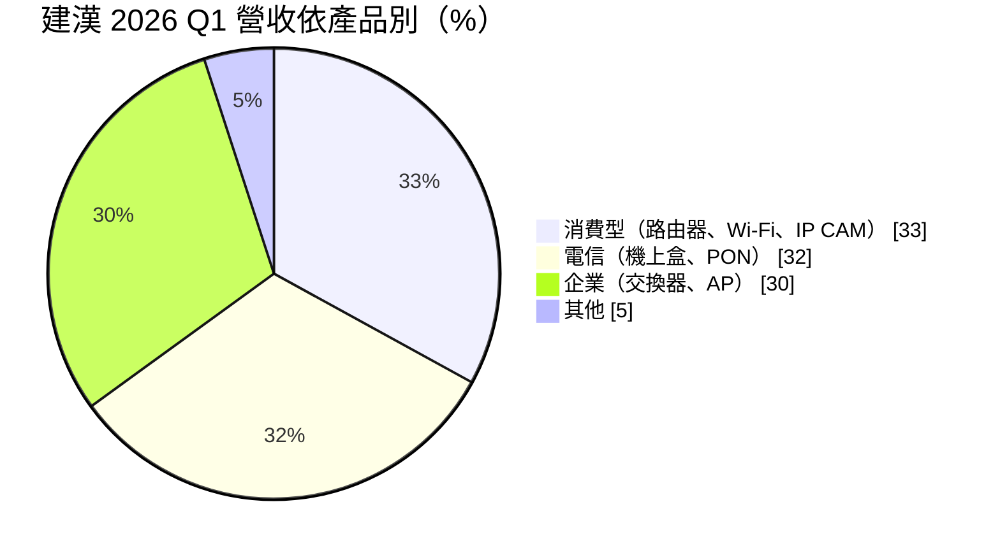
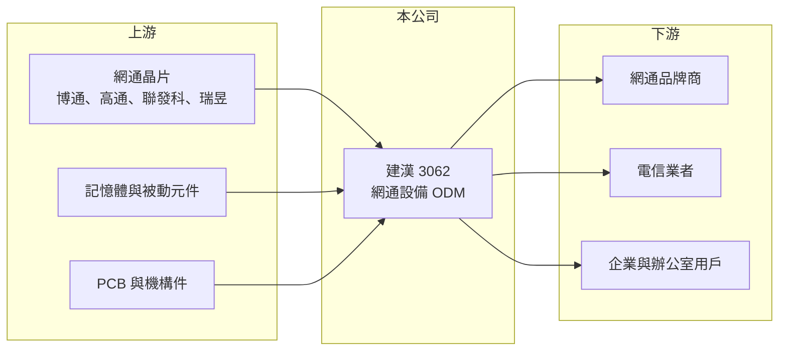

# 3062 建漢

> 上市｜[[產業索引-通信網路業|通信網路業]]｜上市（櫃）日期 2003/07/28

# 第一章：企業模式與商業藍圖

> [!info] 撰寫說明
> 本文由 Claude 依公開資料整理，架構比照 [[2330台積電]] 的四章研究，資料截至 2026-10-08。財務數字來源：Goodinfo 年度經營績效頁、證交所開放資料（基本資料、2026 年第二季資產負債與損益、營益分析、股利）、poorstock 法說會整理；產業描述為整理性內容，尚未逐條比對原始文件。#待校對

評估一家網通代工廠的長期價值，第一步是看它在品牌客戶與晶片商之間扮演什麼角色。本章說明建漢科技（股票代號：3062，以下簡稱建漢）的產品組合與營運模式，以及它為何長年處在低毛利的位置。

## 一、核心定位：中型網通設備設計代工廠

建漢成立於 1998 年，總部位於新竹科學園區，2003 年上市，實收資本額約 33 億元。公司替品牌商與電信業者設計、製造網路設備，屬於 [[ODM]] 模式：客戶提出規格，建漢負責硬體設計、韌體與量產。這種模式的好處是能接觸多個終端市場，代價是議價權大多在客戶手上，獲利高度取決於產品組合與成本控制。

和 [[2345智邦]]、[[5388中磊]]、[[6285啟碁]] 等大型同業相比，建漢的營收規模約 40 億元上下，屬於中小型廠商。規模較小代表採購議價力與自動化投資都較受限，這是它長期毛利率偏低的結構性原因之一。

## 二、產品結構：消費、電信、企業三足鼎立

依法說會整理，2026 年第一季的產品比重大致平均分布在三個市場。

* **消費型產品：** 家用路由器、[[Wi-Fi 7]] 設備與 IP 攝影機，其中部分攝影機加入邊緣運算與影像辨識功能。這類產品出貨量大，但價格競爭最激烈。
* **電信產品：** 機上盒與 [[PON]] 光纖終端設備，客戶是電信業者或替電信業者供貨的品牌商，產品週期跟隨電信商的寬頻升級計畫。
* **企業產品：** 交換器、無線基地台與智慧辦公室管理設備，毛利相對較高，是公司希望提升比重的方向。

地區別方面，2026 年第一季亞洲約占 51%、美洲 30%、歐洲 19%，歐洲比重較 2025 年前三季明顯下降，顯示客戶組合仍在變動。

## 三、長期方向：以新規格換代爭取訂單

網通代工廠的成長主要來自規格換代，例如 Wi-Fi 6 升級到 Wi-Fi 7、GPON 升級到 Multi-G PON。建漢在法說會中把 2025 至 2027 年的成長動能放在 AI 相關的邊緣運算產品、Wi-Fi 7、5G 與 Multi-G PON，並提出擴充研發人力。這個方向本身合理，但同業也在做相同的事，能否取得具規模的新客戶，是策略能否落地的關鍵。

# 第二章：護城河深度與競爭優勢

在長期價值投資中，「護城河」指企業抵禦競爭、維持超額利潤的保護機制。網通代工是競爭者眾多的行業，本章分析建漢的相對優勢與弱點。

## 一、相對優勢

建漢的優勢在於產品線廣、能同時服務消費、電信與企業三種客戶，任何一個市場轉弱時，其他市場可以部分抵銷。其次是二十多年的網通設計經驗，在韌體整合與電信商認證上累積了一定的技術基礎，新進者要取得電信業者的認證通常需要一到兩年。

不過這些優勢屬於「能留在牌桌上」的條件，而不是能收取超額利潤的護城河。從財務結果看，建漢 2021 至 2025 年營業利益率每年都是負數，代表它目前並沒有建立有效的定價能力。

## 二、主要競爭對手

| 對手 | 定位 | 對建漢的威脅 |
|---|---|---|
| [[5388中磊]] | 寬頻與電信設備大廠 | 在電信客戶與 PON 設備直接競爭，規模大很多 |
| [[6285啟碁]] | 無線網通與車用、衛星 | 在 Wi-Fi 與企業網通有更完整的客戶群 |
| [[4906正文]]、[[3596智易]] | 寬頻與無線代工 | 爭取同一批品牌與電信商訂單 |
| 中國網通代工廠 | 低成本大量生產 | 壓低消費型產品報價 |

## 三、守得住／守不住／觀察重點

守得住的是既有電信與企業客戶的認證關係，這類訂單換供應商的成本較高。守不住的是消費型產品的價格，晶片與記憶體成本上升時往往無法完全轉嫁，2023 年毛利率一度只有 0.26%。長期觀察重點有三：企業與電信產品能否持續提高比重、是否能在 Wi-Fi 7 與 Multi-G PON 換代中拿到具規模的新客戶，以及本業能否回到損益兩平。

# 第三章：財務體質與盈利規模

資料日期：2026-10-08，表格是撰寫當時的快照；最新月營收、毛利率、累計 EPS 由自動排程寫在本筆記的屬性欄位（月營收、毛利率、累計EPS 等）。#待校對

財務報表是檢驗護城河是否真實存在的最終標準。本章用五年的三率、ROE 與資本報酬，檢視建漢的獲利品質。

## 一、多年度經營績效

| 年度 | 營收（新台幣） | [[毛利率]] | [[營業利益率]] | EPS（元） | [[ROE]] |
|---|---|---|---|---|---|
| 2021 | 39.5 億 | 2.77% | -7.11% | 0.07 | 0.45% |
| 2022 | 57.5 億 | 4.99% | -3.70% | -1.12 | -6.98% |
| 2023 | 38.1 億 | 0.26% | -12.3% | -0.97 | -6.44% |
| 2024 | 36.0 億 | 8.54% | -6.34% | 0.01 | 0.06% |
| 2025 | 41.9 億 | 4.67% | -12.5% | 0.68 | 4.96% |
| 2026 上半年 | 20.0 億 | 2.58% | -14.5% | -0.88 | 未查得 |

五年間毛利率都在 9% 以下，營業利益率全為負數，代表毛利連營業費用都無法支應。2021 至 2025 年平均 ROE 約 -1.6%（推算），營收年複合成長率約 1.5%（推算），規模大致持平。2025 年營業虧損約 5.2 億元，全年卻有 EPS 0.68 元，差額來自業外收益；證交所股利資料的備註列有處分權益法投資等項目，推估主要為一次性的處分利益（推估）。依公司章程，可分配盈餘低於實收資本額 3% 時可不分配，近年配息並不穩定。

## 二、[[ROIC]] 與 [[WACC]]：價值創造利差

**ROIC 推算：** 2025 年營業利益約 -5.2 億元（41.9 億 × -12.5%），以 20% 稅率估算稅後約 -4.2 億元。2026 年第二季股東權益約 40.4 億元，負債總額約 22 億元，其中多為應付帳款等營運負債，假設有息負債約 5 億元（推估），投入資本約 45 億元，ROIC 約 -9%（推算）。

**WACC 推算：** 台灣 10 年期公債 1.75%、市場風險溢酬 6%、β 取網通代工同業常見值 1.1，股東權益成本約 8.4%；負債成本 2.5%、稅後 2.0%；權益占投入資本約 89%，WACC 約 7.7%（推算）。

**結論：** 建漢的 ROIC 長期為負，遠低於 WACC，代表本業持續消耗股東資本，帳面獲利主要靠業外處分支撐。除非本業回到正的營業利益率，否則長期並未創造價值。

# 第四章：總體風險與地緣政治

任何企業都無法脫離宏觀環境獨立存在。本章分析建漢長期必須面對的產業與營運風險。

## 一、產業週期風險

網通設備需求跟隨電信商資本支出與消費者換機週期，2022 年的缺料搶貨與 2023 年的庫存調整，就讓建漢營收從 57.5 億元掉到 38.1 億元。這種[[長鞭效應]]對中小型代工廠的衝擊特別大，因為它們通常不是客戶的第一供應商，砍單時最先受影響。

## 二、營運與財務風險

連續多年營業虧損是最核心的風險。如果業外處分利益無法持續，本業虧損會直接侵蝕淨值。其次是成本轉嫁能力有限，網通晶片、記憶體與被動元件漲價時，代工廠往往要自行吸收。此外，2025 至 2026 年歐洲營收比重大幅變動，顯示客戶集中度與客戶流動都可能造成營收波動。

## 三、地緣政治與匯率

美國對中國製網通設備的關稅與資安限制，讓客戶要求供應商分散生產地點，代工廠需要投入額外的產能布局成本。營收以美元計價為主，新台幣升值會壓縮本來就很薄的毛利。

# 專有名詞解析

## 應用

- **[[PON]]**：被動光纖網路，電信商把光纖拉到家戶的主流架構，10G PON、25G PON 代表傳輸速度世代。

## 金融

- **[[長鞭效應]]**：終端需求的小幅變動，沿供應鏈往上游傳遞時被逐級放大，造成上游庫存與訂單劇烈波動。
- **[[ROIC]]**：投入資本報酬率，稅後營業利益除以股東權益與有息負債的合計，衡量本業對所有資金提供者的報酬。
- **[[WACC]]**：加權平均資金成本，依股東權益與負債的比重加權計算的資金成本，ROIC 高於它才代表創造價值。

## 產業

- **[[ODM]]**：原廠委託設計製造，代工廠可提出設計方案並負責生產，與客戶綁定較深，議價能力較高。
- **[[Wi-Fi 7]]**：最新一代 Wi-Fi 標準，傳輸速度與頻寬大幅提升，帶動網通晶片與射頻元件換代。

# 核心供應鏈

## 1. 上游：晶片與零組件
- 網通晶片：[[AVGO博通]]、[[QCOM高通]]、[[2454聯發科]]、[[2379瑞昱]]
- 記憶體、被動元件、PCB 與機構件供應商

## 2. 中游：網通代工同業
- [[5388中磊]]、[[6285啟碁]]、[[4906正文]]、[[3596智易]]、[[2345智邦]]、[[3380明泰]]

## 3. 下游：客戶
- 網通品牌商與電信業者（公司未揭露具名客戶）

## 最新新聞
<!-- news:start -->
<!-- news:end -->

## 相關連結
- [公開資訊觀測站](https://mopsov.twse.com.tw/mops/web/t05st03?step=1&firstin=1&co_id=3062)
- [Goodinfo](https://goodinfo.tw/tw/StockDetail.asp?STOCK_ID=3062)
- [Yahoo 股市](https://tw.stock.yahoo.com/quote/3062)
- [鉅亨網新聞](https://www.cnyes.com/twstock/3062/news)
