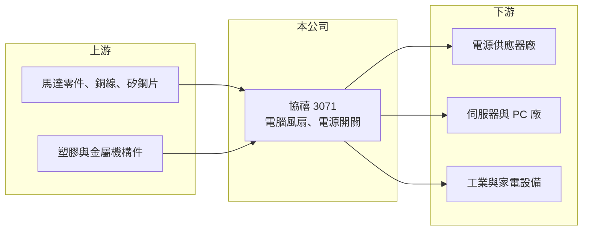

# 3071 協禧

> 上櫃｜[[產業索引-電腦及週邊設備業|電腦及週邊設備業]]｜上市（櫃）日期 2004/12/30

# 第一章：企業模式與商業藍圖

> [!info] 撰寫說明
> 精簡版，由 Claude 依公開資料整理，架構比照 [[2330台積電]]，資料截至 2026-10-08。來源：櫃買中心開放資料快照（基本資料、2026 年上半年財報、本益比殖利率）、Goodinfo 經營績效年度表、nStock 公司簡介。公開資料有限，產品別營收比重、客戶與工廠細節未查得，相關描述標「待校對」。#待校對

協禧是老牌的電腦散熱風扇與電源開關廠，本章說明它在電子零組件供應鏈中的位置。

- **核心業務：** 協禧成立於 1978 年，2004 年上櫃，總部在屏東。主要產品是電腦風扇、電源開關與電氣器材。[[散熱風扇]]是電腦、伺服器、電源供應器與工業設備都需要的基本零件，負責把機器內部的熱帶走；電源開關則是控制設備通電的元件，兩者都屬於用量大、規格多的標準化零件。
- **營收結構：** 產品別營收比重未查得。從客群推估，風扇主要賣給電源供應器、伺服器與工業設備廠，開關則賣給家電與電子設備廠（推估，待校對）。這類零件單價不高，靠多樣規格與穩定交貨累積訂單。
- **營運據點：** 登記與主要營運地在屏東，海外生產據點細節未查得。2026 年第二季末合併報表中有約 4.6 億元的非控制權益，代表有子公司並非百分之百持股，集團架構較單純零件廠複雜。
- **長期方向：** AI 伺服器功耗大幅上升，帶動高轉速、高風量風扇的需求，這是傳統風扇廠升級的機會。2026 年上半年營業利益率升到約 11.8%，高於過去幾年的 4% 至 9%，可能反映產品組合往伺服器與高階應用移動（推估，待校對）。

# 第二章：護城河深度與競爭優勢

散熱風扇市場競爭激烈，本章分析協禧的定位與主要對手。

- **競爭優勢：** 協禧經營風扇與開關近半世紀，累積了大量規格與客戶認證。電源與伺服器廠導入風扇時要做噪音、壽命與可靠度測試，一旦通過，同一平台的生命週期內很少更換供應商，這是零件廠最主要的黏著度來源。
- **主要對手：** 台灣同業有 [[2421建準]]、[[6591動力-KY]]，以及做系統散熱的 [[3017奇鋐]]、[[3324雙鴻]]；國際對手包括日本電產（Nidec）、山洋電氣、德國 ebm-papst 等。大廠在伺服器風扇與液冷的研發投入遠大於協禧，協禧規模較小，較難在最高階的 AI 伺服器散熱取得主導地位。
- **觀察重點：** 長期要看營業利益率能否穩定在 10% 以上，以及營業外損失與非控制權益是否持續吃掉獲利。2026 年上半年營業利益 1.78 億元，但歸屬母公司淨利只有 0.54 億元，中間被業外損失、所得稅與少數股權分走大半，這個結構會影響股東實際拿到的報酬。

# 第三章：財務體質與盈利規模

資料日期：2026-10-08，表格是撰寫當時的快照；最新月營收、毛利率、累計 EPS 由自動排程寫在本筆記的屬性欄位（月營收、毛利率、累計EPS 等）。#待校對

協禧營收長期在 21 億至 28 億元之間，毛利率穩定在三成左右，但 EPS 自 2022 年後逐年下滑。

| 年度 | 營收（億元） | [[毛利率]] | [[營業利益率]] | EPS（元） | [[ROE]] |
|---|---|---|---|---|---|
| 2019 | 22.2 | 29.6% | 7.57% | 1.81 | 13.8% |
| 2020 | 21.2 | 31.2% | 9.06% | 1.82 | 13.1% |
| 2021 | 25.0 | 27.8% | 8.90% | 1.86 | 12.9% |
| 2022 | 27.9 | 27.6% | 7.27% | 2.08 | 15.1% |
| 2023 | 24.0 | 30.2% | 3.56% | 1.21 | 6.99% |
| 2024 | 24.8 | 30.0% | 5.71% | 0.81 | 7.88% |
| 2025 | 23.3 | 30.9% | 5.91% | 0.57 | 4.52% |

- **營收規模：** 營收從 2020 年 21.2 億元到 2025 年 23.3 億元，五年年複合成長率約 1.9%（推算），屬於成熟零件廠的低成長型態。2026 年上半年營收 15.1 億元、毛利率 31.2%、營業利益率 11.8%，營收與獲利率都明顯高於前一年。
- **獲利：** 近五年（2021 至 2025 年）平均 ROE 約 9.5%（推算）。毛利率穩定、營業利益率波動，說明費用控制與產品組合是獲利的主要變數。2026 年上半年 EPS 0.49 元。
- **財務特色：** 2026 年第二季末總資產 42.2 億元、總負債 22.2 億元，負債比約 52%，股東權益 20.1 億元（其中歸屬母公司 15.4 億元），每股淨值 14.03 元。現金股利 2024 年度 0.81 元、2025 年度 0.8 元，分別約為當年 EPS 的 100% 與 140%，公司傾向維持配息金額。
- **[[ROIC]] 與 [[WACC]]：** 2026 年上半年營業利益 1.78 億元，年化稅後約 2.85 億元；以權益總額 20.1 億元計 ROIC 約 14.2%，含全部負債 42.2 億元計約 6.7%（推算）。2025 年營業利益約 1.38 億元，稅後 1.10 億元，ROIC 約 2.6% 至 5.5%（推算）。WACC 以 CAPM 推估：無風險利率 1.75%、市場風險溢酬 6%、β 取零件同業常見值 1.0，股東權益成本約 7.75%；有息負債比重假設 20%、成本 2.5%、稅後 2%，WACC 約 6.6%（推算）。2023 至 2025 年 ROIC 大致低於 WACC，2026 年上半年回到 WACC 之上，能否延續要看伺服器相關產品的比重。

# 第四章：總體風險與地緣政治

協禧的風險集中在零件價格競爭與集團結構，本章整理相關風險。

- **產業週期：** 風扇與開關的需求跟著 PC、電源供應器與伺服器出貨起伏，PC 市場成熟、伺服器則受雲端業者資本支出週期影響。AI 伺服器若改採[[液冷散熱]]，風扇的用量與規格也可能改變。
- **營運風險：** 零件產品容易被要求年年降價，若沒有新規格支撐，毛利率會被逐步侵蝕。業外損失與非控制權益比重偏高，會讓本業的改善無法完整反映在 EPS 上。
- **其他風險：** 銅線、矽鋼片、塑膠等原料價格波動影響成本。海外生產與外銷涉及匯率與關稅風險，產地細節未查得，需以年報確認。

# 專有名詞解析

## 金融

- **[[ROIC]]**：投入資本報酬率，稅後營業利益除以股東權益加有息負債，衡量本業運用資本的效率。
- **[[WACC]]**：加權平均資金成本，股東權益成本與負債成本依資本結構加權，是 ROIC 必須超越的門檻。

## 產業

- **[[散熱風扇]]**：以馬達帶動扇葉，把設備內部熱空氣排出的零件，伺服器、電源與電腦都需要。
- **[[液冷散熱]]**：以液體帶走晶片熱量的散熱方式，散熱效率高於風冷，適用高功耗的 AI 伺服器。

# 核心供應鏈

- 上游：馬達零件、銅線、矽鋼片、塑膠與金屬機構件。
- 下游／客戶：電源供應器廠（例如 [[2308台達電]]、[[2301光寶科]] 這類廠商，實際客戶未查得）、伺服器與 PC 廠、工業與家電設備廠。
- 同業：[[2421建準]]、[[6591動力-KY]]、[[3017奇鋐]]、[[3324雙鴻]]；國外有 Nidec、山洋電氣、ebm-papst。

## 最新新聞
<!-- news:start -->
<!-- news:end -->

## 相關連結
- [公開資訊觀測站](https://mopsov.twse.com.tw/mops/web/t05st03?step=1&firstin=1&co_id=3071)
- [Goodinfo](https://goodinfo.tw/tw/StockDetail.asp?STOCK_ID=3071)
- [Yahoo 股市](https://tw.stock.yahoo.com/quote/3071)
- [鉅亨網新聞](https://www.cnyes.com/twstock/3071/news)
