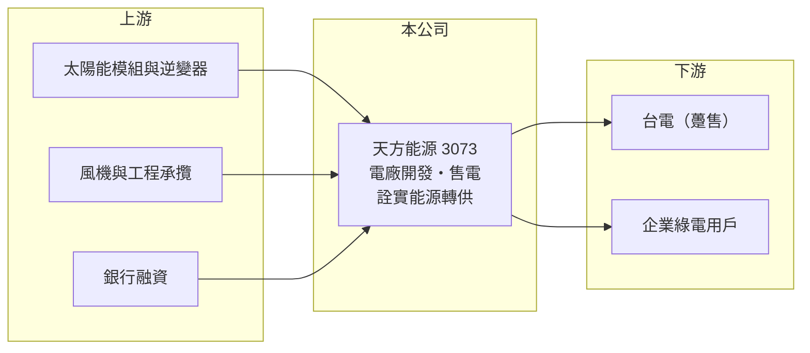

# 3073 天方能源

> 上櫃｜[[產業索引-綠能環保|綠能環保]]｜上市（櫃）日期 2007/10/08

# 第一章：企業模式與商業藍圖

> [!info] 撰寫說明
> 精簡版，由 Claude 依公開資料整理，架構比照 [[2330台積電]]，資料截至 2026-10-08。來源：Goodinfo 經營績效年表（2019 至 2025 年）；富果 2025 年 12 月 16 日法說會摘要（AI 整理，業務、案場與子公司）；櫃買中心開放資料快照（基本資料、2026 年第二季資產負債與上半年損益）。公司轉型年份與前身業務未查得，公開資料有限。#待校對

天方能源（以下簡稱天方）成立於 1991 年 10 月、2007 年 10 月上櫃，總部在台北市中山區，董事長兼總經理為甘正智。依法說資料，天方是 [[1444力麗]] 集團旗下的再生能源事業體，業務涵蓋案場開發、建造、運維與售電，目前仍處於「先投資、後收電費」的建置期，營收規模很小、獲利不穩定。

- **核心業務：** 天方的商業模式是開發並持有太陽能與風力電廠，賣電給台電或企業取得長期穩定的電費收入，同時承接光電工程。子公司詮實能源經營[[綠電轉供]]，向發電業者購買綠電再轉售企業用戶，依法說資料每年轉供量超過一億度。這讓天方同時具備「發電」與「售電」兩種角色。
- **營收結構：** 2025 年前三季營收約 6,150 萬元，其中售電收入占 60.26%，工程收入占 28.4%。2025 年全年營收約 0.88 億元，2026 年上半年為 0.90 億元，顯示新案場併網後售電收入開始放大。
- **案場與裝置容量：** 已併網的太陽能案場分布在高雄楠梓、台南、屏東，合計[[裝置容量]]約 7.8 MW；屏東林邊 40 MW 地面型案場預計 2026 年分兩期（17 MW、23 MW）併網。風電方面，透過與台電、天力新能源合資的澎湖綠電公司參與澎湖陸域風電，11 支風機中已有 3 支、9 MW 併網（皆為 2025 年底資料，待校對）。
- **長期方向：** 中長期計畫包括彰化芳苑約 40 MW 的[[漁電共生]]案場（預計 2028 至 2029 年陸續併網）、菲律賓收購 IRAC 公司取得 6.8 MW 屋頂型案場，以及洽談日本儲能市場。若林邊與芳苑案場如期完成，天方的自有裝置容量將從不到 10 MW 擴大到接近 90 MW，商業模式會從工程與小型電廠轉為以長期售電收入為主。

# 第二章：護城河深度與競爭優勢

天方的競爭力來自集團資源與案場開發能力，但目前規模遠小於主要綠能同業，護城河尚未成形。

- **競爭優勢：** 太陽能電廠的價值關鍵在於取得土地與併網容量、通過環評與地方協調，以及以合理成本融資。天方背後有力麗集團與合資夥伴（台電、天力新能源）的支持，並同時經營綠電轉供，能把自有電廠與外購綠電組合後賣給企業，提升議價彈性。
- **主要對手：** 台灣綠能開發與售電同業包括 [[6806森崴能源]]、[[6869雲豹能源]]、[[6873泓德能源]]、[[3576聯合再生]]、[[6443元晶]] 等，它們的裝置容量多在數百 MW 以上，天方在規模、融資成本與企業客戶數量上都處於劣勢。
- **觀察重點：** 林邊 40 MW 的併網時程與實際發電量、詮實能源售電規模能否擴大，以及漁電共生與海外案場能否在不過度稀釋股東的前提下取得資金。

# 第三章：財務體質與盈利規模

資料日期：2026-10-08，表格是撰寫當時的快照；最新月營收、毛利率、累計 EPS 由自動排程寫在本筆記的屬性欄位（月營收、毛利率、累計EPS 等）。#待校對

天方的營收長期不到 1 億元，盈虧交替，財務數字反映的是建置期的電廠開發商，而不是成熟的發電業者。

| 年度 | 營收（億元） | [[毛利率]] | [[營業利益率]] | EPS（元） | [[ROE]] |
|---|---|---|---|---|---|
| 2019 | 0.27 | 18.1% | -105% | -3.20 | -41.4% |
| 2020 | 0.57 | 36.1% | 1.8% | -0.37 | -4.22% |
| 2021 | 0.30 | 35.0% | -41.2% | -3.16 | -23.0% |
| 2022 | 0.83 | 72.7% | 25.2% | 0.91 | 5.19% |
| 2023 | 0.43 | 47.6% | -40.6% | -0.99 | -7.36% |
| 2024 | 0.56 | 58.7% | 59.5% | 0.75 | 5.14% |
| 2025 | 0.88 | 33.3% | 6.47% | 0.00 | 0.00% |
| 2026 上半年 | 0.90 | 16.1% | -14.4% | -0.27 | 未查得 |

註：2019 至 2025 年取自 Goodinfo（原始表格欄位錯置，數值依位置對應，待校對）；2026 年上半年取自櫃買中心開放資料推算（毛利 0.15 億、營業損失 0.13 億）。2024 年營業利益率高於毛利率，推估含其他收益。

- **長期指標：** 2020 至 2025 年營收年複合成長率約 9.1%（推算），但基期極小；2021 至 2025 年平均 ROE 約 -4.0%（推算），長期沒有替股東創造穩定報酬。股利紀錄這次未查得，以建置期資金需求推估配息能力有限。
- **[[ROIC]] 與 [[WACC]]：** 2026 年上半年營業損失約 0.13 億元，年化約 -0.26 億元；第二季權益 6.70 億元，總負債 16.8 億元中有息負債未查得，假設約 13 億元（含林邊案場長期借款），投入資本約 19.7 億元，ROIC 約 -1.3%（推算，虧損不計稅盾）；2025 年營業利益約 0.06 億元，ROIC 約 0.2%（推算）。WACC 以無風險利率 1.75%、市場風險溢酬 6%、β 1.0（綠能開發商常見值）、稅前負債成本 3%、稅率 20%、權益比重約 34% 計算約 4.2%（推算）。ROIC 為負或接近零，遠低於 WACC，代表目前投入的資本尚未產生回報；電廠要到全數併網並穩定發電後，才可能讓 ROIC 回到 WACC 之上。
- **財務特色：** 2026 年第二季資產 23.5 億元、負債比率約 71%，每股淨值 16.93 元。資產規模是年營收的 20 倍以上，代表大量資金已投入尚未完全發電的案場；高負債使利率與融資條件成為影響獲利的關鍵。

# 第四章：總體風險與地緣政治

天方的風險集中在建置期的執行與融資，以及小型綠能業者面對政策與大型同業競爭的壓力。

- **產業週期：** 太陽能電廠一旦併網就有長達 20 年的穩定電費收入，但建置期需要大量資本，且受土地、環評、併網排程影響。天方的營收與獲利在 2019 至 2025 年間大起大落，說明案場進度延後就會直接反映在財報上。
- **營運風險：** 林邊與芳苑案場若延誤，負債利息仍要支付，可能持續虧損；漁電共生涉及養殖與地方協調，執行難度高於一般地面型電廠。菲律賓與日本的海外布局則增加管理與匯率風險。
- **其他風險：** 綠電躉購費率與轉供規則等能源政策調整；利率上升墊高融資成本；颱風、鹽害等天災影響電廠設備；高負債下若需辦理增資，可能稀釋既有股東。

# 專有名詞解析

## 金融

- **[[ROIC]]**：投入資本報酬率，稅後營業利益除以股東權益加有息負債，衡量本業運用資本的效率。
- **[[WACC]]**：加權平均資金成本，股東與債權人要求報酬率的加權平均，是 ROIC 要超越的門檻。

## 產業

- **[[綠電轉供]]**：再生能源業者透過台電電網把綠電輸送給企業用戶，由售電業者撮合買賣，是企業取得綠電的主要方式。
- **[[漁電共生]]**：在魚塭上方或周邊設置太陽能板，同時養殖與發電，須維持一定的養殖產量。
- **[[裝置容量]]**：發電設備的最大額定輸出功率，以 MW（百萬瓦）計，是衡量電廠規模的基本指標。

# 核心供應鏈

- 上游：模組與逆變器供應商名單未查得，台灣模組廠如 [[6443元晶]]、[[3576聯合再生]]（是否供貨給天方未查得）。
- 下游／客戶：台電與企業綠電用戶；集團母公司 [[1444力麗]]；合資夥伴台電、天力新能源。
- 同業：[[6806森崴能源]]、[[6869雲豹能源]]、[[6873泓德能源]]。

## 最新新聞
<!-- news:start（自動產生，請勿手動編輯此範圍） -->
- 2026-10-14 🏛️ 重訊 16:28｜公告本公司115年9月份自結合併財務報告之 負債比率、流動比率及速動比率｜[觀測站](https://mops.twse.com.tw/mops/#/web/t05st01)

完整紀錄：[[3073天方能源 新聞]]
<!-- news:end -->

## 相關連結
- [公開資訊觀測站](https://mopsov.twse.com.tw/mops/web/t05st03?step=1&firstin=1&co_id=3073)
- [Goodinfo](https://goodinfo.tw/tw/StockDetail.asp?STOCK_ID=3073)
- [Yahoo 股市](https://tw.stock.yahoo.com/quote/3073)
- [鉅亨網新聞](https://www.cnyes.com/twstock/3073/news)
