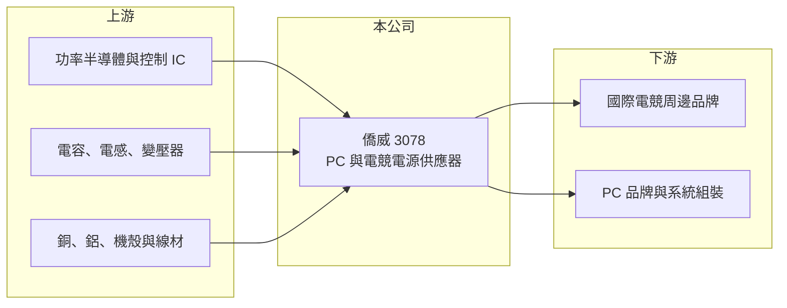

# 3078 僑威

> 上櫃｜[[產業索引-電子零組件業|電子零組件業]]｜上市（櫃）日期 2005/01/31

# 第一章：企業模式與商業藍圖

> [!info] 撰寫說明
> 精簡版，由 Claude 依公開資料整理，架構比照 [[2330台積電]]，資料截至 2026-10-08。來源：櫃買中心開放資料快照（基本資料、2026 年第二季資產負債與損益、本益比殖利率）、Goodinfo 經營績效頁、nStock 公司簡介；電競電源定位參考自由時報與中時新聞標題。公開資料有限，產品比重與客戶未查得。#待校對

僑威科技（以下簡稱僑威）是一家[[電源供應器]]製造商，主力是個人電腦與電競玩家使用的桌上型電源。理解僑威的關鍵在於：它的營收高度跟著 PC 與電競硬體的換機潮起伏，而公司在高瓦數、高效率電競電源上建立了代工地位。

- **核心業務：** 僑威成立於 1993 年，2005 年在櫃買中心掛牌，依公司登記，主要業務是電源供應器及各式電子零組件的加工製造與買賣。電源供應器負責把插座的交流電轉成電腦零件需要的直流電，是每台桌機必備的零件。電競玩家會為高階顯示卡購買高瓦數、高轉換效率的電源，這一塊的單價與毛利都高於一般辦公電腦電源。
- **營收結構：** 依新聞報導，僑威近年以電競電源作為成長主力（#待校對），客戶多為國際電競周邊品牌，以代工（OEM/ODM）方式出貨。產品別與客戶別的營收比重公開資料未查得。由於電競市場與顯示卡世代更替高度相關，新一代高階顯示卡推出時，對大瓦數電源的需求通常會跟著提升。
- **營運據點：** 公司總部在台灣，生產基地以中國為主（#待校對）。2023 年起 PC 電源廠普遍把部分產能移往越南等地，以因應美國關稅與客戶「中國以外」的要求，僑威的具體海外布局公開資料未查得。
- **長期方向：** 電源產業的長期升級方向是更高瓦數、更高轉換效率與更小體積，AI 個人電腦與高階顯示卡持續推高單機用電，有利於高瓦數電源的需求。僑威的長期課題是把電競電源的設計能力延伸到其他電源應用，以降低單一市場的波動。

# 第二章：護城河深度與競爭優勢

僑威屬於規模中等的電源代工廠，護城河主要來自設計能力與品牌客戶的長期合作，而不是技術獨占。

- **競爭優勢：** 電源供應器攸關整台電腦的安全與穩定，品牌商在導入新代工廠前需要長時間的安規認證與可靠度測試，一旦合作，往往延續多個產品世代。僑威長年服務電競品牌，熟悉高瓦數、低噪音、高效率的設計要求，在這個利基市場累積了一定的口碑。2020 年與 2023 年營業利益率曾達 16% 以上，在電源代工業中屬於偏高的水準，顯示產品組合偏向高階。
- **主要對手：** 台灣的電源同業包括 [[3015全漢]]、[[6203海韻電]]、[[6412群電]]、[[6282康舒]] 與 [[2457飛宏]]，以及規模大得多的 [[2308台達電]] 與 [[2301光寶科]]；中國也有許多低價電源廠。電競電源的主要競爭在於誰能先拿到品牌新一代產品的設計案。
- **觀察重點：** 長期最該追蹤的是營收能否在 PC 與電競週期之間維持穩定，以及毛利率能否守在兩成以上。2026 年上半年毛利率約 19.1%、營業利益率約 7.0%，明顯低於 2025 年，顯示這門生意的獲利會隨出貨量與產品組合大幅波動。

# 第三章：財務體質與盈利規模

資料日期：2026-10-08，表格是撰寫當時的快照；最新月營收、毛利率、累計 EPS 由自動排程寫在本筆記的屬性欄位（月營收、毛利率、累計EPS 等）。#待校對

僑威的財務呈現「高報酬但高波動」的樣貌：營收在 65 億到 110 億元之間大幅擺動，ROE 多數年度在 15% 以上。

| 年度 | 營收（億元） | [[毛利率]] | [[營業利益率]] | EPS（元） | [[ROE]] |
|---|---|---|---|---|---|
| 2021 | 101 | 19.3% | 12.1% | 4.30 | 18.0% |
| 2022 | 64.9 | 19.2% | 9.0% | 3.13 | 12.7% |
| 2023 | 109 | 24.6% | 16.8% | 6.79 | 25.3% |
| 2024 | 86.2 | 24.3% | 14.4% | 5.62 | 18.8% |
| 2025 | 100 | 25.7% | 16.9% | 6.07 | 19.2% |

（來源：Goodinfo 經營績效頁；2020 年營收 75.6 億元、EPS 4.55 元。）

- **營收規模：** 2020 至 2025 年營收由 75.6 億元增至 100 億元，年複合成長率約 5.8%（推算），但中間 2022 年曾大跌三成五、2023 年又大增近七成。這種劇烈波動來自 PC 與電競硬體的庫存循環：品牌商在缺貨期大量備貨，需求降溫後又急踩剎車。
- **獲利：** 近五年（2021 至 2025）平均 ROE 約 18.8%（推算），即使在 2022 年的低谷也有 12.7%，代表本業在週期底部仍能賺錢。2023 至 2025 年毛利率穩定在 24% 至 26%，比 2021 至 2022 年的 19% 高出一截，反映產品組合往高階移動。
- **財務特色：** 2026 年第二季總資產約 105.2 億元、歸屬母公司權益約 68.3 億元、負債約 36.9 億元，流動資產占總資產約八成，資產以現金、應收帳款與存貨為主，屬於輕資產的代工模式。最近一次每股現金股利 4.0 元，以 2025 年 EPS 6.07 元計算配發率約 66%（推算）；Goodinfo 統計歷年平均現金股利約 2.14 元，配息隨獲利調整。
- **[[ROIC]] 與 [[WACC]]：** 以 2025 年營業利益約 16.9 億元（100 億元 × 16.9%）、稅率 20% 計算，稅後營業利益約 13.5 億元。有息負債未查得，投入資本以權益 68.3 億元到「權益加全部負債」105.2 億元為區間，ROIC 約 12.8% 至 19.8%（推算）。WACC 以 CAPM 推估：無風險利率 1.75%、市場風險溢酬 6%、β 假設 1.0（PC 相關零組件股常見值），權益成本約 7.8%；稅後負債成本假設 2%、負債占兩成五，WACC 約 6.3%（推算）。ROIC 明顯高於 WACC，代表在多數年度公司都創造經濟價值；不過在 2022 年或 2026 年這類需求低谷，利差會大幅縮小。

# 第四章：總體風險與地緣政治

僑威的風險主要來自 PC 與電競的需求週期、客戶集中，以及生產據點的地緣政治。

- **產業週期：** 電競與 PC 需求受顯示卡世代、遊戲大作推出與總體消費力影響，[[長鞭效應]]會讓代工廠的訂單波動遠大於終端銷售的波動。2026 年前九月累計營收約 46.7 億元，明顯低於 2025 年同期的水準，正說明了這種週期性。
- **營運風險：** 代工模式下客戶集中於少數國際品牌，品牌若轉單或自身銷售不佳，影響會直接反映到營收。電源產品的毛利率對量產規模敏感，出貨量下滑時固定成本無法攤提，營業利益率會比營收下降得更快。
- **其他風險：** 生產基地若集中在中國，美國關稅與供應鏈「去中國化」要求可能迫使公司增加海外設廠成本。營收以美元計價，新台幣升值會壓縮毛利；銅、鋁、半導體功率元件與電容等料件價格波動也會影響成本。

# 專有名詞解析

## 金融

- **[[長鞭效應]]**：終端需求的小幅變動，沿供應鏈往上游傳遞時被逐級放大，造成上游庫存與訂單劇烈波動。
- **[[營業槓桿]]**：固定成本占比高時，營收小幅變動會讓營業利益大幅變動的現象。

## 產業

- **[[電源供應器]]**：把交流電轉換成電子設備所需直流電的裝置，品質影響整台設備的安全與穩定。

# 核心供應鏈

- 上游：功率半導體與電源控制 IC、電容與電感等被動元件（例如 [[2327國巨]]、[[2472立隆電]]）、變壓器、銅與鋁等金屬材料。
- 下游／客戶：國際電競周邊品牌與 PC 品牌、系統組裝商（具體客戶公開資料未查得，#待校對）。
- 同業：[[3015全漢]]、[[6203海韻電]]、[[6412群電]]、[[6282康舒]]、[[2457飛宏]]、[[2308台達電]]、[[2301光寶科]]。

## 最新新聞
<!-- news:start -->
<!-- news:end -->

## 相關連結
- [公開資訊觀測站](https://mopsov.twse.com.tw/mops/web/t05st03?step=1&firstin=1&co_id=3078)
- [Goodinfo](https://goodinfo.tw/tw/StockDetail.asp?STOCK_ID=3078)
- [Yahoo 股市](https://tw.stock.yahoo.com/quote/3078)
- [鉅亨網新聞](https://www.cnyes.com/twstock/3078/news)
