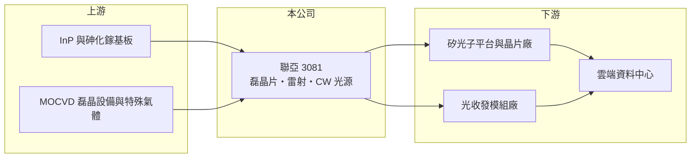

# 3081 聯亞

> 上櫃｜[[產業索引-通信網路業|通信網路業]]｜上市（櫃）日期 2015/07/22

# 第一章：企業模式與商業藍圖

> [!info] 撰寫說明
> 本文由 Claude 依公開資料整理，架構比照 [[2330台積電]] 的四章研究，資料截至 2026-10-08。財務數字來源：Goodinfo 年度經營績效頁、櫃買中心開放資料（基本資料、2026 年第二季資產負債與損益、本益比殖利率）、優分析 2026 年營收與法人報導、理財周刊公司介紹；產業描述為整理性內容，尚未逐條比對原始文件。#待校對

評估一家光通訊上游廠的長期價值，關鍵在於它掌握哪一段不容易被取代的製程。本章說明聯亞光電（股票代號：3081，以下簡稱聯亞）如何從化合物半導體[[磊晶]]起家，成為 AI 資料中心[[矽光子]]光源的供應商。

## 一、核心定位：III-V 族化合物磊晶與雷射晶片

聯亞成立於 1997 年，2015 年在櫃買中心掛牌，實收資本額約 10.2 億元。公司主要在砷化鎵與 [[InP]] 基板上長出化合物半導體磊晶層，並進一步做成雷射與光檢測元件。這些元件負責光通訊中「把電變成光、再把光變回電」的最前端工作，是[[光收發模組]]裡價值最高、技術門檻也最高的零件之一。

磷化銦雷射的良率取決於磊晶層的厚度、成分與缺陷控制，製程經驗需要多年累積，全球能穩定大量供貨的廠商不多。這是聯亞能在光通訊供應鏈中占有一席之地的原因。

## 二、產品世代：從電信光纖到矽光子 CW 雷射

聯亞早期的客戶多來自電信光纖與資料中心的傳統光模組，產品是 DFB 雷射與檢光器的磊晶片。近年最重要的變化是[[CW 雷射]]：在矽光子架構中，調變與傳輸在矽晶片上完成，但矽本身不能發光，需要外接一顆穩定輸出的連續波雷射當光源。聯亞把 CW 雷射視為光通訊的主力產品，依 2026 年報導，1.6T 世代產品已開始量產，3.2T 產品仍與客戶共同開發。

這個轉變的意義在於，資料中心光模組從 400G、800G 走向 1.6T 時，矽光子方案的比重提高，而每個矽光子模組都需要 CW 雷射光源。產品世代更替因此直接擴大了聯亞的可服務市場。

## 三、長期方向：長約綁定與產能擴充

依 2026 年報導，聯亞與一家美國客戶簽訂 2027 至 2030 年、為期 4 年的長期採購合約，法人估計 2027 年產能將達 2026 年的 2.5 倍。長約能提高產能投資的確定性，但也代表公司對單一大客戶的依賴加深。各產品與客戶的營收比重，公開資料未查得。

# 第二章：護城河深度與競爭優勢

在長期價值投資中，「護城河」指企業抵禦競爭、維持超額利潤的保護機制。本章分析聯亞在化合物半導體光源領域的優勢與挑戰。

## 一、聯亞護城河的組成

* **磊晶製程的經驗曲線：** InP 雷射的良率與可靠度需要長時間的製程調校，新進者即使買得到設備，也需要數年才能達到資料中心客戶要求的品質。這構成時間上的進入障礙。
* **客戶驗證的轉換成本：** 光模組廠與矽光子平台一旦完成雷射光源的可靠度驗證，更換供應商要重新做長時間測試，因此客戶傾向維持既有供應鏈。
* **長期合約：** 2027 至 2030 年的長約讓聯亞在供不應求時能鎖住需求，也提高擴產投資的回收可見度。

## 二、主要競爭對手

| 對手 | 定位 | 對聯亞的威脅 |
|---|---|---|
| [[4979華星光]]、[[3234光環]] | 台灣光通訊雷射與元件廠 | 在雷射晶片與代工服務部分重疊 |
| [[3105穩懋]] | 化合物半導體晶圓代工 | 擁有大規模化合物半導體產能，可切入光電元件 |
| 美日雷射大廠（如 Lumentum、Coherent、住友電工） | 垂直整合的雷射與光模組廠 | 技術與規模領先，可自製光源 |

## 三、守得住／守不住／觀察重點

守得住的是已通過驗證的 CW 雷射與磊晶片供貨地位，以及長約帶來的需求能見度。守不住的是景氣反轉時的價格，2023 年資料中心與電信需求調整時，聯亞毛利率從 31.9% 掉到 13.1% 並出現虧損，顯示光通訊元件的週期性很強。長期觀察重點是 3.2T 世代能否持續打入、擴產後良率是否維持，以及客戶集中度的變化。

# 第三章：財務體質與盈利規模

資料日期：2026-10-08，表格是撰寫當時的快照；最新月營收、毛利率、累計 EPS 由自動排程寫在本筆記的屬性欄位（月營收、毛利率、累計EPS 等）。#待校對

財務報表是檢驗護城河是否真實存在的最終標準。本章用五年的三率、ROE 與資本報酬，檢視聯亞在光通訊週期中的獲利品質。

## 一、多年度經營績效

| 年度 | 營收（新台幣） | [[毛利率]] | [[營業利益率]] | EPS（元） | [[ROE]] |
|---|---|---|---|---|---|
| 2021 | 18.7 億 | 41.0% | 22.0% | 3.71 | 7.83% |
| 2022 | 23.8 億 | 31.9% | 14.0% | 3.61 | 7.64% |
| 2023 | 10.6 億 | 13.1% | -26.4% | -2.31 | -5.15% |
| 2024 | 12.1 億 | 19.8% | -9.25% | -0.59 | -1.43% |
| 2025 | 22.0 億 | 42.7% | 23.1% | 4.66 | 10.8% |
| 2026 上半年 | 21.3 億 | 56.3% | 44.5% | 7.75 | 未查得 |

這張表清楚呈現光通訊元件的高營運槓桿：營收從 2022 年的 23.8 億元腰斬到 2023 年的 10.6 億元時，營業利益率從 14% 掉到 -26%；2026 年上半年營收超過前一年全年的九成，營業利益率衝到 44.5%。2021 至 2025 年平均 ROE 約 3.9%（推算），營收年複合成長率約 4.1%（推算），但 2026 年的獲利水準已遠高於過去五年平均。櫃買中心資料顯示最近一次現金股利為每股 4.0 元，約為 2025 年 EPS 的 86%（推算）。

## 二、[[ROIC]] 與 [[WACC]]：價值創造利差

**ROIC 推算：** 2025 年營業利益約 5.1 億元（22.0 億 × 23.1%），稅後約 4.1 億元。2026 年第二季股東權益約 51.9 億元（每股淨值 51.01 元 × 約 1.02 億股），負債總額約 15 億元，假設有息負債約 3 億元（推估），投入資本約 55 億元，2025 年 ROIC 約 7.4%（推算）。若以 2026 年上半年營業利益 9.5 億元年化，稅後約 15 億元，ROIC 約 27%（推算）。

**WACC 推算：** 台灣 10 年期公債 1.75%、市場風險溢酬 6%、β 取光通訊同業常見值 1.3，股東權益成本約 9.6%；負債成本 2.5%、稅後 2.0%；權益占投入資本約 95%，WACC 約 9.2%（推算）。

**結論：** 聯亞在景氣低谷時 ROIC 為負，2025 年仍略低於 WACC，2026 年才明顯超越。這代表它是典型的週期型價值創造者：長期是否創造價值，取決於高峰期的超額報酬能否彌補低谷期的虧損，以及擴產後能否維持高利用率。

# 第四章：總體風險與地緣政治

任何企業都無法脫離宏觀環境獨立存在。本章分析聯亞長期必須面對的產業、技術與營運風險。

## 一、產業週期風險

光通訊需求高度依賴雲端業者的資本支出。2023 年的庫存調整已證明，一旦客戶放緩採購，聯亞的營收與獲利會在一年內大幅下滑。AI 資料中心投資目前處於擴張期，但未來若出現投資放緩或客戶庫存過高，大幅擴產後的折舊會放大虧損。

## 二、技術演進風險

矽光子與 [[CPO]] 是聯亞目前的成長來源，但光源架構仍在演進。例如部分廠商研究把雷射直接整合在矽晶片上，或改用不同波長與材料；若主流架構改變，外接 CW 雷射的需求可能受影響。此外，3.2T 與更高速世代需要新一代產品通過驗證，任何延遲都會讓競爭者搶得先機。

## 三、客戶集中與匯率

長約綁定美國大客戶，好處是能見度高，風險是議價力受限，且單一客戶策略改變對營收影響很大。營收以美元計價為主，新台幣升值會壓縮毛利。

# 專有名詞解析

## 半導體

- **[[磊晶]]**：在基板上長出一層排列整齊的晶體薄膜，是 LED 與化合物半導體元件的關鍵製程。
- **[[InP]]**：磷化銦，適合製作光通訊雷射與光接收元件的化合物半導體材料，是資料中心光模組的關鍵。
- **[[CW 雷射]]**：連續波雷射，持續輸出穩定光源，矽光子架構需要外接的 CW 雷射提供光。
- **[[矽光子]]**：在矽晶片上製作光學元件，以光取代電傳輸資料，可降低 AI 資料中心的傳輸耗電。
- **[[CPO]]**：共同封裝光學，把光學收發元件與交換晶片封裝在一起，縮短電訊號距離以降低功耗。

## 產業

- **[[光收發模組]]**：把電訊號轉成光訊號傳輸、再轉回電訊號的模組，資料中心以 800G、1.6T 速率區分世代。

# 核心供應鏈

## 1. 上游：基板與設備
- InP 與砷化鎵基板供應商、MOCVD 磊晶設備商

## 2. 中游：聯亞與同業
- 同業：[[4979華星光]]、[[3234光環]]、[[3105穩懋]]、[[8086宏捷科]]

## 3. 下游：矽光子與光模組
- 矽光子晶片與光模組客戶：美國客戶（長約，未具名）、光收發模組廠
- 終端：雲端資料中心，交換晶片來自 [[NVDA輝達]]、[[AVGO博通]] 等

## 最新新聞
<!-- news:start（自動產生，請勿手動編輯此範圍） -->
- 2026-10-05 📰 媒體 19:28｜聯亞受惠AI產品出貨量增 9月營收年增達190.2%再創單月新高｜[鉅亨網](https://news.cnyes.com/news/id/6621936)
- 2026-10-05 📰 媒體 17:50｜營收速報 - 聯亞(3081)9月營收5.40億元年增率高達190.16％｜[鉅亨網](https://news.cnyes.com/news/id/6621839)
- 2026-10-05 📰 媒體 10:29｜【跨年度做夢行情】友達、聯亞、台達電、聯發科非首選？這幾檔才是下一檔飆股？｜[鉅亨網](https://news.cnyes.com/news/id/6621551)

完整紀錄：[[3081聯亞 新聞]]
<!-- news:end -->

## 相關連結
- [公開資訊觀測站](https://mopsov.twse.com.tw/mops/web/t05st03?step=1&firstin=1&co_id=3081)
- [Goodinfo](https://goodinfo.tw/tw/StockDetail.asp?STOCK_ID=3081)
- [Yahoo 股市](https://tw.stock.yahoo.com/quote/3081)
- [鉅亨網新聞](https://www.cnyes.com/twstock/3081/news)
