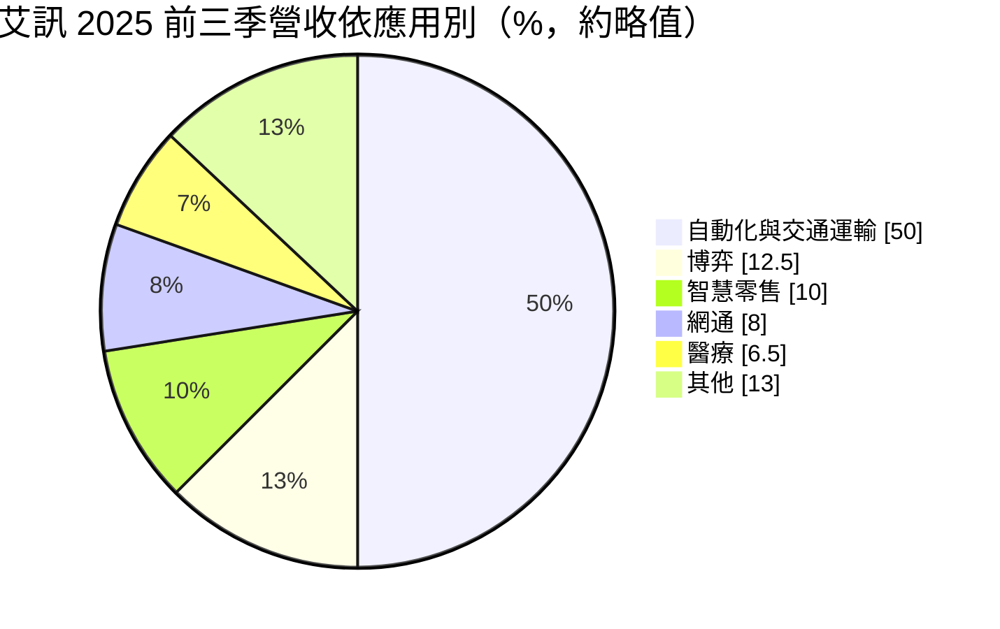
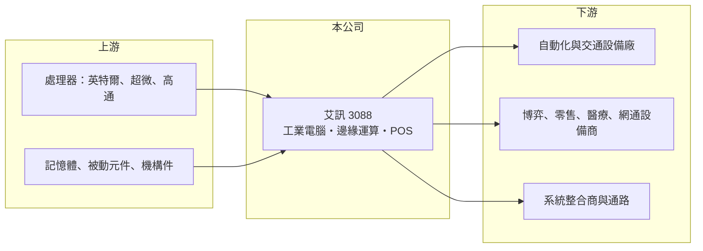

# 3088 艾訊

> 上櫃｜[[產業索引-電腦及週邊設備業|電腦及週邊設備業]]｜上市（櫃）日期 2005/04/28

# 第一章：企業模式與商業藍圖

> [!info] 撰寫說明
> 精簡版，由 Claude 依公開資料整理，架構比照 [[2330台積電]] 的四章研究，資料截至 2026-10-08。來源：櫃買中心開放資料快照（基本資料、2026 年第二季資產負債與綜合損益、股利）、富果研究 2025 年 11 月法說會摘要、財經媒體標題。公開資料有限，多年度財務數字多數未查得。#待校對

艾訊（股票代號 3088）是一家專做[[工業電腦]]的台灣公司，產品放在工廠、交通、醫療、零售等場域，負責長時間穩定地收集與處理資料。理解艾訊，重點在於它如何用「少量多樣、長期供貨、客製設計」的模式，在大型電腦廠不想做的利基市場裡賺取穩定毛利。

## 一、核心定位：工業物聯網與邊緣運算的硬體平台

- **核心業務：** 艾訊成立於 1990 年，2005 年上櫃，英文品牌為 Axiomtek，產品包括嵌入式主機板、無風扇工業電腦、強固型平板與網通安全設備，近年以[[工業物聯網]]與[[邊緣運算]]為主軸。工業電腦和一般消費性電腦最大的不同在於，客戶要的是 5 到 10 年不停產、能耐高溫震動的穩定規格，而不是最新效能，因此產品生命週期長、價格競爭相對溫和。
- **應用結構：** 依富果整理的法說會內容，2025 年前三季自動化與交通運輸約占營收一半，其餘垂直應用約占 37%，其中博弈約 12% 至 13%、智慧零售近 10%、網通約 8%、醫療約 6% 至 7%。應用分散的好處是單一產業景氣轉弱時，其他板塊可以部分抵銷，但也代表公司必須同時維持多個產業的專業知識。
- **地區結構：** 同一資料顯示美洲約占營收 50%、歐洲約 21%、亞洲及其他約 29%，中國僅約 3%。這個結構讓艾訊相對不受中國市場價格戰影響，但也使美元匯率與美國景氣成為獲利的主要變數。

## 二、營運據點與長期方向

- **營運據點：** 總部位於新北市汐止，美國設有在地研發與設計導入團隊，歐洲以德國子公司為中心。在客戶所在地提供設計導入服務，是工業電腦廠把一次性訂單轉為多年期專案的關鍵，因為客戶的設備設計一旦採用某家主機板，後續多年都會沿用。
- **長期方向：** 公司把產品開發聚焦在智慧製造、能源與網通安全、交通與智慧城市、醫療與服務業四大場景，並持續提高客製化與半客製化產品的比重。客製化程度越高，客戶轉換成本越高，毛利也越能守住，這是艾訊長期維持三成以上[[毛利率]]的基礎。
- **併購補強：** 法說會提到艾訊併購 POS 廠博承，把產品線延伸到零售端的 [[POS]] 終端。併購年份與股本變動細節尚待校對，但方向上是用併購補足垂直應用，而非單純擴充產能。#待校對

# 第二章：護城河深度與競爭優勢

工業電腦產業沒有絕對的技術壟斷者，競爭靠的是長期供貨承諾、客製化能力與在地服務。本章說明艾訊的護城河與它在同業中的位置。

## 一、護城河組成

- **設計導入帶來的轉換成本：** 工業設備廠一旦把艾訊的主機板設計進產品，就要花數月到一年做驗證與認證，之後多年持續下單。這讓營收具有類似經常性收入的性質，也讓艾訊不必每年從頭爭取客戶。
- **長期供貨與料件管理能力：** 工業客戶要求同一型號供貨 7 到 10 年，廠商必須管理晶片停產、備料與版本控管。這種能力需要多年累積的供應鏈關係，新進者不易複製，也是工業電腦毛利長期高於一般電腦代工的原因。
- **美國在地服務：** 美洲占營收一半，且在美國有設計導入團隊。在供應鏈「去中國化」的趨勢下，非中國生產、在地支援的供應商較容易取得北美專案。

## 二、主要對手

| 對手 | 定位 | 與艾訊的關係 |
|---|---|---|
| [[2395研華]] | 全球工業電腦龍頭，產品線最完整 | 規模與通路遠大於艾訊，在標準品市場直接競爭 |
| [[6166凌華]]、[[6579研揚]]、[[8050廣積]] | 台灣工業電腦與嵌入式板卡廠 | 在嵌入式主機板與邊緣 AI 平台重疊 |
| [[3594磐儀]]、[[3479安勤]]、[[2397友通]] | 中小型工業電腦廠 | 爭取博弈、醫療、零售等垂直專案 |
| [[6922宸曜]] | 強固型與車載邊緣運算 | 在交通與 AI 邊緣運算應用重疊 |

## 三、觀察重點

- **客製化比重與毛利率：** 客製化專案越多，毛利越穩；若標準品比重升高，就會直接面對研華等大廠的價格競爭。長期觀察毛利率能否維持在三成以上。
- **邊緣 AI 的轉型程度：** 工業場域的影像辨識與預測保養需要在現場運算，若艾訊能把邊緣 AI 平台變成主要產品，單價與毛利都有提升空間。

# 第三章：財務體質與盈利規模

資料日期：2026-10-08，表格是撰寫當時的快照；最新月營收、毛利率、累計 EPS 由自動排程寫在本筆記的屬性欄位（月營收、毛利率、累計EPS 等）。#待校對

財務數字用來檢驗艾訊的利基模式是否真的帶來穩定報酬。由於這次只取得少數年度資料，表格中許多格子未查得，判讀時應以趨勢與區間為主。

## 一、多年度財務

| 年度 | 營收（億元） | [[毛利率]] | [[營業利益率]] | EPS（元） | [[ROE]] |
|---|---|---|---|---|---|
| 2022 | 未查得 | 未查得 | 未查得 | 未查得 | 未查得 |
| 2023 | 未查得 | 未查得 | 未查得 | 未查得 | 未查得 |
| 2024 | 約 69 | 未查得 | 未查得 | 未查得 | 未查得 |
| 2025 前三季 | 約 50 | Q3 為 33.7% | 未查得 | 2.76 | 未查得 |
| 2026 上半年 | 46.13 | 33.09% | 12.29% | 4.28 | 約 17%（年化推算） |

- **營收規模：** 2024 年營收約 69 億元，2026 年上半年已達 46 億元，1 至 8 月累計年增約五成，主要來自台灣與美洲的專案出貨。專案型業務的特色是營收會隨大案出貨而跳動，長期應看多年平均。
- **獲利：** 2025 年第二季曾因近 2 億元匯兌損失出現單季虧損（EPS 負 0.29 元），第三季即回到 1.81 元。這說明艾訊本業穩定，但美元計價比重高，匯率對單季獲利影響很大。
- **財務特色：** 2026 年第二季底股東權益約 56.2 億元、負債總計 28.5 億元，其中非流動負債僅 4.4 億元，財務結構保守。依櫃買中心資料，最近一年度現金股利約 2.93 元，延續以現金回饋股東的習慣。資產負債表股本約 13.1 億元，高於基本資料登記的實收資本額 11.3 億元，顯示近期有增資或換股，股本已擴大。#待校對

## 二、[[ROIC]] 與 [[WACC]]

- **ROIC（推算）：** 以 2026 年上半年營業利益 5.67 億元年化為 11.34 億元，乘以（1－20%）得稅後營業利益約 9.07 億元。投入資本以股東權益 56.2 億元加上推估有息負債約 4 億元（以非流動負債為上限估計，有息負債未查得）約 60 億元計算，ROIC 約 15%（推算）。
- **WACC（推算）：** 無風險利率取 1.75%，市場風險溢酬 6%，β 取工業電腦同業常見值 0.9，股權成本約 7.2%；有息負債比重低，負債成本以 2.5% 稅後 2% 計算，WACC 約 7%（推算）。
- **判讀：** ROIC 約 15% 高於 WACC 約 7%，代表在目前的營運水準下，艾訊每投入一元資本都在創造超額報酬。不過這是用景氣較好的期間推算，應以多年平均確認；工業電腦業的長期 ROIC 通常比代工業高，原因正是高毛利與輕資產。

# 第四章：總體風險與地緣政治

艾訊的風險主要來自工業設備投資週期、匯率與專案集中度。本章挑出長期最相關的幾項。

## 一、產業週期

- **工業資本支出週期：** 工廠自動化與交通建設的投資會隨景氣與利率起伏，景氣下行時客戶會延後專案，營收可能連續數季下滑。工業電腦的庫存調整通常比消費性電子慢，但持續時間也較長。
- **博弈與零售的需求波動：** 博弈約占營收一成以上，這類設備隨賭場與娛樂場所的資本支出而變動，也受各地法規影響。

## 二、營運風險

- **匯率：** 美洲占營收一半，2025 年第二季的匯兌損失已讓單季轉虧。新台幣大幅升值期間，獲利波動會明顯放大。
- **料件與晶片停產：** 長期供貨承諾仰賴英特爾、AMD 等處理器與記憶體的供應，DDR4 等舊世代料件停產或漲價，會增加備料成本。
- **併購整合：** 股本擴大與併購 POS 廠的整合成效，需要觀察能否帶來毛利率不下降的營收成長。

## 三、其他風險

- **地緣政治與關稅：** 美國是最大市場，美國對台灣或亞洲製造的關稅政策會直接影響報價與交期。
- **大廠競爭：** 研華等大廠若積極進攻垂直應用，或晶片廠直接推出參考設計，中小型工業電腦廠的議價空間可能被壓縮。

# 專有名詞解析

## 應用

- **[[工業物聯網]]**：讓工廠設備與感測器連網，即時回傳運轉資料以便監控、預測保養與節能，簡稱 IIoT。
- **[[邊緣運算]]**：在攝影機或終端裝置上直接處理資料，不必全部傳回雲端，可降低延遲與頻寬。
- **[[POS]]**：銷售時點系統，零售與餐飲業的收銀與交易終端設備。

## 產業

- **[[工業電腦]]**：用於工廠、醫療、交通、能源等場域的電腦，強調長時間穩定運作、耐環境與長期供貨，而非最新效能。

# 核心供應鏈

- 上游：處理器與晶片平台 [[INTC英特爾]]、[[AMD超微]]、[[QCOM高通]]；另有記憶體、被動元件與機構件供應商。
- 下游／客戶：歐美工業自動化、交通運輸、博弈、智慧零售、醫療與網通設備商，以及各地系統整合商；具體客戶名單未查得。
- 同業：[[2395研華]]、[[6166凌華]]、[[6579研揚]]、[[8050廣積]]、[[3594磐儀]]、[[3479安勤]]、[[2397友通]]、[[6922宸曜]]。

## 最新新聞
<!-- news:start（自動產生，請勿手動編輯此範圍） -->
- 2026-10-08 📰 媒體 17:23｜營收速報 - 艾訊(3088)9月營收8.89億元年增率高達37.02％｜[鉅亨網](https://news.cnyes.com/news/id/6625009)

完整紀錄：[[3088艾訊 新聞]]
<!-- news:end -->

## 相關連結
- [公開資訊觀測站](https://mopsov.twse.com.tw/mops/web/t05st03?step=1&firstin=1&co_id=3088)
- [Goodinfo](https://goodinfo.tw/tw/StockDetail.asp?STOCK_ID=3088)
- [Yahoo 股市](https://tw.stock.yahoo.com/quote/3088)
- [鉅亨網新聞](https://www.cnyes.com/twstock/3088/news)
