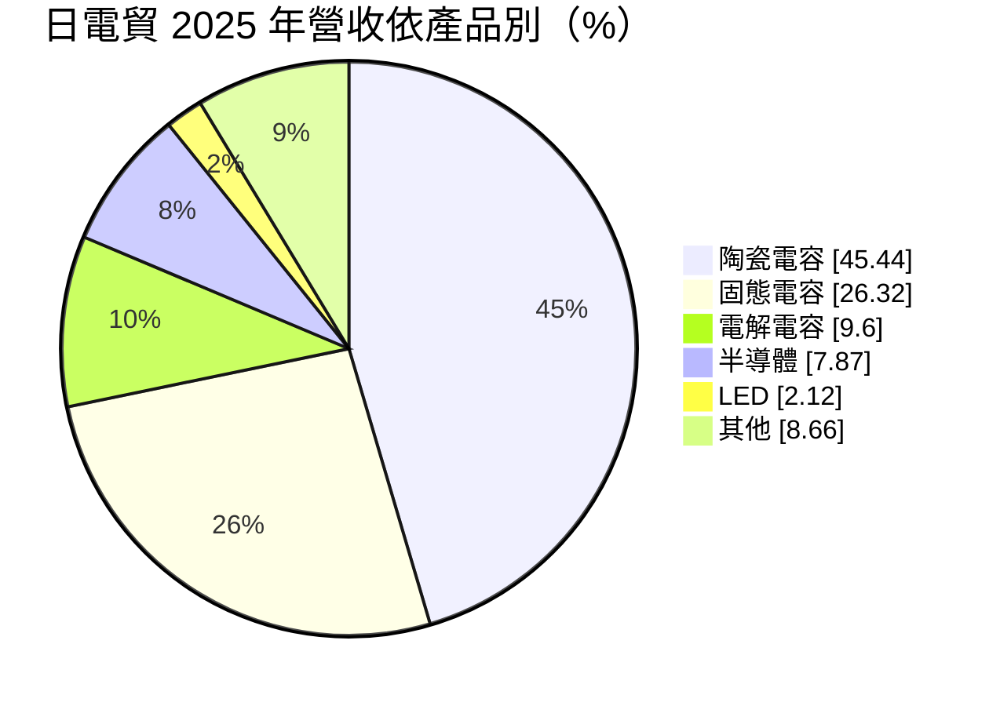
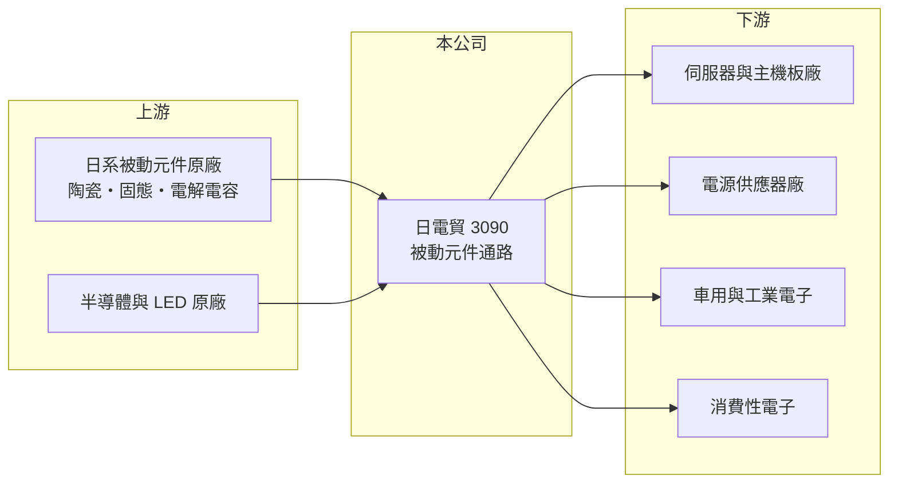

# 3090 日電貿

> 上市｜[[產業索引-電子零組件業|電子零組件業]]｜上市（櫃）日期 2007/12/31

# 第一章：企業模式與商業藍圖

> [!info] 撰寫說明
> 精簡版，由 Claude 依公開資料整理，架構比照 [[2330台積電]]，資料截至 2026-10-08。來源：證交所開放資料快照（基本資料、2026 年第二季資產負債與損益、股利）、Goodinfo 經營績效頁、富邦 MoneyDJ 公司基本資料（2025 年營收比重）、科技新報與 CMoney 文章標題。代理原廠名單未查得。#待校對

日電貿（以下簡稱日電貿）是台灣最大的[[被動元件]]通路商，理解它的關鍵在於：它專注在電容這一類「用量大、單價低、但缺貨時影響整條產線」的零件，毛利率因此明顯高於一般 IC 通路商。

- **核心業務：** 日電貿成立於 1993 年，總部在新北新店，2007 年上市。公司代理以日系為主的被動元件原廠產品，銷售給主機板、伺服器、電源供應器與消費性電子等製造商。依 CMoney 研究報告的標題，日電貿是台灣最大的被動元件代理商。被動元件品項成千上萬、單價低，原廠難以直接服務大量中小客戶，通路商的備貨與配送因此不可或缺。
- **營收結構：** 2025 年營收約 81% 來自電容，其中[[MLCC]]（陶瓷電容）約 45%、[[導電高分子電容]]（固態電容）約 26%、[[鋁質電解電容]]約 10%，其餘為半導體、LED 與其他。固態電容耐高溫、壽命長，大量用於伺服器與顯示卡的電源電路，是 AI 伺服器時代受惠最明顯的品項。
- **營運據點：** 除台灣外，依 2018 年科技新報的報導，公司深耕越南與馬來西亞市場，跟著台商與國際品牌往東南亞移動的產能布局，中國華南與華東也是主要市場（據點明細未查得）。
- **長期方向：** 同一篇 2018 年報導提到公司採取持續購併的策略，透過併購擴充產品線與客戶群。長期的成長動能來自伺服器、車用與工業電子對高規格電容的需求，這些應用每台使用的電容數量與規格都高於消費性電子。

# 第二章：護城河深度與競爭優勢

日電貿的護城河建立在原廠代理權、產品線深度與庫存管理能力，比一般通路商略寬。

- **競爭優勢：** 被動元件的料號多、交期長，缺料時客戶整條產線都會停擺，因此客戶重視通路商能否穩定供貨。日電貿長期代理多家日系電容原廠，產品線涵蓋陶瓷、固態、電解三大電容類別，客戶可以一次採購，這種「一站購足」能力是小型通路商做不到的。毛利率長期維持在 15% 至 17%，也說明它提供的價值不只是轉手。
- **主要對手：** 被動元件通路的同業包括大型綜合通路 [[3702大聯大]]、[[3036文曄]] 的被動元件部門，以及台系原廠 [[2327國巨]]、[[2492華新科]] 的自有業務。台灣的 [[3026禾伸堂]] 兼具通路與自有 MLCC，也是直接競爭者。原廠自設直銷體系是長期威脅。
- **觀察重點：** 長期要觀察伺服器與車用占營收比重是否持續提升，以及固態電容等高單價品項的成長。[[營業利益率]]由 2023 年的 8.19% 升到 2025 年的 10.1%，產品組合改善若能延續，才能支撐更高的獲利水準。

# 第三章：財務體質與盈利規模

資料日期：2026-10-08，表格是撰寫當時的快照；最新月營收、毛利率、累計 EPS 由自動排程寫在本筆記的屬性欄位（月營收、毛利率、累計EPS 等）。#待校對

日電貿的財務特色是「通路商規模、零組件廠毛利」，負債比低，而且配息率高。

| 年度 | 營收（億元） | [[毛利率]] | [[營業利益率]] | EPS（元） | [[ROE]] |
|---|---|---|---|---|---|
| 2021 | 104 | 16.9% | 9.86% | 4.59 | 18.7% |
| 2022 | 104 | 17.1% | 8.55% | 8.02 | 26.9% |
| 2023 | 107 | 15.4% | 8.19% | 3.39 | 11.2% |
| 2024 | 121 | 16.0% | 9.18% | 4.52 | 14.9% |
| 2025 | 157 | 16.4% | 10.1% | 5.48 | 12.4% |

（來源：Goodinfo 經營績效頁；2020 年營收 92.4 億元、EPS 3.36 元。）

- **營收規模：** 2020 至 2025 年營收由 92.4 億元增至 157 億元，年複合成長率約 11.2%（推算），2025 年成長特別明顯。2026 年上半年營收約 96.5 億元，毛利率約 18.9%、營業利益率約 12.1%，EPS 4.91 元，獲利率高於過去五年。
- **獲利：** 2021 至 2025 年平均 ROE 約 16.8%（推算）。2022 年 EPS 8.02 元明顯高於營業利益可解釋的水準，推估含較大的業外收益（例如投資處分），2026 年上半年業外收入約 4.8 億元也偏高，評估本業時應以營業利益為準。
- **財務特色：** 2026 年第二季總資產約 270 億元、負債約 83 億元、權益約 186 億元，負債比約三成，在通路業中屬於低槓桿。2025 年度現金股利每股 4.8 元，配息率約 88%（推算）；Goodinfo 統計歷年平均現金股利約 2.44 元。權益規模大於營運所需，部分資產為長期投資（推估）。
- **[[ROIC]] 與 [[WACC]]：** 以 2025 年營業利益約 15.9 億元（157 億元 × 10.1%）、稅率 20% 計算，稅後營業利益約 12.7 億元。有息負債未查得，投入資本以權益約 186 億元到「權益加全部負債」約 270 億元為區間，ROIC 約 4.7% 至 6.8%（推算）；若扣除非營運用的長期投資，本業 ROIC 會更高。WACC 以 [[CAPM]] 推估：無風險利率 1.75%、市場風險溢酬 6%、β 假設 0.9，權益成本約 7.2%；負債占一成、稅後成本 2%，WACC 約 6.6%（推算）。以帳面權益計算，ROIC 大致與 WACC 持平；本業本身創造價值，但大量投資性資產稀釋了整體資本報酬。

# 第四章：總體風險與地緣政治

日電貿的風險來自被動元件的強週期、原廠關係與終端集中度。

- **產業週期：** 被動元件是電子業週期最明顯的品項之一，缺貨時價格與交期同步暴漲、客戶重複下單，景氣反轉時又出現庫存去化，這就是[[長鞭效應]]。2022 至 2023 年 EPS 從 8.02 元降到 3.39 元，就是一次完整的循環。
- **營運風險：** 代理權集中於少數日系原廠，若原廠改變通路政策或被併購，影響重大。持續併購的策略也帶來整合風險與商譽減損風險。
- **其他風險：** 進貨以日圓與美元計價，匯率變動影響毛利。東南亞與中國據點受關稅與地緣政治政策影響。AI 伺服器需求若放緩，高階電容的成長動能會減弱。

# 專有名詞解析

## 金融

- **[[長鞭效應]]**：終端需求的小幅變動，沿供應鏈往上游傳遞時被逐級放大，造成上游庫存與訂單劇烈波動。

## 產業

- **[[被動元件]]**：不需外加電源即可運作的電子元件，主要是電容、電阻與電感，負責儲能、濾波與限流。
- **[[MLCC]]**：積層陶瓷電容，以多層陶瓷介質與電極交疊製成，體積小、用量大，是最主要的被動元件。
- **[[導電高分子電容]]**：以導電高分子取代或搭配電解液的電容，包括固態與固液混合型，耐高溫、壽命長，單價與毛利較高。
- **[[鋁質電解電容]]**：以鋁箔為電極、電解液為介質的電容，容量大、價格低，廣泛用於電源供應器與車用電子。

# 核心供應鏈

- 上游：以日系為主的電容原廠，以及半導體與 LED 原廠（代理名單未查得）。#待校對
- 下游／客戶：伺服器與主機板廠（如 [[2382廣達]]、[[2376技嘉]]、[[2357華碩]]）、電源供應器廠（如 [[2308台達電]]、[[6282康舒]]）、車用與工業電子製造商。上述為產業代表性廠商，非公司揭露客戶。#待校對
- 同業：[[3026禾伸堂]]、[[3702大聯大]]、[[3036文曄]]；台系電容原廠 [[2327國巨]]、[[2492華新科]]、[[6449鈺邦]]、[[2472立隆電]]。

## 最新新聞
<!-- news:start（自動產生，請勿手動編輯此範圍） -->
- 2026-10-22 🏛️ 重訊 16:32｜公告本公司受邀參加統一證券115年11月10日舉辦之法人說明會。｜[觀測站](https://mops.twse.com.tw/mops/#/web/t05st01)
- 2026-10-22 🏛️ 重訊 16:31｜代子公司力禾科技股份有限公司公告現金增資發行新股及 增資基準日等相關事宜。｜[觀測站](https://mops.twse.com.tw/mops/#/web/t05st01)
- 2026-10-06 📰 媒體 19:50｜營收速報 - 日電貿(3090)9月營收18.53億元年增率高達31.27％｜[鉅亨網](https://news.cnyes.com/news/id/6622940)

完整紀錄：[[3090日電貿 新聞]]
<!-- news:end -->

## 相關連結
- [公開資訊觀測站](https://mopsov.twse.com.tw/mops/web/t05st03?step=1&firstin=1&co_id=3090)
- [Goodinfo](https://goodinfo.tw/tw/StockDetail.asp?STOCK_ID=3090)
- [Yahoo 股市](https://tw.stock.yahoo.com/quote/3090)
- [鉅亨網新聞](https://www.cnyes.com/twstock/3090/news)
