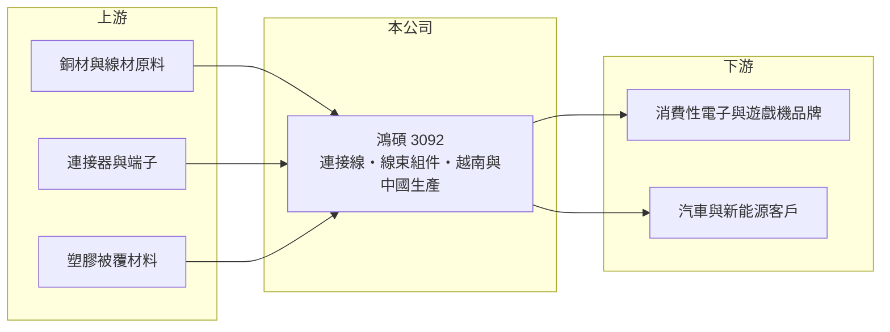

# 3092 鴻碩

> 上市｜[[產業索引-電子零組件業|電子零組件業]]｜上市（櫃）日期 2021/05/13

# 第一章：企業模式與商業藍圖

> [!info] 撰寫說明
> 精簡版，由 Claude 依公開資料整理，架構比照 [[2330台積電]]，資料截至 2026-10-08。來源：證交所開放資料快照（基本資料、2026 年第二季資產負債與損益、股利）、Goodinfo 經營績效頁、自由財經、旺得富、CMoney 文章標題。產品與應用描述部分依記憶整理。公開資料有限。#待校對

鴻碩精密電工（以下簡稱鴻碩）是一家[[連接線]]與[[線束]]組件製造商，理解它的關鍵在於：公司正從消費性電子線材轉向車用與新能源應用，並把產能移往越南，轉型期間連續出現大額虧損。

- **核心業務：** 鴻碩成立於 1991 年，總部在台北內湖，2021 年在證交所上市。公司生產各類電子連接線與線束組件，也就是兩端帶有[[連接器]]、把訊號或電力從一個設備送到另一個設備的線材，應用於消費性電子、遊戲機與汽車（產品明細依記憶整理，#待校對）。依 2021 年 CMoney 文章標題，當時的成長動能來自車用與遊戲機兩大應用。
- **營收結構：** 公開資料未查得最新的產品或應用別營收比重。線材組件的成本中，銅材占比高，產品規格由客戶訂定，屬於接單生產的代工模式，因此毛利率受銅價與產能利用率影響很大。
- **營運據點：** 依 2025 年 12 月自由財經報導標題，鴻碩的越南廠已逐步到位。線材組裝屬勞力密集產業，過去主要在中國生產，移往越南是為了因應客戶「中國以外」的供應鏈要求與關稅風險（中國廠區現況未查得）。
- **長期方向：** 同一篇報導提到公司強化布局[[新能源]]事業，例如電動車與儲能相關的高壓線束（具體產品未查得，#待校對）。新能源線束的規格與驗證門檻高於消費性線材，若能打入，毛利率與訂單穩定度都會較好；但驗證時間長，短期內需要先承擔新廠與研發的成本。

# 第二章：護城河深度與競爭優勢

鴻碩目前的護城河有限，競爭力取決於能否在車用與新能源領域建立客戶認證。

- **競爭優勢：** 線材組件需要依客戶規格客製，量產前要經過樣品與可靠度驗證，進入客戶的供應名單後有一定的轉換成本，車用產品尤其如此。鴻碩有三十多年的線材製造經驗，加上越南新產能，可以承接需要「非中國產地」的訂單。不過消費性線材本身技術門檻不高，這部分的優勢偏弱。
- **主要對手：** 台灣的連接線與線束同業眾多，包括 [[5457宣德]]、[[2392正崴]]、[[3665貿聯-KY]]、[[3023信邦]]、[[6290良維]] 等，中國大陸也有大量低成本的線材廠。依 2026 年 5 月旺得富報導，連接線廠因銅價上漲與轉型陣痛普遍承壓，鴻碩與宣德持續虧損。
- **觀察重點：** 長期最該追蹤的是越南廠的產能利用率，以及新能源與車用營收能否接替消費性產品。[[毛利率]]由 2020 年的 24.2% 降到 2025 年的 4.38%，能否回到兩成以上，是判斷轉型是否成功的關鍵。

# 第三章：財務體質與盈利規模

資料日期：2026-10-08，表格是撰寫當時的快照；最新月營收、毛利率、累計 EPS 由自動排程寫在本筆記的屬性欄位（月營收、毛利率、累計EPS 等）。#待校對

鴻碩的財務顯示營收連年縮小、虧損擴大，並以較高的負債支撐越南新廠投資。

| 年度 | 營收（億元） | [[毛利率]] | [[營業利益率]] | EPS（元） | [[ROE]] |
|---|---|---|---|---|---|
| 2021 | 30.1 | 16.3% | 0.89% | 0.25 | 1.25% |
| 2022 | 33.6 | 17.2% | 2.45% | 0.71 | 3.29% |
| 2023 | 21.6 | 14.5% | -8.76% | -1.58 | -7.87% |
| 2024 | 19.3 | 12.0% | -14.2% | -2.08 | -10.8% |
| 2025 | 16.4 | 4.38% | -34.8% | -5.14 | -32.8% |

（來源：Goodinfo 經營績效頁；2020 年營收 26.5 億元、EPS 1.58 元。）

- **營收規模：** 2020 至 2025 年營收年複合成長率約 -9.2%（推算），2022 年後連續三年下滑。2026 年上半年營收約 8.31 億元，毛利率回到約 10.1%，但營業虧損約 2.12 億元，EPS -2.19 元，虧損仍未止住。
- **獲利：** 2021 至 2025 年平均 ROE 約 -9.4%（推算），2025 年 ROE -32.8%，等於一年虧掉約三分之一的股東權益。營收下滑時，新廠折舊與人事等固定成本無法攤提，毛利率與營業利益率同步惡化，這是製造業的[[營業槓桿]]反向作用。
- **財務特色：** 2026 年第二季總資產約 48.4 億元、負債約 35.8 億元（其中非流動負債約 18.5 億元）、權益約 12.7 億元，負債比約 74%，每股淨值約 11.6 元，已接近面額。2025 年度未配發股利。在虧損期間，自由現金流為負（推估），財務彈性有限。
- **[[ROIC]] 與 [[WACC]]：** 2025 年營業虧損約 5.7 億元（16.4 億元 × -34.8%），稅後約 -4.6 億元（推算）。有息負債未查得，投入資本以權益約 12.7 億元到「權益加全部負債」約 48.4 億元為區間，ROIC 約 -9% 至 -36%（推算）。WACC 以 [[CAPM]] 推估：無風險利率 1.75%、市場風險溢酬 6%、β 假設 1.0，權益成本約 7.75%；稅後負債成本假設 2.4%、負債占五成，WACC 約 5.1%（推算）。ROIC 為負且遠低於 WACC，代表目前持續毀損價值；轉型若成功，至少需先讓營業利益轉正。

# 第四章：總體風險與地緣政治

鴻碩的風險在於轉型尚未完成時，財務壓力已經升高。

- **產業週期：** 消費性電子與遊戲機的需求週期短、波動大，訂單結束後若新產品未接上，營收就會斷層。車用與新能源產業的景氣也受電動車補貼與利率影響，並非穩定成長。
- **營運風險：** 越南新廠初期良率與產能利用率不高，折舊與人力成本壓在毛利率上。高負債結構下，若虧損持續，可能需要[[現金增資]]或處分資產，稀釋現有股東權益。
- **其他風險：** 銅是線材的主要原料，銅價上漲若無法轉嫁，直接壓縮毛利。美國關稅與中國供應鏈政策的變化，可能使產能配置需要再調整。

# 專有名詞解析

## 金融

- **[[營業槓桿]]**：固定費用占比高時，營收或毛利小幅變動會造成營業利益大幅變動的現象。
- **[[現金增資]]**：公司發行新股向股東或投資人募集資金，會增加股本並稀釋原股東持股比例。

## 產業

- **[[連接線]]**：兩端帶有插頭、用來連接電子設備的線材組件，例如 USB、HDMI 與電源線。
- **[[線束]]**：把多條電線、端子與連接器組合成一束的組件，用於汽車與設備內部的配電與訊號傳輸。
- **[[連接器]]**：讓電子零件、模組或設備之間可插拔連接的元件，負責傳遞電力或訊號。
- **[[新能源]]**：電動車、儲能與再生能源等相關產業，對高壓、大電流線材與零件的需求高。

# 核心供應鏈

- 上游：銅材與裸線供應商（如 [[1605華新]]、[[1609大亞]] 等產業代表）、連接器與端子廠、塑膠被覆材料廠。#待校對
- 下游／客戶：消費性電子、遊戲機、汽車與新能源相關客戶（具體名單未查得）。#待校對
- 同業：[[5457宣德]]、[[2392正崴]]、[[3665貿聯-KY]]、[[3023信邦]]、[[6290良維]]。

## 最新新聞
<!-- news:start（自動產生，請勿手動編輯此範圍） -->
- 2026-10-13 🏛️ 重訊 18:20｜公告鴻碩董事會決議通過本公司對「鴻銘智能股份有限公司」現金增資案｜[觀測站](https://mops.twse.com.tw/mops/#/web/t05st01)
- 2026-10-13 🏛️ 重訊 18:20｜代子公司「鴻銘智能股份有限公司」公告董事會決議 通過辦理現金增資發行新股｜[觀測站](https://mops.twse.com.tw/mops/#/web/t05st01)
- 2026-10-13 🏛️ 重訊 18:19｜代重要子公司「鴻碩精密電工(蘇州)有限公司」公告為 100%投資之大陸子公司「鴻碩精密電工(湖北)有限公司」 背書保證案｜[觀測站](https://mops.twse.com.tw/mops/#/web/t05st01)
- 2026-10-13 🏛️ 重訊 18:19｜公告鴻碩董事會決議通過本公司對「航碩興業有限公司」現金增資案｜[觀測站](https://mops.twse.com.tw/mops/#/web/t05st01)
- 2026-10-13 🏛️ 重訊 18:19｜公告鴻碩董事會決議通過「航碩興業有限公司」對「鴻碩精密電工(越南) 有限公司」現金增資案。｜[觀測站](https://mops.twse.com.tw/mops/#/web/t05st01)

完整紀錄：[[3092鴻碩 新聞]]
<!-- news:end -->

## 相關連結
- [公開資訊觀測站](https://mopsov.twse.com.tw/mops/web/t05st03?step=1&firstin=1&co_id=3092)
- [Goodinfo](https://goodinfo.tw/tw/StockDetail.asp?STOCK_ID=3092)
- [Yahoo 股市](https://tw.stock.yahoo.com/quote/3092)
- [鉅亨網新聞](https://www.cnyes.com/twstock/3092/news)
