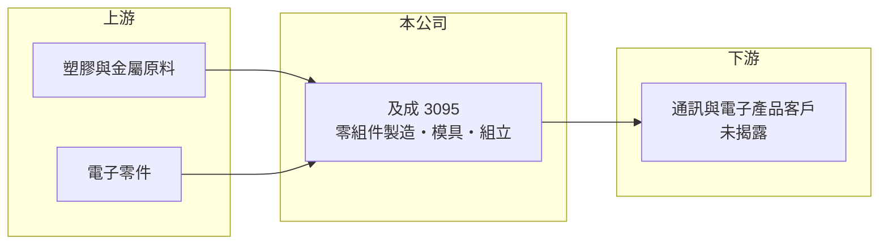

# 3095 及成

> 上櫃｜[[產業索引-通信網路業|通信網路業]]｜上市（櫃）日期 2005/05/26

# 第一章：企業模式與商業藍圖

> [!info] 撰寫說明
> 本文由 Claude 依公開資料整理，架構比照 [[2330台積電]] 的四章研究，資料截至 2026-10-08。財務數字來源：Goodinfo 年度經營績效頁、櫃買中心開放資料（基本資料、2026 年第二季資產負債與損益、本益比殖利率）、nStock 公司資料頁。公開資料有限，產品與客戶結構未查得，產業描述為整理性內容。#待校對

評估一家小型零組件廠，首先要弄清楚它在供應鏈中做的是哪一段、靠什麼賺錢。本章說明及成企業（股票代號：3095，以下簡稱及成）的業務範圍與規模，並坦白指出公開資料不足之處。

## 一、核心定位：老牌通訊與電子零組件製造商

及成於 1973 年經濟部核准設立，是歷史超過五十年的製造業公司，2005 年在櫃買中心掛牌，產業分類為通信網路業。依公開登記的業務範圍，公司從事通訊、光電、照相機、電子、電腦與週邊產品零組件的製造、加工、組立，以及相關模具的設計製造。換句話說，它屬於替電子產品品牌或系統廠供應零件與組裝服務的中游廠商。

這類公司的價值通常來自模具設計與精密加工能力：電子產品的外殼、結構件與小型組件需要依客戶設計開模，開模後的量產訂單會延續整個產品生命週期。不過及成未公開具體產品線、客戶名單與營收比重，本文無法進一步拆解。

## 二、規模與資本結構

及成的實收資本額約 1.62 億元，年營收約 6 億元，是上櫃公司中規模很小的一群。2026 年第二季資產總額約 10.4 億元、負債約 8.4 億元、股東權益約 2.0 億元，[[負債比率]]約八成，財務槓桿明顯高於一般電子零組件廠。Goodinfo 資料顯示公司股本在 2021 年約 10.9 億元，之後降為約 1 億元，推估曾辦理[[減資]]彌補虧損（推估，待校對）。

## 三、長期方向

由於公司未發布法說會或策略說明，長期方向未查得。從營收看，2026 年 1 至 8 月營收累計約 4.65 億元、年增約 17%（nStock 資料），8 月營收為九年來同月新高，顯示近年營運規模有回升。後續應觀察營收成長來自哪一類產品，以及能否持續轉為穩定獲利。

# 第二章：護城河深度與競爭優勢

在長期價值投資中，「護城河」指企業抵禦競爭、維持超額利潤的保護機制。本章依有限的公開資料，評估及成的競爭位置。

## 一、相對優勢

及成的主要資產是長期經營累積的模具設計與零組件製造經驗，以及與既有客戶的合作關係。開模型零件的特性是客戶換供應商需要重新開模與驗證，因此一旦取得專案，通常能維持到產品停產。

## 二、主要競爭對手

電子零組件與機構件代工廠商眾多，包括台灣與中國的大量中小型模具與射出廠。及成未揭露具體產品，因此無法列出直接對手；可以確定的是，這個行業的進入門檻不高，價格競爭激烈。

## 三、守得住／守不住／觀察重點

從財務數字判斷，及成目前沒有明顯的護城河：2021 至 2025 年毛利率在 14% 至 22% 之間，營業利益率多數年度接近零或為負，五年中有四年虧損。守得住的是既有專案的延續性，守不住的是規模經濟與價格。長期觀察重點是 2026 年的獲利改善能否延續，以及高負債比率能否降低。

# 第三章：財務體質與盈利規模

資料日期：2026-10-08，表格是撰寫當時的快照；最新月營收、毛利率、累計 EPS 由自動排程寫在本筆記的屬性欄位（月營收、毛利率、累計EPS 等）。#待校對

財務報表是檢驗護城河是否真實存在的最終標準。本章用五年的三率、ROE 與資本報酬，檢視及成的獲利品質。

## 一、多年度經營績效

| 年度 | 營收（新台幣） | [[毛利率]] | [[營業利益率]] | EPS（元） | [[ROE]] |
|---|---|---|---|---|---|
| 2021 | 4.56 億 | 14.1% | -5.98% | -0.28 | -42.6% |
| 2022 | 4.31 億 | 14.3% | -7.65% | -3.20 | -69.4% |
| 2023 | 4.47 億 | 22.3% | 1.04% | -1.16 | -20.4% |
| 2024 | 5.90 億 | 20.7% | 2.99% | 0.84 | 8.25% |
| 2025 | 6.29 億 | 17.7% | 0.52% | -2.00 | -14.0% |
| 2026 上半年 | 3.60 億 | 21.8% | 6.06% | 1.73 | 未查得 |

營收從 2022 年的 4.3 億元成長到 2025 年的 6.3 億元，營收年複合成長率約 8.4%（2021 至 2025 年，推算），但獲利並未同步改善。2021 至 2025 年平均 ROE 約 -28%（推算），ROE 波動極大，原因是股東權益規模很小，少量虧損就會造成很大的百分比變化。2025 年本業小幅獲利，全年卻每股虧損 2 元，代表業外損失或財務成本拖累。櫃買中心資料顯示近年沒有發放現金股利。2026 年上半年營業利益率回升到 6%，是近五年最好的水準。

## 二、[[ROIC]] 與 [[WACC]]：價值創造利差

**ROIC 推算：** 2025 年營業利益約 0.03 億元（6.29 億 × 0.52%），幾乎為零。2026 年第二季股東權益約 2.0 億元，負債總額約 8.4 億元，假設有息負債約 5 億元（推估），投入資本約 7 億元，2025 年 ROIC 約 0.4%（推算）。若以 2026 年上半年營業利益 0.22 億元年化，稅後約 0.35 億元，ROIC 約 5%（推算）。

**WACC 推算：** 台灣 10 年期公債 1.75%、市場風險溢酬 6%、β 取小型電子零組件常見值 1.0，股東權益成本約 7.8%；負債成本 3%、稅後 2.4%；權益僅占投入資本約 29%，WACC 約 4.0%（推算）。高負債讓 WACC 看起來偏低，但也代表財務風險較高，股東實際要求的報酬應更高。

**結論：** 過去五年及成的 ROIC 大多低於 WACC，沒有創造價值。2026 年上半年若能維持，ROIC 才首次接近或略高於資金成本，但樣本期間太短，需要更多年度驗證。

# 第四章：總體風險與地緣政治

任何企業都無法脫離宏觀環境獨立存在。本章分析及成長期必須面對的風險。

## 一、財務結構風險

負債比率約八成、股東權益僅約 2 億元，是及成最主要的風險。一旦營運轉差，虧損會快速侵蝕淨值，過去推估曾辦理減資就是這種風險的展現。高負債也限制了擴產與研發投資的空間。

## 二、產業與客戶風險

零組件代工的訂單取決於客戶的產品生命週期，客戶產品停產或轉單時，營收可能大幅變動。公司未揭露客戶集中度，投資人難以評估單一客戶依賴的程度。

## 三、資訊揭露風險

及成沒有定期法說會，產品、客戶與策略資訊都很有限。對長期投資人而言，資訊不透明本身就是一種風險，評估時應以年報與財報附註為主要依據。

# 專有名詞解析

## 金融

- **[[負債比率]]**：負債總額除以資產總額，比率越高代表財務槓桿越大，景氣反轉時的償債壓力也越大。
- **[[減資]]**：公司減少股本，可用來彌補累積虧損或把現金退還股東，彌補虧損型減資通常代表過去經營不佳。
- **[[ROIC]]**：投入資本報酬率，稅後營業利益除以股東權益與有息負債的合計，衡量本業對所有資金提供者的報酬。
- **[[WACC]]**：加權平均資金成本，依股東權益與負債的比重加權計算的資金成本，ROIC 高於它才代表創造價值。

# 核心供應鏈

## 1. 上游：原料與零件
- 塑膠、金屬原料與電子零件供應商（未揭露）

## 2. 中游：及成
- 零組件製造、加工、組立與模具設計

## 3. 下游：客戶
- 通訊、光電、相機、電腦週邊產品客戶（公司未揭露具名客戶）

## 最新新聞
<!-- news:start -->
<!-- news:end -->

## 相關連結
- [公開資訊觀測站](https://mopsov.twse.com.tw/mops/web/t05st03?step=1&firstin=1&co_id=3095)
- [Goodinfo](https://goodinfo.tw/tw/StockDetail.asp?STOCK_ID=3095)
- [Yahoo 股市](https://tw.stock.yahoo.com/quote/3095)
- [鉅亨網新聞](https://www.cnyes.com/twstock/3095/news)
