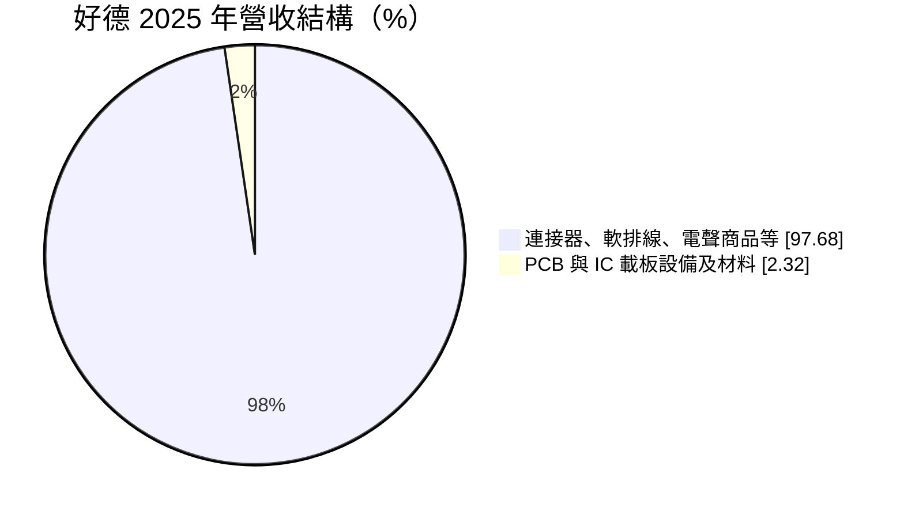
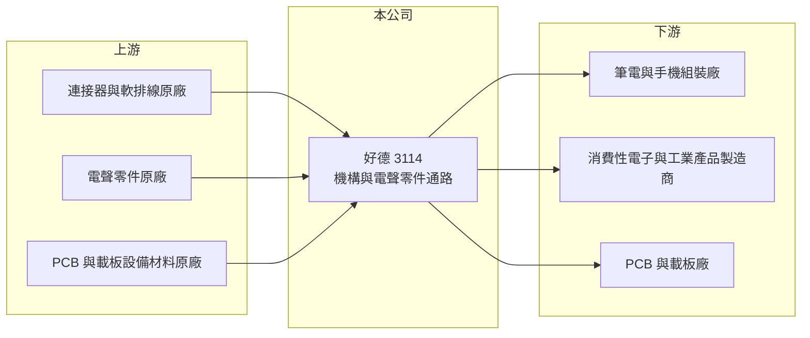

# 3114 好德

> 上櫃｜[[產業索引-電子零組件業|電子零組件業]]｜上市（櫃）日期 2004/03/25

# 第一章：企業模式與商業藍圖

> [!info] 撰寫說明
> 精簡版，由 Claude 依公開資料整理，架構比照 [[2330台積電]]，資料截至 2026-10-08。來源：櫃買中心開放資料快照（基本資料、2026 年第二季資產負債與損益、本益比殖利率）、Goodinfo 經營績效頁、富邦 MoneyDJ 公司基本資料（2025 年營收比重）。代理原廠與客戶未查得。公開資料有限。#待校對

好德科技（以下簡稱好德）是一家專注於機構與電聲零件的[[電子通路]]商，理解它的關鍵在於：它代理的不是晶片，而是[[連接器]]、軟排線與電聲零件這類「每台電子產品都要用、但規格繁多」的零組件。

- **核心業務：** 好德成立於 1978 年，總部在台北，2004 年在櫃買中心掛牌。公司替原廠銷售連接器、[[軟排線]]與電聲零件（如麥克風、揚聲器、蜂鳴器等），客戶是筆電、手機、消費性電子與工業產品的製造商。這類零件單價不高但品項繁多，原廠需要通路商協助處理大量的小額訂單與交貨。
- **營收結構：** 2025 年營收約 97.7% 來自連接器、軟排線與電聲商品，約 2.3% 來自 PCB 與 IC 載板設備及相關材料。主力業務高度集中，設備材料業務比重很小，屬於多角化嘗試。
- **營運據點：** 公司以台灣為總部，客戶的生產基地多在中國與東南亞，通路商需要在當地提供倉儲與交貨服務（海外據點明細未查得，#待校對）。
- **長期方向：** 好德的營收在 2021 年達到 37.2 億元高點後回落，2025 年回到約 30 億元。長期的課題是在消費性電子之外，增加車用、工業與伺服器等應用的比重，因為這些應用的零件規格要求高、產品生命週期長，對通路商的訂單穩定度較有幫助。

# 第二章：護城河深度與競爭優勢

好德的護城河來自代理權與客戶的[[設計導入]]，屬於窄護城河的通路模式。

- **競爭優勢：** 連接器與軟排線需要依產品機構設計選型，客戶在開發階段選定料號後，量產期間通常不會更換，通路商若能在設計階段就參與，就能取得整個產品週期的訂單。好德經營四十多年，累積了穩定的原廠與客戶關係。毛利率約 10%，高於 IC 通路商，反映零件選型服務的價值。
- **主要對手：** 連接器原廠如 [[3533嘉澤]]、[[6126信音]]、[[3605宏致]] 等台系廠商通常自設業務直接銷售，國際原廠也有自己的通路體系；綜合型通路商 [[3702大聯大]]、[[3036文曄]] 也代理部分被動與機構件。好德的規模較小，議價力有限。
- **觀察重點：** 長期最該觀察[[毛利率]]能否維持在 10% 左右，以及非消費性應用的占比。營業利益率由 2022 年的 4.04% 降到 2024 年的 2.67%，代表費用效率與產品組合仍有改善空間。

# 第三章：財務體質與盈利規模

資料日期：2026-10-08，表格是撰寫當時的快照；最新月營收、毛利率、累計 EPS 由自動排程寫在本筆記的屬性欄位（月營收、毛利率、累計EPS 等）。#待校對

好德的財務屬於小型通路商的典型樣貌：營收約 30 億元、毛利率約 10%、營業利益率 3% 上下，負債比不高，持續配息。

| 年度 | 營收（億元） | [[毛利率]] | [[營業利益率]] | EPS（元） | [[ROE]] |
|---|---|---|---|---|---|
| 2021 | 37.2 | 10.2% | 4.56% | 2.42 | 12.3% |
| 2022 | 32.4 | 10.9% | 4.04% | 3.33 | 15.6% |
| 2023 | 27.4 | 10.5% | 3.64% | 1.55 | 6.70% |
| 2024 | 27.6 | 9.81% | 2.67% | 1.80 | 7.41% |
| 2025 | 30.1 | 9.60% | 3.04% | 2.22 | 9.05% |

（來源：Goodinfo 經營績效頁；2020 年營收 31.9 億元、EPS 1.76 元。）

- **營收規模：** 2020 至 2025 年營收年複合成長率約 -1.2%（推算），基本上是持平。2026 年上半年營收約 15.6 億元，毛利率約 10.5%、營業利益率約 3.65%，EPS 1.02 元。營收規模跟著消費性電子景氣起伏，缺乏長期成長動能。
- **獲利：** 2021 至 2025 年平均 ROE 約 10.2%（推算）。2022 年 EPS 3.33 元高於營業利益可解釋的水準，推估含業外收益。低毛利模式下，毛利率每變動 1 個百分點，營業利益可能變動三成左右。
- **財務特色：** 2026 年第二季總資產約 27.0 億元、負債約 10.5 億元、權益約 16.4 億元，負債比約 39%，每股淨值約 25.5 元。最近一期每股現金股利 1.4 元，以 2025 年 EPS 2.22 元計，配息率約 63%（推算）；Goodinfo 統計歷年平均現金股利約 0.94 元，配息持續但金額隨獲利調整。
- **[[ROIC]] 與 [[WACC]]：** 以 2025 年營業利益約 0.92 億元（30.1 億元 × 3.04%）、稅率 20% 計算，稅後營業利益約 0.73 億元。有息負債未查得，投入資本以權益約 16.4 億元到「權益加全部負債」約 27.0 億元為區間，ROIC 約 2.7% 至 4.5%（推算）。WACC 以 [[CAPM]] 推估：無風險利率 1.75%、市場風險溢酬 6%、β 假設 0.8，權益成本約 6.6%；負債占兩成、稅後成本 2%，WACC 約 5.6%（推算）。本業 ROIC 略低於 WACC，ROE 能接近一成部分仰賴業外收益；只有在 2021、2022 年景氣高點時，本業才明顯創造價值。

# 第四章：總體風險與地緣政治

好德的風險主要來自消費性電子景氣、原廠關係與規模限制。

- **產業週期：** 主力客戶集中在筆電、手機與消費性電子，這些產品的需求起伏會透過[[長鞭效應]]放大到零件通路。2023 年營收由 32.4 億元降到 27.4 億元，就是庫存調整期的結果。
- **營運風險：** 代理權若被原廠收回或轉給大型通路商，營收會立即受影響。小型通路商在缺料期間的配貨優先順序也較低，可能錯失景氣高點的訂單。
- **其他風險：** 客戶生產基地多在中國與東南亞，關稅與供應鏈移轉會改變出貨地點與物流成本。進貨多以外幣計價，匯率影響毛利。

# 專有名詞解析

## 金融

- **[[長鞭效應]]**：終端需求的小幅變動，沿供應鏈往上游傳遞時被逐級放大，造成上游庫存與訂單劇烈波動。

## 產業

- **[[電子通路]]**：替上游原廠銷售零組件並提供備貨、技術支援與帳期的中間商，毛利率低、靠周轉賺錢。
- **[[連接器]]**：讓電子零件、模組或設備之間可插拔連接的元件，負責傳遞電力或訊號。
- **[[軟排線]]**：扁平、可彎折的排線，用於筆電、手機等產品內部連接主機板與模組，節省空間。
- **[[設計導入]]**：零件被客戶選入產品設計並完成驗證，之後該產品量產期間都會持續採購，是零組件廠長期營收的來源。

# 核心供應鏈

- 上游：連接器、軟排線、電聲零件原廠，以及 PCB 與 IC 載板設備材料原廠（代理名單未查得）。#待校對
- 下游／客戶：筆電與手機組裝廠（如 [[2382廣達]]、[[2317鴻海]] 等產業代表）、消費性電子與工業產品製造商、PCB 與載板廠。非公司揭露客戶。#待校對
- 同業：[[3702大聯大]]、[[3036文曄]]（綜合型通路）；連接器原廠 [[3533嘉澤]]、[[6126信音]]、[[3605宏致]]。

## 最新新聞
<!-- news:start -->
<!-- news:end -->

## 相關連結
- [公開資訊觀測站](https://mopsov.twse.com.tw/mops/web/t05st03?step=1&firstin=1&co_id=3114)
- [Goodinfo](https://goodinfo.tw/tw/StockDetail.asp?STOCK_ID=3114)
- [Yahoo 股市](https://tw.stock.yahoo.com/quote/3114)
- [鉅亨網新聞](https://www.cnyes.com/twstock/3114/news)
