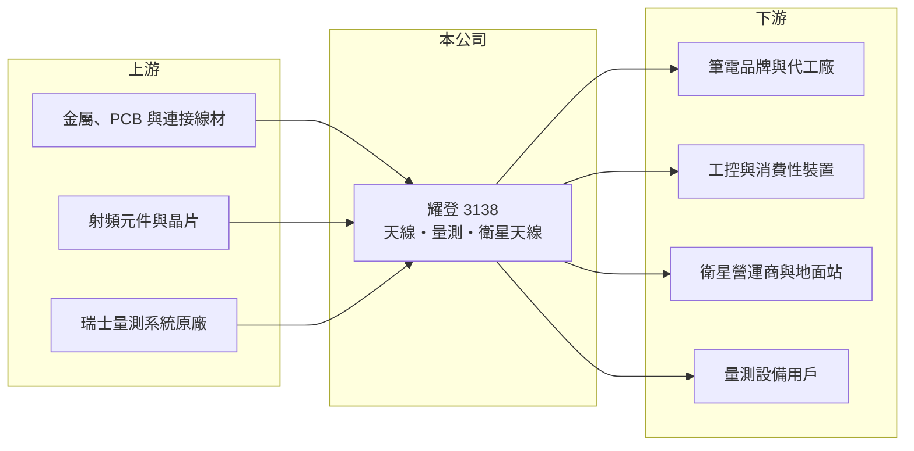

# 3138 耀登

> 上市｜[[產業索引-通信網路業|通信網路業]]｜上市（櫃）日期 2020/12/11

# 第一章：企業模式與商業藍圖

> [!info] 撰寫說明
> 本文由 Claude 依公開資料整理，架構比照 [[2330台積電]] 的四章研究，資料截至 2026-10-08。財務數字來源：Goodinfo 年度經營績效頁、證交所開放資料（基本資料、2026 年第二季資產負債與損益、營益分析、股利）、富果研究 2026 年 3 月法說會整理；產業描述為整理性內容，尚未逐條比對原始文件。#待校對

評估一家天線廠的長期價值，要看它能否從單純的零件供應商，走向需要系統整合能力的高頻產品。本章說明耀登科技（股票代號：3138，以下簡稱耀登）的三大事業與它在筆電、衛星市場的定位。

## 一、核心定位：天線設計製造加上量測服務

耀登成立於 1990 年，總部在桃園八德，2020 年轉為上市，實收資本額約 5.6 億元。公司的核心是無線通訊天線：筆電、工控設備與消費性電子產品內部都需要天線來收發 Wi-Fi、行動通訊與定位訊號，而天線的效能會受到機殼材質、空間與周邊元件干擾，需要依每款產品客製設計與調校。耀登的價值就在於這種「設計加量測加製造」的一條龍能力。

公司的第二個事業是量測設備，獨家代理瑞士電磁波量測系統在台灣與中國的銷售；第三個是資安測試認證與永續顧問，目前占比較小。量測事業讓耀登在客戶產品開發初期就能接觸設計需求，有助於天線本業的接單。

## 二、產品結構

公司未公布精確的營收比重，依法說會描述：

* **射頻天線：** 最大的事業，包括筆電、工控與消費性裝置的被動天線，以及[[毫米波]]主動式陣列天線模組。主要客戶為美國筆電品牌，2026 年新切入全球前兩大筆電品牌的供應鏈（未具名），是公司預期金額成長最大的業務。
* **量測設備：** 疫情期間設備採購潮之後已恢復穩定，2026 年預期與前一年持平。
* **[[低軌衛星]]相關：** 包括衛星地面終端天線與地面站專案，例如國家太空中心的 Ka 頻段地面站專案。公司估計 2026 年衛星相關營收占比有機會達 3% 至 5%，仍處於小量接單與驗證階段。

## 三、長期方向：雙引擎與三地製造

耀登把長期策略定為「射頻天線加低軌衛星」雙成長引擎，技術上從射頻元件延伸到系統級解決方案，並加入 GSMA 參與衛星直連手機（[[NTN]]）的標準化。製造布局採台灣、中國崑山、越南三地，越南北部新廠正在興建，竹北則投資高頻模組製程；這些投資回應了品牌客戶「中國以外產能」的要求。

# 第二章：護城河深度與競爭優勢

在長期價值投資中，「護城河」指企業抵禦競爭、維持超額利潤的保護機制。本章分析耀登的天線事業能守住多少利潤。

## 一、耀登護城河的組成

* **設計與量測的整合：** 天線需要在客戶的機殼內實測與調校，耀登同時擁有量測設備代理與實驗室能力，能縮短客戶開發時間。這讓它在設計階段就被綁入專案，量產訂單隨之而來。
* **高毛利的產品組合：** 2021 至 2025 年毛利率穩定在 40% 至 44%，在硬體零件廠中屬於偏高的水準，顯示客製化設計具有一定的定價能力。
* **多地生產：** 台灣、中國、越南三地製造，符合品牌客戶分散產地的需求。

## 二、主要競爭對手

| 對手 | 定位 | 對耀登的威脅 |
|---|---|---|
| [[6285啟碁]] | 網通、車用與衛星天線及模組 | 規模大，在衛星終端與車用領域領先 |
| 筆電天線同業（台灣與中國天線廠） | 筆電與消費性天線 | 以價格爭取筆電品牌訂單 |
| 國際量測與天線廠 | 量測系統與高階天線 | 在衛星與國防市場技術領先 |

## 三、守得住／守不住／觀察重點

守得住的是毛利率，客製化設計讓耀登的毛利率長年維持在 40% 以上。守不住的是營業利益率：2021 年營業利益率 10.8%，2025 年降到 4.33%，2026 年上半年只有 0.8%，代表研發、新廠與擴張費用吃掉了大部分毛利。長期觀察重點是新筆電品牌客戶能否帶來規模、越南新廠投產後的效率，以及衛星業務能否從專案走向量產。

# 第三章：財務體質與盈利規模

資料日期：2026-10-08，表格是撰寫當時的快照；最新月營收、毛利率、累計 EPS 由自動排程寫在本筆記的屬性欄位（月營收、毛利率、累計EPS 等）。#待校對

財務報表是檢驗護城河是否真實存在的最終標準。本章用五年的三率、ROE 與資本報酬，檢視耀登的獲利品質。

## 一、多年度經營績效

| 年度 | 營收（新台幣） | [[毛利率]] | [[營業利益率]] | EPS（元） | [[ROE]] |
|---|---|---|---|---|---|
| 2021 | 14.3 億 | 42.2% | 10.8% | 5.96 | 22.5% |
| 2022 | 17.2 億 | 40.4% | 5.58% | 6.89 | 21.7% |
| 2023 | 17.8 億 | 43.7% | 12.8% | 4.42 | 12.6% |
| 2024 | 17.1 億 | 40.8% | 5.08% | 3.05 | 7.84% |
| 2025 | 17.4 億 | 40.7% | 4.33% | 1.50 | 3.54% |
| 2026 上半年 | 8.45 億 | 43.4% | 0.80% | 0.41 | 未查得 |

耀登的營收在 2022 年以後停在 17 億元左右，毛利率穩定，但營業利益率與 ROE 逐年下滑。2021 至 2025 年平均 ROE 約 13.6%（推算），營收年複合成長率約 5.0%（推算），近三年 ROE 的下降趨勢比平均值更值得注意。2025 年管理層表示匯率因素侵蝕 EPS 近 1 元。2025 年度現金股利每股 1.67 元，總額約 0.84 億元，高於當年淨利 0.74 億元，配息率超過 100%（推算），代表公司動用保留盈餘維持配息。2025 年底帳上現金約 13 億元。

## 二、[[ROIC]] 與 [[WACC]]：價值創造利差

**ROIC 推算：** 2025 年營業利益約 0.75 億元（17.4 億 × 4.33%），稅後約 0.6 億元。2026 年第二季股東權益約 26.4 億元，負債總額約 17 億元，假設有息負債約 8 億元（推估），投入資本約 34 億元，ROIC 約 1.8%（推算）。若扣除約 13 億元現金，營運投入資本約 21 億元，ROIC 約 2.9%（推算）。

**WACC 推算：** 台灣 10 年期公債 1.75%、市場風險溢酬 6%、β 取電子零組件同業常見值 1.2，股東權益成本約 9.0%；負債成本 2.5%、稅後 2.0%；權益占投入資本約 77%，WACC 約 7.4%（推算）。

**結論：** 耀登在 2021 至 2023 年 ROIC 明顯高於 WACC（推估），近兩年則降到 WACC 之下，代表擴張期的投資尚未帶來相應的獲利。越南新廠、新客戶與衛星業務能否把營業利益率拉回 10% 上下，決定它能否重新創造價值。

# 第四章：總體風險與地緣政治

任何企業都無法脫離宏觀環境獨立存在。本章分析耀登長期必須面對的風險。

## 一、終端市場與客戶集中

射頻天線事業高度依賴筆電市場，筆電出貨在疫情後經歷大幅修正，未來也會隨換機週期起伏。主要客戶集中在少數美系筆電品牌，品牌的天線設計策略或供應商名單改變，都會直接影響耀登的營收。

## 二、擴張與費用風險

八德新總部、越南新廠與竹北高頻模組製程同時投資，短期會推升折舊與營業費用。如果新客戶與新產品的營收放量慢於預期，營業利益率可能持續偏低。衛星業務目前以專案為主，量產時程有不確定性。

## 三、匯率與地緣政治

營收以美元計價為主，2025 年匯率已明顯影響獲利。中國崑山仍是重要生產基地，美中貿易限制升溫時，產能需要更快移往越南，移轉期間的成本與良率是風險。

# 專有名詞解析

## 應用

- **[[低軌衛星]]**：運行在約 500 至 2,000 公里高度的通訊衛星群，延遲較低，需大量地面接收設備，代表業者為 Starlink。
- **[[毫米波]]**：30 至 300 GHz 的高頻段電磁波，頻寬大但傳輸距離短，需用陣列天線集中訊號，用於 5G 與衛星通訊。
- **[[NTN]]**：非地面網路，讓手機或終端直接透過衛星或高空平台連線，是 5G 與 6G 標準納入衛星通訊的架構。

## 金融

- **[[ROIC]]**：投入資本報酬率，稅後營業利益除以股東權益與有息負債的合計，衡量本業對所有資金提供者的報酬。
- **[[WACC]]**：加權平均資金成本，依股東權益與負債的比重加權計算的資金成本，ROIC 高於它才代表創造價值。

# 核心供應鏈

## 1. 上游：材料、元件與代理原廠
- 金屬、PCB、線材與射頻元件供應商
- 瑞士電磁波量測系統原廠（獨家代理）

## 2. 中游：耀登與同業
- 同業：[[6285啟碁]]（天線與衛星終端）；射頻元件相關：[[3152璟德]]

## 3. 下游：客戶
- 美系筆電品牌與全球前兩大筆電品牌（未具名），筆電代工廠如 [[2382廣達]]、[[2324仁寶]]（推估，未經公司證實）
- 國家太空中心等衛星地面站專案

## 最新新聞
<!-- news:start -->
<!-- news:end -->

## 相關連結
- [公開資訊觀測站](https://mopsov.twse.com.tw/mops/web/t05st03?step=1&firstin=1&co_id=3138)
- [Goodinfo](https://goodinfo.tw/tw/StockDetail.asp?STOCK_ID=3138)
- [Yahoo 股市](https://tw.stock.yahoo.com/quote/3138)
- [鉅亨網新聞](https://www.cnyes.com/twstock/3138/news)
