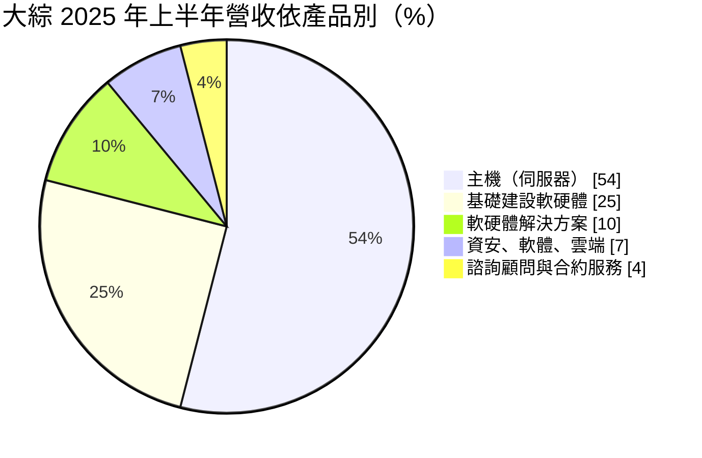
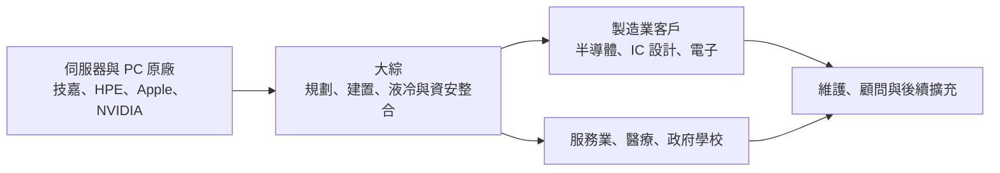
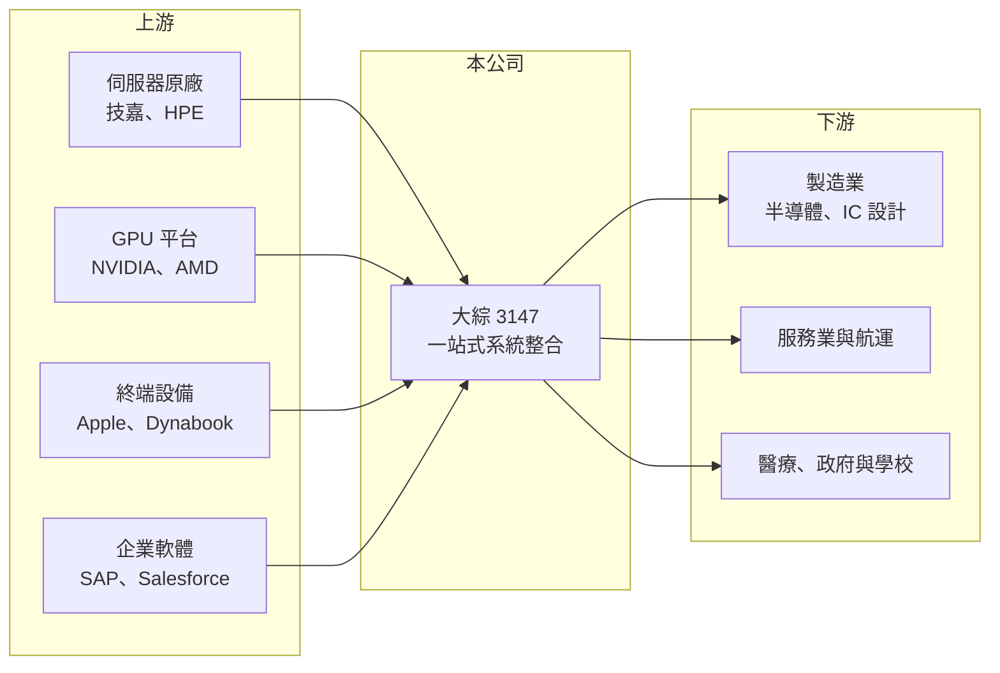

# 3147 大綜

> 上櫃｜[[產業索引-資訊服務業|資訊服務業]]｜上市（櫃）日期 2018/05/29

# 第一章：企業模式與商業藍圖

> [!info] 撰寫說明
> 精簡版，由 Claude 依公開資料整理，架構比照 [[2330台積電]] 的四章研究，資料截至 2026-10-08。來源：富果研究 2025 年 8 月法說會備忘錄（2025 年上半年產品別營收、客戶產業分布、合作品牌、海外據點）、Goodinfo 年度經營績效頁、櫃買中心開放資料（基本資料、2026 年第二季資產負債與綜合損益、每月營收、本益比殖利率）。#待校對

大綜電腦是以製造業為主要客戶的系統整合商，本章說明它從終端電腦到資料中心的一站式服務模式，以及 AI 伺服器需求如何讓營收在 2024 年後快速放大。

## 一、核心定位：製造業的一站式 IT 整合商

- **核心業務：** 大綜提供從終端設備（PC、筆電）到資料中心基礎建設（伺服器、儲存、網路）的一站式[[系統整合]]服務，並涵蓋資安、雲端、AI 應用與 ERP、CRM 顧問導入（富果研究）。四大強項為新世代資料中心（含[[液冷]]方案）、結合獨立軟體商的 AI 應用方案、Apple 設備自動化部署與資安整合，以及 SAP、Salesforce 等企業軟體顧問。
- **公司背景：** 大綜成立於 1991 年、2018 年上櫃，董事長兼總經理為李志忠，實收資本額約 4.37 億元（櫃買中心開放資料）。技術工程師占人員結構約 60%（富果研究），代表公司以技術服務能力為核心，而不只是硬體轉售。
- **營收結構：** 2025 年上半年依產品別如下（富果研究）：

- **客戶產業分布：** 製造業約 65%、服務業約 20%、醫療產業約 10%、政府與學校約 5%（富果研究，未標示年份）。成長動能主要來自半導體、IC 設計與航運業大型客戶的 [[AI伺服器]]採購，2025 年上半年前五大合作品牌為技嘉、HPE、Apple、NVIDIA 與 Dynabook（富果研究）。

## 二、資本轉化邏輯：龐大客戶基礎帶動大型專案

大綜累積的客戶超過 2 萬家，每年固定成交約 2,000 多家（富果研究）。這個龐大的客戶基礎讓它能在 AI 伺服器需求出現時，迅速把既有的製造業客戶轉為大型專案。法說會也提到已取得某大客戶未來兩年的伺服器與儲存設備合約（富果研究），顯示大型客戶的訂單有一定延續性。

## 三、長期藍圖

公司跟隨客戶的海外據點，已在美國、日本、德國、越南、馬來西亞設點（富果研究），服務台灣製造業的海外工廠。此外，公司投入 NVIDIA CUDA 與 AMD ROCm 平台、在新竹設立液冷實驗室，並推廣針對用電大戶的表後儲能方案（富果研究），嘗試把服務從 IT 延伸到能源管理。

# 第二章：護城河深度與競爭優勢

本章分析大綜的競爭優勢，以及硬體比重高的整合商模式有哪些限制。

## 一、競爭優勢

- **製造業的客戶基礎：** 2 萬多家客戶、製造業占六成五，讓大綜熟悉工廠的 IT 環境與採購流程。當客戶需要 AI 伺服器或新資料中心時，既有關係與實績讓它容易取得議約機會。
- **液冷與高密度機房能力：** AI 伺服器耗電與發熱量遠高於傳統伺服器，資料中心需要重新設計散熱與供電。大綜設有液冷實驗室，能協助客戶規劃高密度機房，這是一般 PC 經銷商不具備的能力。
- **跟隨客戶出海：** 台灣製造業在美國、日本、德國與東南亞設廠，需要熟悉台灣作業習慣的 IT 夥伴。大綜跟隨設點，有機會把海外工廠的 IT 需求一併承接。

## 二、主要對手

| 對手 | 定位 | 與大綜的比較 |
|---|---|---|
| [[2480敦陽科]] | 高科技製造業系統整合 | 客戶群高度重疊，敦陽科服務比重較高 |
| [[6214精誠]] | 大型資訊服務集團 | 企業系統整合的全面對手 |
| 6112邁達特 | 系統整合與 IT 服務 | 企業基礎架構與 PC 案件競爭 |
| [[3029零壹]] | IT 解決方案代理商 | 上游代理商，也在部分方案上競爭 |
| 伺服器品牌直營團隊 | 大客戶直接銷售 | 超大型 AI 專案可能由原廠直接承接 |

## 三、觀察重點

- **AI 伺服器需求的持續性：** 2026 年上半年營收已超過 2025 年全年，成長高度依賴少數大型客戶的 AI 伺服器採購，需求高峰過後營收可能大幅回落。
- **毛利率：** 伺服器轉售毛利率較低，2025 年毛利率降到 12.6%，若顧問、資安與維護比重沒有同步提升，利潤率會持續被稀釋。
- **海外接單成效：** 美國、日本、馬來西亞等據點能否穩定接單，是降低台灣客戶集中風險的關鍵。

# 第三章：財務體質與盈利規模

資料日期：2026-10-08，表格是撰寫當時的快照；最新月營收、毛利率、累計 EPS 由自動排程寫在本筆記的屬性欄位（月營收、毛利率、累計EPS 等）。#待校對

本章用多年度數據檢視大綜在 AI 伺服器浪潮下的規模擴張與資本報酬。

## 一、多年度三率與 ROE

| 年度 | 營收（新台幣） | [[毛利率]] | [[營業利益率]] | EPS（元） | [[ROE]] |
|---|---|---|---|---|---|
| 2020 | 25.8 億 | 16.7% | 4.92% | 3.35 | 16.6% |
| 2021 | 46.6 億 | 12.6% | 5.26% | 4.94 | 20.1% |
| 2022 | 34.7 億 | 17.0% | 7.57% | 6.88 | 24.3% |
| 2023 | 39.9 億 | 17.7% | 8.25% | 7.38 | 23.6% |
| 2024 | 49.7 億 | 15.6% | 7.06% | 11.94 | 32.9% |
| 2025 | 81.7 億 | 12.6% | 6.06% | 8.43 | 22.5% |
| 2026 上半年 | 88.6 億 | 11.96% | 7.06% | 11.26 | 未查得 |

註：2020 至 2025 年取自 Goodinfo；2026 上半年取自櫃買中心綜合損益。2024 年 EPS 明顯高於營業利益推算值，推估含業外收益或股本變動影響（推估，待校對）。

- **營收成長：** 2020 至 2025 年營收年複合成長率約 25.9%（推算），2026 年 1 至 8 月累計營收約 119.6 億元、年增約 112%（櫃買中心每月營收）。營收波動大，2021 年與 2025 年後的跳升都與大型專案有關。
- **利潤率：** 營收放大時毛利率下降，營業利益率維持在 6% 至 8%，代表費用控制良好，但產品組合偏向低毛利硬體。
- **ROE：** 2021 至 2025 年平均 ROE 約 24.7%（推算），在資訊服務業屬於高水準。

## 二、股利與財務結構

最近一次現金股利為 6.5 元（櫃買中心本益比殖利率資料），以 2025 年 EPS 8.43 元計算配發率約 77%（推算）。2026 年第二季底權益約 19.4 億元、總負債約 65.9 億元，其中流動負債約 65.6 億元、非流動負債僅約 0.27 億元；流動資產約 78.6 億元（櫃買中心資產負債）。負債大幅增加推估來自大型專案的預收款與應付帳款（推估），屬於營運性負債，但也代表公司的營運資金高度依賴少數大案的收付款節奏。

## 三、[[ROIC]] 與 [[WACC]]

**ROIC 推算：** 2025 年營業利益約 81.7 億元 × 6.06% ≈ 4.95 億元，扣除 20% 稅後約 3.96 億元。投入資本以 2026 年第二季權益 19.4 億元加上非流動負債 0.27 億元計算，約 19.6 億元，ROIC 約 20.2%（推算）；有息負債未查得，若流動負債中含短期借款，ROIC 會略低。

**WACC 推算：** 公債殖利率 1.75%、市場風險溢酬 6%、β 取中小型資服股常見值 0.9，權益成本約 7.15%；有息負債推估不高，WACC 約 7.0%（推算）。

**結論：** ROIC 約 20%，遠高於約 7% 的 WACC，代表大綜目前大幅創造價值。不過這段高報酬建立在 AI 伺服器的高峰需求上，長期利差能否維持，取決於需求退潮後的服務收入能否撐住獲利。

# 第四章：總體風險與地緣政治

本章整理大綜長期面對的產業、營運與其他風險。

## 一、產業週期

- **AI 投資週期：** 企業的 AI 伺服器採購具有明顯的集中性，一旦大型客戶完成建置，次年的採購量可能大幅下降，營收波動會比一般系統整合商更劇烈。
- **製造業景氣：** 客戶以製造業為主，半導體與電子業的資本支出週期會直接影響 IT 投資。

## 二、營運風險

- **客戶集中：** 成長來自少數半導體、IC 設計與航運大客戶，單一客戶延後採購就可能讓營收明顯下滑。
- **低毛利與營運資金：** 伺服器單價高、毛利低，大型專案需要先備貨，若客戶付款延遲，會增加資金壓力與呆帳風險。
- **新事業：** 表後儲能等新業務的規模仍小，需要時間驗證是否能成為穩定收入。

## 三、其他風險

- **供貨與出口管制：** GPU 伺服器受原廠供貨與美國出口管制影響，交期與可銷售地區可能受限。
- **匯率與海外營運：** 美國、日本、德國等海外據點面臨匯率波動、當地人才取得與法規差異。

# 專有名詞解析

## 應用

- **[[系統整合]]**：替客戶規劃並整合軟硬體、網路與應用系統，讓不同設備與軟體能一起運作的資訊服務。
- **[[AI伺服器]]**：搭載 GPU 等加速晶片、專門用來訓練或執行 AI 模型的伺服器，單價與耗電都遠高於一般伺服器。

## 金融

- **[[ROIC]]**：投入資本報酬率，衡量企業用股東與債權人投入的資本，每年能產生多少稅後營業利益。
- **[[WACC]]**：加權平均資金成本，股東要求報酬與負債利息依資本結構加權後的平均值，是判斷是否創造價值的門檻。

## 產業

- **[[液冷]]**：以液體帶走晶片或機櫃熱量的散熱方式，散熱效率高於傳統風扇，適合高功耗的 AI 伺服器。

# 核心供應鏈

- 上游：[[2376技嘉]]、HPE、[[NVDA輝達]]、[[AMD超微]]、[[AAPL蘋果]]、Dynabook，以及 SAP、Salesforce 等企業軟體。
- 下游／客戶：半導體、IC 設計、電子與航運等製造及服務業大型客戶，醫療院所、政府與學校。
- 同業：[[2480敦陽科]]、[[6214精誠]]、6112邁達特、[[3029零壹]]。

## 最新新聞
<!-- news:start（自動產生，請勿手動編輯此範圍） -->
- 2026-10-13 🏛️ 重訊 15:23｜更正115年8月背書保證資訊揭露明細表｜[觀測站](https://mops.twse.com.tw/mops/#/web/t05st01)
- 2026-10-12 📰 媒體 18:50｜營收速報 - 大綜(3147)9月營收17.75億元年增率高達287.94％｜[鉅亨網](https://news.cnyes.com/news/id/6628382)
- 2026-10-06 🏛️ 重訊 14:06｜公告本公司董事會決議通過發行國內第一次無擔保轉換公司債｜[觀測站](https://mops.twse.com.tw/mops/#/web/t05st01)

完整紀錄：[[3147大綜 新聞]]
<!-- news:end -->

## 相關連結
- [公開資訊觀測站](https://mopsov.twse.com.tw/mops/web/t05st03?step=1&firstin=1&co_id=3147)
- [Goodinfo](https://goodinfo.tw/tw/StockDetail.asp?STOCK_ID=3147)
- [Yahoo 股市](https://tw.stock.yahoo.com/quote/3147)
- [鉅亨網新聞](https://www.cnyes.com/twstock/3147/news)
