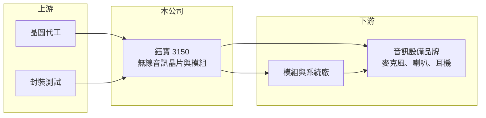

# 3150 鈺寶-創

> 創新板｜[[產業索引-半導體業|半導體業]]｜上市（櫃）日期 2024/06/27

# 第一章：企業模式與商業藍圖

> [!info] 撰寫說明
> 精簡版，由 Claude 依公開資料整理，架構比照 [[2330台積電]] 的四章研究，資料截至 2026-10-08。來源：Goodinfo 年度經營績效頁、nStock 公司簡介、證交所開放資料（基本資料、2026 年第二季資產負債與綜合損益、營益分析、股利、每月營收）。創新板／新掛牌，公開資料有限；產品別、應用別與客戶資料未查得，產品應用描述多為推估。#待校對

鈺寶科技是一家規模很小的無線音訊晶片設計公司，本章說明它的業務定位與長期方向。

## 一、核心定位：無線音訊控制晶片與模組

鈺寶成立於 1998 年，原名凌源通訊，2003 年更名為鈺寶，2024 年 6 月在證交所[[創新板]]掛牌，總部位於新竹市，實收資本額約 4.4 億元（nStock、證交所開放資料）。公司主要業務是無線音訊控制晶片及模組的研發設計、製造與銷售。

* **IC 設計（[[Fabless]]）公司的角色：** 鈺寶自己設計晶片，把製造交給晶圓代工與封測廠，再把晶片或加上周邊零件做成模組賣給終端產品廠。這種模式不需要自建晶圓廠，但必須持續投入研發才能跟上規格演進。
* **晶片加模組的雙軌銷售：** 只賣晶片的毛利較高但客戶需自行設計電路；賣模組則能服務設計能力較弱的中小品牌，讓產品更快上市。公司同時做兩者，可以涵蓋不同規模的客戶。

## 二、應用市場

[[無線音訊]]的應用包括無線麥克風、無線喇叭、耳機與各類影音設備（推估，具體應用與比重未查得）。這類市場的特性是產品種類多、單一機種量不大，對晶片的低延遲、抗干擾與成本要求高。公司毛利率長期維持在 40% 以上（Goodinfo），代表產品具有一定技術門檻，不是純粹拚價格的通用晶片。

## 三、營運規模與長期方向

公司年營收長期在 2 億至 4 億元之間，2025 年為 3.02 億元（Goodinfo），在 IC 設計業屬於非常小的規模。2026 年 1 至 8 月累計營收約 2.28 億元，與去年同期約 2.28 億元持平（證交所每月營收）。小規模的好處是能專注利基市場，壞處是研發資源有限，若市場轉向藍牙等大廠主導的規格，公司要面對規模懸殊的競爭。

# 第二章：護城河深度與競爭優勢

無線音訊晶片市場由大廠主導，本章分析鈺寶能在哪些位置生存，以及面臨的競爭壓力。

## 一、護城河的核心組成要素

* **專注利基規格：** 公司深耕無線音訊近三十年，對特定頻段、低延遲傳輸與音質調校累積經驗，適合大廠不願投入的小量多樣市場（推估）。
* **晶片加模組的整套方案：** 提供模組可以降低客戶開發門檻，客戶一旦導入，換供應商需要重新設計與驗證，形成一定的轉換成本。
* **毛利率穩定：** 毛利率長年在 42% 至 49%（Goodinfo），即使營收波動也沒有大幅崩落，顯示定價能力尚可。

## 二、主要競爭對手

| 對手 | 定位 | 對鈺寶的威脅 |
|---|---|---|
| [[2379瑞昱]] | 藍牙與音訊晶片大廠 | 規模與產品線遠大於鈺寶 |
| [[6526達發]] | 藍牙音訊 SoC | 在耳機與無線音訊市場直接競爭 |
| [[4952凌通]]、[[5471松翰]] | 消費性 MCU 與音訊晶片 | 在低價消費性產品競爭 |
| 中國音訊晶片廠（如炬芯、恆玄） | 低價藍牙音訊 SoC | 以價格搶中國品牌客戶 |

## 三、守得住與守不住

* **守得住：** 需要專屬無線協定、低延遲的專業或半專業音訊設備。
* **守不住：** 規模經濟。營業利益率在 -12.5% 至 16.3% 之間大幅擺盪（Goodinfo），營收只要下滑兩成，研發費用就會讓公司轉為虧損。
* **觀察重點：** 營收能否穩定站上 4 億元，讓營業利益率維持正數。

# 第三章：財務體質與盈利規模

資料日期：2026-10-08，表格是撰寫當時的快照；最新月營收、毛利率、累計 EPS 由自動排程寫在本筆記的屬性欄位（月營收、毛利率、累計EPS 等）。#待校對

本章用多年度數據檢視鈺寶「毛利率穩定、獲利隨營收擺盪」的特性。

## 一、多年度三率與 ROE

| 年度 | 營收（新台幣） | [[毛利率]] | [[營業利益率]] | EPS（元） | [[ROE]] |
|---|---|---|---|---|---|
| 2021 | 4.26 億 | 44.9% | 16.3% | 2.33 | 20.6% |
| 2022 | 3.88 億 | 48.8% | 13.3% | 2.15 | 16.8% |
| 2023 | 2.19 億 | 47.0% | -12.5% | -0.70 | -4.43% |
| 2024 | 3.45 億 | 47.6% | 5.57% | 0.72 | 4.70% |
| 2025 | 3.02 億 | 44.6% | -5.53% | -0.22 | -1.52% |
| 2026 上半年 | 1.70 億 | 44.80% | -1.67% | 0.03 | 未查得 |

註：2021 至 2025 年取自 Goodinfo；2026 上半年取自證交所營益分析與綜合損益。Goodinfo 另有 2012 至 2020 年資料，營收多在 2 億至 3.6 億元之間，虧損年度不少。

* **營收停滯：** 2021 至 2025 年營收年複合成長率約 -8.2%（推算），長期看並未擴大規模。
* **獲利高度槓桿：** 毛利率幾乎不變，但營業利益率隨營收大幅波動，因為研發與管理費用相對固定。2021 至 2025 年平均 ROE 約 7.2%（推算），波動很大。

## 二、股利與財務結構

2025 年雖然虧損，仍配發每股 0.50 元，其中 0.45 元來自資本公積、0.05 元來自盈餘（證交所股利資料），屬於動用過去累積資金的配發。2026 年第二季底總資產約 6.9 億元、總負債約 0.97 億元、權益約 5.9 億元，每股淨值 13.30 元（證交所資產負債），財務結構保守、幾乎沒有負債壓力。

## 三、[[ROIC]] 與 [[WACC]]

**ROIC 推算：** 2025 年營業利益約 3.02 億 × -5.53% ≈ -0.17 億元（虧損不計稅）。假設總負債 0.97 億元的一半約 0.48 億元為有息負債（實際可能更低），加上權益 5.9 億元，投入資本約 6.4 億元，ROIC 約 -2.6%（推算）。2021 年營業利益約 0.69 億元時，以目前投入資本計算 ROIC 約 9%（推算）。

**WACC 推算：** 台灣 10 年期公債 1.75%、市場風險溢酬 6%、β 取小型 IC 設計常見值 1.0，權益成本約 7.75%；幾乎沒有負債，權益占比約 92%，WACC 約 7.3%（推算）。

**結論：** 2025 年 ROIC 為負，低於資金成本；只有在營收達到 4 億元左右的年度，ROIC 才明顯高於 WACC。公司是否長期創造價值，取決於能否擺脫營收停滯。

# 第四章：總體風險與地緣政治

本章整理鈺寶長期面對的技術、競爭與營運風險。

## 一、產業週期

* **消費性電子週期：** 無線音訊產品屬消費性電子，需求隨景氣與庫存循環波動，2023 年營收大減就是消費性電子庫存調整的反映（推估）。
* **晶圓代工產能與價格：** 成熟製程代工價格上漲時，小型 IC 設計公司議價力弱，成本壓力較大。

## 二、營運風險

* **規模過小：** 研發人力與資金有限，難以同時追趕多種新規格；若主要客戶轉單，營收可能大幅波動。
* **技術規格轉移：** 若藍牙 LE Audio 等標準規格普及，專屬無線協定的市場可能被大廠的標準晶片取代（推估）。

## 三、其他風險

* **中國同業低價競爭：** 中國音訊晶片廠在政策支持下快速擴張，壓低市場價格。
* **匯率：** 以美元計價銷售，新台幣升值會壓低營收與毛利。

# 專有名詞解析

## 半導體

- **[[Fabless]]**：無晶圓廠的 IC 設計公司，只負責晶片電路設計，把製造外包給晶圓代工與封測廠。

## 應用

- **[[無線音訊]]**：以無線方式傳輸聲音訊號的技術與產品，包括藍牙耳機、無線麥克風與無線喇叭。

## 金融

- **[[創新板]]**：證交所 2021 年設立的板塊，讓尚未獲利但具技術或創新能力的公司掛牌，初期限合格投資人交易。
- **[[ROIC]]**：投入資本報酬率，衡量企業用股東與債權人投入的資本，每年能產生多少稅後營業利益。
- **[[WACC]]**：加權平均資金成本，股東要求報酬與負債利息依資本結構加權後的平均值，是判斷是否創造價值的門檻。

# 核心供應鏈

- 上游：晶圓代工廠與封裝測試廠（實際合作廠商未查得）。
- 下游／客戶：無線音訊設備品牌與系統組裝廠（客戶名稱未查得）。
- 同業：[[2379瑞昱]]、[[6526達發]]、[[4952凌通]]、[[5471松翰]]、炬芯、恆玄。

## 最新新聞
<!-- news:start -->
<!-- news:end -->

## 相關連結
- [公開資訊觀測站](https://mopsov.twse.com.tw/mops/web/t05st03?step=1&firstin=1&co_id=3150)
- [Goodinfo](https://goodinfo.tw/tw/StockDetail.asp?STOCK_ID=3150)
- [Yahoo 股市](https://tw.stock.yahoo.com/quote/3150)
- [鉅亨網新聞](https://www.cnyes.com/twstock/3150/news)
