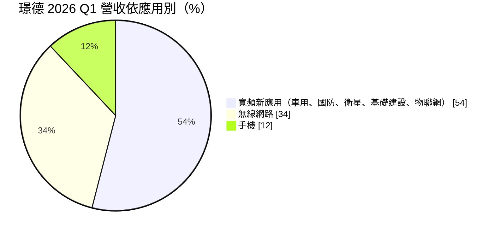
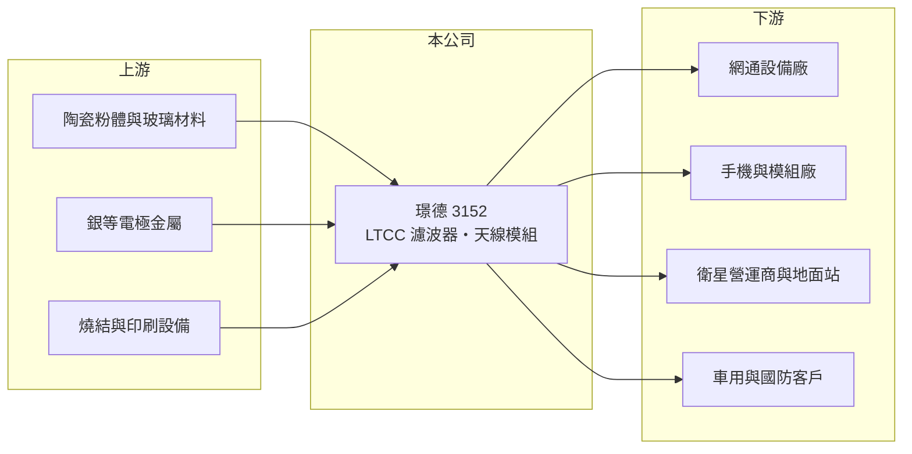

# 3152 璟德

> 上櫃｜[[產業索引-通信網路業|通信網路業]]｜上市（櫃）日期 2008/03/24

# 第一章：企業模式與商業藍圖

> [!info] 撰寫說明
> 本文由 Claude 依公開資料整理，架構比照 [[2330台積電]] 的四章研究，資料截至 2026-10-08。財務數字來源：Goodinfo 年度經營績效頁、櫃買中心開放資料（基本資料、2026 年第二季資產負債與損益、本益比殖利率）、經濟日報 2026 年 4 月股東會報導；產業描述為整理性內容，尚未逐條比對原始文件。#待校對

評估一家被動元件廠，關鍵在於它的材料與設計能力能否跟著通訊規格往更高頻率走。本章說明璟德電子（股票代號：3152，以下簡稱璟德）如何以 [[LTCC]] 技術供應無線通訊的高頻元件，並從手機與網通延伸到衛星、車用與國防。

## 一、核心定位：LTCC 高頻元件專業廠

璟德成立於 1998 年，2008 年在櫃買中心掛牌。公司以低溫共燒陶瓷（LTCC）製程生產無線通訊用的整合元件與模組，例如濾波器、平衡轉換器、雙工器與天線元件。無線設備需要把不同頻段的訊號分開、過濾雜訊，這些工作由高頻被動元件完成；LTCC 能把多層線路燒結在一塊小陶瓷內，體積小、耐高溫且高頻特性穩定，適合手機、Wi-Fi 與衛星通訊。

這門生意的核心能力在於陶瓷材料配方、多層線路設計與燒結製程的整合。同一個濾波器規格，要在不同頻段、溫度與功率下維持穩定，需要大量設計經驗與模擬工具，因此是少數廠商主導的利基市場。

## 二、產品結構：寬頻新應用已過半

依 2026 年 4 月股東會資料，2026 年第一季營收結構如下：

寬頻新應用的比重從一年前的 35% 升到 54%，公司表示這類產品毛利高於平均。在衛星領域，璟德表示已打入三大衛星營運商，[[Ka 頻段]]與 Ku 頻段射頻元件出貨給衛星與地面站；同時開發[[低軌衛星]]用的 LTCC 雙頻雙極化天線陣列模組，以及衛星直連手機所需的高頻濾波器。

## 三、資本配置：2026 年現金減資

璟德長年維持高配息，2026 年更通過[[現金減資]] 3 億元，減資比例約 43.5%，股本由 6.9 億元降至 3.9 億元，每股退還約 4.35 元；加上 2025 年度每股現金股利 4.02 元，股東每股合計取回約 8.37 元。把用不到的現金退還股東，反映經營層偏向保守、重視資本效率的資本配置習慣。

# 第二章：護城河深度與競爭優勢

在長期價值投資中，「護城河」指企業抵禦競爭、維持超額利潤的保護機制。本章分析璟德在高頻被動元件領域的優勢。

## 一、璟德護城河的組成

* **材料與設計整合：** LTCC 元件的效能取決於陶瓷材料與多層線路設計，客戶通常要求依特定頻段客製，設計經驗難以快速複製。
* **高頻與衛星的認證門檻：** 衛星與國防客戶對可靠度要求極高，驗證時間長，通過後轉換成本高；公司表示在 Ka、Ku 頻段地面站元件擁有高市占。
* **毛利率長期偏高：** 2021 至 2025 年毛利率介於 36% 至 57%，屬於被動元件中的高水準，顯示產品具差異化。

## 二、主要競爭對手

| 對手 | 定位 | 對璟德的威脅 |
|---|---|---|
| 村田製作所、TDK | 日本被動元件龍頭，LTCC 與 SAW/BAW 濾波器 | 規模與技術全面領先，在手機市場占主導 |
| [[3221台嘉碩]] | SAW/BAW 濾波器與石英元件 | 在網通與車用濾波器部分重疊 |
| 中國 LTCC 廠 | 低價網通與消費性元件 | 壓低 Wi-Fi 與一般網通元件報價 |

## 三、守得住／守不住／觀察重點

守得住的是衛星、國防與車用等高可靠度利基市場。守不住的是手機市場，手機元件以日系大廠為主，且高度整合進射頻前端模組，璟德手機比重已降到 12%。長期觀察重點是低軌衛星天線模組能否通過驗證量產、6G 與 Wi-Fi 8 等新規格帶來的元件需求，以及寬頻新應用比重能否持續提高。

# 第三章：財務體質與盈利規模

資料日期：2026-10-08，表格是撰寫當時的快照；最新月營收、毛利率、累計 EPS 由自動排程寫在本筆記的屬性欄位（月營收、毛利率、累計EPS 等）。#待校對

財務報表是檢驗護城河是否真實存在的最終標準。本章用五年的三率、ROE 與資本報酬，檢視璟德的獲利品質。

## 一、多年度經營績效

| 年度 | 營收（新台幣） | [[毛利率]] | [[營業利益率]] | EPS（元） | [[ROE]] |
|---|---|---|---|---|---|
| 2021 | 28.5 億 | 57.4% | 45.7% | 14.88 | 27.9% |
| 2022 | 14.7 億 | 36.3% | 20.4% | 3.99 | 7.46% |
| 2023 | 14.9 億 | 38.9% | 23.2% | 4.09 | 7.91% |
| 2024 | 16.9 億 | 45.3% | 27.5% | 6.21 | 11.7% |
| 2025 | 14.3 億 | 43.0% | 19.3% | 9.42 | 16.7% |
| 2026 上半年 | 7.59 億 | 43.8% | 28.5% | 3.21 | 未查得 |

2021 年是網通與手機需求的高峰，營收 28.5 億元、營業利益率 45.7%；2022 年需求退潮後營收腰斬，但營業利益率仍維持 20% 以上，顯示即使在低谷也能穩定獲利。2021 至 2025 年平均 ROE 約 14.3%（推算），營收年複合成長率約 -15.8%（推算，受 2021 年高基期影響）。2025 年營業利益約 2.8 億元，EPS 卻達 9.42 元，代表有大額業外收益，來源未查得（推估為投資處分或評價利益，待校對），不宜視為常態。2026 年起股本降為 3.9 億元，同樣的獲利可對應較高的 EPS。Goodinfo 統計歷年平均現金股利約 5.32 元，配息長期穩定。

## 二、[[ROIC]] 與 [[WACC]]：價值創造利差

**ROIC 推算：** 2025 年營業利益約 2.8 億元（14.3 億 × 19.3%），稅後約 2.2 億元。2026 年第二季股東權益約 36.5 億元（每股淨值 93.44 元 × 約 3,900 萬股），負債約 7.7 億元且以營運負債為主，假設有息負債為零（推估），投入資本約 36.5 億元，ROIC 約 6.1%（推算）。以 2026 年上半年營業利益 2.2 億元年化，稅後約 3.5 億元，ROIC 約 9.5%（推算）。若扣除帳上現金與金融資產（金額未查得），營運資本的報酬會更高。

**WACC 推算：** 台灣 10 年期公債 1.75%、市場風險溢酬 6%、β 取被動元件同業常見值 1.0，股東權益成本約 7.8%；幾乎無負債，WACC 約 7.8%（推算）。

**結論：** 璟德的本業 ROIC 在景氣高峰遠高於 WACC，低谷時約與 WACC 相當。帳上累積大量資本拉低了整體 ROIC，2026 年的現金減資正是把多餘資本還給股東、提高資本效率的做法，長期而言是創造價值的資本配置。

# 第四章：總體風險與地緣政治

任何企業都無法脫離宏觀環境獨立存在。本章分析璟德長期必須面對的風險。

## 一、終端需求週期

網通與手機需求有明顯的庫存週期，2021 至 2022 年營收從 28.5 億元掉到 14.7 億元就是例子。即使寬頻新應用比重提高，衛星與國防訂單也常以專案形式出現，季度波動大。

## 二、技術與競爭風險

高頻元件的技術路線會隨通訊規格改變，例如手機濾波器大量改用 SAW 與 BAW 技術，並被整合進射頻前端模組，LTCC 在部分應用的空間可能縮小。低軌衛星天線模組仍在客戶驗證階段，若驗證延後，新事業的貢獻會遞延。

## 三、成本、關稅與匯率

公司提到關稅與原物料漲價是營運挑戰。陶瓷粉體與貴金屬電極材料價格上漲時，元件價格未必能即時調整。營收以美元計價為主，新台幣升值會壓縮毛利。

# 專有名詞解析

## 半導體

- **[[LTCC]]**：低溫共燒陶瓷，把多層陶瓷與金屬線路在約 900°C 一起燒結，可做成體積小、高頻特性穩定的濾波器與天線元件。

## 應用

- **[[低軌衛星]]**：運行在約 500 至 2,000 公里高度的通訊衛星群，延遲較低，需大量地面接收設備，代表業者為 Starlink。
- **[[Ka 頻段]]**：約 26.5 至 40 GHz 的衛星通訊頻段，頻寬大、傳輸速度快，但容易受雨水衰減影響，常用於高速衛星網路。

## 金融

- **[[現金減資]]**：公司減少股本並把對應現金退還股東，可提高每股盈餘與淨值報酬率。
- **[[ROIC]]**：投入資本報酬率，稅後營業利益除以股東權益與有息負債的合計，衡量本業對所有資金提供者的報酬。
- **[[WACC]]**：加權平均資金成本，依股東權益與負債的比重加權計算的資金成本，ROIC 高於它才代表創造價值。

# 核心供應鏈

## 1. 上游：材料與設備
- 陶瓷粉體、玻璃材料、銀電極材料與燒結設備供應商

## 2. 中游：璟德與同業
- 同業：村田製作所、TDK、[[3221台嘉碩]]

## 3. 下游：客戶
- 網通設備廠：[[6285啟碁]]、[[5388中磊]] 等（推估，未經公司證實）
- 三大衛星營運商（未具名）、車用與國防客戶

## 最新新聞
<!-- news:start -->
<!-- news:end -->

## 相關連結
- [公開資訊觀測站](https://mopsov.twse.com.tw/mops/web/t05st03?step=1&firstin=1&co_id=3152)
- [Goodinfo](https://goodinfo.tw/tw/StockDetail.asp?STOCK_ID=3152)
- [Yahoo 股市](https://tw.stock.yahoo.com/quote/3152)
- [鉅亨網新聞](https://www.cnyes.com/twstock/3152/news)
