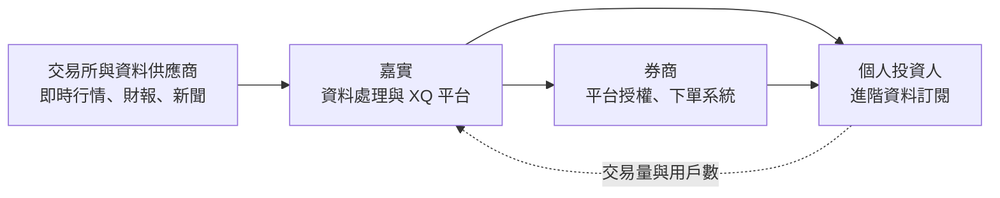
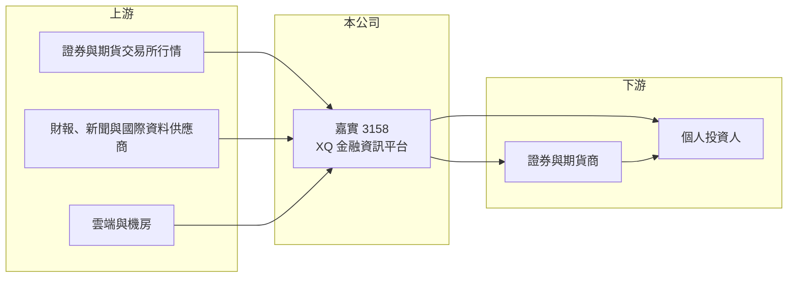

# 3158 嘉實

> 上櫃｜[[產業索引-資訊服務業|資訊服務業]]｜上市（櫃）日期 2025/11/17

# 第一章：企業模式與商業藍圖

> [!info] 撰寫說明
> 精簡版，由 Claude 依公開資料整理，架構比照 [[2330台積電]] 的四章研究，資料截至 2026-10-08。來源：nStock 公司簡介（沿革、登記業務、上櫃日期）、Goodinfo 年度經營績效頁、櫃買中心開放資料（基本資料、2026 年第二季資產負債與綜合損益、每月營收、本益比殖利率）、聯合新聞網與優分析上櫃報導標題。XQ 產品線、客戶結構與收費模式依記憶整理；營收比重未查得。#待校對

嘉實資訊是台灣主要的金融資訊與看盤交易軟體供應商，本章說明它以即時行情資料為原料、以軟體平台為產品、向券商與投資人收費的商業模式，以及這個模式為何能維持六成以上的毛利率。

## 一、核心定位：金融資訊平台

- **核心業務：** 嘉實登記從事資訊軟體服務、電子資訊供應服務及電腦設備批發零售（nStock 公司簡介）。實際上它以「XQ」系列看盤與交易平台聞名，把交易所的即時行情、財務資料與新聞整理成分析工具，提供給券商與個人投資人使用（依記憶整理，待校對）。這是一種把公開資料加工成高附加價值資訊服務的模式。
- **公司背景：** 嘉實原名精業嘉實，1999 年成立，2004 年更名為嘉實資訊（nStock 公司簡介），2025 年 11 月 17 日上櫃，實收資本額約 3.07 億元（櫃買中心開放資料）。上櫃前已營運二十多年，在台灣投資人與券商間有一定知名度。
- **收入來源：** 公開資料未查得比重。以業務性質推估，收入可分為兩類：一是向券商收取的平台授權與系統服務費，券商再把 XQ 提供給自己的客戶下單使用；二是向個人投資人收取的進階資料與分析工具訂閱費（推估，待校對）。兩者多為按月或按年收費的[[經常性收入]]，這是毛利率高且穩定的原因。
- **長期方向：** [[程式交易]]、量化策略與 AI 選股工具的普及，提高投資人對資料品質與分析工具的需求。嘉實若能把平台延伸到策略回測、自動交易與海外市場資料，就能提高每位用戶的貢獻（推估）。

## 二、資本轉化邏輯：資料加工一次、多次銷售

資訊平台的成本主要是資料授權費、研發人力與伺服器，這些成本大多固定。用戶數與券商合作家數增加時，邊際成本很低，因此[[毛利率]]長期維持在 64% 至 67%（Goodinfo）。另一方面，台股成交量與投資人數增加，會同時帶動券商與個人的需求，使嘉實的營收與市場熱度高度相關。

# 第二章：護城河深度與競爭優勢

本章分析嘉實的護城河構成，以及它在金融資訊市場的競爭。

## 一、競爭優勢

- **用戶習慣與轉換成本：** 投資人一旦熟悉某套看盤軟體的介面、指標與自訂策略，就不太願意更換；程式交易用戶在平台上撰寫的策略腳本也無法直接搬走。這種使用習慣構成相當強的轉換成本。
- **券商通路：** 透過與券商合作，嘉實的平台成為券商提供給客戶的工具之一，券商負擔部分費用並協助推廣。券商更換平台需要重新整合下單系統與訓練客服，因此合作關係通常長期穩定（推估）。
- **資料處理的累積：** 長年累積的歷史資料庫、資料清洗流程與指標計算能力，需要時間與人力才能建立，新進者不易短期追上。

## 二、主要對手

| 對手 | 定位 | 與嘉實的比較 |
|---|---|---|
| [[6214精誠]] | 資訊服務集團，提供券商交易系統 | 券商端系統的主要對手 |
| [[5201凱衛]] | 券商與金融資訊軟體 | 在券商資訊系統上競爭 |
| 券商自建 App | 免費看盤與下單 | 以免費工具搶一般投資人 |
| 財經資訊平台（CMoney 等，未上市） | 投資資訊訂閱 | 搶個人投資人的訂閱預算 |
| 國際金融資訊商（Bloomberg、LSEG 等） | 專業機構市場 | 主要在法人市場，與嘉實的散戶客群重疊有限 |

## 三、觀察重點

- **台股熱度的依賴：** 營收與成交量、開戶數高度相關，多頭市場時成長快，空頭時用戶可能縮減訂閱。
- **產品延伸：** 程式交易、AI 分析與海外市場資料能否成為新的付費項目，決定長期成長空間。
- **券商合作的穩定性：** 大型券商若改用自建系統，會影響授權收入。

# 第三章：財務體質與盈利規模

資料日期：2026-10-08，表格是撰寫當時的快照；最新月營收、毛利率、累計 EPS 由自動排程寫在本筆記的屬性欄位（月營收、毛利率、累計EPS 等）。#待校對

本章用多年度數據檢視嘉實的高毛利結構與資本報酬。

## 一、多年度三率與 ROE

| 年度 | 營收（新台幣） | [[毛利率]] | [[營業利益率]] | EPS（元） | [[ROE]] |
|---|---|---|---|---|---|
| 2020 | 6.66 億 | 64.5% | 18.2% | 3.97 | 23.1% |
| 2021 | 7.70 億 | 64.6% | 21.4% | 5.30 | 28.3% |
| 2022 | 8.13 億 | 65.0% | 22.2% | 5.88 | 29.0% |
| 2023 | 8.23 億 | 67.0% | 21.3% | 5.91 | 27.5% |
| 2024 | 9.46 億 | 64.0% | 19.8% | 7.32 | 31.3% |
| 2025 | 10.10 億 | 64.4% | 22.1% | 7.27 | 23.4% |
| 2026 上半年 | 5.56 億 | 64.66% | 22.89% | 3.48 | 未查得 |

註：2020 至 2025 年取自 Goodinfo；2026 上半年取自櫃買中心綜合損益。2025 年 ROE 下降，推估與上櫃前後的增資使權益增加有關（推估，待校對）。

- **營收成長：** 2020 至 2025 年營收年複合成長率約 8.7%（推算），2026 年 1 至 8 月累計營收約 7.73 億元、年增約 21.5%（櫃買中心每月營收），反映台股交易熱絡。
- **利潤率穩定：** 毛利率六年都在 64% 至 67%，營業利益率在 18% 至 23%，即使市場熱度變化，利潤率仍相當穩定，代表訂閱型收入的韌性。
- **ROE：** 2021 至 2025 年平均 ROE 約 27.9%（推算），是資訊服務業中的高水準。

## 二、股利與財務結構

最近一次現金股利為 6.5 元（櫃買中心本益比殖利率資料），以 2025 年 EPS 7.27 元計算配發率約 89%（推算）。2026 年第二季底權益約 9.54 億元、總負債約 3.86 億元，其中流動負債約 3.20 億元、非流動負債約 0.66 億元（櫃買中心資產負債）。負債比不到三成，推估流動負債以預收訂閱費與應付費用為主（推估），沒有明顯的借款需求。

## 三、[[ROIC]] 與 [[WACC]]

**ROIC 推算：** 2025 年營業利益約 10.10 億元 × 22.1% ≈ 2.23 億元，扣除 20% 稅後約 1.79 億元。投入資本以權益 9.54 億元加上非流動負債 0.66 億元計算，約 10.2 億元，ROIC 約 17.5%（推算）；若扣除帳上多餘現金，營運資本報酬會更高（推估）。

**WACC 推算：** 公債殖利率 1.75%、市場風險溢酬 6%、β 取金融資訊股常見值 0.8（與市場熱度相關），權益成本約 6.55%；幾乎沒有有息負債，WACC 約 6.5%（推算）。

**結論：** ROIC 約 17.5%，比約 6.5% 的 WACC 高出約 11 個百分點，代表嘉實的平台模式長期創造價值。成長不需要大量資本，因此能維持高配息。

# 第四章：總體風險與地緣政治

本章整理嘉實長期面對的市場、營運與其他風險。

## 一、產業週期

- **股市多空循環：** 投資人的交易意願與訂閱意願隨股市熱度變化，空頭市場時個人用戶可能取消進階訂閱，券商也可能縮減支出。
- **券商產業整併：** 券商合併或數位化轉型，可能改變平台採購決策。

## 二、營運風險

- **免費工具的替代：** 券商 App 與網路平台提供越來越完整的免費看盤功能，基本行情服務的付費意願可能下降，嘉實需要以更專業的分析與程式交易功能維持差異化。
- **資料成本：** 交易所與資料供應商的授權費若調漲，會壓縮毛利率。
- **系統穩定性：** 行情與下單系統在開盤時段不能中斷，任何當機都會影響商譽與券商合作。

## 三、其他風險

- **法規：** 金融監理機關對投資建議、程式交易與資訊揭露的規範調整，可能影響產品設計。
- **資安：** 平台連結券商下單系統，資安事件可能造成重大損失。

# 專有名詞解析

## 金融

- **[[經常性收入]]**：按月或按年持續收取的收入，例如維護合約與訂閱費，可預測性高於一次性的專案收入。
- **[[程式交易]]**：以電腦程式依預先設定的條件自動下單的交易方式，需要即時行情與穩定的下單系統。
- **[[ROIC]]**：投入資本報酬率，衡量企業用股東與債權人投入的資本，每年能產生多少稅後營業利益。
- **[[WACC]]**：加權平均資金成本，股東要求報酬與負債利息依資本結構加權後的平均值，是判斷是否創造價值的門檻。

# 核心供應鏈

- 上游：證券與期貨交易所的即時行情、財報與新聞資料供應商、雲端與機房服務。
- 下游／客戶：證券與期貨商，例如 [[2885元大金]]、[[6005群益證]]、[[2855統一證]]（產業代表，非指名客戶）；個人投資人。
- 同業：[[6214精誠]]、[[5201凱衛]]，以及券商自建 App 與財經資訊平台。

## 最新新聞
<!-- news:start -->
<!-- news:end -->

## 相關連結
- [公開資訊觀測站](https://mopsov.twse.com.tw/mops/web/t05st03?step=1&firstin=1&co_id=3158)
- [Goodinfo](https://goodinfo.tw/tw/StockDetail.asp?STOCK_ID=3158)
- [Yahoo 股市](https://tw.stock.yahoo.com/quote/3158)
- [鉅亨網新聞](https://www.cnyes.com/twstock/3158/news)
