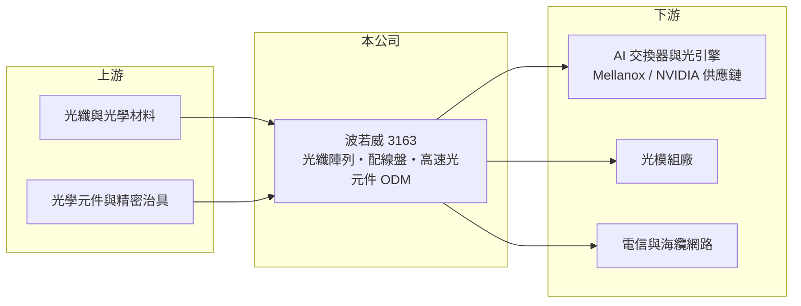

# 3163 波若威

> 上櫃｜[[產業索引-通信網路業|通信網路業]]｜上市（櫃）日期 2012/12/03

# 第一章：企業模式與商業藍圖

> [!info] 撰寫說明
> 本文由 Claude 依公開資料整理，架構比照 [[2330台積電]] 的四章研究，資料截至 2026-10-08。財務數字來源：Goodinfo 年度經營績效頁、櫃買中心開放資料（基本資料、2026 年第二季資產負債與損益、本益比殖利率）、經濟日報 2026 年報導；傳統產品線描述部分憑記憶整理，已標「待校對」。#待校對

評估一家光通訊元件廠，要看它的產品能否跟著資料中心的傳輸速度一代一代升級。本章說明波若威科技（股票代號：3163，以下簡稱波若威）如何從光通訊被動元件出發，切入 AI 資料中心的高速光纖連接與 [[CPO]] 供應鏈。

## 一、核心定位：光通訊元件與 ODM 代工

波若威成立於 1998 年，2012 年在櫃買中心掛牌，實收資本額約 9.5 億元。公司早期以光纖通訊的被動元件與模組為主，產品用於電信骨幹與海纜網路中的訊號分光、濾波與放大（傳統產品線細節待校對）。被動元件不需要電力，但必須把多條光纖與光學元件以微米級精度對準、固定，良率取決於精密組裝與測試經驗。

近年公司的重心轉向資料中心：替客戶以 [[ODM]] 模式生產高速光通訊元件，產品已發展到 40 至 72 通道，並供應光纖配線盤與[[光纖陣列]]。依 2026 年報導，公司以 NVIDIA 旗下交換器子公司 Mellanox 夥伴的身分，把光纖配線盤與光纖陣列產品送進一線 AI 供應鏈。

## 二、產品世代：從 800G 走向 CPO

資料中心的光連接正從可插拔光收發模組走向 CPO。在可插拔架構中，光纖連接在模組外部；到了 CPO，光學引擎直接封裝在交換晶片旁，需要大量高密度的光纖陣列與內部光纖配線，這正好是波若威擅長的精密光纖組裝。依 2026 年報導，公司規劃 2026 年下半年交付 1.6T 與 3.2T 產品，2026 年第三季 CPO 產品小量試產，2027 年推出 6.4T 世代產品。這些時程屬於公司與媒體的規劃，實際進度仍需追蹤。

各產品的營收比重未查得。

## 三、長期方向

波若威的長期方向是從傳統電信光元件，轉型為 AI 資料中心光纖連接的精密組裝夥伴。這個轉型的價值在於，資料中心的光纖連接數量會隨 GPU 叢集規模倍增，每一代速度升級也都需要重新設計與驗證，能先取得一線客戶認證的廠商將享有先行者優勢。

# 第二章：護城河深度與競爭優勢

在長期價值投資中，「護城河」指企業抵禦競爭、維持超額利潤的保護機制。本章分析波若威在光纖連接領域的優勢與限制。

## 一、波若威護城河的組成

* **精密光纖組裝經驗：** 二十多年的被動元件與模組經驗，讓公司具備高通道數光纖對準、測試與可靠度驗證的能力，這是 CPO 時代最需要的製程基礎。
* **一線供應鏈認證：** 打入 AI 交換器供應鏈後，產品規格與客戶設計綁定，換供應商需要重新驗證，具有一定的轉換成本。

不過 ODM 模式下的議價權偏向客戶，且光纖組裝的門檻低於雷射與晶片，護城河屬於較窄的類型。

## 二、主要競爭對手

| 對手 | 定位 | 對波若威的威脅 |
|---|---|---|
| [[3363上詮]] | 光纖連接器與 CPO 光纖陣列 | 綁定台積電 CPO 平台，直接競爭光纖陣列 |
| [[6442光聖]] | 光纖跳線與光纖配線 | 在資料中心光纖連接產品重疊 |
| [[3450聯鈞]] | 光通訊元件與代工 | 爭取同一批光模組與 CPO 訂單 |
| 美日光纖連接大廠 | 高密度光纖連接方案 | 技術與客戶基礎雄厚 |

## 三、守得住／守不住／觀察重點

守得住的是已導入的一線客戶專案。守不住的是本業毛利率，2021 至 2025 年毛利率只有 14% 至 25%，2024 年營業利益率甚至為負，顯示代工型產品的定價能力有限。長期觀察重點是 CPO 從試產到量產的時程、1.6T 與 3.2T 產品的出貨規模，以及本業營業利益率能否明顯提升。

# 第三章：財務體質與盈利規模

資料日期：2026-10-08，表格是撰寫當時的快照；最新月營收、毛利率、累計 EPS 由自動排程寫在本筆記的屬性欄位（月營收、毛利率、累計EPS 等）。#待校對

財務報表是檢驗護城河是否真實存在的最終標準。本章用五年的三率、ROE 與資本報酬，檢視波若威的獲利品質。

## 一、多年度經營績效

| 年度 | 營收（新台幣） | [[毛利率]] | [[營業利益率]] | EPS（元） | [[ROE]] |
|---|---|---|---|---|---|
| 2021 | 23.0 億 | 15.9% | 4.69% | 1.09 | 4.43% |
| 2022 | 32.1 億 | 24.8% | 14.8% | 6.00 | 22.4% |
| 2023 | 27.8 億 | 20.0% | 8.67% | 5.63 | 18.1% |
| 2024 | 19.4 億 | 14.4% | -0.27% | 5.75 | 17.0% |
| 2025 | 22.3 億 | 18.1% | 5.38% | 6.22 | 17.0% |
| 2026 上半年 | 12.5 億 | 17.1% | 3.61% | 3.50 | 未查得 |

這張表最需要注意的是本業與業外的落差。2024 年營業利益率為負，EPS 卻有 5.75 元；2026 年上半年營業利益約 0.45 億元，業外收入卻達 3.0 億元。換句話說，近三年的 EPS 與 ROE 大部分來自[[業外收益]]，來源未查得（推估為轉投資評價或處分利益，待校對），不能直接視為本業實力。2021 至 2025 年平均 ROE 約 15.8%（推算），營收年複合成長率約 -0.8%（推算）。最近一次現金股利為每股 3.5 元。

## 二、[[ROIC]] 與 [[WACC]]：價值創造利差

**ROIC 推算（只計本業）：** 2025 年營業利益約 1.2 億元（22.3 億 × 5.38%），稅後約 0.96 億元。2026 年第二季股東權益約 32.9 億元，負債約 11 億元，假設有息負債約 4 億元（推估），投入資本約 37 億元，ROIC 約 2.6%（推算）。

**WACC 推算：** 台灣 10 年期公債 1.75%、市場風險溢酬 6%、β 取光通訊同業常見值 1.3，股東權益成本約 9.6%；負債成本 2.5%、稅後 2.0%；權益占投入資本約 89%，WACC 約 8.7%（推算）。

**結論：** 以本業計算，波若威的 ROIC 明顯低於 WACC，股東報酬主要靠業外收益撐起。若 CPO 與高速產品放量後營業利益率能提高到兩位數，ROIC 才有機會超越資金成本；在此之前，評估時應把本業與業外分開看。

# 第四章：總體風險與地緣政治

任何企業都無法脫離宏觀環境獨立存在。本章分析波若威長期必須面對的風險。

## 一、AI 資本支出週期

公司成長高度依賴 AI 資料中心的投資節奏。2023 至 2024 年營收從 27.8 億元降到 19.4 億元，說明光通訊需求的波動性。若雲端業者放緩資本支出，或 CPO 導入時程延後，大量的擴產與研發投入會壓縮獲利。

## 二、技術與競爭風險

CPO 的光纖連接架構尚未完全定型，不同交換晶片與封裝平台可能採用不同設計，供應商需要同時投入多種方案。台灣多家光纖連接廠都在爭取相同的機會，量產後價格競爭可能加劇。

## 三、獲利品質與匯率

業外收益占獲利比重高，波動性大，若業外收益減少，EPS 可能大幅下降。營收以美元計價為主，新台幣升值會壓縮本來就不高的毛利率。

# 專有名詞解析

## 半導體

- **[[CPO]]**：共同封裝光學，把光學收發元件與交換晶片封裝在一起，縮短電訊號距離以降低功耗。

## 應用

- **[[光纖陣列]]**：FA，把多條光纖精準排列固定的元件，是 CPO 與光模組中光纖對準晶片的關鍵零件。

## 金融

- **[[業外收益]]**：本業以外的收入，例如投資收益、股利、利息與資產處分利得，波動通常較大。
- **[[ROIC]]**：投入資本報酬率，稅後營業利益除以股東權益與有息負債的合計，衡量本業對所有資金提供者的報酬。
- **[[WACC]]**：加權平均資金成本，依股東權益與負債的比重加權計算的資金成本，ROIC 高於它才代表創造價值。

## 產業

- **[[ODM]]**：原廠委託設計製造，代工廠可提出設計方案並負責生產，與客戶綁定較深，議價能力較高。

# 核心供應鏈

## 1. 上游：光纖與光學材料
- 光纖、陶瓷插芯、光學元件與精密治具供應商

## 2. 中游：波若威與同業
- 同業：[[3363上詮]]、[[6442光聖]]、[[3450聯鈞]]

## 3. 下游：客戶
- AI 交換器供應鏈：[[NVDA輝達]]（Mellanox）相關一線供應鏈
- 光模組廠與電信網路業者

## 最新新聞
<!-- news:start -->
<!-- news:end -->

## 相關連結
- [公開資訊觀測站](https://mopsov.twse.com.tw/mops/web/t05st03?step=1&firstin=1&co_id=3163)
- [Goodinfo](https://goodinfo.tw/tw/StockDetail.asp?STOCK_ID=3163)
- [Yahoo 股市](https://tw.stock.yahoo.com/quote/3163)
- [鉅亨網新聞](https://www.cnyes.com/twstock/3163/news)
