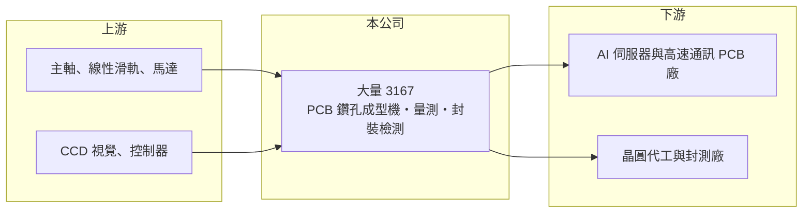

# 3167 大量

> 上市｜[[產業索引-電機機械|電機機械]]｜上市（櫃）日期 2013/10/21

# 第一章：企業模式與商業藍圖

> [!info] 撰寫說明
> 精簡版，由 Claude 依公開資料整理，架構比照 [[2330台積電]]，資料截至 2026-10-08。來源：證交所開放資料快照（基本資料、2026 年第二季資產負債與損益、營益分析、股利分派）、Goodinfo 經營績效頁、富果研究 2026 年 3 月法說會摘要。#待校對

大量科技（以下簡稱大量）是桃園八德的 PCB 設備廠，主力是[[PCB 鑽孔機]]。理解它的關鍵在於：AI 伺服器用的電路板層數多、孔多、精度要求高，讓鑽孔設備從一般機台變成產能瓶頸，大量因此從景氣循環股變成 AI 供應鏈的一環。

- **核心業務：** 大量成立於 1980 年，2013 年在證交所上市。PCB 事業部以鑽孔機與成型機為核心，包括一般機型與附 CCD 視覺對位的高階機型，並獨家開發內層銅厚量測機（TM 系列），可與[[背鑽]]設備搭配使用。半導體事業部則提供 CoWoS、SoIC 等[[先進封裝]]製程所需的量測、[[AOI]] 與自動化設備。
- **營收結構：** PCB 設備是營收主體，PCB 與半導體的確切比重未查得。2025 年高階機種占比由過去的一至兩成提升到三成以上，全年出貨高階 CCD 機台 501 台、TM 量測機 27 台。產品組合往高階移動，是毛利率由 28.9% 跳升到 39.2% 的主因。
- **營運據點：** 總部與工廠位於桃園八德，中國生產基地在南京與淮安漣水，2026 年初三廠合計月產能約 350 台。南京新廠已啟用，公司規劃把月產能提高到約 400 台，外包產能也由每月 30 台擴至 50 台。
- **長期方向：** 大量的長期題目是兩條線：PCB 端吃下 AI 伺服器與高速通訊板的高階鑽孔與量測需求；半導體端以量測與檢測設備切入先進封裝，客戶包括台積電、世界先進與日月光集團。依 2026 年 3 月法說，2026 年訂單已滿，部分客戶已洽談 2027 年產能。

# 第二章：護城河深度與競爭優勢

大量的護城河來自高階鑽孔的精度、量測與鑽孔整合的獨特方案，以及在台灣與中國 PCB 客戶間的長期裝機基礎。

- **競爭優勢：** AI 伺服器板動輒二三十層，背鑽深度與對位精度直接影響訊號品質，大量把銅厚量測與背鑽結合，提供其他廠商較少具備的整合方案。PCB 廠買設備看重穩定性與售後服務，大量長年在台灣與中國華東設有據點，裝機量大，形成轉換成本。
- **主要對手：** 全球 PCB 鑽孔機市場的主要對手包括中國的大族數控與日本、德國的設備廠，以雷射鑽孔為主的則有日本廠商（名單待校對）。台灣同業中，[[8027鈦昇]] 做雷射鑽孔與半導體設備，[[2467志聖]] 做 PCB 與先進封裝製程設備。大量在機械鑽孔上屬於國際前段班。
- **觀察重點：** 長期最重要的是 AI 帶動的高階需求能延續多久，以及產能擴充後的高毛利能否維持。過去 2018、2021 年都出現「景氣高點擴產、隔年大幅衰退」的情形，2023 年營業利益率曾降到 −3.58%。半導體事業若能放大，可以降低對 PCB 擴產週期的依賴。

# 第三章：財務體質與盈利規模

資料日期：2026-10-08，表格是撰寫當時的快照；最新月營收、毛利率、累計 EPS 由自動排程寫在本筆記的屬性欄位（月營收、毛利率、累計EPS 等）。#待校對

大量是典型的資本設備股：營收隨客戶擴產劇烈起伏，景氣好時營運槓桿非常大，景氣差時可能接近虧損。

| 年度 | 營收（億元） | [[毛利率]] | [[營業利益率]] | EPS（元） | [[ROE]] |
|---|---|---|---|---|---|
| 2021 | 44.4 | 25.9% | 12.4% | 5.51 | 20.1% |
| 2022 | 23.7 | 25.1% | 4.50% | 3.91 | 13.6% |
| 2023 | 12.9 | 25.3% | −3.58% | 0.16 | 0.53% |
| 2024 | 26.0 | 28.9% | 2.77% | 1.48 | 5.20% |
| 2025 | 50.8 | 39.2% | 18.0% | 8.13 | 23.5% |

（來源：Goodinfo 經營績效頁；2025 年數字與法說會一致，營收 50.77 億元、營業利益 9.16 億元。2026 年上半年依證交所資料，營收 48.1 億元、毛利率 43.45%、營業利益率 24.48%、EPS 9.26 元。）

- **營收規模：** 2020 至 2025 年營收由 24.3 億元增至 50.8 億元，年複合成長率約 15.9%（推算），但中間經歷 2023 年跌到 12.9 億元的低谷。2026 年上半年營收已接近 2025 全年，顯示這一輪 AI 擴產的強度遠超過去週期。
- **獲利：** 2021 至 2025 年平均 ROE 約 12.6%（推算），區間從 0.5% 到 23.5%。毛利率在 2025 年由長期的 25% 至 29% 跳升到 39%，2026 年上半年再升到 43%，反映高階機種與供不應求的定價能力。
- **財務特色：** 依 2026 年第二季資料，總資產約 121.0 億元、負債約 78.0 億元、股東權益約 43.0 億元，負債比約 64%。負債大幅增加推估主要來自客戶預付款等合約負債與應付帳款，屬於接單旺盛的設備商常見現象（推估，待校對）。2025 年度配發現金股利每股 4 元，配息率約五成；Goodinfo 統計歷年平均現金股利約 1.85 元。
- **[[ROIC]] 與 [[WACC]]：** 以 2025 年營業利益 9.16 億元、稅率 20% 計算，稅後營業利益約 7.3 億元；投入資本以股東權益 43.0 億元到總資產 121.0 億元為區間，ROIC 約 6.0% 至 17.0%（推算）。由於總資產中包含大量客戶預收款與應付款，實際投入資本接近股東權益端，ROIC 推估在 15% 以上（推算）。WACC 以 CAPM 推估：無風險利率 1.75%、市場風險溢酬 6%、β 假設 1.3（設備股常見值），權益成本約 9.6%；有息負債比重低，WACC 約 9%（推算）。2025 年 ROIC 明顯高於 WACC，但 2023 至 2024 年遠低於 WACC，長期是否創造價值取決於這一輪景氣的長度。

# 第四章：總體風險與地緣政治

大量的風險主要是設備業的週期性，以及產能與地緣政治的集中。

- **產業週期：** PCB 廠買設備是為了擴產，擴產完成後設備需求就會驟降。2021 年營收 44.4 億元、2023 年只剩 12.9 億元，就是這種週期的寫照。AI 需求即使長期成長，也可能出現客戶集中擴產後的消化期。
- **營運風險：** 產能擴充與外包放大，若訂單反轉會留下過剩產能與庫存。出貨到認列營收約需 3 至 6 個月，訂單變化反映到財報有時間差。高階機種需要持續研發，才能跟上更細的孔徑與更多的層數。
- **其他風險：** 主要生產基地與部分客戶在中國，受美中科技管制與關稅影響；中國本土鑽孔機廠商以價格競爭。新台幣與人民幣匯率波動影響報價與獲利。

# 專有名詞解析

## 半導體

- **[[先進封裝]]**：把多顆晶片以中介層、混合鍵合等方式高密度整合的封裝技術，例如 CoWoS、SoIC。

## 產業

- **[[PCB 鑽孔機]]**：在印刷電路板上鑽出導通孔的設備，孔位精度與速度決定電路板的良率與產能。
- **[[背鑽]]**：把導通孔中多餘的銅柱鑽除以減少訊號干擾的製程，用於高速伺服器與通訊板。
- **[[AOI]]**：自動光學檢測，以光學影像取代人眼檢查產品瑕疵，廣泛用於 PCB、面板與半導體。

# 核心供應鏈

- 上游：主軸、線性滑軌與傳動元件，例如 [[2049上銀]]；CCD 視覺與控制系統供應商；鑽針耗材如 [[8021尖點]]。
- 下游／客戶：AI 伺服器與高速通訊板廠，例如 [[2368金像電]]、[[3037欣興]]、[[4958臻鼎-KY]]、[[3044健鼎]] 這類 PCB 業者（具體客戶公開資料未點名，#待校對）；半導體端客戶包括 [[2330台積電]]、世界先進與 [[3711日月光投控]]。
- 同業：[[8027鈦昇]]、[[2467志聖]]，以及中國大族數控等鑽孔設備廠。

## 最新新聞
<!-- news:start（自動產生，請勿手動編輯此範圍） -->
- 2026-10-19 📰 媒體 18:07｜臻鼎攜大量、尖點等夥伴 與中央大學成立「前瞻PCB人才培育講座」｜[鉅亨網](https://news.cnyes.com/news/id/6633417)
- 2026-10-14 📰 媒體 20:00｜大量科技上半年賺回近一股本 9月純益3.52億元單月EPS 3.82元｜[鉅亨網](https://news.cnyes.com/news/id/6630412)
- 2026-10-14 🏛️ 重訊 15:59｜係因本公司有價證券於集中交易市場達公布注意交易資訊標 準，故公布相關財務業務等重大訊息，以利投資人區別瞭解｜[觀測站](https://mops.twse.com.tw/mops/#/web/t05st01)
- 2026-10-06 📰 媒體 08:20｜營收速報 - 大量(3167)9月營收13.04億元年增率高達172.33％｜[鉅亨網](https://news.cnyes.com/news/id/6622264)

完整紀錄：[[3167大量 新聞]]
<!-- news:end -->

## 相關連結
- [公開資訊觀測站](https://mopsov.twse.com.tw/mops/web/t05st03?step=1&firstin=1&co_id=3167)
- [Goodinfo](https://goodinfo.tw/tw/StockDetail.asp?STOCK_ID=3167)
- [Yahoo 股市](https://tw.stock.yahoo.com/quote/3167)
- [鉅亨網新聞](https://www.cnyes.com/twstock/3167/news)
