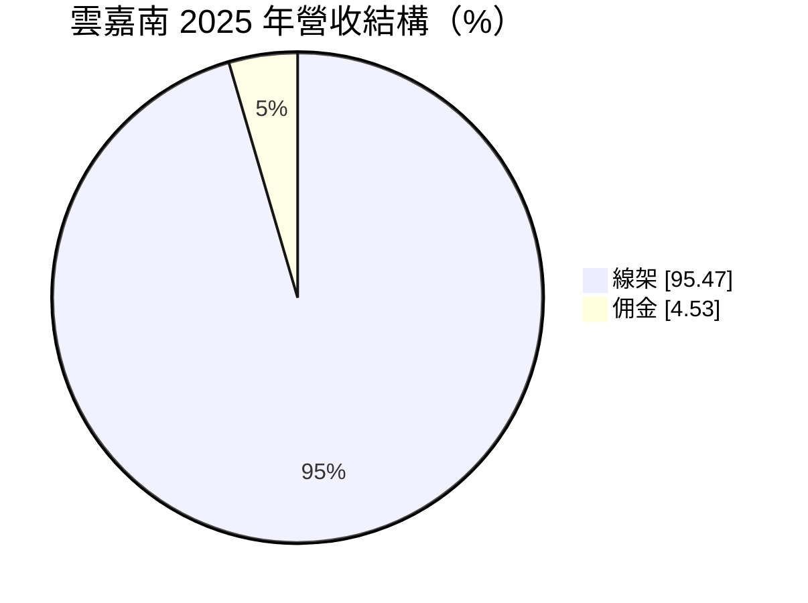
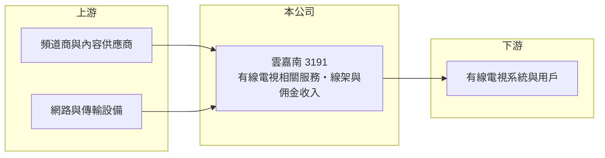

# 3191 雲嘉南

> 上櫃｜[[產業索引-電子零組件業|電子零組件業]]｜上市（櫃）日期 2005/04/12

# 第一章：企業模式與商業藍圖

> [!info] 撰寫說明
> 精簡版，由 Claude 依公開資料整理，架構比照 [[2330台積電]]，資料截至 2026-10-08。來源：櫃買中心開放資料快照（基本資料、2026 年第二季資產負債與損益、本益比殖利率）、Goodinfo 經營績效頁、富邦 MoneyDJ 公司基本資料（2025 年營收比重）。業務屬性依委託方產業分類（有線電視業者）與營收項目名稱推估，未取得公司自述。公開資料有限。#待校對

雲嘉南科技（以下簡稱雲嘉南）是一家規模很小、與[[有線電視]]相關的上櫃公司，理解它的關鍵在於：營收每年不到 3 億元，本業長期虧損，產業本身又面臨串流影音帶來的用戶流失，經營重點在於守住現有收入並控制成本。

- **核心業務：** 雲嘉南成立於 1991 年，2005 年在櫃買中心掛牌，登記地址在台北市中正區，產業分類為電子零組件。依撰寫委託方的產業分類，公司屬於有線電視相關業者；2025 年營收約 95% 來自「線架」、約 5% 來自佣金。「線架」的確切內容（例如頻道上架或線路架設服務）公開資料未說明，本文推估與有線電視系統的頻道或網路服務相關。#待校對
- **營收結構：** 營收由 2021 年的 2.85 億元降到 2025 年的 1.69 億元，呈現逐年下滑。毛利率約 20% 至 26%，但營業費用高於毛利，營業利益率長期為負。佣金收入比重小，推估為代理銷售相關服務所得。
- **營運據點：** 公司名稱「雲嘉南」指雲林、嘉義、台南地區，推估業務區域以南台灣為主（未查得正式說明，#待校對）。有線電視依地區經營，同一地區的系統業者家數有限，區域性特徵明顯。
- **長期方向：** 有線電視產業在台灣已進入成熟甚至萎縮期，業者普遍轉向寬頻上網、數位加值服務與[[OTT]]整合，以彌補傳統電視訂戶的流失。雲嘉南的具體轉型方向未查得，長期能否穩住營收，取決於能否在既有服務之外找到新的收入來源。

# 第二章：護城河深度與競爭優勢

雲嘉南的護城河薄弱，主要依賴有線電視產業的區域經營特性。

- **競爭優勢：** 有線電視需經主管機關核准分區經營，線路建設成本高，區域內的競爭者有限，這讓既有業者有一定的進入門檻。若雲嘉南的業務與此相關，這種區域性與既有用戶關係是主要優勢。但這個優勢正被不需要佈線的網路串流服務削弱。
- **主要對手：** 有線電視業者面對的競爭包括同區域的其他系統業者、[[2412中華電]] 的 MOD、電信業者 [[3045台灣大]]、[[4904遠傳]] 的影音服務，以及國際串流平台。上市櫃同業中，[[6464台數科]] 是有線電視系統業者的代表。
- **觀察重點：** 長期要觀察營收衰退的速度能否放緩，以及營業虧損能否收斂。2025 年 EPS 0.51 元雖為正數，但營業利益率為 -17.5%，獲利來自[[業外收入]]，本業並未轉好。

# 第三章：財務體質與盈利規模

資料日期：2026-10-08，表格是撰寫當時的快照；最新月營收、毛利率、累計 EPS 由自動排程寫在本筆記的屬性欄位（月營收、毛利率、累計EPS 等）。#待校對

雲嘉南的財務特徵是營收小且下滑、本業持續虧損，每股淨值已明顯低於面額。

| 年度 | 營收（億元） | [[毛利率]] | [[營業利益率]] | EPS（元） | [[ROE]] |
|---|---|---|---|---|---|
| 2021 | 2.85 | 24.4% | -6.13% | -0.59 | -23.7% |
| 2022 | 2.26 | 23.3% | -11.4% | -0.19 | -7.79% |
| 2023 | 2.08 | 26.5% | -12.9% | -0.55 | -17.9% |
| 2024 | 1.83 | 20.0% | -17.9% | -0.57 | -10.6% |
| 2025 | 1.69 | 23.7% | -17.5% | 0.51 | 9.28% |

（來源：Goodinfo 經營績效頁；2020 年營收 2.40 億元、EPS -3.12 元。）

- **營收規模：** 2020 至 2025 年營收年複合成長率約 -6.8%（推算），2021 年後逐年下滑。2026 年上半年營收約 0.90 億元，毛利率約 28.1%，營業虧損約 0.11 億元，EPS -0.26 元。
- **獲利：** 2021 至 2025 年平均 ROE 約 -10.1%（推算），五年中只有 2025 年因業外收益轉為獲利。營收小、固定費用占比高，營收每下滑一成，虧損幅度就明顯擴大。
- **財務特色：** 2026 年第二季總資產約 3.82 億元、負債約 1.38 億元（其中非流動負債約 0.94 億元）、權益約 2.44 億元，股本約 4.36 億元，每股淨值約 5.60 元，代表過去累積了大量[[累積虧損]]。近年未配發股利，Goodinfo 統計歷年平均現金股利約 0.12 元。
- **[[ROIC]] 與 [[WACC]]：** 2025 年營業虧損約 0.30 億元（1.69 億元 × -17.5%），稅後約 -0.24 億元（推算）。有息負債未查得，投入資本以權益約 2.44 億元到「權益加全部負債」約 3.82 億元為區間，ROIC 約 -6% 至 -10%（推算）。WACC 以 [[CAPM]] 推估：無風險利率 1.75%、市場風險溢酬 6%、β 假設 0.8（電信媒體股常見值），權益成本約 6.6%；負債占三成、稅後成本 2%，WACC 約 5.2%（推算）。ROIC 為負且低於 WACC，代表本業長期未創造經濟價值。

# 第四章：總體風險與地緣政治

雲嘉南的風險主要來自產業結構性衰退與公司規模過小。

- **產業週期：** 有線電視的問題不是週期而是結構：年輕族群改看串流平台，訂戶數長期下滑，頻道授權費卻未必同步下降。營收逐年減少的趨勢反映的就是這種產業變化。
- **營運風險：** 營收規模小，固定成本難以壓縮，若營收繼續下滑，虧損可能擴大並持續侵蝕已偏低的淨值。業務資訊揭露有限，外部投資人不易判斷營收來源的穩定性。
- **其他風險：** 有線電視受主管機關的費率審議與經營區域規範，法規變動直接影響收入。股價容易受籌碼與題材影響，與基本面脫節。

# 專有名詞解析

## 應用

- **[[有線電視]]**：以纜線把電視訊號送到用戶家中的付費電視服務，在台灣依區域核准經營。
- **[[OTT]]**：透過網際網路直接提供影音內容的服務，例如串流平台，不需經過有線電視或電信業者的專屬網路。

## 金融

- **[[業外收入]]**：本業以外的收益，例如投資收益、處分利益與利息收入，通常不具持續性。
- **[[累積虧損]]**：歷年虧損累積後尚未彌補的金額，依公司法須先彌補完畢才能分配盈餘。

# 核心供應鏈

- 上游：頻道商、內容供應商與傳輸設備廠（具體對象未查得）。#待校對
- 下游／客戶：有線電視系統業者或終端用戶（依業務屬性推估）。#待校對
- 同業：[[6464台數科]]；競爭的電信影音服務 [[2412中華電]]、[[3045台灣大]]、[[4904遠傳]]。

## 最新新聞
<!-- news:start -->
<!-- news:end -->

## 相關連結
- [公開資訊觀測站](https://mopsov.twse.com.tw/mops/web/t05st03?step=1&firstin=1&co_id=3191)
- [Goodinfo](https://goodinfo.tw/tw/StockDetail.asp?STOCK_ID=3191)
- [Yahoo 股市](https://tw.stock.yahoo.com/quote/3191)
- [鉅亨網新聞](https://www.cnyes.com/twstock/3191/news)
