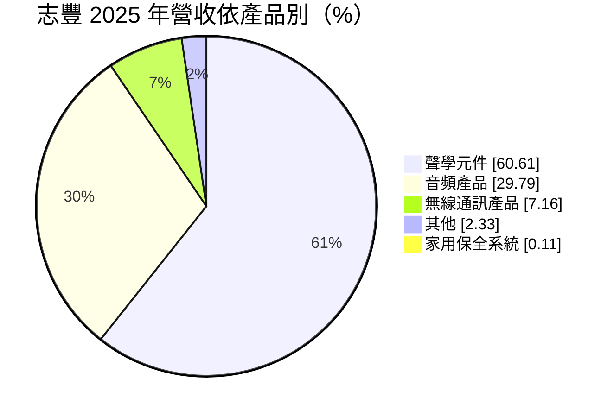
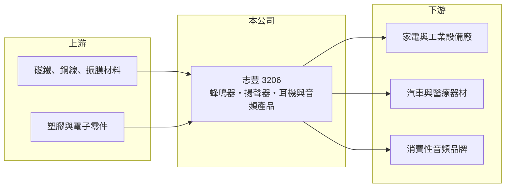

# 3206 志豐

> 上櫃｜[[產業索引-電子零組件業|電子零組件業]]｜上市（櫃）日期 2007/02/08

# 第一章：企業模式與商業藍圖

> [!info] 撰寫說明
> 精簡版，由 Claude 依公開資料整理，架構比照 [[2330台積電]]，資料截至 2026-10-08。來源：櫃買中心開放資料快照（基本資料、2026 年第二季資產負債與損益、本益比殖利率）、Goodinfo 經營績效頁、富邦 MoneyDJ 公司基本資料（2025 年營收比重）、CMoney 文章標題。產品細項與生產據點部分依記憶整理。#待校對

志豐電子（以下簡稱志豐）是一家聲學元件與音頻產品製造商，理解它的關鍵在於：公司從蜂鳴器、[[揚聲器]]等小型聲學元件起家，再往耳機等完整音頻產品延伸，毛利率約兩成，獲利跟著音頻產品的訂單週期起伏。

- **核心業務：** 志豐成立於 1979 年，總部在新北淡水，2007 年在櫃買中心掛牌。公司生產[[蜂鳴器]]、揚聲器、麥克風等聲學元件，用於家電、汽車、工業設備、醫療器材與消費性電子的提示音與語音功能（產品細項依記憶整理，#待校對）。這類元件單價低、但幾乎所有會發出聲音的電子產品都需要。
- **營收結構：** 2025 年聲學元件約占 61%、音頻產品約 30%、無線通訊產品約 7%，其他與家用保全系統合計約 2%。依 CMoney 文章標題，市場將志豐定位為「耳機與專業聲學大廠」，音頻產品（例如耳機）是聲學元件之外的第二支柱。
- **營運據點：** 總部在台灣，生產基地主要在中國大陸（廠區明細未查得，#待校對）。聲學元件組裝需要大量人工，生產地點與勞動成本、客戶供應鏈要求密切相關。
- **長期方向：** 志豐的長期課題是提高車用、工業與專業音頻等高附加價值產品的比重。這些應用對可靠度與聲學調校要求高，產品生命週期長，比一般消費性耳機更能穩定獲利。2023 年 ROE 達 20.8% 的高點，顯示產品組合對時，獲利能力可以明顯提升。

# 第二章：護城河深度與競爭優勢

志豐的護城河來自聲學設計經驗與客戶認證，屬於中小型零組件廠的窄護城河。

- **競爭優勢：** 聲學元件的音壓、頻率與耐用度要依產品機構調校，客戶在設計階段選定料號後，量產期間通常不會更換，這就是[[設計導入]]帶來的黏著度。志豐經營四十多年，累積大量標準品型錄與客製經驗，能同時服務許多中小量多樣的工業客戶。
- **主要對手：** 聲學元件領域有日系廠商（如村田、TDK 的蜂鳴器產品）與大量中國廠商競爭；耳機與音頻產品方面，台灣的 [[2439美律]] 規模大得多，中國的歌爾、立訊等代工大廠也具成本優勢。志豐的定位是避開大品牌旗艦機種，專注於中小量、多樣化的訂單。
- **觀察重點：** 長期要觀察[[毛利率]]能否維持在 20% 以上，以及音頻產品訂單是否穩定。營業利益率由 2023 年的 8.88% 降到 2025 年的 4.42%，主要受音頻產品訂單減少與費用壓力影響（推估）。

# 第三章：財務體質與盈利規模

資料日期：2026-10-08，表格是撰寫當時的快照；最新月營收、毛利率、累計 EPS 由自動排程寫在本筆記的屬性欄位（月營收、毛利率、累計EPS 等）。#待校對

志豐的財務屬於中小型零組件廠的樣貌：營收約 30 至 40 億元、毛利率約兩成，獲利隨產品組合波動，配息穩定。

| 年度 | 營收（億元） | [[毛利率]] | [[營業利益率]] | EPS（元） | [[ROE]] |
|---|---|---|---|---|---|
| 2021 | 42.6 | 14.2% | 3.34% | 2.39 | 12.0% |
| 2022 | 41.5 | 19.8% | 6.34% | 3.60 | 17.2% |
| 2023 | 35.5 | 21.9% | 8.88% | 4.82 | 20.8% |
| 2024 | 36.8 | 21.5% | 6.25% | 4.10 | 13.7% |
| 2025 | 31.9 | 20.8% | 4.42% | 2.02 | 7.17% |

（來源：Goodinfo 經營績效頁；2020 年營收 33.9 億元、EPS 2.90 元。）

- **營收規模：** 2020 至 2025 年營收年複合成長率約 -1.2%（推算），2021 年高點後回落。2026 年上半年營收約 16.1 億元，毛利率約 20.7%、營業利益率約 4.39%，EPS 0.82 元。營收規模大致持平，獲利變化主要來自毛利率與費用。
- **獲利：** 2021 至 2025 年平均 ROE 約 14.2%（推算），在中小型零組件廠中屬於中上水準。2021 年毛利率只有 14.2%，2022 年回升到 19.8%，反映原物料與運費高漲時期的成本壓力，以及之後的產品組合調整。
- **財務特色：** 2026 年第二季總資產約 32.2 億元、負債約 15.0 億元、權益約 17.2 億元（其中[[非控制權益]]約 1.6 億元），負債比約 47%，每股淨值約 26.4 元。最近一期每股現金股利 1.5 元，以 2025 年 EPS 2.02 元計，配息率約 74%（推算）；Goodinfo 統計歷年平均現金股利約 1.15 元，配息穩定。
- **[[ROIC]] 與 [[WACC]]：** 以 2025 年營業利益約 1.41 億元（31.9 億元 × 4.42%）、稅率 20% 計算，稅後營業利益約 1.13 億元。有息負債未查得，投入資本以權益約 17.2 億元到「權益加全部負債」約 32.2 億元為區間，ROIC 約 3.5% 至 6.6%（推算）；2023 年同法約 7% 至 13%（推算）。WACC 以 [[CAPM]] 推估：無風險利率 1.75%、市場風險溢酬 6%、β 假設 0.9，權益成本約 7.2%；負債占三成、稅後成本 2%，WACC 約 5.6%（推算）。景氣好的年度 ROIC 高於 WACC，2025 年則大致持平，長期屬於小幅創造價值的類型。

# 第四章：總體風險與地緣政治

志豐的風險來自消費性音頻產品的訂單波動、中國生產集中與原物料成本。

- **產業週期：** 耳機與消費性音頻產品的需求受終端品牌新機週期影響，訂單可能隨機種結束而中斷。工業與家電用聲學元件較穩定，但也跟著全球製造業景氣起伏。
- **營運風險：** 中小型零組件廠的客戶議價力強，價格每年都有調降壓力。若音頻產品失去主要客戶，營收與毛利率都會受影響。合併報表中有子公司的外部股東權益，部分獲利不歸母公司股東。
- **其他風險：** 生產集中於中國，面臨關稅、人工成本上升與供應鏈移轉的壓力。磁鐵、銅線等原料價格與匯率變動也影響毛利。

# 專有名詞解析

## 金融

- **[[非控制權益]]**：合併報表中屬於子公司其他股東的權益與淨利，不歸母公司股東所有。
- **[[CAPM]]**：資本資產定價模型，以無風險利率加上 β 乘以市場風險溢酬，推估股東要求的報酬率。

## 產業

- **[[揚聲器]]**：把電訊號轉成聲音的元件，由磁路、振膜與音圈組成，用於音響、汽車、手機與筆電。
- **[[蜂鳴器]]**：發出提示音的小型聲學元件，常見於家電、汽車、醫療與工業設備。
- **[[設計導入]]**：零件被客戶選入產品設計並完成驗證，之後該產品量產期間都會持續採購，是零組件廠長期營收的來源。

# 核心供應鏈

- 上游：磁鐵、漆包線、振膜材料、塑膠件與電子零件供應商（具體名單未查得）。#待校對
- 下游／客戶：家電、工業設備、汽車、醫療器材製造商與消費性音頻品牌（具體名單未查得）。#待校對
- 同業：[[2439美律]]（耳機與聲學）；國際的村田、TDK 聲學元件部門與中國歌爾等。

## 最新新聞
<!-- news:start -->
<!-- news:end -->

## 相關連結
- [公開資訊觀測站](https://mopsov.twse.com.tw/mops/web/t05st03?step=1&firstin=1&co_id=3206)
- [Goodinfo](https://goodinfo.tw/tw/StockDetail.asp?STOCK_ID=3206)
- [Yahoo 股市](https://tw.stock.yahoo.com/quote/3206)
- [鉅亨網新聞](https://www.cnyes.com/twstock/3206/news)
