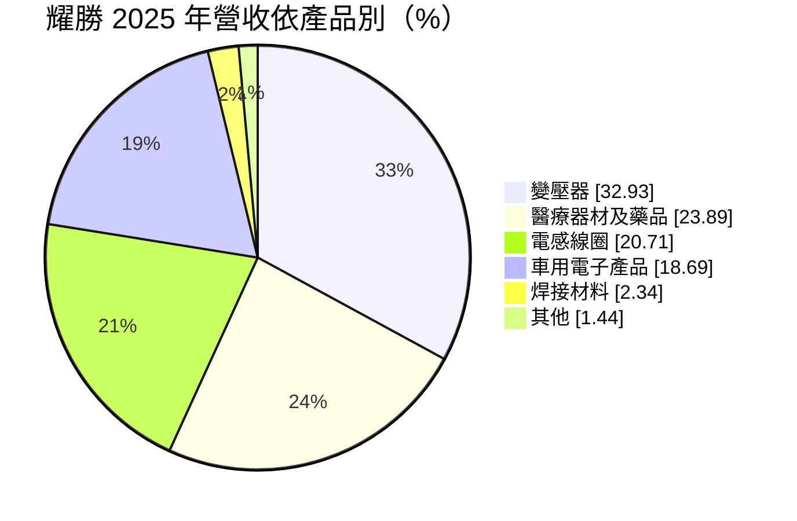
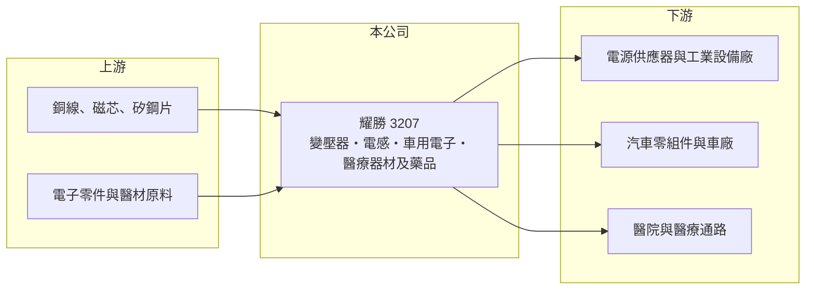

# 3207 耀勝

> 上櫃｜[[產業索引-電子零組件業|電子零組件業]]｜上市（櫃）日期 2004/11/04

# 第一章：企業模式與商業藍圖

> [!info] 撰寫說明
> 精簡版，由 Claude 依公開資料整理，架構比照 [[2330台積電]]，資料截至 2026-10-08。來源：櫃買中心開放資料快照（基本資料、2026 年第二季資產負債與損益、本益比殖利率）、Goodinfo 經營績效頁、富邦 MoneyDJ 公司基本資料（2025 年營收比重）、優分析與理財周刊文章標題。醫療事業的子公司架構未查得。#待校對

耀勝電子（以下簡稱耀勝）原本是[[變壓器]]與[[電感]]等磁性元件製造商，理解它的關鍵在於：公司近年透過集團化經營跨入車用電子與醫療事業，營收規模五年內成長超過一倍，但新事業尚未帶來穩定獲利。

- **核心業務：** 耀勝成立於 1992 年，總部在桃園大溪，2004 年在櫃買中心掛牌。本業是變壓器與電感線圈，這類[[磁性元件]]負責電壓轉換與濾波，用於電源供應器、工業設備與家電。2025 年磁性元件合計約占營收 54%，仍是主要收入來源。
- **營收結構：** 醫療器材及藥品約占 24%、車用電子產品約占 19%，焊接材料與其他約 4%。醫療事業的加入讓公司從單純的電子零組件廠，變成「電子加醫療」的多角化集團；依理財周刊文章的圖說，耀勝集團董事長蘇浩熙同時擔任「強生」的總經理，顯示醫療業務透過集團內公司經營（公司全名與持股比例未查得，#待校對）。
- **營運據點：** 總部與部分生產在台灣，磁性元件的主要生產基地推估在中國與東南亞（未查得，#待校對）。合併報表中[[非控制權益]]約 19.2 億元，高於歸屬母公司的權益約 17.0 億元，代表集團內有外部股東持股比例很高的子公司。
- **長期方向：** 依優分析文章標題，公司規劃多元事業並進、提升毛利率，並與強生策略聯盟拓展醫療布局。長期看，車用電子與醫療器材的認證門檻高、產品生命週期長，若能放量，有機會改善磁性元件本業低毛利的結構；但多角化也意味著管理複雜度與資本需求同步增加。

# 第二章：護城河深度與競爭優勢

耀勝的護城河尚在建立中，本業磁性元件競爭激烈，新事業的優勢仍待證明。

- **競爭優勢：** 變壓器與電感需依客戶的電源設計客製，完成驗證後可隨產品量產多年，具一定的轉換成本。車用電子需通過車規驗證、醫療器材需取得法規許可證，這些門檻一旦跨過，就能形成比一般電子零件更穩定的客戶關係。耀勝同時擁有磁性元件與車用、醫療三條產品線，可在不同產業間分散風險。
- **主要對手：** 磁性元件領域的台灣同業包括 [[2457飛宏]]（電源）、[[3058立德]]、[[6155鈞寶]] 等，以及大量中國廠商；車用電子與醫療器材則面對各自產業的專業廠商，例如 [[4106雃博]]、[[4126太醫]] 等醫材公司。
- **觀察重點：** 長期最該觀察的是醫療與車用事業何時轉為穩定獲利，以及[[毛利率]]能否回到 2022、2023 年約 26% 至 27% 的水準。2024 年後營收成長但毛利率降到 15% 至 18%，代表新增營收的獲利能力偏低。

# 第三章：財務體質與盈利規模

資料日期：2026-10-08，表格是撰寫當時的快照；最新月營收、毛利率、累計 EPS 由自動排程寫在本筆記的屬性欄位（月營收、毛利率、累計EPS 等）。#待校對

耀勝的財務呈現「營收擴張、獲利轉弱」的多角化轉型期特徵，且合併報表中外部股東權益比重很高。

| 年度 | 營收（億元） | [[毛利率]] | [[營業利益率]] | EPS（元） | [[ROE]] |
|---|---|---|---|---|---|
| 2021 | 9.69 | 16.2% | 0.37% | 0.74 | 8.45% |
| 2022 | 12.3 | 26.2% | 10.5% | 4.32 | 28.4% |
| 2023 | 11.2 | 27.1% | 4.44% | 1.75 | 7.04% |
| 2024 | 15.2 | 17.6% | -0.52% | -0.16 | -1.79% |
| 2025 | 19.2 | 15.4% | -5.12% | -0.82 | -2.74% |

（來源：Goodinfo 經營績效頁；2020 年營收 7.2 億元、EPS -0.39 元。）

- **營收規模：** 2020 至 2025 年營收由 7.2 億元增至 19.2 億元，年複合成長率約 21.7%（推算），主要來自醫療與車用事業的併入（推估）。2026 年上半年營收約 8.24 億元，毛利率約 18.3%，營業虧損約 0.72 億元，EPS -1.09 元。
- **獲利：** 2021 至 2025 年平均 ROE 約 7.9%（推算），但主要由 2022 年的 28.4% 拉高，2024、2025 年皆為虧損。營收擴大但營業利益率轉負，代表新事業的營業費用與管理成本高於其毛利貢獻。
- **財務特色：** 2026 年第二季總資產約 61.9 億元、負債約 25.7 億元、權益總計約 36.3 億元，其中歸屬母公司約 17.0 億元、非控制權益約 19.2 億元，母公司每股淨值約 25.7 元。近年未配發現金股利，Goodinfo 統計歷年平均現金股利約 0.21 元。新事業擴張期間自由現金流為負（推估）。
- **[[ROIC]] 與 [[WACC]]：** 2025 年營業虧損約 0.98 億元（19.2 億元 × -5.12%），稅後約 -0.79 億元（推算）。有息負債未查得，投入資本以權益總計約 36.3 億元到「權益加全部負債」約 61.9 億元為區間，ROIC 約 -1.3% 至 -2.2%（推算）。WACC 以 [[CAPM]] 推估：無風險利率 1.75%、市場風險溢酬 6%、β 假設 1.0，權益成本約 7.75%；負債占三成、稅後成本 2%，WACC 約 6.0%（推算）。ROIC 為負、低於 WACC，代表多角化擴張目前尚未創造價值；只有 2022 年本業景氣高點時明顯高於資金成本。

# 第四章：總體風險與地緣政治

耀勝的風險集中在多角化的執行、集團架構的複雜度與本業的價格競爭。

- **產業週期：** 磁性元件跟著電源供應器、工業與消費性電子景氣起伏，2022 年的高獲利屬於景氣高點，不宜視為常態。車用電子受汽車銷售與電動車政策影響，醫療器材則相對穩定但成長較慢。
- **營運風險：** 醫療與電子是完全不同的產業，法規、通路與研發邏輯都不同，跨產業管理容易分散資源。非控制權益比重高，代表部分子公司的獲利有一大半不屬於耀勝股東，母公司股東實際分到的利益需要特別留意。
- **其他風險：** 銅、矽鋼片等原料價格影響磁性元件成本；醫療器材與藥品受各國法規審查與健保給付政策影響。海外生產據點面臨關稅與地緣政治風險。

# 專有名詞解析

## 金融

- **[[非控制權益]]**：合併報表中屬於子公司其他股東的權益與淨利，不歸母公司股東所有。
- **[[CAPM]]**：資本資產定價模型，以無風險利率加上 β 乘以市場風險溢酬，推估股東要求的報酬率。

## 產業

- **[[變壓器]]**：利用線圈與鐵芯改變交流電壓的元件，是電源供應器與電力設備的基本零件。
- **[[電感]]**：以線圈儲存磁能、抑制電流變化的被動元件，用於濾波與電源轉換。
- **[[磁性元件]]**：以線圈與磁芯組成的元件總稱，包括變壓器、電感與扼流圈，負責電能轉換與雜訊抑制。

# 核心供應鏈

- 上游：銅線、磁芯、矽鋼片等磁性材料供應商，電子零件與醫材原料供應商（具體名單未查得）。#待校對
- 下游／客戶：電源供應器與工業設備廠（如 [[2308台達電]]、[[6282康舒]] 等產業代表，非公司揭露客戶）、汽車零組件廠、醫院與醫療通路。#待校對
- 同業：[[3058立德]]、[[6155鈞寶]]、[[2457飛宏]]（磁性元件與電源）；醫材 [[4106雃博]]、[[4126太醫]]。

## 最新新聞
<!-- news:start（自動產生，請勿手動編輯此範圍） -->
- 2026-10-15 🏛️ 重訊 15:56｜公告本公司發言人及財務主管異動｜[觀測站](https://mops.twse.com.tw/mops/#/web/t05st01)

完整紀錄：[[3207耀勝 新聞]]
<!-- news:end -->

## 相關連結
- [公開資訊觀測站](https://mopsov.twse.com.tw/mops/web/t05st03?step=1&firstin=1&co_id=3207)
- [Goodinfo](https://goodinfo.tw/tw/StockDetail.asp?STOCK_ID=3207)
- [Yahoo 股市](https://tw.stock.yahoo.com/quote/3207)
- [鉅亨網新聞](https://www.cnyes.com/twstock/3207/news)
