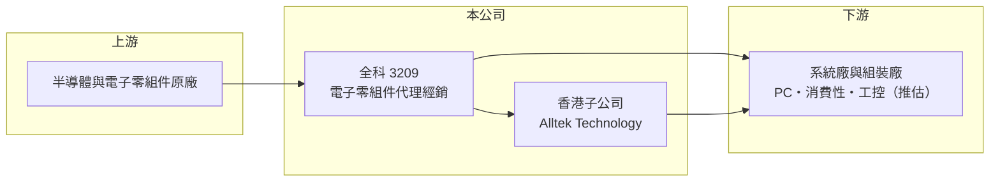

# 3209 全科

> 上市｜[[產業索引-電子通路業|電子通路業]]｜上市（櫃）日期 2008/11/26

# 第一章：企業模式與商業藍圖

> [!info] 撰寫說明
> 精簡版，由 Claude 依公開資料整理，架構比照 [[2330台積電]]，資料截至 2026-10-08。來源：證交所開放資料（基本資料、2026 年第二季財報、股利）、Goodinfo 經營績效與基本資料頁。公開資料有限，代理產品線與營收比重未查得，產品描述屬推估。#待校對

全科科技是一家以台灣為總部、透過香港子公司服務兩岸客戶的電子零組件通路商。理解它的關鍵，在於通路商「低毛利、高週轉」的商業邏輯，以及規模如何轉化為股東報酬。

- **核心業務：** 全科成立於 1991 年，2008 年上市，總部在台北內湖，主要從事半導體與電子零組件的代理與經銷，也就是[[電子通路]]。通路商替原廠向數以百計的系統廠鋪貨、備庫存、提供技術支援，賺取的是買賣價差與服務價值，而不是自己設計或製造晶片。
- **營收結構：** 公開資料未查得代理產品線與營收比重。從毛利率長期只有 4% 至 5% 判斷，主力應是出貨量大、標準化程度高的零組件（推估），這類產品競爭靠的是價格、交期與庫存調度，而非獨家技術。
- **營運據點：** 依 Goodinfo 揭露的子公司資料，全科設有香港子公司 Alltek Technology (H.K.) 負責電子零組件代理經銷，另有子公司嵩森科技與 Alltek Group Corp.。香港據點的意義在於承接華南組裝廠的訂單與美元結算，這是台灣通路商服務中國供應鏈的傳統架構。
- **長期方向：** 2020 至 2025 年營收在 419 億到 604 億元之間起伏，2026 年前 8 個月營收年增約 43%（證交所月營收）。長期來看，全科的成長要靠爭取新的[[代理權]]與擴大現有產品線在客戶端的滲透，而不是單純依賴景氣回升。

# 第二章：護城河深度與競爭優勢

通路商的護城河通常不深，但能靠規模、原廠關係與資金調度能力形成相對優勢。本章說明全科的競爭位置。

- **競爭優勢：** 全科的優勢在於經營三十多年累積的原廠授權與客戶名單，以及數百億元營收所需的[[營運資金]]調度能力。通路業的進入門檻之一是資金，客戶要求月結、原廠要求預付或短票期，只有資金充足的通路商能撐起大規模出貨。
- **主要對手：** 國內大型通路商 [[3702大聯大]]、[[3036文曄]] 規模大全科十倍以上，在同一批原廠的代理權爭奪上具有優勢；中型同業如 [[3312弘憶股]]、[[6189豐藝]]、[[3048益登]] 則與全科在中型客戶市場直接競爭。
- **觀察重點：** 通路業最大的結構風險是原廠收回代理權或整併通路。全科能否維持主要代理線、並在 AI 伺服器、車用、工控等成長應用取得新產品線，是判斷護城河是否穩固的關鍵。

# 第三章：財務體質與盈利規模

資料日期：2026-10-08，表格是撰寫當時的快照；最新月營收、毛利率、累計 EPS 由自動排程寫在本筆記的屬性欄位（月營收、毛利率、累計EPS 等）。#待校對

通路商的財務重點不在毛利率高低，而在於微薄的利潤率能否透過高資產週轉轉化為不錯的 ROE。

| 年度 | 營收（億元） | [[毛利率]] | [[營業利益率]] | EPS（元） | [[ROE]] |
|---|---|---|---|---|---|
| 2020 | 419 | 3.87% | 1.36% | 2.51 | 14.1% |
| 2021 | 471 | 5.19% | 2.32% | 4.05 | 21.4% |
| 2022 | 604 | 4.06% | 2.03% | 5.01 | 24.9% |
| 2023 | 560 | 4.12% | 2.19% | 2.61 | 12.3% |
| 2024 | 459 | 5.02% | 2.60% | 3.02 | 14.6% |
| 2025 | 474 | 5.25% | 2.56% | 3.02 | 12.9% |
| 2026 上半年 | 343.3 | 5.12% | 2.95% | 3.28 | 未查得 |

- **營收規模：** 2020 至 2025 年營收年複合成長率約 2.5%（推算），2022 年是高點，之後隨庫存調整回落，2026 年上半年營收 343 億元，已接近 2025 年全年的七成。
- **獲利：** 營業利益率長期在 1.4% 至 3% 之間，屬典型通路商水準。近 5 年（2021 至 2025）平均 ROE 約 17.2%（推算），代表即使利潤率很薄，靠高週轉與適度財務槓桿仍能為股東創造雙位數報酬。
- **財務特色：** 2026 年第二季總資產 229.7 億元、負債 171.4 億元、權益 58.4 億元，負債比約 75%，反映通路商以應付帳款與銀行借款支撐存貨與應收帳款的結構。2025 年度配發現金股利 2 元加股票股利 0.5 元，公司章程規定盈餘分配不低於可分配盈餘的 50%。

**[[ROIC]] 與 [[WACC]]：** 有息負債金額未查得，以負債總額的 40% 估計約 68.5 億元（推算假設）。2025 年營業利益約 12.1 億元，扣 20% 稅後約 9.7 億元，除以權益 58.4 億元加有息負債 68.5 億元，ROIC 約 7.6%；以 2026 年上半年營業利益 10.1 億元年化，ROIC 約 12.8%（推算）。WACC 以 CAPM 推估：無風險利率 1.75%、市場風險溢酬 6%、β 取通路同業常見值 1.0，股權成本約 7.75%；稅前負債成本 2.5%、稅後 2%，股權占比約 46%，WACC 約 4.6%（推算）。ROIC 高於 WACC，代表全科在正常景氣下能創造價值，但利差會隨營業利益率起伏而明顯擴大或收斂。

# 第四章：總體風險與地緣政治

通路商位於原廠與系統廠之間，風險主要來自庫存、代理權與資金成本三方面。

- **產業週期：** 電子零組件需求有明顯的庫存循環，2022 年缺貨時通路商拉高庫存，2023 年需求轉弱後營收與 EPS 同步下滑。[[長鞭效應]]會讓通路商的存貨跌價風險比終端品牌更大。
- **營運風險：** 原廠收回代理權、原廠之間合併後整併通路，都可能讓一條產品線的營收一次消失。此外大額應收帳款集中在少數客戶時，客戶倒帳的衝擊會遠超過一年的獲利。
- **其他風險：** 香港子公司承接兩岸訂單，暴露在美中科技管制與出口限制之下；營收以美元計價、帳上負債高，匯率與利率變動會直接影響業外損益與利息支出。

# 專有名詞解析

## 金融

- **[[營運資金]]**：存貨加應收帳款減應付帳款，是企業營運需要先墊付的資金，通路商營收成長時需求會同步增加。
- **[[長鞭效應]]**：終端需求的小幅變動，沿供應鏈往上游傳遞時被逐級放大，造成上游庫存與訂單劇烈波動。

## 產業

- **[[電子通路]]**：替半導體原廠向系統廠銷售零組件、備庫存並提供技術支援的中間商，賺取買賣價差與服務價值。
- **[[代理權]]**：原廠授權通路商銷售其產品的權利，可能因原廠策略調整或併購而被收回。

# 核心供應鏈

- 上游：半導體與電子零組件原廠（代理品牌未查得）。
- 下游／客戶：台灣與中國的電子系統廠、組裝廠（推估）。
- 同業：[[3702大聯大]]、[[3036文曄]]、[[3312弘憶股]]、[[6189豐藝]]、[[3048益登]]、[[3028增你強]]。

## 最新新聞
<!-- news:start（自動產生，請勿手動編輯此範圍） -->
- 2026-10-12 📰 媒體 18:50｜營收速報 - 全科(3209)9月營收57.03億元年增率高達90.48％｜[鉅亨網](https://news.cnyes.com/news/id/6628383)
- 2026-10-12 🏛️ 重訊 17:06｜代子公司嵩森科技公告向關係人取得使用權資產｜[觀測站](https://mops.twse.com.tw/mops/#/web/t05st01)

完整紀錄：[[3209全科 新聞]]
<!-- news:end -->

## 相關連結
- [公開資訊觀測站](https://mopsov.twse.com.tw/mops/web/t05st03?step=1&firstin=1&co_id=3209)
- [Goodinfo](https://goodinfo.tw/tw/StockDetail.asp?STOCK_ID=3209)
- [Yahoo 股市](https://tw.stock.yahoo.com/quote/3209)
- [鉅亨網新聞](https://www.cnyes.com/twstock/3209/news)
