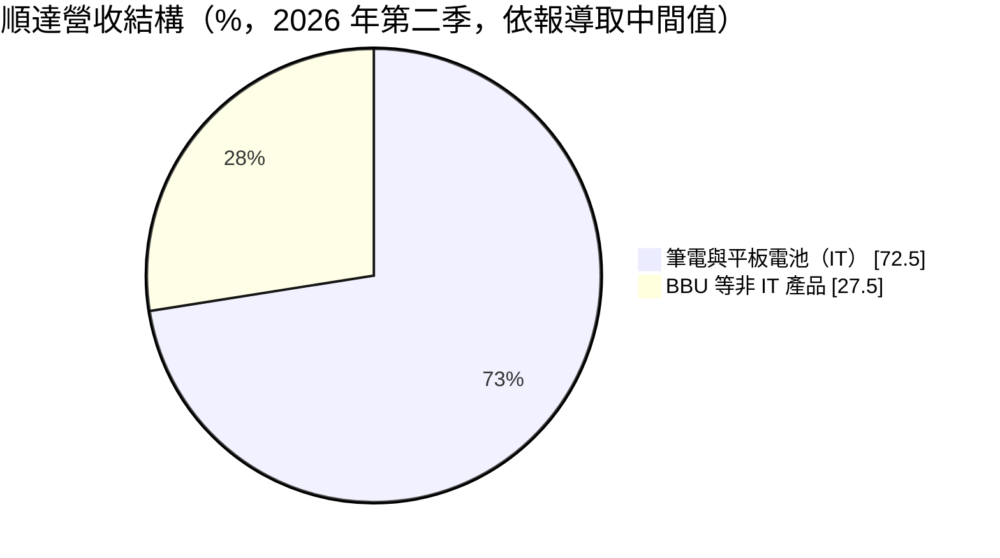
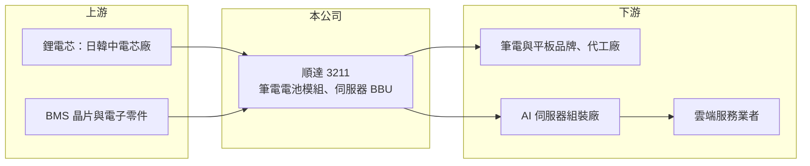

# 3211 順達

> 上櫃｜[[產業索引-電腦及週邊設備業|電腦及週邊設備業]]｜上市（櫃）日期 2004/11/08

# 第一章：企業模式與商業藍圖

> [!info] 撰寫說明
> 精簡版，由 Claude 依公開資料整理，架構比照 [[2330台積電]]，資料截至 2026-10-08。來源：櫃買中心開放資料快照（基本資料、2026 年上半年財報、本益比殖利率）、Goodinfo 經營績效年度表、Taipei Times 2026 年 7 月 30 日報導。2021 與 2024 年 EPS 中業外收益的來源未查得。#待校對

順達是台灣兩大筆電電池模組廠之一，近年把重心轉向 AI 伺服器的備援電池，本章說明這個轉型的商業邏輯。

- **核心業務：** 順達成立於 1998 年，2004 年上櫃，主要產品是筆記型電腦與平板用的[[鋰電池模組]]，以及資料中心伺服器機櫃用的 [[BBU]]。電池模組廠向日韓中電芯廠採購電芯，再加上電池管理系統（[[BMS]]）、保護電路與外殼，組裝成可以直接裝進產品的電池包，核心價值在於電路設計、安全驗證與大量生產。
- **營收結構：** 依 2026 年 7 月報導，包含 BBU 在內的非 IT 產品在 2026 年第二季約占營收 25% 至 30%，公司預期 2026 年全年超過 50%，AI 資料中心 BBU 營收可達 60 億至 70 億元。其餘為筆電與平板電池。BBU 毛利率高於筆電電池，因此非 IT 比重的高低直接決定公司的獲利率。
- **營運據點：** 依同一報導，2026 年資本支出約 10 億元，主要用於擴充台灣與泰國的 BBU 產能，BBU 產線稼動率 2026 年約 60% 至 70%，預期 2027 年超過 80%。在台灣與泰國生產，可符合美國雲端客戶對非中國產地的要求。
- **長期方向：** 產品從 3kW、5.5kW BBU 往 8kW、12kW 升級，15kW 以上及 [[HVDC]] 相關產品預計 2027 年量產，並新增雲端服務客戶。AI 伺服器機櫃功率持續提高，每櫃需要的備援電力跟著增加，是順達未來十年最主要的成長來源。

# 第二章：護城河深度與競爭優勢

電池模組是代工性質的行業，本章分析順達如何從低毛利的筆電電池，轉往認證門檻較高的 BBU。

- **競爭優勢：** 順達長期供應全球筆電品牌，累積大規模生產與電池安全認證的經驗。BBU 要通過伺服器平台與雲端業者的長時間驗證，順達較早切入輝達（[[NVDA輝達]]）架構伺服器的 BBU 供應，取得先發優勢。一旦被設計進某一代伺服器平台，訂單通常會延續整個平台週期。
- **主要對手：** 筆電電池的主要對手是 [[6121新普]]，兩家長期占台灣筆電電池模組的大部分市場；BBU 領域還有 [[2308台達電]]、[[2301光寶科]] 等電源大廠，以及 [[3323加百裕]]、[[5309系統電]] 等新進者。電源大廠可以把電源與 BBU 整套供應，是順達最大的競爭壓力。
- **觀察重點：** 長期要看 BBU 能否維持較高毛利、新雲端客戶能否穩定放量，以及筆電電池的價格是否持續下滑。2026 年上半年非 IT 產品比重下降，就讓淨利年減約 31%，說明公司獲利對 BBU 出貨節奏非常敏感。

# 第三章：財務體質與盈利規模

資料日期：2026-10-08，表格是撰寫當時的快照；最新月營收、毛利率、累計 EPS 由自動排程寫在本筆記的屬性欄位（月營收、毛利率、累計EPS 等）。#待校對

順達營收在 2021 年達到 208 億元高峰後逐年下滑，但毛利率從不到一成升到 16.6%，獲利結構明顯改善。

| 年度 | 營收（億元） | [[毛利率]] | [[營業利益率]] | EPS（元） | [[ROE]] |
|---|---|---|---|---|---|
| 2019 | 178 | 8.97% | 4.98% | 5.61 | 11.9% |
| 2020 | 193 | 10.7% | 6.94% | 7.02 | 14.5% |
| 2021 | 208 | 7.87% | 4.08% | 22.42 | 38.9% |
| 2022 | 191 | 8.90% | 4.56% | 5.33 | 8.73% |
| 2023 | 172 | 8.81% | 4.06% | 5.23 | 9.29% |
| 2024 | 139 | 11.4% | 5.34% | 17.59 | 28.0% |
| 2025 | 132 | 16.6% | 9.43% | 9.05 | 13.4% |

- **營收規模：** 營收從 2020 年 193 億元降到 2025 年 132 億元，五年年複合成長率約 -7.3%（推算），主因是筆電電池縮減。2026 年上半年營收 68.4 億元、毛利率 16.9%、營業利益率 9.5%、EPS 3.40 元。
- **獲利：** 2021 與 2024 年 EPS 明顯高於本業水準。以 2024 年為例，營業利益約 7.4 億元，稅後換算每股約 3.9 元，EPS 17.59 元中大部分應來自業外收益（推算，來源未查得）。近五年平均 ROE 約 19.7%，但受這兩年一次性收益拉高，本業 ROE 較接近 9% 至 14%（推算）。
- **財務特色：** 2026 年第二季末總資產 188.6 億元、總負債 99.0 億元，負債比約 53%，負債大多為應付帳款等營運負債；股東權益 89.6 億元，每股淨值 58.04 元。2025 年度現金股利約 11.47 元，高於當年 EPS 9.05 元，顯示公司習慣把一次性收益與累積盈餘大方發還股東。
- **[[ROIC]] 與 [[WACC]]：** 2026 年上半年營業利益 6.46 億元，年化稅後約 10.3 億元；以股東權益 89.6 億元計 ROIC 約 11.5%，含全部負債 188.6 億元計約 5.5%（推算）。2025 年營業利益約 12.4 億元、稅後約 10 億元，ROIC 約 10% 至 11%（以權益計，推算）。WACC 以 CAPM 推估：無風險利率 1.75%、市場風險溢酬 6%、β 取 1.2（AI 相關題材股波動較大，同業常見值），股東權益成本約 8.95%；有息負債比重假設 15%、成本 2%、稅後 1.6%，WACC 約 7.8%（推算）。以權益計算的 ROIC 高於 WACC，代表 BBU 轉型後本業開始創造價值；筆電電池時代的 ROIC 則大致與 WACC 相當。

# 第四章：總體風險與地緣政治

順達的轉型成果高度依賴 AI 資料中心，本章整理相關風險。

- **產業週期：** BBU 需求取決於雲端業者與 AI 伺服器的資本支出，一旦投資放緩，出貨與稼動率會快速下滑。筆電電池則跟著 PC 換機週期，長期成長有限、價格壓力大。
- **營運風險：** 電源大廠可整合 BBU 與電源模組一起銷售，順達若無法在規格升級（12kW 以上、HVDC）保持領先，可能被擠壓。客戶集中在少數伺服器平台與雲端業者，單一客戶訂單變化影響很大。電池涉及起火安全，品質事故會造成重大損失。
- **其他風險：** 電芯主要向日韓中廠商採購，電芯價格與供應會影響成本。營收以美元計價為主，新台幣升值壓縮毛利；泰國擴產涉及當地勞動成本與管理風險。

# 專有名詞解析

## 金融

- **[[ROIC]]**：投入資本報酬率，稅後營業利益除以股東權益加有息負債，衡量本業運用資本的效率。
- **[[WACC]]**：加權平均資金成本，股東權益成本與負債成本依資本結構加權，是 ROIC 必須超越的門檻。

## 產業

- **[[鋰電池模組]]**：把多顆鋰電芯加上保護電路、電池管理系統與外殼組成的電池包，供筆電、工具機或伺服器使用。
- **[[BBU]]**：備援電池單元，AI 伺服器機櫃在市電中斷時的短時供電裝置，可避免運算中斷。
- **[[BMS]]**：電池管理系統，監控每顆電芯的電壓、溫度與電量，避免過充過放並延長壽命。
- **[[HVDC]]**：高壓直流供電，資料中心以 ±400V 或 800V 直流取代傳統交流配電，可減少轉換損耗。

# 核心供應鏈

- 上游：日本、韓國與中國的鋰電芯廠（例如三星 SDI、LG 新能源、松下、村田，實際採購對象待校對），BMS 晶片與被動元件。
- 下游／客戶：筆電與平板品牌及其代工廠，採用 [[NVDA輝達]] 平台的 AI 伺服器組裝廠與雲端服務業者。
- 同業：[[6121新普]]、[[3323加百裕]]、[[5309系統電]]、4931新盛力；BBU 另有 [[2308台達電]]、[[2301光寶科]]。

## 最新新聞
<!-- news:start（自動產生，請勿手動編輯此範圍） -->
- 2026-10-16 🏛️ 重訊 17:01｜公告本公司115年第3季合併自結損益｜[觀測站](https://mops.twse.com.tw/mops/#/web/t05st01)

完整紀錄：[[3211順達 新聞]]
<!-- news:end -->

## 相關連結
- [公開資訊觀測站](https://mopsov.twse.com.tw/mops/web/t05st03?step=1&firstin=1&co_id=3211)
- [Goodinfo](https://goodinfo.tw/tw/StockDetail.asp?STOCK_ID=3211)
- [Yahoo 股市](https://tw.stock.yahoo.com/quote/3211)
- [鉅亨網新聞](https://www.cnyes.com/twstock/3211/news)
