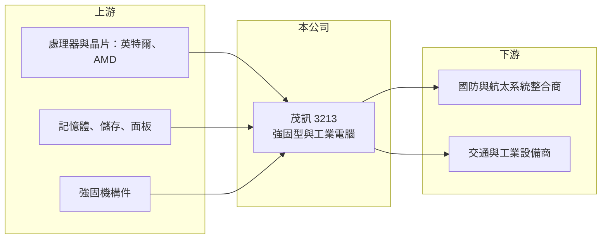

# 3213 茂訊

> 上櫃｜[[產業索引-電腦及週邊設備業|電腦及週邊設備業]]｜上市（櫃）日期 2004/10/01

# 第一章：企業模式與商業藍圖

> [!info] 撰寫說明
> 精簡版，由 Claude 依公開資料整理，架構比照 [[2330台積電]]，資料截至 2026-10-08。來源：櫃買中心開放資料快照（基本資料、2026 年上半年財報、本益比殖利率）、Goodinfo 經營績效年度表、nStock 公司簡介。公開資料有限，產品別與客戶別營收比重未查得，強固型電腦與國防應用的描述依財經媒體分類與記憶整理。#待校對

茂訊是專做特殊用途電腦的中小型廠商，本章說明它為何能在營收持平的情況下，維持遠高於一般電腦代工廠的獲利率。

- **核心業務：** 茂訊成立於 1990 年，2004 年上櫃，營業項目為電腦軟硬體與零組件的研發、設計、製造與銷售。財經媒體將它與 [[2364倫飛]] 並列為[[強固型電腦]]族群，產品用於國防、航太、交通與工業等嚴苛環境（待校對）。這類電腦要耐震、耐溫、防水防塵，並且長期供貨，與一般消費電腦是完全不同的市場。
- **營收結構：** 產品別與客戶別比重未查得。依產業特性推估，客戶以歐美國防與系統整合商為主，產品包含強固型系統、主機板與板卡等（推估，待校對）。這類訂單量小、規格多，但單價與毛利都較高。
- **營運據點：** 總部登記在新北市深坑，海外銷售據點與生產配置未查得。國防與航太客戶通常要求供應商長期穩定、可追溯，台灣廠商多以台灣生產搭配海外銷售服務據點經營。
- **長期方向：** 全球國防支出在 2020 年代明顯上升，歐美國家也更重視供應鏈來自友好國家，這對台灣的強固型電腦廠是長期順風。茂訊 2023 年起毛利率由約兩成跳升到三成以上，2026 年上半年再升到約 36%，反映高毛利產品比重提高。

# 第二章：護城河深度與競爭優勢

特殊用途電腦的競爭關鍵在於認證與長期供貨能力，本章分析茂訊的利基。

- **競爭優勢：** 強固型與國防用電腦要通過美軍標準等嚴格測試，並承諾多年不停產，客戶一旦把產品設計進武器或載具系統，往往在整個專案期間不會更換供應商。這種高轉換成本讓茂訊能維持三成以上毛利率與兩成左右的營業利益率，遠高於一般電腦代工的個位數。
- **主要對手：** 台灣同業有 [[2364倫飛]]、3416融程電、[[2395研華]]、3088艾訊、[[3594磐儀]]；國際有 Getac（3005神基 旗下）、Panasonic、Curtiss-Wright 等。大廠產品線完整、品牌知名度高，茂訊規模較小，靠特定專案與客製化能力爭取訂單。
- **觀察重點：** 長期要看國防相關訂單能否延續、毛利率能否維持在三成以上，以及營收能否跳脫近年 27 億至 30 億元的區間。過去營收持平但獲利率提升，未來若要成長，需要新客戶或新專案帶動規模擴大。

# 第三章：財務體質與盈利規模

資料日期：2026-10-08，表格是撰寫當時的快照；最新月營收、毛利率、累計 EPS 由自動排程寫在本筆記的屬性欄位（月營收、毛利率、累計EPS 等）。#待校對

茂訊營收多年持平在 27 億至 30 億元，但 2023 年起毛利率與營業利益率明顯上台階。

| 年度 | 營收（億元） | [[毛利率]] | [[營業利益率]] | EPS（元） | [[ROE]] |
|---|---|---|---|---|---|
| 2019 | 28.2 | 22.6% | 11.4% | 4.74 | 19.1% |
| 2020 | 29.8 | 22.9% | 12.5% | 5.51 | 21.0% |
| 2021 | 28.1 | 22.1% | 11.6% | 10.87 | 34.2% |
| 2022 | 27.1 | 20.6% | 9.81% | 3.89 | 10.3% |
| 2023 | 29.9 | 30.1% | 19.4% | 7.85 | 18.7% |
| 2024 | 28.5 | 31.5% | 19.0% | 8.44 | 17.2% |
| 2025 | 28.9 | 30.5% | 17.8% | 7.40 | 12.4% |

- **營收規模：** 營收從 2020 年 29.8 億元到 2025 年 28.9 億元，五年年複合成長率約 -0.6%（推算），規模穩定。2026 年上半年營收 17.4 億元、毛利率 35.9%、營業利益率 25.6%、EPS 5.62 元，營收與獲利率都高於往年同期。
- **獲利：** 近五年（2021 至 2025 年）平均 ROE 約 18.6%（推算）。2021 年 EPS 10.87 元明顯高於營業利益可支撐的水準，應含業外收益（推算，來源未查得）。2023 年後的高獲利則來自本業毛利率提升，品質較好。
- **財務特色：** 2026 年第二季末總資產 56.4 億元、總負債 16.9 億元，負債比約 30%，股東權益 39.4 億元，每股淨值 66.53 元。2024 年度現金股利 6 元、2025 年度 7 元，配息率約九成以上，近五年平均現金股利約 5.14 元，屬於高配息、穩定配息的公司。
- **[[ROIC]] 與 [[WACC]]：** 2026 年上半年營業利益 4.45 億元，年化稅後約 7.1 億元；以股東權益 39.4 億元計 ROIC 約 18.1%，含全部負債 56.4 億元計約 12.6%（推算）。2025 年營業利益約 5.1 億元、稅後約 4.1 億元，ROIC 約 10% 至 12%（推算）。WACC 以 CAPM 推估：無風險利率 1.75%、市場風險溢酬 6%、β 取工業電腦同業常見值 0.9，股東權益成本約 7.15%；幾乎沒有有息負債，假設比重 5%、稅後成本 1.6%，WACC 約 6.9%（推算）。ROIC 長期高於 WACC，代表茂訊在利基市場持續創造價值。

# 第四章：總體風險與地緣政治

茂訊的獲利來自利基市場，風險也集中在少數專案與客戶，本章整理相關風險。

- **產業週期：** 國防與航太採購受各國預算與政治週期影響，大型專案可能延後或取消；工業與交通應用則跟著設備投資景氣起伏。國防支出目前處於上升期，但十年尺度上會有高低循環。
- **營運風險：** 營收規模小、客戶集中，單一專案結束會造成明顯的營收缺口。強固型電腦需要長期供貨，舊零件停產時要重新設計與認證，增加成本。
- **其他風險：** 國防產品涉及出口管制與各國採購法規，政策變化可能限制銷售對象。營收以美元計價為主，新台幣升值會壓縮毛利；記憶體與處理器等零件價格上漲也影響成本。

# 專有名詞解析

## 金融

- **[[ROIC]]**：投入資本報酬率，稅後營業利益除以股東權益加有息負債，衡量本業運用資本的效率。
- **[[WACC]]**：加權平均資金成本，股東權益成本與負債成本依資本結構加權，是 ROIC 必須超越的門檻。

## 產業

- **[[強固型電腦]]**：為軍事、戶外、交通等嚴苛環境設計的電腦，需耐震、耐溫、防水防塵並長期供貨。
- **[[工業電腦]]**：用於工廠自動化、交通、醫療等場域的電腦，強調長期供貨、耐用與穩定。

# 核心供應鏈

- 上游：處理器與晶片（[[INTC英特爾]]、[[AMD超微]]）、記憶體與儲存、工業級面板與強固機構件。
- 下游／客戶：國防與航太系統整合商、交通與工業設備商（實際客戶未查得）。
- 同業：[[2364倫飛]]、3416融程電、[[2395研華]]、3088艾訊、[[3594磐儀]]、3005神基；國外有 Panasonic、Curtiss-Wright。

## 最新新聞
<!-- news:start -->
<!-- news:end -->

## 相關連結
- [公開資訊觀測站](https://mopsov.twse.com.tw/mops/web/t05st03?step=1&firstin=1&co_id=3213)
- [Goodinfo](https://goodinfo.tw/tw/StockDetail.asp?STOCK_ID=3213)
- [Yahoo 股市](https://tw.stock.yahoo.com/quote/3213)
- [鉅亨網新聞](https://www.cnyes.com/twstock/3213/news)
