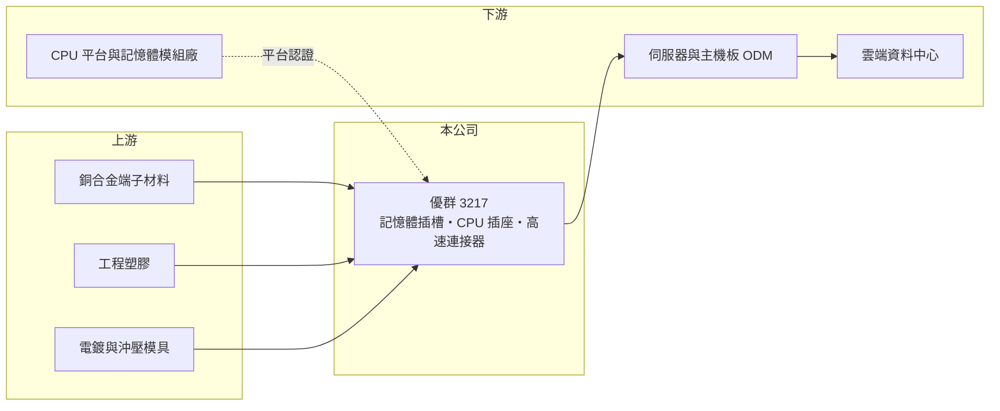

# 3217 優群

> 上櫃｜[[產業索引-電子零組件業|電子零組件業]]｜上市（櫃）日期 2004/04/30

# 第一章：企業模式與商業藍圖

> [!info] 撰寫說明
> 精簡版，由 Claude 依公開資料整理，架構比照 [[2330台積電]]，資料截至 2026-10-08。來源：櫃買中心開放資料快照（基本資料、2026 年第二季資產負債與損益、本益比殖利率）、Goodinfo 經營績效頁、富邦 MoneyDJ 公司基本資料、優分析與 CMoney 文章標題。產品細項與客戶依記憶整理，未逐條查證。#待校對

優群科技（以下簡稱優群）是一家專精於記憶體插槽等電腦與伺服器[[連接器]]的製造商，理解它的關鍵在於：它在一個利基產品上做到極高的毛利率，獲利跟著記憶體規格世代交替（例如 [[DDR5]]）而成長。

- **核心業務：** 優群成立於 1987 年，總部在新竹，2004 年在櫃買中心掛牌，營收 100% 來自電子零組件。公司的主力產品是記憶體模組插槽（[[DIMM 插槽]]），也就是主機板上插記憶體條的連接器，另有 CPU 插座與其他高速連接器（產品細項依記憶整理，#待校對）。每一片伺服器或電腦主機板都需要多個記憶體插槽，伺服器用量尤其多。
- **營收結構：** 公開資料只揭露「電子零組件 100%」，未拆分產品或應用（未查得）。依優分析文章標題，DDR5 滲透率提升曾帶動優群單季營收創新高，顯示記憶體規格升級是營收成長的主要驅動力。伺服器每顆 CPU 搭配的記憶體通道越來越多，插槽用量隨之增加。
- **營運據點：** 總部與研發在新竹，生產基地推估以中國與台灣為主（未查得，#待校對）。連接器生產需要精密沖壓、塑膠射出與電鍍，品質控管是核心能力。
- **長期方向：** 優群的長期成長動能來自伺服器平台世代交替：每一代新 CPU 平台都可能帶來新的記憶體規格與插槽設計，速度越高、對訊號完整性的要求越嚴格，能通過認證的供應商就越少。[[AI 伺服器]]與資料中心的擴建，也提升了高階插槽的需求。

# 第二章：護城河深度與競爭優勢

優群的護城河來自平台認證與高速訊號設計能力，是這批公司中護城河最明確的一家。

- **競爭優勢：** 記憶體插槽必須通過 CPU 平台廠與伺服器品牌的嚴格驗證，速度越快的世代驗證越難，供應商家數因此有限。優群長期專注於此一產品，累積了訊號完整性與精密製造經驗。[[毛利率]]長期維持在 40% 至 50%，遠高於一般連接器廠的 20% 至 30%，說明它在利基市場中擁有定價能力。
- **主要對手：** 記憶體插槽與 CPU 插座的主要競爭者包括美系的 Amphenol、TE Connectivity、Molex，以及台灣的 [[3533嘉澤]]、[[2392正崴]] 旗下的富士康系連接器業務。嘉澤是 CPU 插座的主要供應商，在伺服器高速連接器領域與優群直接競爭。
- **觀察重點：** 長期要觀察新一代記憶體規格（例如更高速的 DDR5 與後續世代、伺服器新型記憶體模組）中，優群能否維持認證與市占。2025 年營業利益率 31.5%，若能在下一代規格維持類似水準，代表護城河仍然有效。

# 第三章：財務體質與盈利規模

資料日期：2026-10-08，表格是撰寫當時的快照；最新月營收、毛利率、累計 EPS 由自動排程寫在本筆記的屬性欄位（月營收、毛利率、累計EPS 等）。#待校對

優群的財務特徵是高毛利、高 ROE、低負債與高配息，是典型的利基型零組件公司。

| 年度 | 營收（億元） | [[毛利率]] | [[營業利益率]] | EPS（元） | [[ROE]] |
|---|---|---|---|---|---|
| 2021 | 30.2 | 42.1% | 26.0% | 7.11 | 17.3% |
| 2022 | 26.1 | 39.3% | 20.7% | 6.80 | 15.7% |
| 2023 | 30.0 | 46.7% | 27.5% | 8.11 | 17.9% |
| 2024 | 34.7 | 50.0% | 30.4% | 11.25 | 22.7% |
| 2025 | 41.5 | 49.9% | 31.5% | 12.69 | 24.5% |

（來源：Goodinfo 經營績效頁；2020 年營收 26.0 億元、毛利率 48.0%、EPS 7.20 元。）

- **營收規模：** 2020 至 2025 年營收由 26.0 億元增至 41.5 億元，年複合成長率約 9.8%（推算），2024、2025 年連續成長。2026 年上半年營收約 18.95 億元，毛利率約 48.2%、營業利益率約 29.6%，EPS 5.20 元，獲利率維持在高檔。
- **獲利：** 2021 至 2025 年平均 ROE 約 19.6%（推算），且呈上升趨勢。即使在 2022 年電子業庫存調整期，營業利益率仍有 20.7%，顯示獲利的下限相當高，這是利基產品與高毛利帶來的抗跌性。
- **財務特色：** 2026 年第二季總資產約 71.3 億元、負債約 22.8 億元、權益約 48.5 億元，負債比約 32%，每股淨值約 53.8 元。最近一期每股現金股利 10 元，以 2025 年 EPS 12.69 元計，配息率約 79%（推算）；Goodinfo 統計歷年平均現金股利約 2.52 元，近年股利隨獲利明顯提高。高獲利、低資本支出的特性，推估自由現金流長期為正。
- **[[ROIC]] 與 [[WACC]]：** 以 2025 年營業利益約 13.1 億元（41.5 億元 × 31.5%）、稅率 20% 計算，稅後營業利益約 10.5 億元。有息負債未查得，投入資本以權益約 48.5 億元到「權益加全部負債」約 71.3 億元為區間，ROIC 約 14.7% 至 21.6%（推算）。WACC 以 [[CAPM]] 推估：無風險利率 1.75%、市場風險溢酬 6%、β 假設 1.0（電子零組件股常見值），權益成本約 7.75%；有息負債少，WACC 約 7.5%（推算）。ROIC 明顯高於 WACC，代表優群長期穩定創造經濟價值，是這批公司中資本效率最好的一家。

# 第四章：總體風險與地緣政治

優群的風險集中在產品集中、平台世代交替與客戶集中。

- **產業週期：** 營收高度依賴伺服器與電腦主機板出貨，資料中心投資若放緩，或電腦需求下滑，訂單會直接減少。記憶體規格換代初期需求暴增、成熟期價格下滑，形成另一層週期。
- **營運風險：** 產品集中在記憶體插槽等少數品項，若在新一代規格中失去認證或市占，影響會很大。技術路線也可能改變，例如部分新架構把記憶體直接焊在板上或改用其他模組形式，會減少插槽用量。
- **其他風險：** 客戶多為大型伺服器 ODM 與平台廠，議價力強。生產基地若在中國，面臨關稅與供應鏈移轉壓力。銅、貴金屬電鍍材料價格與匯率也影響成本。

# 專有名詞解析

## 半導體

- **[[DDR5]]**：第五代雙倍資料率記憶體標準，傳輸速度與容量高於 DDR4，伺服器與電腦平台約在 2022 年後開始導入。

## 應用

- **[[AI 伺服器]]**：搭載 GPU 等加速晶片、用於訓練與推論 AI 模型的伺服器，對散熱與電源規格要求很高。

## 金融

- **[[CAPM]]**：資本資產定價模型，以無風險利率加上 β 乘以市場風險溢酬，推估股東要求的報酬率。

## 產業

- **[[連接器]]**：讓電子零件、模組或設備之間可插拔連接的元件，負責傳遞電力或訊號。
- **[[DIMM 插槽]]**：主機板上插入記憶體模組的長條形連接器，伺服器每顆 CPU 常搭配多個插槽。

# 核心供應鏈

- 上游：銅合金端子材料、工程塑膠、電鍍與沖壓模具供應商（具體名單未查得）。#待校對
- 下游／客戶：伺服器與主機板廠（如 [[2382廣達]]、[[3231緯創]]、[[6669緯穎]]、[[2376技嘉]]、[[2357華碩]] 等產業代表，非公司揭露客戶），平台認證涉及 [[INTC英特爾]]、[[AMD超微]] 等 CPU 廠。#待校對
- 同業：[[3533嘉澤]]、[[2392正崴]]；國際的 Amphenol、TE Connectivity、Molex。

## 最新新聞
<!-- news:start -->
<!-- news:end -->

## 相關連結
- [公開資訊觀測站](https://mopsov.twse.com.tw/mops/web/t05st03?step=1&firstin=1&co_id=3217)
- [Goodinfo](https://goodinfo.tw/tw/StockDetail.asp?STOCK_ID=3217)
- [Yahoo 股市](https://tw.stock.yahoo.com/quote/3217)
- [鉅亨網新聞](https://www.cnyes.com/twstock/3217/news)
