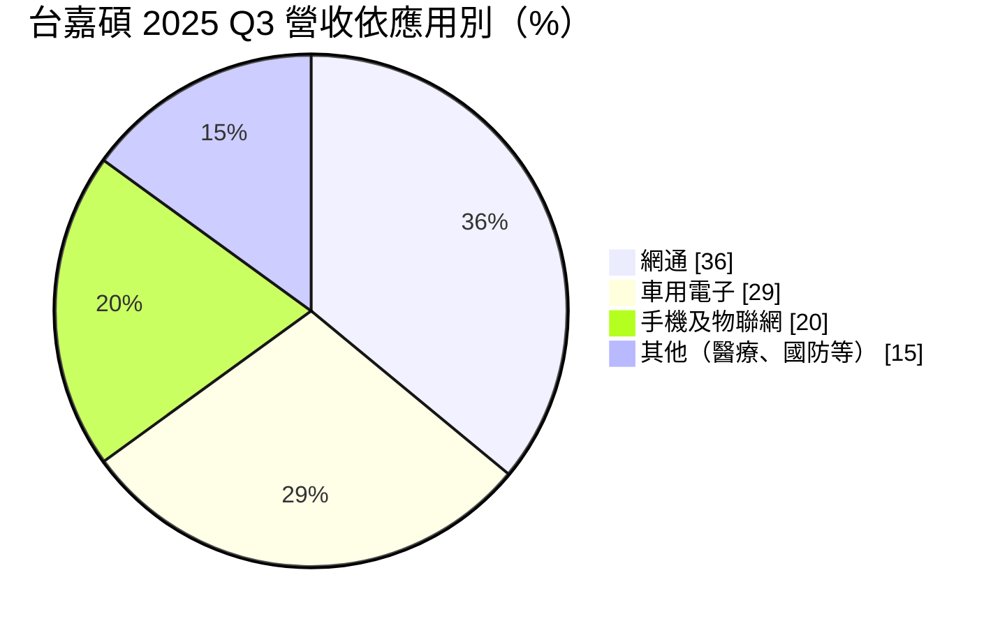
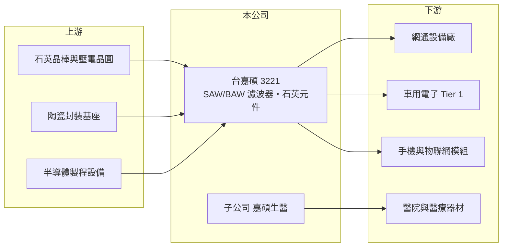

# 3221 台嘉碩

> 上櫃｜[[產業索引-通信網路業|通信網路業]]｜上市（櫃）日期 2006/02/22

# 第一章：企業模式與商業藍圖

> [!info] 撰寫說明
> 本文由 Claude 依公開資料整理，架構比照 [[2330台積電]] 的四章研究，資料截至 2026-10-08。財務數字來源：Goodinfo 年度經營績效頁、櫃買中心開放資料（基本資料、2026 年第二季資產負債與損益、本益比殖利率）、富果研究 2025 年 11 月法說會整理；產業描述為整理性內容，尚未逐條比對原始文件。#待校對

每一台無線設備都需要「頻率元件」來產生穩定的時脈與過濾訊號。本章說明台灣嘉碩科技（股票代號：3221，以下簡稱台嘉碩）的產品組合、應用分布，以及它如何從網通元件擴展到車用、衛星與醫療。

## 一、核心定位：頻率元件完整方案供應商

台嘉碩成立於 1997 年，總部在桃園平鎮，2006 年在櫃買中心掛牌，實收資本額約 10.5 億元。公司產品涵蓋 [[SAW 濾波器]]與 BAW 濾波器、石英晶體與振盪器、天線與陶瓷介質濾波器。濾波器負責讓無線設備只接收需要的頻段，石英元件則提供電子系統的時脈基準，兩者都是通訊設備不可缺少的基礎零件。

能同時提供濾波器與石英元件，是台嘉碩的定位特色：客戶在設計網通或車用模組時，可以向同一家供應商取得多種頻率元件，降低採購與驗證成本。

## 二、應用結構：網通與車用為主

依 2025 年第三季法說會資料：

地區分布為亞洲 28%、中國 23%、美洲 21%、台灣 16%、歐洲 12%，客戶分散在各地。車用占比接近三成，應用包括車載通訊盒（T-Box）、[[ADAS]] 與充電樁；車用元件的驗證期長、產品週期也長，是相對穩定的收入來源。

## 三、長期方向：非中國產能與第二成長曲線

台嘉碩的生產據點在台南與中國無錫，並在菲律賓 Laguna 建立新廠，2025 年底至 2026 年初試量產，目的在回應客戶「非中國製造」的需求。技術上，公司開發以 SAW 技術製作的高頻[[石英振盪器]]（頻率可達 625MHz，用於 AI 高速傳輸）與 5G 小型基地台濾波器。第二成長曲線是子公司嘉碩生醫，聚焦醫療器材與檢驗感測器，已打入 40 家以上大型醫院，並在 17 個國家申請產品取證。

# 第二章：護城河深度與競爭優勢

在長期價值投資中，「護城河」指企業抵禦競爭、維持超額利潤的保護機制。本章分析台嘉碩在頻率元件市場的競爭位置。

## 一、台嘉碩的相對優勢

* **產品線完整：** 同時提供 SAW/BAW 濾波器、石英元件與天線，能以組合方案服務網通與車用客戶。
* **車用驗證：** 車用頻率元件需通過嚴格的可靠度驗證，一旦導入，通常能供應整個車款生命週期，轉換成本高。
* **非中國產能：** 菲律賓新廠讓公司能爭取供應鏈重組下的訂單，法說會提到希望藉此取得更好的定價權。

## 二、主要競爭對手

| 對手 | 定位 | 對台嘉碩的威脅 |
|---|---|---|
| 村田製作所、Qorvo、Skyworks | 國際濾波器大廠 | 在手機與高階射頻前端居主導地位 |
| [[3042晶技]] | 全球主要石英元件廠 | 規模大，在石英元件直接競爭 |
| [[3152璟德]] | LTCC 濾波器與天線 | 在網通、衛星高頻元件部分重疊 |
| 中國頻率元件廠 | 低價石英與 SAW 元件 | 壓低網通與消費性產品價格 |

## 三、守得住／守不住／觀察重點

守得住的是車用與工業等驗證週期長的市場。守不住的是一般網通與手機元件的價格，2021 年毛利率 24.7%，2025 年降到 20.5%，營業利益率則從 2022 年的 14.2% 降到 1% 上下，顯示價格競爭與費用上升的壓力。長期觀察重點是菲律賓廠的效益、高頻石英振盪器能否打入 AI 伺服器與光模組供應鏈，以及嘉碩生醫能否轉為獲利。

# 第三章：財務體質與盈利規模

資料日期：2026-10-08，表格是撰寫當時的快照；最新月營收、毛利率、累計 EPS 由自動排程寫在本筆記的屬性欄位（月營收、毛利率、累計EPS 等）。#待校對

財務報表是檢驗護城河是否真實存在的最終標準。本章用五年的三率、ROE 與資本報酬，檢視台嘉碩的獲利品質。

## 一、多年度經營績效

| 年度 | 營收（新台幣） | [[毛利率]] | [[營業利益率]] | EPS（元） | [[ROE]] |
|---|---|---|---|---|---|
| 2021 | 29.3 億 | 24.7% | 7.82% | 5.28 | 24.3% |
| 2022 | 33.6 億 | 27.6% | 14.2% | 3.18 | 14.0% |
| 2023 | 21.3 億 | 24.8% | 0.57% | -0.13 | -2.03% |
| 2024 | 21.8 億 | 21.7% | 2.78% | 0.98 | 3.51% |
| 2025 | 22.3 億 | 20.5% | 1.23% | 0.08 | -1.18% |
| 2026 上半年 | 12.1 億 | 24.0% | 6.46% | 0.82 | 未查得 |

2021 至 2022 年是網通需求高峰，之後營收從 33.6 億元降到 21 億元上下，營業利益率幾乎歸零。2021 年 EPS 5.28 元高於營業利益所能支撐的水準，推估含有業外收益（推估）。2021 至 2025 年平均 ROE 約 7.7%（推算），營收年複合成長率約 -6.6%（推算）。2025 年第三季因韓國訴訟提列約 3,900 萬元費用，壓低全年獲利。2026 年上半年毛利率回升到 24%、營業利益率 6.5%，是近三年最好的水準。Goodinfo 統計歷年平均現金股利約 0.98 元，最近一次約 0.28 元，配息隨獲利波動。

## 二、[[ROIC]] 與 [[WACC]]：價值創造利差

**ROIC 推算：** 2025 年營業利益約 0.27 億元（22.3 億 × 1.23%），稅後約 0.22 億元。2026 年第二季股東權益約 21.6 億元，負債約 9.6 億元，假設有息負債約 5 億元（推估），投入資本約 26.6 億元，ROIC 約 0.8%（推算）。以 2026 年上半年營業利益 0.78 億元年化，稅後約 1.25 億元，ROIC 約 4.7%（推算）。

**WACC 推算：** 台灣 10 年期公債 1.75%、市場風險溢酬 6%、β 取電子零組件同業常見值 1.1，股東權益成本約 8.4%；負債成本 2.5%、稅後 2.0%；權益占投入資本約 81%，WACC 約 7.2%（推算）。

**結論：** 2023 年以後台嘉碩的 ROIC 持續低於 WACC，沒有創造價值；2022 年以前的高峰期則高於 WACC（推估）。2026 年上半年的改善若能延續並提升到 10% 左右的營業利益率，才可能重新跨過資金成本。

# 第四章：總體風險與地緣政治

任何企業都無法脫離宏觀環境獨立存在。本章分析台嘉碩長期必須面對的風險。

## 一、產業週期與價格競爭

頻率元件需求跟隨網通、手機與車用的出貨週期，2022 年後的庫存調整讓營收大幅下滑。中國廠商在石英與 SAW 元件大幅擴產，一般規格產品的價格長期承壓。

## 二、營運與法律風險

菲律賓新廠的初期折舊與學習曲線會影響毛利；嘉碩生醫屬於投資期，短期內可能拖累獲利。2025 年的韓國訴訟提列費用，顯示專利與商業糾紛也可能帶來一次性損失。

## 三、地緣政治與匯率

中國無錫是重要生產基地，美中貿易限制可能影響對美國客戶的出貨，這也是設立菲律賓廠的原因。營收以美元計價為主，新台幣升值會壓縮毛利。

# 專有名詞解析

## 應用

- **[[SAW 濾波器]]**：表面聲波濾波器，利用聲波在壓電材料表面傳遞來篩選特定頻率，常用於手機與網通設備。
- **[[石英振盪器]]**：利用石英晶體的穩定振動產生精準時脈訊號的元件，是電子系統計時的基準。
- **[[ADAS]]**：先進駕駛輔助系統，以攝影機、雷達等感測器協助駕駛，例如自動煞車與車道維持。

## 金融

- **[[ROIC]]**：投入資本報酬率，稅後營業利益除以股東權益與有息負債的合計，衡量本業對所有資金提供者的報酬。
- **[[WACC]]**：加權平均資金成本，依股東權益與負債的比重加權計算的資金成本，ROIC 高於它才代表創造價值。

# 核心供應鏈

## 1. 上游：材料與封裝
- 石英晶棒、鉭酸鋰等壓電晶圓、陶瓷封裝基座供應商

## 2. 中游：台嘉碩與同業
- 同業：[[3042晶技]]、[[3152璟德]]、村田製作所

## 3. 下游：客戶
- 網通設備、車用電子、手機與物聯網模組廠（公司未揭露具名客戶）

## 最新新聞
<!-- news:start -->
<!-- news:end -->

## 相關連結
- [公開資訊觀測站](https://mopsov.twse.com.tw/mops/web/t05st03?step=1&firstin=1&co_id=3221)
- [Goodinfo](https://goodinfo.tw/tw/StockDetail.asp?STOCK_ID=3221)
- [Yahoo 股市](https://tw.stock.yahoo.com/quote/3221)
- [鉅亨網新聞](https://www.cnyes.com/twstock/3221/news)
