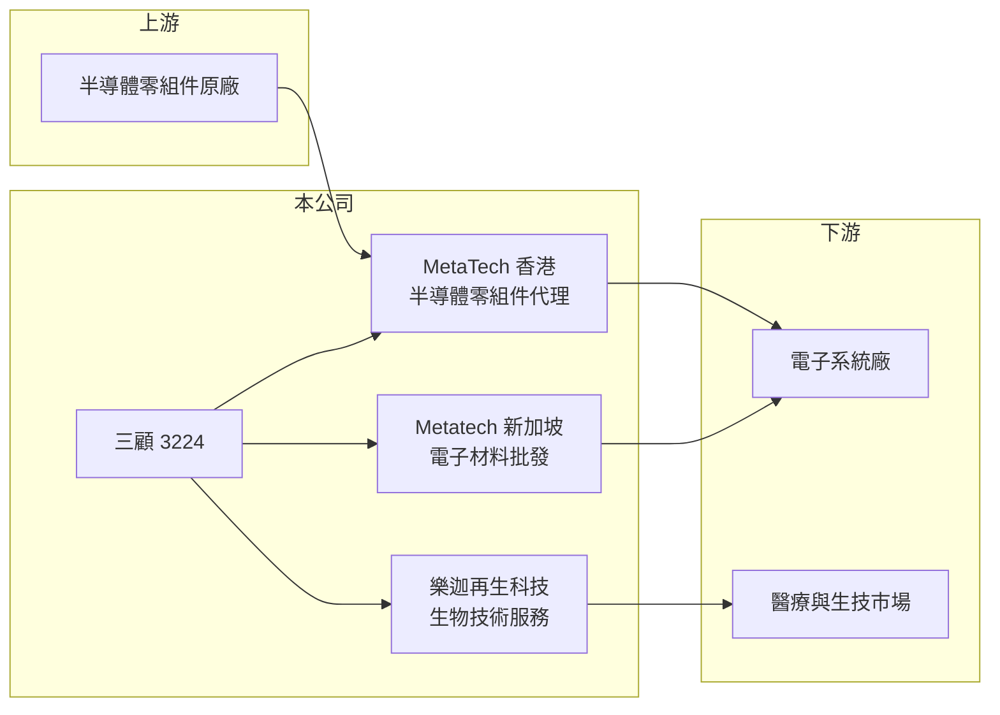

# 3224 三顧

> 上櫃｜[[產業索引-電子通路業|電子通路業]]｜上市（櫃）日期 2004/06/03

# 第一章：企業模式與商業藍圖

> [!info] 撰寫說明
> 精簡版，由 Claude 依公開資料整理，架構比照 [[2330台積電]]，資料截至 2026-10-08。來源：櫃買中心開放資料（基本資料、2026 年第二季財報）、Goodinfo 經營績效與基本資料頁。公開資料有限，代理品牌與營收比重未查得。#待校對

三顧是一家規模不大的半導體零組件通路商，近年另外投入再生醫療相關的生技事業，形成「通路本業加生技新事業」的雙軌結構。理解三顧，要同時看通路本業的獲利能力，以及新事業吃掉多少資源。

- **核心業務：** 三顧成立於 1998 年，2004 年上櫃，本業是半導體零組件的代理經銷，主要透過香港子公司 MetaTech Limited 執行，另於 2018 年設立新加坡子公司 Metatech (S) 經營電子材料批發。這種「台灣母公司加境外子公司」的架構，讓公司能以美元接單、服務亞洲的系統廠客戶。
- **營收結構：** 代理品牌與產品比重未查得。依營業項目，三顧除電子材料外，也登記了生物技術服務、西藥與醫療器材批發、化粧品等業務，顯示公司已在通路本業以外布局生技相關收入。
- **新事業：** 2023 年設立子公司樂迦再生科技，從事生物技術服務。2026 年第二季三顧權益總計 26.6 億元中，非控制權益高達 12.6 億元，代表有外部股東大幅參與子公司增資（推估以樂迦為主）。
- **長期方向：** 通路本業提供穩定但規模有限的營收，生技事業則是高投入、回收期長的布局。三顧的長期價值取決於生技事業能否在幾年內產生收入，否則持續的研發與營運支出會拖累整體獲利。

# 第二章：護城河深度與競爭優勢

小型通路商很難在規模上與大型同業競爭，三顧的定位因此更依賴少數利基產品線與新事業的差異化。

- **競爭優勢：** 三顧的毛利率長期約 11% 至 13%，明顯高於大型通路商的 4% 至 6%，顯示其代理產品偏利基型，需要較多技術支援而非單純拚價格（推估）。這類產品線的客戶黏著度較高，但市場規模也較小。
- **主要對手：** 在半導體通路面對 [[3702大聯大]]、[[3036文曄]] 等大型通路商，以及 [[3232昱捷]]、[[3444利機]] 等規模相近的利基型通路商；在再生醫療領域則須與專業生技公司競爭，三顧並無明顯先發優勢。
- **觀察重點：** 營業利益率自 2020 年起連續為負，代表本業毛利不足以支應整體費用。觀察重點在於費用結構中有多少屬於生技事業的投入，以及這些投入何時能轉為營收。

# 第三章：財務體質與盈利規模

資料日期：2026-10-08，表格是撰寫當時的快照；最新月營收、毛利率、累計 EPS 由自動排程寫在本筆記的屬性欄位（月營收、毛利率、累計EPS 等）。#待校對

三顧的財務數字呈現「毛利率尚可、營業利益長期為負」的特徵，這是判斷其投資價值的核心矛盾。

| 年度 | 營收（億元） | [[毛利率]] | [[營業利益率]] | EPS（元） | [[ROE]] |
|---|---|---|---|---|---|
| 2020 | 15.8 | 10.8% | -5.09% | -1.42 | -8.6% |
| 2021 | 20.1 | 13.2% | -1.79% | -0.40 | -2.76% |
| 2022 | 18.5 | 11.6% | -4.94% | -0.17 | -1.94% |
| 2023 | 14.5 | 11.5% | -13.3% | -1.94 | -7.55% |
| 2024 | 14.1 | 12.2% | -15.8% | -1.01 | -6.17% |
| 2025 | 15.1 | 13.0% | -15.3% | -1.53 | -10.4% |
| 2026 上半年 | 8.27 | 14.85% | -9.94% | -0.08 | 未查得 |

- **營收規模：** 2020 至 2025 年營收在 14 億到 20 億元之間，年複合成長率約 -0.9%（推算），本業規模沒有明顯擴大。2026 年前 8 個月營收年增約 19%（櫃買中心月營收）。
- **獲利：** 2023 年起營業利益率擴大到 -13% 至 -16%，與樂迦再生科技設立的時間點相符，費用增加應與生技事業有關（推估）。近 5 年平均 ROE 約 -5.8%（推算）。2026 年上半年稅後虧損 6,936 萬元，其中 6,318 萬元歸屬非控制權益，母公司股東承擔的虧損較小。
- **財務特色：** 2026 年第二季總資產 38.1 億元、負債 11.6 億元，負債比約 30%，財務槓桿低；保留盈餘為 -3.4 億元，代表歷年累積虧損，目前未配發現金股利。

**[[ROIC]] 與 [[WACC]]：** 2025 年營業損失約 2.3 億元，ROIC 為負。以權益 26.6 億元加有息負債（以負債總額 40% 估約 4.6 億元）計算，ROIC 約 -5.9%；2026 年上半年年化約 -4.2%（推算）。WACC 以 CAPM 推估：無風險利率 1.75%、市場風險溢酬 6%、β 取 1.0（同業常見值），股權成本約 7.75%；稅後負債成本 2%，股權占比約 85%，WACC 約 6.9%（推算）。ROIC 長期低於 WACC 且為負，代表公司目前處於消耗資本的階段，價值能否回升取決於生技事業商業化與通路本業轉盈。

# 第四章：總體風險與地緣政治

三顧的風險集中在新事業的不確定性，以及小型通路商在原廠關係上的弱勢。

- **產業週期：** 通路本業隨電子零組件庫存循環起伏，2021 年營收高點後連續兩年下滑。小型通路商缺乏議價力，景氣反轉時存貨與價格壓力更明顯。
- **營運風險：** 生技事業的研發與法規審查期長，營收實現時點難以預測。若長期無法產生收入，持續虧損將侵蝕股東權益，也可能需要再度增資稀釋股權。
- **其他風險：** 再生醫療受衛福部法規管理，法規調整會直接影響商業化進度；通路本業以美元計價，匯率波動影響獲利；境外子公司之間的資金貸與也需留意資金流向。

# 專有名詞解析

## 金融

- **[[非控制權益]]**：子公司中不屬於母公司的股東權益，比例高代表外部股東持有子公司的大量股份。
- **[[累積虧損]]**：歷年虧損累計後使保留盈餘為負，公司須先彌補虧損才能發放股利。

## 產業

- **[[電子通路]]**：替半導體原廠向系統廠銷售零組件、備庫存並提供技術支援的中間商，賺取買賣價差與服務價值。
- **[[再生醫療]]**：利用細胞、基因或組織工程修復或取代受損組織的醫療技術，台灣於近年建立專法管理。

# 核心供應鏈

- 上游：半導體零組件原廠（代理品牌未查得）。
- 下游／客戶：亞洲電子系統廠；生技事業面向醫療市場。
- 同業：[[3232昱捷]]、[[3444利機]]、[[3702大聯大]]、[[3036文曄]]。

## 最新新聞
<!-- news:start（自動產生，請勿手動編輯此範圍） -->
- 2026-10-15 📰 媒體 19:12｜三顧攜正揚推進血小板裂解液及乾眼症製劑兩大產品 攻再生醫療與眼科商機｜[鉅亨網](https://news.cnyes.com/news/id/6631397)
- 2026-10-14 🏛️ 重訊 18:12｜本公司受邀參加康和證券舉辦之法人說明會｜[觀測站](https://mops.twse.com.tw/mops/#/web/t05st01)

完整紀錄：[[3224三顧 新聞]]
<!-- news:end -->

## 相關連結
- [公開資訊觀測站](https://mopsov.twse.com.tw/mops/web/t05st03?step=1&firstin=1&co_id=3224)
- [Goodinfo](https://goodinfo.tw/tw/StockDetail.asp?STOCK_ID=3224)
- [Yahoo 股市](https://tw.stock.yahoo.com/quote/3224)
- [鉅亨網新聞](https://www.cnyes.com/twstock/3224/news)
