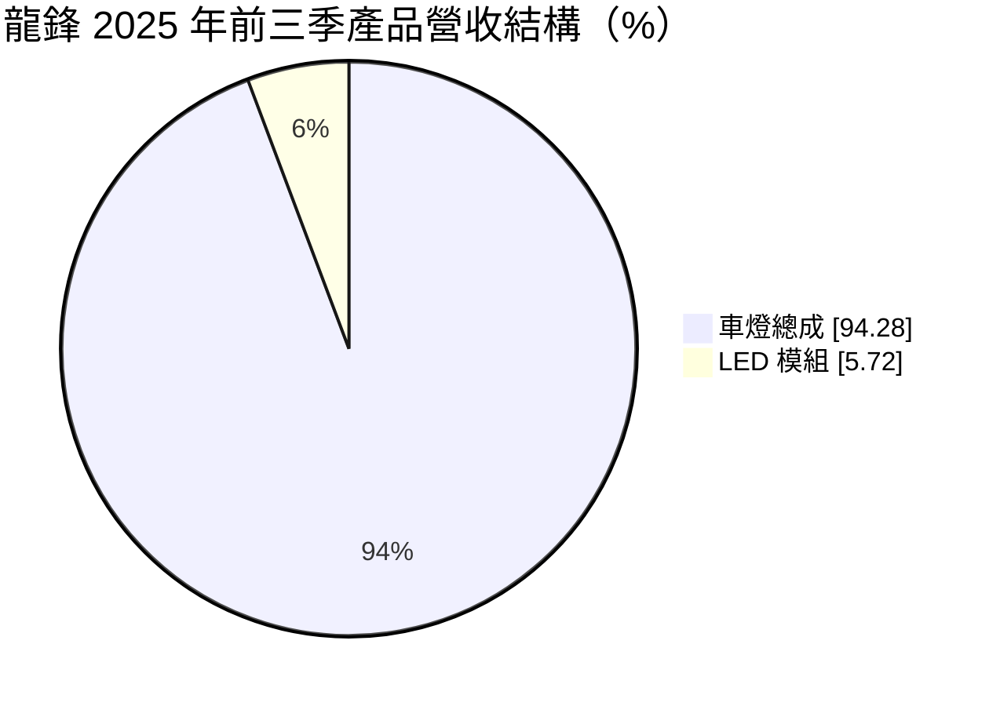
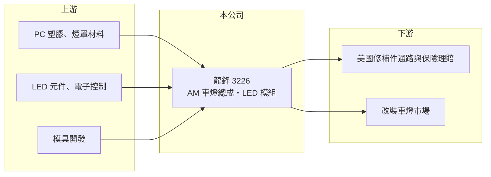

# 3226 龍鋒

> 上櫃｜[[產業索引-電機機械|電機機械]]｜上市（櫃）日期 2004/06/16

# 第一章：企業模式與商業藍圖

> [!info] 撰寫說明
> 精簡版，由 Claude 依公開資料整理，架構比照 [[2330台積電]]，資料截至 2026-10-08。來源：櫃買中心開放資料快照（基本資料、2026 年第二季資產負債與損益、本益比殖利率）、Goodinfo 經營績效頁、富果研究 2025 年 11 月法說會摘要。公開資料有限。#待校對

龍鋒科技（以下簡稱龍鋒）是台南永康的車燈廠，主力是銷往美國的汽車[[售後市場]]車燈總成。理解它的關鍵在於：台灣車燈業在全球 AM 車燈市場有群聚優勢，但龍鋒的命運高度綁在美國關稅與匯率上。

- **核心業務：** 龍鋒成立於 1986 年，2004 年在櫃買中心掛牌，從事車用照明產品的研發與製造，產品包括頭燈、後燈、霧燈與角燈總成，以及 LED 模組。2025 年前三季車燈總成占營收 94.28%，其中頭燈約 66%、後燈約 24%。
- **營收結構：** 依應用市場，2025 年前三季[[AM 車燈]]修補市場占 64%、改裝車燈市場占 36%；依車型，一般乘用車占 90%、重型卡車占 10%。修補市場比重提高，代表公司更偏向需求穩定的保險理賠與維修市場，而改裝市場則較受消費景氣影響。
- **營運據點：** 總部與生產基地位於台南永康，地區別營收比重未查得，但主要市場在美國。台南是台灣車燈與汽車售後零件的重要聚落，模具、塑膠與電子協力廠完整。
- **長期方向：** 公司持續擴充 [[CAPA 認證]]品項，以因應 OE 保修市場的中國低價競爭，並深化電控技術、研究 MCU 與車燈之間的訊息傳遞，讓產品從單純燈具走向智慧照明。LED 模組比重由 2024 年同期的 4.08% 升到 5.72%，代表產品逐步往電子化移動。

# 第二章：護城河深度與競爭優勢

龍鋒的護城河是窄護城河，來自模具開發的累積、CAPA 認證與美國通路關係。

- **競爭優勢：** AM 車燈的關鍵是「新車上市後多快能開出對應的模具」，車種多、模具投資大，累積的模具庫本身就是競爭力。取得 CAPA 認證的產品可以進入保險理賠市場，價格比原廠件低但品質受認可，這是一般低價廠難以取得的門票。2015 至 2024 年龍鋒的毛利率穩定在 23% 至 26%，營業利益率多在 16% 至 20%，說明它在利基市場中有不錯的經營效率。
- **主要對手：** 台灣 AM 車燈同業包括 [[1522堤維西]]、[[6605帝寶]]，以及中國大量的車燈廠。帝寶與堤維西規模較大、品項較多，龍鋒則以專注與成本控制競爭。
- **觀察重點：** 2025 年營收 16.1 億元、毛利率降到 14.3%、EPS 只剩 0.24 元，2026 年上半年毛利率約 5.4% 並出現虧損。長期最該追蹤的是關稅成本如何在客戶與公司之間分攤，以及公司研擬的貿易流程調整方案能否恢復毛利率。

# 第三章：財務體質與盈利規模

資料日期：2026-10-08，表格是撰寫當時的快照；最新月營收、毛利率、累計 EPS 由自動排程寫在本筆記的屬性欄位（月營收、毛利率、累計EPS 等）。#待校對

龍鋒在 2025 年以前是穩定高 ROE 的小型出口商，2025 年美國關稅讓獲利結構瞬間改變。

| 年度 | 營收（億元） | [[毛利率]] | [[營業利益率]] | EPS（元） | [[ROE]] |
|---|---|---|---|---|---|
| 2021 | 29.2 | 23.7% | 17.5% | 3.58 | 17.6% |
| 2022 | 22.4 | 22.8% | 12.5% | 4.95 | 22.9% |
| 2023 | 21.6 | 25.0% | 20.5% | 4.04 | 17.1% |
| 2024 | 21.3 | 25.0% | 16.7% | 5.56 | 20.7% |
| 2025 | 16.1 | 14.3% | 4.15% | 0.24 | 0.84% |

（來源：Goodinfo 經營績效頁。2026 年上半年依櫃買中心資料，營收 6.35 億元、營業損失 0.39 億元、EPS −0.36 元。）

- **營收規模：** 營收由 2015 年的 11 億元成長到 2021 年的 29.2 億元高點，之後逐步回落，2025 年降到 16.1 億元。2020 至 2025 年年複合成長率約 −8.4%（推算）。2021 年的高點與疫情期間美國售後需求暢旺有關（推估）。
- **獲利：** 2021 至 2025 年平均 ROE 約 15.8%（推算），2015 至 2024 年 ROE 多在 15% 至 28% 之間，是同規模傳產股中相當高的水準。2025 年的崩落主要來自美國自 2025 年 4 月起把產品關稅由 0% 至 2.5% 提高到 25%、公司提供銷貨折讓，以及新台幣升值造成的兌換損失。
- **財務特色：** 依 2026 年第二季資料，總資產約 24.7 億元、負債約 6.1 億元、股東權益約 18.6 億元，負債比約 25%，每股淨值 28.83 元，財務結構保守。Goodinfo 統計的歷年平均現金股利約 1.18 元，近期因獲利大減未配息。
- **[[ROIC]] 與 [[WACC]]：** 以 2025 年營業利益約 0.67 億元（16.1 億元 × 4.15%）、稅率 20% 計算，稅後營業利益約 0.53 億元；有息負債不多，投入資本以股東權益 18.6 億元到總資產 24.7 億元為區間，ROIC 約 2.2% 至 2.9%（推算）。2024 年同法約 11.5% 至 15.3%（推算）。WACC 以 CAPM 推估：無風險利率 1.75%、市場風險溢酬 6%、β 假設 0.8，權益成本約 6.6%；負債占二成、稅後負債成本 2%，WACC 約 5.7%（推算）。過去十年 ROIC 明顯高於 WACC，是長期創造價值的公司；2025 年起跌破資金成本，關稅衝擊是否為永久性，決定這個優勢還在不在。

# 第四章：總體風險與地緣政治

龍鋒的風險集中在美國貿易政策與匯率，屬於單一市場出口商的典型風險。

- **產業週期：** AM 車燈需求來自事故修補與改裝，修補需求跟著車輛保有量與行駛里程走，相對穩定；改裝需求則受消費景氣影響較大。美國利率與二手車市場也會影響修車需求。
- **營運風險：** 美國關稅提高後，客戶下單保守，公司為維持市場流動性提供折讓，直接侵蝕毛利。營收縮減時，模具等固定成本攤提的負擔被放大。新車型的模具投資若跟不上，也會失去修補市場的份額。
- **其他風險：** 新台幣升值同時影響營收與業外匯兌；塑膠原料與 LED 元件價格波動影響成本。中國車燈廠在 OE 保修市場的低價競爭持續，公司若要轉移生產地降低關稅，也面臨投資與管理的執行風險。

# 專有名詞解析

## 應用

- **[[售後市場]]**：新車出廠之後的維修、保養與改裝零件市場，英文為 Aftermarket，需求較不受新車銷售影響。
- **[[AM 車燈]]**：售後市場用的替換車燈，主要用於事故修補與改裝，價格低於原廠件。

## 產業

- **[[CAPA 認證]]**：美國汽車零件認證協會的認證，取得認證的副廠件可被保險公司用於理賠維修。

# 核心供應鏈

- 上游：PC 塑膠與燈罩材料、LED 元件與電子控制模組供應商，以及台南的模具與塑膠協力廠。
- 下游／客戶：美國汽車修補件通路、保險理賠維修體系與改裝車燈市場（具體客戶公開資料未點名，#待校對）。
- 同業：台灣 AM 車燈廠 [[1522堤維西]]、[[6605帝寶]]，以及中國車燈廠。

## 最新新聞
<!-- news:start -->
<!-- news:end -->

## 相關連結
- [公開資訊觀測站](https://mopsov.twse.com.tw/mops/web/t05st03?step=1&firstin=1&co_id=3226)
- [Goodinfo](https://goodinfo.tw/tw/StockDetail.asp?STOCK_ID=3226)
- [Yahoo 股市](https://tw.stock.yahoo.com/quote/3226)
- [鉅亨網新聞](https://www.cnyes.com/twstock/3226/news)
