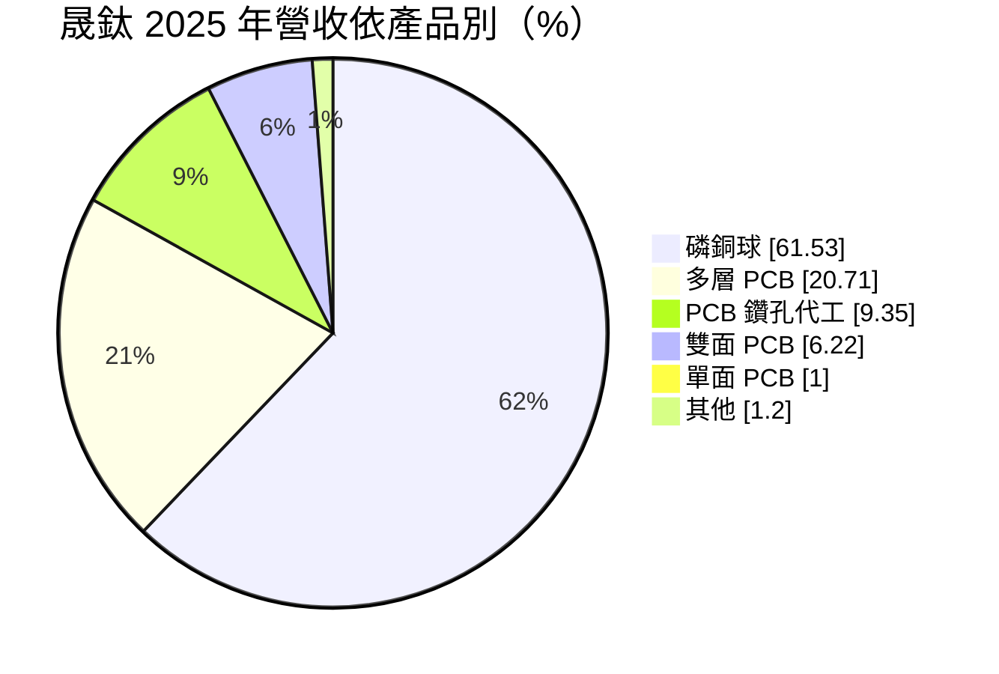
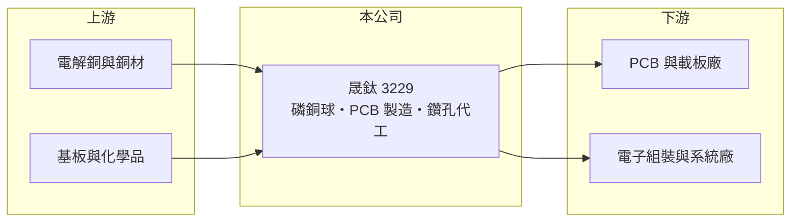

# 3229 晟鈦

> 上市｜[[產業索引-電子零組件業|電子零組件業]]｜上市（櫃）日期 2009/12/31

# 第一章：企業模式與商業藍圖

> [!info] 撰寫說明
> 精簡版，由 Claude 依公開資料整理，架構比照 [[2330台積電]]，資料截至 2026-10-08。來源：證交所開放資料快照（基本資料、2026 年第二季資產負債與損益、股利政策）、Goodinfo 經營績效頁、富邦 MoneyDJ 公司基本資料（2025 年營收比重）、CMoney 文章標題。客戶與生產據點未查得。公開資料有限。#待校對

晟鈦（以下簡稱晟鈦）是一家同時做 [[PCB]] 材料與 PCB 製造的小型公司，理解它的關鍵在於：營收已由 PCB 本業轉為以[[磷銅球]]為主，這是 PCB 電鍍銅製程的消耗性材料，需求跟著 PCB 產業的產量與銅價同步起伏。

- **核心業務：** 晟鈦成立於 1987 年，總部在新北新莊，2009 年在證交所上市。公司有兩條業務線：一是生產磷銅球，供 PCB 廠在[[電鍍]]銅製程中作為陽極材料；二是生產單面、雙面與多層 PCB，並提供 PCB 鑽孔代工。磷銅球屬於[[耗材]]，PCB 廠只要生產就必須持續補充，因此需求比設備穩定。
- **營收結構：** 2025 年磷銅球約占 62%，PCB 製造合計約 28%，鑽孔代工約 9%。磷銅球的售價大致是「銅價加加工費」，營收會隨銅價放大或縮小，但加工利潤才是真正的獲利來源。
- **營運據點：** 公司登記地址在新北新莊，生產據點與海外布局未查得（#待校對）。PCB 產業集中在台灣、中國與東南亞，材料供應商需要靠近客戶以縮短交期。
- **長期方向：** 營收由 2020 年的 3.91 億元成長到 2025 年的 10.4 億元，成長主要來自磷銅球。AI 伺服器帶動高層數、高厚度 PCB 的需求，電鍍銅的用量增加，對上游材料是長期利多；依 CMoney 文章標題，市場已注意到 PCB 上游原材料需求上升對晟鈦的影響（年份未標示，僅作趨勢參考）。

# 第二章：護城河深度與競爭優勢

晟鈦的護城河有限，競爭力來自材料品質的客戶認證與 PCB 業務的一條龍服務。

- **競爭優勢：** 磷銅球的含磷量與純度會影響電鍍品質，PCB 廠在導入新材料前需要驗證，一旦認證通過，客戶通常不會輕易更換，具有一定的轉換成本。晟鈦同時懂 PCB 製程與材料，能從使用端理解客戶需求，這是單純材料廠較少具備的經驗。
- **主要對手：** 磷銅球市場的競爭者包括日系與中國的銅材加工廠，以及台灣的銅材業者；PCB 製造方面，晟鈦規模遠小於 [[3044健鼎]]、[[2313華通]]、[[2367燿華]] 等大廠，屬於利基型的小量多樣接單。
- **觀察重點：** 長期最該觀察[[毛利率]]能否穩定在一成以上。2020 至 2025 年毛利率只有 2% 至 10%，2025 年仍處於營業虧損；2026 年上半年毛利率回升到約 13.2%、營業利益率約 8.8%，若能延續，代表規模效益開始顯現。

# 第三章：財務體質與盈利規模

資料日期：2026-10-08，表格是撰寫當時的快照；最新月營收、毛利率、累計 EPS 由自動排程寫在本筆記的屬性欄位（月營收、毛利率、累計EPS 等）。#待校對

晟鈦的財務特徵是營收快速成長、但過去五年大多虧損，2026 年上半年才出現明顯的獲利轉機。

| 年度 | 營收（億元） | [[毛利率]] | [[營業利益率]] | EPS（元） | [[ROE]] |
|---|---|---|---|---|---|
| 2021 | 4.40 | 9.79% | -13.6% | -1.72 | -20.5% |
| 2022 | 8.20 | 4.70% | -5.93% | -0.66 | -7.13% |
| 2023 | 9.28 | 5.40% | -3.36% | -0.39 | -4.03% |
| 2024 | 9.18 | 7.13% | -0.62% | 0.14 | 1.40% |
| 2025 | 10.4 | 6.47% | -0.19% | -0.43 | -4.53% |

（來源：Goodinfo 經營績效頁；2020 年營收 3.91 億元、EPS -2.27 元。）

- **營收規模：** 2020 至 2025 年營收年複合成長率約 21.6%（推算），成長幅度明顯，但部分來自銅價上漲帶來的售價放大。2026 年上半年營收約 7.56 億元，毛利率約 13.2%、營業利益率約 8.8%，EPS 1.28 元，已超過過去任何一個完整年度。
- **獲利：** 2021 至 2025 年平均 ROE 約 -7.0%（推算），營業利益率逐年改善，從 -13.6% 收斂到接近損益兩平。這說明營收擴大後，固定成本攤提效果逐步出現，也就是[[營業槓桿]]開始轉為正向。
- **財務特色：** 2026 年第二季總資產約 10.5 億元、負債約 3.7 億元、權益約 6.8 億元，負債比約 35%，每股淨值約 10.6 元。2025 年度未配發股利。公司章程載明採「剩餘股利政策」，先以保留盈餘支應資本預算，剩餘部分才分派股利，現金股利不低於股利總額的 10%。
- **[[ROIC]] 與 [[WACC]]：** 2025 年營業虧損約 0.02 億元（10.4 億元 × -0.19%），ROIC 約 0%（推算）。若以 2026 年上半年營業利益約 0.67 億元年化為 1.33 億元、稅後約 1.07 億元，投入資本以權益約 6.8 億元到「權益加全部負債」約 10.5 億元為區間，年化 ROIC 約 10% 至 16%（推算，僅半年資料）。WACC 以 [[CAPM]] 推估：無風險利率 1.75%、市場風險溢酬 6%、β 假設 1.1，權益成本約 8.4%；負債占兩成、稅後成本 2%，WACC 約 7.1%（推算）。過去五年 ROIC 低於 WACC，未創造價值；2026 年若能維持上半年水準，才首度高於資金成本，但需要更多年度驗證。

# 第四章：總體風險與地緣政治

晟鈦的風險主要來自銅價、PCB 景氣與公司規模。

- **產業週期：** 磷銅球與 PCB 都跟著電子產業景氣走，PCB 廠減產時耗材用量立即下降。AI 伺服器帶來的高階 PCB 需求是長期趨勢，但消費性電子的 PCB 需求波動仍大。
- **營運風險：** 銅價大幅波動時，若採購與售價調整時間不同步，會產生存貨損益，讓毛利率劇烈變動。公司規模小，主要客戶若轉單或減產，營收影響明顯。
- **其他風險：** 銅價受全球景氣、礦產供給與美元走勢影響，屬於公司無法控制的變數。PCB 製造涉及電鍍與廢水處理，環保法規趨嚴會增加成本。

# 專有名詞解析

## 金融

- **[[營業槓桿]]**：固定費用占比高時，營收或毛利小幅變動會造成營業利益大幅變動的現象。

## 產業

- **[[PCB]]**：印刷電路板，用銅線路連接電子元件的基板，是所有電子產品的骨架。
- **[[磷銅球]]**：含少量磷的銅球，在 PCB 電鍍銅製程中作為陽極，溶解後補充鍍液中的銅離子。
- **[[電鍍]]**：以電流把金屬離子沉積到物體表面的製程，PCB 用來在孔壁與線路上鍍上銅層。
- **[[耗材]]**：生產過程中會被消耗、需要持續補充的材料，需求跟著產量走，比設備穩定。

# 核心供應鏈

- 上游：電解銅與銅材供應商、PCB 基板與化學品供應商（如 [[2383台光電]]、[[6213聯茂]]、[[6274台燿]] 等銅箔基板廠為產業代表）。#待校對
- 下游／客戶：使用磷銅球的 PCB 與載板廠（如 [[3044健鼎]]、[[2313華通]]、[[2367燿華]] 等產業代表，非公司揭露客戶），以及採購小量多樣 PCB 的電子廠。#待校對
- 同業：PCB 製造同業 [[3044健鼎]]、[[2313華通]]、[[2367燿華]]；銅材加工業者（如 [[1605華新]]）。

## 最新新聞
<!-- news:start -->
<!-- news:end -->

## 相關連結
- [公開資訊觀測站](https://mopsov.twse.com.tw/mops/web/t05st03?step=1&firstin=1&co_id=3229)
- [Goodinfo](https://goodinfo.tw/tw/StockDetail.asp?STOCK_ID=3229)
- [Yahoo 股市](https://tw.stock.yahoo.com/quote/3229)
- [鉅亨網新聞](https://www.cnyes.com/twstock/3229/news)
