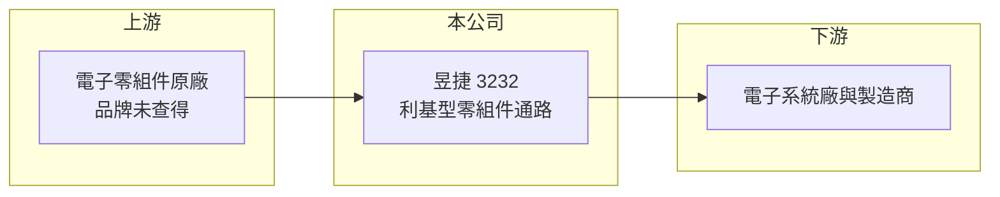

# 3232 昱捷

> 上櫃｜[[產業索引-電子通路業|電子通路業]]｜上市（櫃）日期 2004/11/01

# 第一章：企業模式與商業藍圖

> [!info] 撰寫說明
> 精簡版，由 Claude 依公開資料整理，架構比照 [[2330台積電]]，資料截至 2026-10-08。來源：櫃買中心開放資料（基本資料、2026 年第二季財報、本益比殖利率）、Goodinfo 經營績效與基本資料頁。公開資料有限，代理品牌、產品應用與營收比重均未查得。#待校對

昱捷是一家成立超過三十年、規模約 10 億元上下的小型電子零組件通路商。它的經營重點不是追求營收規模，而是在少數產品線上維持比大型通路商更高的毛利率。

- **核心業務：** 昱捷成立於 1987 年，2004 年上櫃，總部在新北市汐止，營業項目為電子材料批發、零售與電子資訊供應服務，屬於[[電子通路]]業。董事長蔡棟國兼任總經理，屬於經營者與大股東高度重疊的中小企業型態（推估）。
- **營收結構：** 代理品牌與產品比重未查得。從營收規模與毛利率推斷，昱捷代理的是需要[[FAE]]技術支援的利基型零組件，而非大量出貨的標準品（推估）。
- **營運據點：** 公開資料僅揭露台灣總部，海外子公司資訊未查得。
- **長期方向：** 2024 年營收 15.5 億元，2025 年降到 8.93 億元，但毛利率從 9.15% 升到 17.5%，顯示公司在 2025 年調整產品組合，淡出低毛利的大量出貨產品線（推估）。這種「縮營收、拉毛利」的轉向，長期能否帶來更高的獲利，是觀察重點。

# 第二章：護城河深度與競爭優勢

小型通路商的護城河主要來自原廠信任與技術服務，昱捷的優勢與限制都與規模有關。

- **競爭優勢：** 昱捷的毛利率在 9% 至 17.5% 之間，高於大型通路商，代表其產品線仍有一定技術門檻與價格空間。長期合作的原廠與客戶關係，是小型通路商最主要的競爭資產。
- **主要對手：** 大型通路商 [[3702大聯大]]、[[3036文曄]] 可以用規模爭取原廠代理權；規模相近的 [[3224三顧]]、[[3444利機]]、[[3360尚立]] 則在利基產品線上與昱捷競爭。
- **觀察重點：** 小型通路商最大的風險是原廠為節省成本，把代理權集中到大型通路商。昱捷能否持續保有並新增代理線，決定其能否維持獨立經營的價值。

# 第三章：財務體質與盈利規模

資料日期：2026-10-08，表格是撰寫當時的快照；最新月營收、毛利率、累計 EPS 由自動排程寫在本筆記的屬性欄位（月營收、毛利率、累計EPS 等）。#待校對

昱捷的財務表現呈現「營收規模小、利潤率薄、ROE 偏低」的特徵，近年獲利大致在損益兩平附近。

| 年度 | 營收（億元） | [[毛利率]] | [[營業利益率]] | EPS（元） | [[ROE]] |
|---|---|---|---|---|---|
| 2020 | 7.52 | 11.1% | -0.90% | 0.35 | 3.15% |
| 2021 | 10.0 | 13.6% | 3.78% | 0.84 | 6.45% |
| 2022 | 14.2 | 11.0% | 2.02% | 0.39 | 2.50% |
| 2023 | 15.1 | 10.2% | 1.76% | 0.25 | 1.69% |
| 2024 | 15.5 | 9.15% | 0.72% | 0.32 | 2.10% |
| 2025 | 8.93 | 17.5% | 2.88% | 0.29 | 1.91% |
| 2026 上半年 | 5.09 | 17.22% | 3.44% | 0.38 | 未查得 |

- **營收規模：** 2020 至 2025 年營收年複合成長率約 3.5%（推算），但中間經歷 2024 年的高點與 2025 年的大幅收縮。2026 年前 8 個月營收約 7 億元，年增約 11%（櫃買中心月營收）。
- **獲利：** 近 5 年平均 ROE 約 2.9%（推算），明顯偏低。2026 年上半年 EPS 0.38 元，已超過 2025 年全年，顯示產品組合調整後獲利有改善跡象。
- **財務特色：** 2026 年第二季總資產 11.9 億元、負債 5.0 億元、權益 6.9 億元，負債比約 42%，財務結構保守。保留盈餘僅約 4,500 萬元，股利發放能力有限，最近一次現金股利為每股 0.5 元。

**[[ROIC]] 與 [[WACC]]：** 2025 年營業利益約 2,600 萬元，扣 20% 稅後約 2,060 萬元；以權益 6.9 億元加有息負債（以負債總額 40% 估約 2.0 億元）計算，ROIC 約 2.3%，2026 年上半年年化約 3.1%（推算）。WACC 以 CAPM 推估：無風險利率 1.75%、市場風險溢酬 6%、β 取 0.8（小型通路股常見值），股權成本約 6.55%；稅後負債成本 2%，股權占比約 77%，WACC 約 5.5%（推算）。ROIC 長期低於 WACC，代表目前的資本報酬尚不足以彌補資金成本，需要產品組合轉型持續見效才能改善。

# 第四章：總體風險與地緣政治

昱捷的風險主要來自規模小所帶來的代理權依賴與營收波動。

- **產業週期：** 電子零組件需求有庫存循環，小型通路商的營收受單一客戶或單一產品線影響大，景氣轉折時波動幅度往往超過產業平均。
- **營運風險：** 2025 年營收幾乎腰斬，顯示少數產品線變動就能大幅改變營收規模。若主要原廠收回代理權，營收與獲利會受到直接衝擊。
- **其他風險：** 零組件多以美元計價，新台幣升值會壓縮換算後的營收與毛利；利基型產品需要備庫存，存貨跌價也是需要留意的損益項目。

# 專有名詞解析

## 產業

- **[[電子通路]]**：替半導體原廠向系統廠銷售零組件、備庫存並提供技術支援的中間商，賺取買賣價差與服務價值。
- **[[FAE]]**：現場應用工程師，協助客戶把原廠晶片設計進產品，是通路商技術附加價值的核心。
- **[[代理權]]**：原廠授權通路商銷售其產品的權利，可能因原廠策略調整或併購而被收回。

# 核心供應鏈

- 上游：電子零組件原廠（代理品牌未查得）。
- 下游／客戶：台灣電子系統廠與製造商（推估）。
- 同業：[[3224三顧]]、[[3444利機]]、[[3360尚立]]、[[3702大聯大]]、[[3036文曄]]。

## 最新新聞
<!-- news:start -->
<!-- news:end -->

## 相關連結
- [公開資訊觀測站](https://mopsov.twse.com.tw/mops/web/t05st03?step=1&firstin=1&co_id=3232)
- [Goodinfo](https://goodinfo.tw/tw/StockDetail.asp?STOCK_ID=3232)
- [Yahoo 股市](https://tw.stock.yahoo.com/quote/3232)
- [鉅亨網新聞](https://www.cnyes.com/twstock/3232/news)
