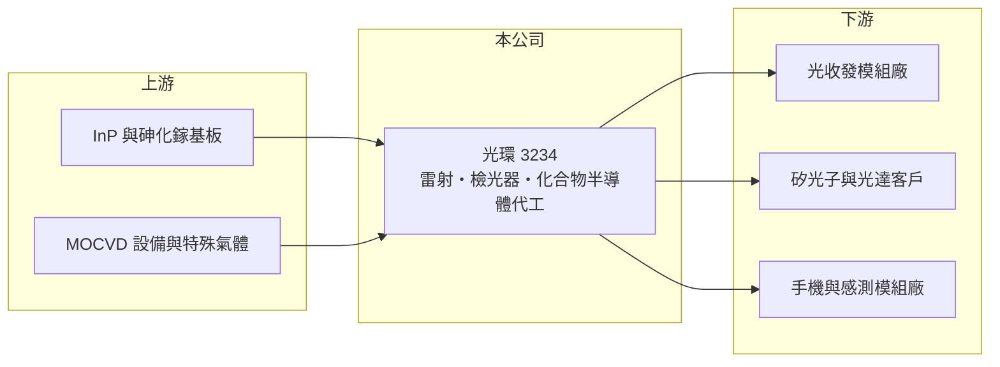

# 3234 光環

> 上櫃｜[[產業索引-通信網路業|通信網路業]]｜上市（櫃）日期 2011/03/24

# 第一章：企業模式與商業藍圖

> [!info] 撰寫說明
> 本文由 Claude 依公開資料整理，架構比照 [[2330台積電]] 的四章研究，資料截至 2026-10-08。財務數字來源：Goodinfo 年度經營績效頁、櫃買中心開放資料（基本資料、2026 年第二季資產負債與損益、本益比殖利率）、富果研究 2025 年 12 月法說會整理；產業描述為整理性內容，尚未逐條比對原始文件。#待校對

評估一家光電元件廠，要看它掌握的是哪一段製程，以及這段製程能否在新應用中找到足夠大的市場。本章說明光環科技（股票代號：3234，以下簡稱光環）從磊晶到封裝測試的垂直整合模式，以及它近年從自有產品轉向代工服務的變化。

## 一、核心定位：垂直整合的化合物半導體光電廠

光環成立於 1997 年，2011 年在櫃買中心掛牌，實收資本額約 12.7 億元。公司以[[砷化鎵]]與 [[InP]] 材料製作光電元件，製程從磊晶、晶圓製程一路到封裝測試都在內部完成。這種垂直整合讓光環能同時做短距與長距光通訊雷射、檢光器與感測用雷射，產品組合比單純做磊晶或封裝的廠商更完整。

## 二、三大產品線

* **光通訊：** 短距離的 [[VCSEL]]（850nm，傳輸速率 1 至 112 Gbps）、長距離的 FP 與 DFB 雷射（1 至 25 Gbps），以及利基型的 APD 檢光器（2.5 至 100 Gbps），應用在資料中心、5G 基地台與 PON。公司特別強調可耐 -40 至 85°C 的工業級 VCSEL。
* **智慧感測：** 660nm、850/940nm 與 1130nm 等波長的 VCSEL，用於手機近接感測、3D 感測、健康感測與光動力治療，公司表示在 Android 手機近接感測 VCSEL 擁有領先市占。
* **代工與 ODM：** 提供 InP 與砷化鎵晶圓代工，包括矽光子用的 [[CW 雷射]]、光達用光放大器與資料中心用檢光器陣列，並做 100G/400G 主動式光纖纜線（AOC）與光達模組的 ODM。

依法說會資料，代工與 ODM 占營收比重從 2024 年前三季的 3% 升到 2025 年前三季的 19%，是公司結構上最明顯的轉變；光通訊與智慧感測的金額大致持平，比重則下降。

## 三、長期方向：成為矽光子與 CPO 的光源與元件夥伴

光環表示將強化 [[CPO]] 與[[矽光子]]相關能力，包括光源、晶片級封裝與高速元件，但不自行做完整的 CPO 系統。這個定位等於把自己放在「替系統廠與模組廠提供關鍵光電元件與代工」的角色，若矽光子普及，對外接光源與化合物半導體代工的需求將會增加。公司也規劃把 100G VCSEL 與檢光器陣列推向車用資料傳輸，2026 年資本支出預計高於 2025 年。

# 第二章：護城河深度與競爭優勢

在長期價值投資中，「護城河」指企業抵禦競爭、維持超額利潤的保護機制。本章分析光環的技術優勢與它為何長期難以獲利。

## 一、相對優勢

光環的優勢在於從磊晶到封測的完整製程，以及橫跨光通訊、感測與代工的產品組合。能同時處理砷化鎵與磷化銦的廠商不多，這讓它能承接客戶在不同波長、不同材料上的客製需求。公司表示目前的產能瓶頸在後段切割而非前段晶圓廠，代表前段仍有產能可用於代工。

## 二、主要競爭對手

| 對手 | 定位 | 對光環的威脅 |
|---|---|---|
| [[3081聯亞]] | InP 磊晶與 CW 雷射 | 在矽光子光源領先，已取得長期合約 |
| [[4979華星光]] | 光通訊雷射與模組 | 在雷射晶片與光模組重疊 |
| [[3105穩懋]] | 化合物半導體晶圓代工 | 規模大，在 VCSEL 與光電代工具成本優勢 |
| 國際雷射大廠（如 Lumentum、Coherent） | 垂直整合雷射與光模組 | 高速 VCSEL 與 EML 技術領先 |

## 三、守得住／守不住／觀察重點

光環目前看不到明顯的護城河：2021 至 2025 年營業利益率每年都是負數，2023 至 2024 年毛利率只有約 4%。技術廣度並未轉化為定價能力，原因可能是規模不足、產品在成熟規格上與大廠競爭。長期觀察重點是代工比重能否持續提高並帶來規模經濟、矽光子光源能否取得量產訂單，以及毛利率能否穩定站上 20%。

# 第三章：財務體質與盈利規模

資料日期：2026-10-08，表格是撰寫當時的快照；最新月營收、毛利率、累計 EPS 由自動排程寫在本筆記的屬性欄位（月營收、毛利率、累計EPS 等）。#待校對

財務報表是檢驗護城河是否真實存在的最終標準。本章用五年的三率、ROE 與資本報酬，檢視光環的獲利品質。

## 一、多年度經營績效

| 年度 | 營收（新台幣） | [[毛利率]] | [[營業利益率]] | EPS（元） | [[ROE]] |
|---|---|---|---|---|---|
| 2021 | 13.1 億 | 17.7% | -9.18% | -1.74 | -16.4% |
| 2022 | 9.90 億 | 25.9% | -5.89% | -0.34 | -5.89% |
| 2023 | 6.30 億 | 3.81% | -52.1% | -4.68 | -57.6% |
| 2024 | 5.74 億 | 4.13% | -44.5% | -2.21 | -31.6% |
| 2025 | 6.83 億 | 13.5% | -22.4% | -1.40 | -19.2% |
| 2026 上半年 | 3.79 億 | 15.0% | -15.0% | -0.48 | 未查得 |

光環五年都處於營業虧損，營收從 2021 年的 13.1 億元縮小到 2024 年的 5.7 億元，再小幅回升。2021 至 2025 年平均 ROE 約 -26%（推算），營收年複合成長率約 -15%（推算）。股本從 2022 年的 7.65 億元增加到 2024 年的 11.1 億元，代表公司靠增資補充資金（推估為現金增資或私募，細節未查得），虧損期間股東權益持續被稀釋。正面訊號是虧損幅度從 2023 年起逐年收斂，2025 年前三季營業費用年減 21%。近年沒有發放現金股利。

## 二、[[ROIC]] 與 [[WACC]]：價值創造利差

**ROIC 推算：** 2025 年營業虧損約 1.5 億元（6.83 億 × -22.4%），虧損期間沒有所得稅，稅後營業利益約 -1.5 億元。2026 年第二季股東權益約 7.0 億元，負債約 5.5 億元，假設有息負債約 3.5 億元（推估），投入資本約 10.5 億元，ROIC 約 -15%（推算）。

**WACC 推算：** 台灣 10 年期公債 1.75%、市場風險溢酬 6%、β 取光通訊同業常見值 1.3，股東權益成本約 9.6%；負債成本 3%、稅後 2.4%；權益占投入資本約 67%，WACC 約 7.2%（推算）。

**結論：** 光環的 ROIC 長期為負，與 WACC 的差距超過 20 個百分點，代表過去五年持續消耗投入的資本。ROIC 為負並不代表技術沒有價值，而是產能利用率與規模不足，固定成本無法被營收攤平；只有代工與矽光子產品帶來大幅營收成長，才可能扭轉。

# 第四章：總體風險與地緣政治

任何企業都無法脫離宏觀環境獨立存在。本章分析光環長期必須面對的風險。

## 一、財務與持續經營風險

長期虧損讓股東權益縮水到約 7 億元，公司需要靠增資補充營運資金。若虧損未能如期收斂，可能需要再次增資，現有股東會被進一步稀釋。

## 二、技術與競爭風險

光通訊元件規格每兩到三年換代一次，從 25G 到 100G、200G 每通道，研發投入大且成果不確定。同業中已有廠商在矽光子光源取得長約，光環需要證明自己的產品能在可靠度與成本上競爭。智慧感測市場則受手機設計變化影響，例如近接感測方案改變時需求可能消失。

## 三、客戶與資訊揭露

公司以保密協議為由未揭露客戶，投資人難以評估客戶集中度。代工業務的訂單常以專案形式出現，營收波動可能很大。

# 專有名詞解析

## 半導體

- **[[砷化鎵]]**：由鎵與砷組成的化合物半導體材料，適合做發光、射頻與高速光電元件。
- **[[InP]]**：磷化銦，適合製作光通訊雷射與光接收元件的化合物半導體材料，是資料中心光模組的關鍵。
- **[[矽光子]]**：在矽晶片上製作光學元件，以光取代電傳輸資料，可降低 AI 資料中心的傳輸耗電。
- **[[VCSEL]]**：垂直共振腔面射型雷射，從晶片表面垂直發光，用於手機 3D 感測與資料中心短距光通訊。
- **[[CW 雷射]]**：連續波雷射，持續輸出穩定光源，矽光子架構需要外接的 CW 雷射提供光。
- **[[CPO]]**：共同封裝光學，把光學收發元件與交換晶片封裝在一起，縮短電訊號距離以降低功耗。

# 核心供應鏈

## 1. 上游：基板與設備
- InP 與砷化鎵基板、MOCVD 磊晶設備與特殊氣體供應商

## 2. 中游：光環與同業
- 同業：[[3081聯亞]]、[[4979華星光]]、[[3105穩懋]]

## 3. 下游：客戶
- 光收發模組廠、矽光子與光達系統廠、Android 手機感測模組廠（公司未揭露具名客戶）

## 最新新聞
<!-- news:start（自動產生，請勿手動編輯此範圍） -->
- 2026-10-19 📰 媒體 14:30｜〈焦點股〉光通訊AIDC需求強勁 聯亞、光環逆勢黑翻紅｜[鉅亨網](https://news.cnyes.com/news/id/6633333)
- 2026-10-13 📰 媒體 15:00｜光環(3234)9月營收年增140%！InP代工擴產加速，上游材料吃緊成最大變數！｜[鉅亨網](https://news.cnyes.com/news/id/6629396)
- 2026-10-12 🏛️ 重訊 16:35｜本公司115年現金增資催繳期間屆滿｜[觀測站](https://mops.twse.com.tw/mops/#/web/t05st01)
- 2026-10-07 📰 媒體 18:53｜營收速報 - 光環(3234)9月營收1.21億元年增率高達140.31％｜[鉅亨網](https://news.cnyes.com/news/id/6623861)

完整紀錄：[[3234光環 新聞]]
<!-- news:end -->

## 相關連結
- [公開資訊觀測站](https://mopsov.twse.com.tw/mops/web/t05st03?step=1&firstin=1&co_id=3234)
- [Goodinfo](https://goodinfo.tw/tw/StockDetail.asp?STOCK_ID=3234)
- [Yahoo 股市](https://tw.stock.yahoo.com/quote/3234)
- [鉅亨網新聞](https://www.cnyes.com/twstock/3234/news)
