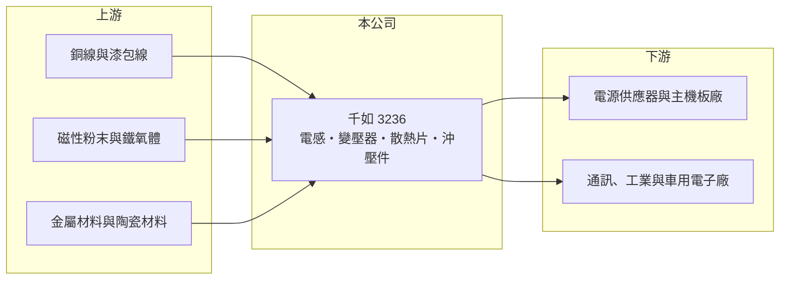

# 3236 千如

> 上櫃｜[[產業索引-電子零組件業|電子零組件業]]｜上市（櫃）日期 2004/12/02

# 第一章：企業模式與商業藍圖

> [!info] 撰寫說明
> 精簡版，由 Claude 依公開資料整理，架構比照 [[2330台積電]]，資料截至 2026-10-08。來源：櫃買中心開放資料快照（基本資料、2026 年第二季資產負債與損益、本益比殖利率、每月營收）、Goodinfo 經營績效頁、nStock 公司簡介。公開資料有限，產品別營收比重、客戶與生產據點未查得。#待校對

千如電機（以下簡稱千如）是一家以[[電感]]為主的[[被動元件]]製造商。理解千如的關鍵在於：電感是幾乎所有電子產品電源電路都要用到的基礎零件，需求面很廣，但產品標準化程度高，獲利取決於產品組合與產能利用率。

- **核心業務：** 千如成立於 1979 年，總部位於桃園楊梅，2004 年在櫃買中心掛牌。依公司登記，主要產品包括晶片電感器、電源電感器、濾波電感元件與變壓器，另有孔洞化結構陶瓷散熱片、精密金屬沖壓零件與 LED 照明燈具。電感的功能是儲存能量、濾除雜訊與穩定電流，電源電路越複雜、功率越高，需要的電感數量與規格也越高。
- **營收結構：** 依公司簡介，產品應用於消費電子、通訊電子、電腦及週邊、工業電子與汽車電子等電路。各產品線與各應用的營收比重公開資料未查得。由於應用分散，單一終端市場的波動對千如的影響相對有限，但也意味著公司較難享有單一高成長市場的完整紅利。
- **營運據點：** 台灣總部在桃園楊梅，生產基地的具體分布公開資料未查得（被動元件同業多在中國設廠，#待校對）。2026 年第二季總資產約 34.9 億元，其中非流動資產約 19.8 億元，占比超過一半，顯示公司擁有相當比重的廠房與設備。
- **長期方向：** 電感產業的長期升級方向是小型化、大電流與高頻化，AI 伺服器、電動車與工業電源都需要更高規格的功率電感。千如能否把產品組合往這些高規格應用移動，是毛利率能否長期站穩 25% 以上的關鍵；2025 年毛利率已升到 25.3%，為近六年最高。

# 第二章：護城河深度與競爭優勢

千如屬於中小型被動元件廠，護城河主要來自製程經驗與客戶認證，而不是規模或技術獨占。

- **競爭優勢：** 電感雖然是標準零件，但電源電感的磁性材料配方、繞線與成型製程會直接影響效率與發熱，客戶在導入新供應商前需要長時間驗證，一旦通過認證就不容易輕易更換。千如經營電感超過四十年，產品線涵蓋晶片電感到變壓器，能提供客戶較完整的磁性元件組合。2020 至 2025 年毛利率維持在 20% 至 25% 之間，沒有出現大幅崩落，代表產品具一定的定價基礎。
- **主要對手：** 台灣的被動元件同業包括 [[2327國巨]]（已整合奇力新的電感業務）、[[3357臺慶科]]、[[6127九豪]] 與 [[2492華新科]]；國際上則有日本村田、TDK、太陽誘電，以及中國的順絡電子、麥捷科技等。日系大廠主導高階規格，中國廠商以價格與產能擴張搶攻中低階市場，千如夾在中間，必須靠利基規格與服務彈性競爭。
- **觀察重點：** 長期最該追蹤的是營業利益率能否回到 2022 年 7% 以上的水準。2023 至 2025 年營收跌回 20 億元上下，營業利益率一度轉負，說明在需求低迷時，千如的固定成本壓力相當明顯；2026 年前九月營收年增約 22%，若營收回升能帶動利潤率同步改善，才代表經營體質真正提升。

# 第三章：財務體質與盈利規模

資料日期：2026-10-08，表格是撰寫當時的快照；最新月營收、毛利率、累計 EPS 由自動排程寫在本筆記的屬性欄位（月營收、毛利率、累計EPS 等）。#待校對

千如的財務呈現「毛利穩定、營業利益率偏薄」的樣貌：營收在 20 億元上下波動，只有 2022 年景氣高峰時 ROE 接近 15%。

| 年度 | 營收（億元） | [[毛利率]] | [[營業利益率]] | EPS（元） | [[ROE]] |
|---|---|---|---|---|---|
| 2021 | 24.8 | 19.9% | 6.0% | 1.02 | 7.2% |
| 2022 | 30.3 | 22.1% | 7.4% | 2.24 | 14.8% |
| 2023 | 19.9 | 22.6% | 1.8% | 0.36 | 2.5% |
| 2024 | 18.6 | 22.0% | -1.1% | 0.04 | 0.3% |
| 2025 | 20.7 | 25.3% | 4.6% | 0.32 | 2.2% |

（來源：Goodinfo 經營績效頁；2020 年營收 20.2 億元、EPS 0.79 元。）

- **營收規模：** 2020 至 2025 年營收由 20.2 億元到 20.7 億元，年複合成長率約 0.5%（推算），等於五年沒有實質成長。2022 年曾衝上 30.3 億元，2023 年又掉回 19.9 億元，反映被動元件產業在疫情期間缺料、拉貨後的庫存調整。2026 年上半年營收約 11.6 億元，前九月累計約 18.6 億元，年增約 22%。
- **獲利：** 近五年（2021 至 2025）平均 ROE 約 5.4%（推算），明顯偏低。毛利率穩定在兩成以上，但營業費用吃掉大部分毛利，使營業利益率長期落在個位數。2026 年上半年毛利率約 24.5%、營業利益率約 4.5%，歸屬母公司淨利約 2,143 萬元、EPS 0.20 元。
- **財務特色：** 2026 年第二季總資產約 34.9 億元、權益約 17.9 億元、負債約 17.0 億元，負債比約 49%，其中非流動負債約 6.7 億元，推估包含中長期借款。最近一次每股現金股利 0.5 元，高於 2025 年 EPS 0.32 元，配發率超過 100%（推算）；Goodinfo 統計歷年平均現金股利約 0.38 元，股利規模小且隨獲利波動。
- **[[ROIC]] 與 [[WACC]]：** 以 2025 年營業利益約 0.95 億元（20.7 億元 × 4.6%）、稅率 20% 計算，稅後營業利益約 0.76 億元。有息負債未查得，投入資本以權益 17.9 億元到「權益加全部負債」34.9 億元為區間，ROIC 約 2.2% 至 4.2%（推算）。WACC 以 [[CAPM]] 推估：無風險利率 1.75%、市場風險溢酬 6%、β 假設 1.0（被動元件股常見值），權益成本約 7.8%；稅後負債成本假設 2%、負債占四成，WACC 約 5.5%（推算）。ROIC 低於 WACC，代表近年千如的本業報酬不足以覆蓋資金成本，只有在 2022 年這類景氣高峰（ROE 14.8%）才明顯創造價值。

# 第四章：總體風險與地緣政治

千如的風險主要來自被動元件的庫存週期、中國同業的價格競爭，以及偏高的固定成本。

- **產業週期：** 被動元件是典型的週期性產業，終端需求變化會透過[[長鞭效應]]放大成上游訂單的劇烈波動。2022 年到 2023 年營收從 30.3 億元掉到 19.9 億元、EPS 從 2.24 元掉到 0.36 元，就是一次完整的去庫存循環。
- **營運風險：** 營業利益率偏薄，營收只要下滑一成，就可能讓獲利大幅縮水甚至轉虧，這是[[營業槓桿]]的負面效果。產品線涵蓋電感、散熱片、沖壓件與照明，資源分散也可能讓公司在主力電感產品上的研發投入不如專業大廠。
- **其他風險：** 中國電感廠持續擴產，可能長期壓低中低階電感報價。原物料方面，銅線、磁性粉末與金屬材料價格波動會影響成本；營收若以美元計價為主，新台幣升值也會壓縮毛利（#待校對）。

# 專有名詞解析

## 金融

- **[[長鞭效應]]**：終端需求的小幅變動，沿供應鏈往上游傳遞時被逐級放大，造成上游庫存與訂單劇烈波動。
- **[[營業槓桿]]**：固定成本占比高時，營收小幅變動會讓營業利益大幅變動的現象。
- **[[CAPM]]**：資本資產定價模型，以無風險利率加上 β 乘以市場風險溢酬，估計股東要求的報酬率。

## 產業

- **[[電感]]**：以線圈儲存磁能的被動元件，用於電源濾波、穩壓與抑制雜訊，是電源電路的基礎零件。
- **[[被動元件]]**：不需外加電源即可運作的電子零件，主要包括電容、電阻與電感。

# 核心供應鏈

- 上游：銅線、磁性粉末與鐵氧體磁芯、金屬沖壓材料與陶瓷材料。
- 下游／客戶：電源供應器、電腦主機板、通訊設備、工業電子與汽車電子製造商（具體客戶公開資料未查得，#待校對）。
- 同業：[[2327國巨]]、[[3357臺慶科]]、[[6127九豪]]、[[2492華新科]]，以及日本村田、TDK、太陽誘電與中國順絡電子。

## 最新新聞
<!-- news:start -->
<!-- news:end -->

## 相關連結
- [公開資訊觀測站](https://mopsov.twse.com.tw/mops/web/t05st03?step=1&firstin=1&co_id=3236)
- [Goodinfo](https://goodinfo.tw/tw/StockDetail.asp?STOCK_ID=3236)
- [Yahoo 股市](https://tw.stock.yahoo.com/quote/3236)
- [鉅亨網新聞](https://www.cnyes.com/twstock/3236/news)
