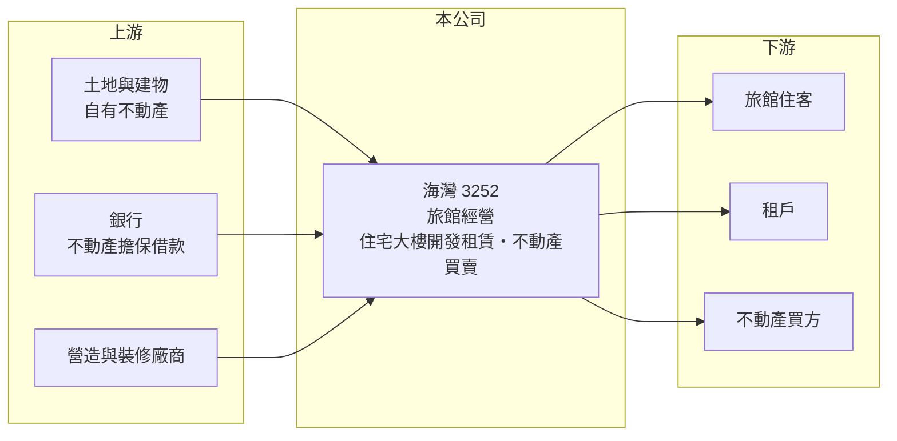

# 3252 海灣

> 上櫃｜[[產業索引-觀光餐旅|觀光餐旅]]｜上市（櫃）日期 2004/09/23

# 第一章：企業模式與商業藍圖

> [!info] 撰寫說明
> 精簡版，由 Claude 依公開資料整理，架構比照 [[2330台積電]] 的四章研究，資料截至 2026-10-08。來源：Goodinfo 年度經營績效頁、Yahoo 股市公司基本資料、櫃買中心開放資料快照（基本資料、2026 年第二季資產負債與綜合損益、每月營收）。公開資料有限，旗下旅館名稱、房間數與營收結構未查得。#待校對

本章說明海灣（股票代號：3252）的事業內容：它是一家以旅館經營與不動產開發租賃為業務的觀光餐旅類上櫃公司，資產規模不小，但營收與獲利都相當有限。

- **核心業務：** 依 Yahoo 股市公司資料，海灣的主要經營業務是一般旅館業、住宅及大樓開發租賃業，以及不動產買賣業。公司成立於 1994 年，2004 年在櫃買中心掛牌，實收資本額約 5.0 億元，目前在櫃買中心歸類為觀光餐旅業。這種「旅館加不動產」的組合，代表公司的價值主要建立在持有的土地與建物上，而不是品牌或服務規模。
- **營收結構：** 本次未查得旅館與租賃、不動產銷售各自的比重。從年度數字看，營收長期維持在每年 4.5 億至 5.8 億元之間，毛利率約 34% 至 50%，營收規模相對穩定，較符合旅館與租金這類經常性收入的特徵，而非建案交屋那種一次性大額認列（推估）。
- **營運據點：** 旗下旅館的地點、名稱與房間數本次未查得。依 2026 年第二季資料，公司總資產約 39.7 億元，遠高於每年約 5 億元的營收，資產周轉率很低，推估大部分資產是旅館與出租不動產（推估）。
- **長期方向：** 公司公開資訊有限，本次未查得明確的經營策略或新開發案。對研究者而言，海灣比較接近「資產股」：長期價值取決於不動產的市場價值、旅館營運能否改善，以及經營層是否有活化資產的計畫。

# 第二章：護城河深度與競爭優勢

資產型公司的護城河主要來自地段與資產品質，本章說明海灣目前可見的優勢與限制。

- **競爭優勢：** 旅館與出租不動產若位於好地段，能提供穩定的租金與住宿收入，也有長期增值空間，這是海灣最主要的潛在價值來源。營業利益率在 2025 年達 15.6%，顯示本業在扣除營業成本與費用後仍有獲利能力。不過由於資料有限，資產的實際地段與品質需要進一步查證。
- **主要對手：** 在旅館經營方面，海灣面對 [[2707晶華]]、[[2739寒舍]]、[[2704國賓]]、[[2702華園]] 等飯店業者，以及大量未上市的商務旅館；在不動產租賃方面，則與各地出租不動產業者競爭租戶。小型業者缺乏國際品牌與會員系統，較難取得高房價。
- **觀察重點：** 最大的問題是營業利益幾乎被利息等業外支出吃掉，2021 至 2025 年 EPS 都在 -0.31 至 0.71 元之間。長期要觀察公司能否降低負債與利息負擔、旅館營運是否改善，以及是否有出售、合建或活化資產的計畫。

# 第三章：財務體質與盈利規模

資料日期：2026-10-08，表格是撰寫當時的快照；最新月營收、毛利率、累計 EPS 由自動排程寫在本筆記的屬性欄位（月營收、毛利率、累計EPS 等）。#待校對

本章用五年經營數字與資本報酬，檢視海灣的獲利結構。

| 年度 | 營收（新台幣） | [[毛利率]] | [[營業利益率]] | EPS（元） | [[ROE]] |
|---|---|---|---|---|---|
| 2021 | 4.46 億 | 49.9% | 0.99% | 0.71 | 1.68% |
| 2022 | 5.75 億 | 38.9% | 6.05% | 0.09 | 0.18% |
| 2023 | 5.39 億 | 34.4% | 9.43% | 0.01 | 0.44% |
| 2024 | 5.15 億 | 34.4% | 8.47% | -0.31 | -0.57% |
| 2025 | 4.96 億 | 38.9% | 15.6% | 0.13 | 0.87% |

- **營收規模：** 營收在 4.5 億至 5.8 億元之間，2022 年後小幅下滑，2025 年約 5.0 億元。2026 年 1 至 8 月累計營收約 3.1 億元，年減約 7.7%；上半年營收約 2.55 億元，毛利率約 41.8%、營業利益率約 14.6%（櫃買中心資料，推算比率）。
- **獲利：** 營業利益率從 2021 年的 1% 提高到 2025 年的 15.6%，本業有改善；但 EPS 只有 0.13 元，ROE 不到 1%。2026 年上半年稅後淨利約 600 萬元，但歸屬母公司為虧損約 700 萬元、EPS -0.14 元，代表部分子公司的獲利屬於少數股東。2021 至 2025 年平均 ROE 約 0.5%（推算），長期幾乎沒有替股東賺到錢，近年也沒有發放現金股利。
- **財務特色：** 依 2026 年第二季資料，總資產約 39.7 億元，負債約 19.7 億元，其中非流動負債約 16.3 億元，推估多為以不動產擔保的長期借款（推估），權益總額約 20.1 億元。營業利益與 EPS 之間的巨大落差，推估主要來自利息支出（推估）。每股淨值約 39 元，代表帳上資產價值遠高於公司的獲利能力。
- **[[ROIC]] 與 [[WACC]]：** 2025 年營業利益約 0.77 億元（4.96 億 × 15.6%），稅後約 0.62 億元；投入資本取 2026 年第二季權益總額 20.1 億元加非流動負債 16.3 億元（視為有息負債），約 36.3 億元，ROIC 約 1.7%（推算）。WACC 以 CAPM 推估：10 年期公債 1.75%、市場風險溢酬 6%、β 取不動產與旅館同業常見值 0.7，股東權益成本約 6.0%；負債成本 3%、稅後 2.4%；權益占約 55%，WACC 約 4.4%（推算）。ROIC 明顯低於 WACC，代表以目前的營運水準，公司投入的資本並沒有創造價值；股東的報酬主要只能寄望於不動產增值或資產處分。

# 第四章：總體風險與地緣政治

本章整理海灣長期必須面對的風險，重點在於高資產、低報酬的結構。

- **產業週期：** 旅館收入受觀光與商務需求影響，疫情等事件會讓住房率大幅下滑；不動產租賃與買賣則受房市景氣、利率與央行[[信用管制]]影響。兩項業務都屬於與景氣同步的產業。
- **營運風險：** 長期借款規模大，利率上升會直接吃掉本來就微薄的獲利。營收規模小、資產周轉率低，若旅館或租賃業務出現空置，固定成本與利息仍需負擔，容易轉為虧損。
- **其他風險：** 公開資訊有限，投資人難以評估資產品質與經營策略；小型股流動性低，經營權結構與大股東決策對公司方向影響很大。

# 專有名詞解析

## 金融

- **[[信用管制]]**：央行限制購屋與建商貸款成數的政策，會影響房市成交與建商資金。
- **[[ROIC]]**：投入資本報酬率，稅後營業利益除以股東權益加有息負債，衡量本業運用資本的效率。
- **[[WACC]]**：加權平均資金成本，股東與債權人要求報酬率的加權平均，是 ROIC 要超越的門檻。

## 產業

- **[[資產股]]**：主要價值來自持有的土地、建物等資產，而非本業獲利能力的公司。
- **[[資產周轉率]]**：營收除以總資產，反映公司用多少資產創造營收，數值越低代表資產越重。

# 核心供應鏈

- 上游：自有土地與建物、提供擔保借款的銀行、營造與裝修廠商。
- 下游／客戶：旅館住客、不動產租戶與買方。
- 同業：[[2707晶華]]、[[2739寒舍]]、[[2704國賓]]、[[2702華園]]。

## 最新新聞
<!-- news:start（自動產生，請勿手動編輯此範圍） -->
- 2026-10-05 🏛️ 重訊 18:37｜更正本公司115年08月20日董事會決議私募普通股定價 及相關事宜｜[觀測站](https://mops.twse.com.tw/mops/#/web/t05st01)

完整紀錄：[[3252海灣 新聞]]
<!-- news:end -->

## 相關連結
- [公開資訊觀測站](https://mopsov.twse.com.tw/mops/web/t05st03?step=1&firstin=1&co_id=3252)
- [Goodinfo](https://goodinfo.tw/tw/StockDetail.asp?STOCK_ID=3252)
- [Yahoo 股市](https://tw.stock.yahoo.com/quote/3252)
- [鉅亨網新聞](https://www.cnyes.com/twstock/3252/news)
