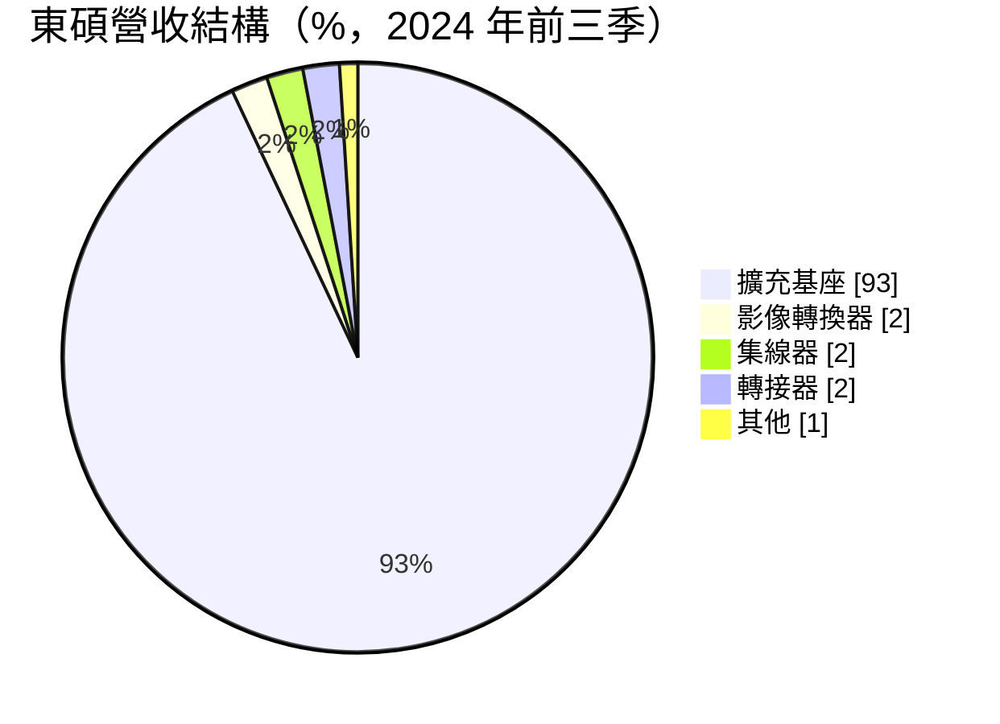
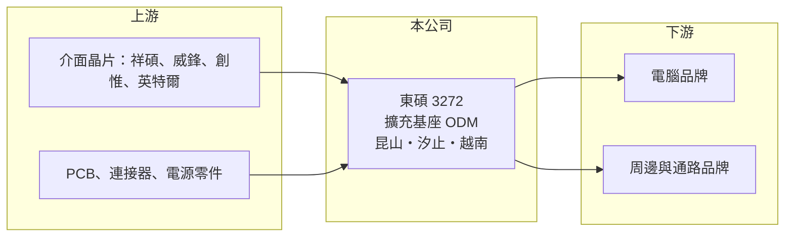

# 3272 東碩

> 上櫃｜[[產業索引-電腦及週邊設備業|電腦及週邊設備業]]｜上市（櫃）日期 2014/08/26

# 第一章：企業模式與商業藍圖

> [!info] 撰寫說明
> 精簡版，由 Claude 依公開資料整理，架構比照 [[2330台積電]]，資料截至 2026-10-08。來源：櫃買中心開放資料快照（基本資料、2026 年上半年財報、本益比殖利率）、Goodinfo 經營績效年度表、東碩 2024 年法說會簡報。產品結構取自 2024 年前三季資料，之後的變化未查得。#待校對

東碩是以[[擴充基座]]為主力的電腦周邊 [[ODM]] 廠，本章說明它的產品、客群與產能布局。

- **核心業務：** 東碩資訊（Good Way Technology）成立於 1993 年，2014 年上櫃，從事電腦周邊的設計、製造、測試與售後服務。主要產品是筆電用的擴充基座（Docking Station），另有訊號轉換器、集線器（Hub）、轉接器與路由器。擴充基座讓輕薄筆電只要接一條線，就能連上多個螢幕、網路與周邊，是企業辦公與遠距工作的常見配件。
- **營收結構：** 依 2024 年法說會簡報，2024 年前三季擴充基座約占營收 93%，影像轉換器、集線器、轉接器各約 2%，其他約 1%。客戶分為電腦品牌、周邊品牌與通路品牌三類：電腦品牌量大、毛利低，通路品牌品項多、毛利較高。
- **營運據點：** 2024 年簡報列出中國昆山廠（年產能約 264 萬台）、台灣汐止廠（約 144 萬台），以及越南太平省新廠（年產能約 216 萬台，原訂 2025 年第一季啟用），另有上海與美國加州辦公室。增設越南廠是為了因應美國客戶對非中國產地的要求。
- **長期方向：** 公司策略是往高規格、軟硬體整合的產品發展，技術重點包括 [[Thunderbolt]] 5、USB4、Chrome 專用基座、氮化鎵（GaN）充電與無線連接，並鎖定 AI PC 帶來的升級需求。截至 2024 年簡報累計取得 45 件發明專利。

# 第二章：護城河深度與競爭優勢

擴充基座是規格標準化、價格競爭激烈的產品，本章分析東碩的競爭處境。

- **競爭優勢：** 東碩長期為電腦品牌設計擴充基座，熟悉 Thunderbolt、USB-C 等介面的相容性測試與安規認證。擴充基座要能穩定支援各品牌筆電、螢幕與周邊，相容性問題處理不好就會大量退貨，這是有經驗的 ODM 廠的主要價值。
- **主要對手：** 擴充基座市場有大量中國低價廠商，以及電腦品牌自行委託的大型代工廠；台灣相關廠商包括 [[4915致伸]] 等周邊代工廠。介面晶片則由 [[5269祥碩]]、[[6756威鋒電子]]、[[6104創惟]] 與國外的英特爾、瑞昱等供應，東碩屬於系統組裝端，議價能力有限。
- **觀察重點：** 東碩 2022 年營收 68 億元的高峰受疫情遠距工作推升，之後營收腰斬並連年虧損，說明它的產品對景氣與客戶庫存非常敏感。長期要看越南廠能否爭取到新訂單、高階產品比重能否提高，以及財務結構能否撐過虧損期。

# 第三章：財務體質與盈利規模

資料日期：2026-10-08，表格是撰寫當時的快照；最新月營收、毛利率、累計 EPS 由自動排程寫在本筆記的屬性欄位（月營收、毛利率、累計EPS 等）。#待校對

東碩 2023 年起營收從高峰大幅縮減，連續三年營業虧損，2026 年上半年虧損再擴大。

| 年度 | 營收（億元） | [[毛利率]] | [[營業利益率]] | EPS（元） | [[ROE]] |
|---|---|---|---|---|---|
| 2019 | 49.1 | 12.8% | 2.77% | 2.04 | 6.64% |
| 2020 | 51.0 | 14.1% | 4.25% | 3.47 | 10.3% |
| 2021 | 46.8 | 10.1% | 0.11% | 0.58 | 1.67% |
| 2022 | 68.0 | 12.0% | 4.51% | 4.18 | 11.6% |
| 2023 | 30.3 | 2.33% | -14.2% | -6.13 | -20.8% |
| 2024 | 27.8 | 11.2% | -7.24% | -3.15 | -12.4% |
| 2025 | 29.4 | 8.14% | -13.6% | -7.65 | -36.7% |

- **營收規模：** 營收從 2020 年 51 億元降到 2025 年 29.4 億元，五年年複合成長率約 -10.4%（推算）。2026 年上半年營收 13.7 億元、毛利率 5.7%、營業利益率 -14.2%、EPS -4.05 元。
- **獲利：** 近五年（2021 至 2025 年）平均 ROE 約 -11.3%（推算）。即使在獲利年度，毛利率也只有 10% 至 14%，營業利益率不到 5%，代表這門生意本身利潤薄，營收一縮減就轉為虧損。
- **財務特色：** 2026 年第二季末總資產 46.6 億元、總負債 37.8 億元（其中流動負債 34.5 億元），負債比約 81%，股東權益只剩 8.8 億元，每股淨值 14.74 元。相較 2024 年第三季簡報的權益 15.2 億元、負債比 65%，財務結構明顯惡化。近年未配發股利。
- **[[ROIC]] 與 [[WACC]]：** 2026 年上半年營業損失 1.94 億元，年化約 -3.9 億元；以股東權益 8.8 億元計 ROIC 約 -44%，含全部負債 46.6 億元計約 -8.3%（推算，虧損不計稅盾）。WACC 以 CAPM 推估：無風險利率 1.75%、市場風險溢酬 6%、β 取 1.1，股東權益成本約 8.35%；有息負債金額未查得，假設占資本一半、成本 3%、稅後 2.4%，WACC 約 5.4%（推算）。ROIC 遠低於 WACC，公司目前在侵蝕資本，關鍵是越南廠與新產品能否讓本業轉回獲利。

# 第四章：總體風險與地緣政治

東碩的風險已從景氣波動延伸到財務體質，本章整理相關風險。

- **產業週期：** 擴充基座需求跟著企業換機與筆電出貨起伏，疫情期間的遠距工作潮透支了部分需求，之後客戶庫存調整拖累訂單。新介面規格（Thunderbolt 5、USB4）與 AI PC 換機潮是可能的復甦動力，但時點難以掌握。
- **營運風險：** 負債比約八成、流動負債占大宗，若虧損持續，資金調度與銀行授信會是壓力，可能需要增資或處分資產。電腦品牌客戶議價力強，中國低價同業競爭激烈，越南新廠初期的成本與良率也會壓縮毛利。
- **其他風險：** 美國關稅政策直接影響中國廠出貨的競爭力，產能移轉越南的速度與成本是關鍵。營收以美元計價，匯率波動與介面晶片價格也會影響獲利。

# 專有名詞解析

## 金融

- **[[ROIC]]**：投入資本報酬率，稅後營業利益除以股東權益加有息負債，衡量本業運用資本的效率。
- **[[WACC]]**：加權平均資金成本，股東權益成本與負債成本依資本結構加權，是 ROIC 必須超越的門檻。

## 產業

- **[[擴充基座]]**：筆電透過一條線連接多個螢幕、網路與周邊的裝置，常見於企業辦公。
- **[[ODM]]**：原廠委託設計製造，代工廠負責產品設計與生產，品牌商負責銷售。
- **[[Thunderbolt]]**：英特爾主導的高速傳輸介面，以 USB-C 接頭同時傳輸資料、影像與電力。

# 核心供應鏈

- 上游：介面晶片廠 [[5269祥碩]]、[[6756威鋒電子]]、[[6104創惟]]、[[INTC英特爾]]，以及 PCB、連接器與電源零件。
- 下游／客戶：電腦品牌、周邊品牌與通路品牌（實際客戶名稱未查得）。
- 同業：[[4915致伸]] 等周邊代工廠，以及中國的擴充基座代工廠。

## 最新新聞
<!-- news:start（自動產生，請勿手動編輯此範圍） -->
- 2026-10-12 📰 媒體 09:58｜貿協率凌華、東碩16家台企2度進軍東京醫療展 三大主題展31項創新醫療方案｜[鉅亨網](https://news.cnyes.com/news/id/6627679)

完整紀錄：[[3272東碩 新聞]]
<!-- news:end -->

## 相關連結
- [公開資訊觀測站](https://mopsov.twse.com.tw/mops/web/t05st03?step=1&firstin=1&co_id=3272)
- [Goodinfo](https://goodinfo.tw/tw/StockDetail.asp?STOCK_ID=3272)
- [Yahoo 股市](https://tw.stock.yahoo.com/quote/3272)
- [鉅亨網新聞](https://www.cnyes.com/twstock/3272/news)
