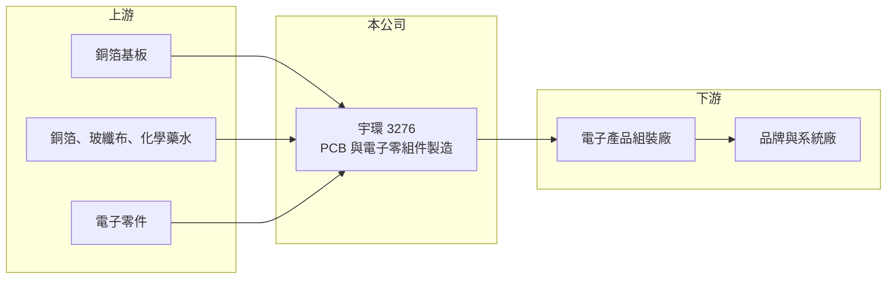

# 3276 宇環

> 上櫃｜[[產業索引-電子零組件業|電子零組件業]]｜上市（櫃）日期 2005/01/12

# 第一章：企業模式與商業藍圖

> [!info] 撰寫說明
> 精簡版，由 Claude 依公開資料整理，架構比照 [[2330台積電]]，資料截至 2026-10-08。來源：櫃買中心開放資料快照（基本資料、2026 年第二季資產負債與損益、本益比殖利率、每月營收）、Goodinfo 經營績效頁、nStock 公司簡介。公開資料有限，具體產品、營收比重、客戶與生產據點均未查得，本文以財務結構與產業特性為主。#待校對

宇環科技（以下簡稱宇環）是一家登記從事電子零組件與[[PCB]]（印刷電路板）製造加工的中小型公司。理解宇環的關鍵在於：公司營收在 2021 至 2025 年間縮小了三分之二，毛利率長期在零附近徘徊，近年的獲利主要靠業外收益支撐，因此它比較像一家「轉型與重整中」的公司，而不是穩定成長的製造商。

- **核心業務：** 宇環成立於 1999 年，總部位於桃園平鎮，2005 年在櫃買中心掛牌。依公司登記，本公司及子公司主要經營電子零組件及印刷電路板的製造、加工與買賣。PCB 是承載與連接電子零件的基板，幾乎所有電子產品都需要，但一般規格板的技術門檻不高、價格競爭激烈。
- **營收結構：** 產品別、應用別與客戶別的營收比重公開資料未查得。從毛利率推斷，宇環的產品偏向競爭激烈的中低階規格，2024 與 2025 年毛利率甚至為負，代表出貨價格不足以覆蓋生產成本。2026 年前九月營收約 5.43 億元，年增約 42%，是近幾年首次明顯回升。
- **營運據點：** 台灣總部在桃園平鎮，其他生產據點公開資料未查得。2026 年第二季資產負債表上有[[非控制權益]]約 0.6 億元，代表合併報表內有非全資持有的子公司。
- **長期方向：** 宇環的長期課題不是擴張，而是讓本業回到毛利為正、營業利益打平的狀態。公司 2025 年曾舉辦法說會，但轉型方向的具體內容未查得；投資人應以毛利率能否穩定轉正，作為判斷轉型是否成功的第一個指標。

# 第二章：護城河深度與競爭優勢

宇環目前看不出明顯的護城河，競爭地位相對薄弱。

- **競爭優勢：** 公開資料難以找出宇環具備的結構性優勢。PCB 產業的優勢通常來自規模（攤提設備成本）、高階製程（HDI、載板、高層數板）或與大客戶的長期認證關係。宇環營收規模只有數億元，遠小於主要同業，近年毛利率接近零，顯示它在價格談判上缺乏籌碼。若公司仍有優勢，較可能來自特定利基客戶或少量多樣的服務彈性（推估）。
- **主要對手：** 台灣 PCB 同業規模大得多，包括 [[3037欣興]]、[[2313華通]]、[[2368金像電]]、[[6153嘉聯益]] 與 [[2367燿華]]；中國大陸也有大量中小型電路板廠以低價競爭。在一般規格板市場，中國廠商的成本優勢使台灣小廠很難以價格取勝。
- **觀察重點：** 長期最該追蹤的有兩點：第一，毛利率能否從 2026 年上半年約 2.7% 持續回升到一成以上；第二，營收回升是否來自可持續的新產品或新客戶，而不只是短期訂單。若營收增加但毛利率仍在低檔，代表擴大的只是虧損規模。

# 第三章：財務體質與盈利規模

資料日期：2026-10-08，表格是撰寫當時的快照；最新月營收、毛利率、累計 EPS 由自動排程寫在本筆記的屬性欄位（月營收、毛利率、累計EPS 等）。#待校對

宇環的財務呈現「營收萎縮、本業虧損、業外撐盈餘」的樣貌：毛利率在 -4% 到 8% 之間，營業利益率多數年度為負。

| 年度 | 營收（億元） | [[毛利率]] | [[營業利益率]] | EPS（元） | [[ROE]] |
|---|---|---|---|---|---|
| 2021 | 16.2 | 6.4% | 0.8% | 1.18 | 11.4% |
| 2022 | 13.3 | 7.8% | 1.6% | 0.87 | 7.8% |
| 2023 | 12.9 | 4.2% | -1.4% | 0.79 | 5.0% |
| 2024 | 8.94 | -3.6% | -14.9% | -0.14 | -5.5% |
| 2025 | 5.05 | -1.4% | -19.6% | 0.21 | -2.3%（待校對） |

（來源：Goodinfo 經營績效頁；2020 年營收 12.6 億元、毛利率 -3.0%、EPS 0.18 元。2020 與 2025 年 ROE 為負但 EPS 為正，正負號不一致，可能與非控制權益或欄位定義有關，待校對。）

- **營收規模：** 營收由 2021 年的 16.2 億元降到 2025 年的 5.05 億元，2020 至 2025 年年複合成長率約 -16.7%（推算）。2026 年上半年營收約 3.31 億元，前九月約 5.43 億元，已超過 2025 年全年，回升幅度明顯，但規模仍只有高峰時的三分之一左右。
- **獲利：** 近五年（2021 至 2025）平均 ROE 約 3.3%（推算，含 2025 年待校對數值）。2023 年後營業利益率持續為負，EPS 卻多數年度為正，差額來自[[業外收入]]。2026 年上半年也是如此：營業損失約 0.35 億元，業外收入約 0.31 億元，歸屬母公司淨利僅約 384 萬元、EPS 0.06 元。依賴業外收益的盈餘品質較低，不能視為本業的獲利能力。
- **財務特色：** 2026 年第二季總資產約 15.6 億元，歸屬母公司權益約 8.7 億元、負債約 6.3 億元，負債比約 40%。非流動資產約 11.2 億元，占總資產七成以上，推估包含廠房、土地或長期投資，這些資產可能是業外收益的來源。每股淨值約 12.46 元，最近一次每股現金股利 0.06 元，Goodinfo 統計歷年平均現金股利約 0.12 元，配息能力有限。
- **[[ROIC]] 與 [[WACC]]：** 2025 年營業損失約 0.99 億元（5.05 億元 × -19.6%），虧損年度不計稅盾，以權益 8.7 億元到「權益加全部負債」15.6 億元為投入資本區間，ROIC 約 -6.3% 至 -11.4%（推算）。WACC 以 [[CAPM]] 推估：無風險利率 1.75%、市場風險溢酬 6%、β 假設 1.1（虧損小型股風險較高），權益成本約 8.4%；稅後負債成本假設 2%、負債占四成，WACC 約 5.8%（推算）。ROIC 為負且遠低於 WACC，代表本業目前在侵蝕股東價值，必須先恢復毛利率，才談得上創造價值。

# 第四章：總體風險與地緣政治

宇環的風險集中在本業虧損、規模不足，以及盈餘依賴業外收益。

- **產業週期：** PCB 需求隨消費電子、電腦與通訊設備的景氣循環起伏，規模小的廠商在景氣下行時最先被砍單，景氣回升時又不一定能拿回訂單。2024 至 2025 年營收腰斬，顯示宇環在上一輪下行週期中受傷特別重。
- **營運風險：** 毛利率長期接近零，任何原料上漲或訂單流失都可能讓虧損擴大。盈餘依賴業外收益，而業外收益（例如資產處分、投資收益或租金）通常不可持續，一旦業外收益減少，帳面虧損就會浮現。
- **其他風險：** PCB 製造涉及電鍍與化學藥水，環保法規趨嚴會增加處理成本；銅箔基板與銅價波動直接影響材料成本。中國大陸同業的低價競爭是長期結構性壓力。

# 專有名詞解析

## 金融

- **[[業外收入]]**：本業營運以外的收益，例如投資收益、利息、租金與資產處分利益，通常較不穩定。
- **[[非控制權益]]**：合併報表中，子公司股權不屬於母公司的部分，代表其他股東的權益。
- **[[CAPM]]**：資本資產定價模型，以無風險利率加上 β 乘以市場風險溢酬，估計股東要求的報酬率。

## 產業

- **[[PCB]]**：印刷電路板，用來承載電子零件並以銅線路連接，幾乎所有電子產品都需要。

# 核心供應鏈

- 上游：銅箔基板（例如 [[6274台燿]]、[[6213聯茂]]）、銅箔（例如 8358金居）、玻纖布與電鍍化學藥水。
- 下游／客戶：電子產品組裝廠與品牌商（具體客戶公開資料未查得，#待校對）。
- 同業：[[3037欣興]]、[[2313華通]]、[[2368金像電]]、[[6153嘉聯益]]、[[2367燿華]]，以及中國大陸中小型電路板廠。

## 最新新聞
<!-- news:start -->
<!-- news:end -->

## 相關連結
- [公開資訊觀測站](https://mopsov.twse.com.tw/mops/web/t05st03?step=1&firstin=1&co_id=3276)
- [Goodinfo](https://goodinfo.tw/tw/StockDetail.asp?STOCK_ID=3276)
- [Yahoo 股市](https://tw.stock.yahoo.com/quote/3276)
- [鉅亨網新聞](https://www.cnyes.com/twstock/3276/news)
