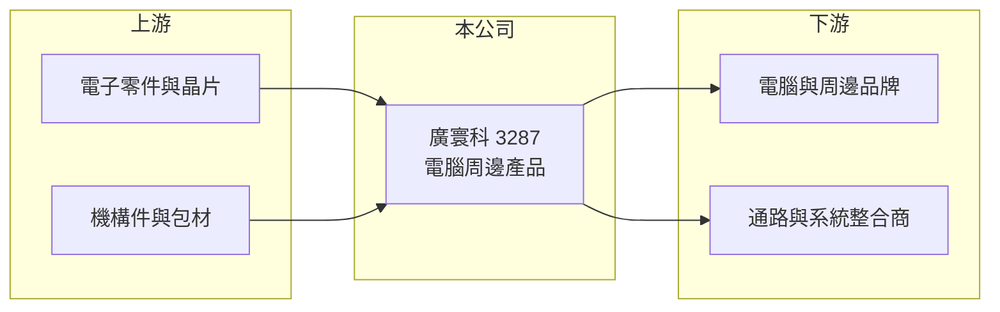

# 3287 廣寰科

> 上櫃｜[[產業索引-電腦及週邊設備業|電腦及週邊設備業]]｜上市（櫃）日期 2008/01/28

# 第一章：企業模式與商業藍圖

> [!info] 撰寫說明
> 精簡版，由 Claude 依公開資料整理，架構比照 [[2330台積電]]，資料截至 2026-10-08。來源：櫃買中心開放資料快照（基本資料、2026 年上半年財報、本益比殖利率）、Goodinfo 經營績效年度表、nStock 公司簡介。公開資料有限，具體產品線、客戶、生產據點與業外收益來源皆未查得，需以公司年報補正。#待校對

廣寰科是規模很小的電腦周邊廠，近年獲利主要來自業外，本章說明目前能確認的商業模式輪廓。

- **核心業務：** 廣寰科技成立於 1999 年，2008 年上櫃，總部在新北市中和，主要業務是電腦周邊產品的研發、製造與銷售。具體產品線與技術定位在本次查得的公開資料中沒有說明，需以年報確認。
- **營收結構：** 產品別與地區別比重未查得。營收規模約 4 億至 9 億元，2025 年 9.41 億元為近年高點，屬於電腦周邊產業中的小型公司。
- **營運據點：** 登記地址在新北市中和區，生產據點未查得。2026 年第二季末合併報表有約 0.7 億元非控制權益，代表旗下有非全資子公司。
- **長期方向：** 2026 年上半年毛利率約 42%，遠高於 2025 年的 23.6%，同時業外收益 2.17 億元是營業利益的三倍。本業與業外何者才是長期獲利來源，是理解這家公司最重要的問題，目前公開資料不足以判斷。

# 第二章：護城河深度與競爭優勢

小型周邊廠的護城河通常有限，本章以可得的財務特徵來評估廣寰科的競爭地位。

- **競爭優勢：** 從財務表現看，廣寰科的毛利率長期維持在 23% 至 30%，高於一般電腦代工廠的個位數至一成多，代表產品具有一定的利基或客製化成分。但營業利益率多數年度只有 1% 至 4%，費用占比偏高，規模經濟不足。
- **主要對手：** 具體對手需視產品線而定，電腦周邊領域的台灣同業包括 [[4915致伸]]、[[2385群光]]、[[8163達方]] 等大型周邊代工廠。這些公司規模是廣寰科的數十倍以上，若產品重疊，廣寰科只能靠小量多樣與客製化生存。
- **觀察重點：** 2024 年營業利益率 1.19%，EPS 卻有 2.35 元；2026 年上半年 EPS 5.88 元也大部分來自業外。投資人需要釐清業外收益是一次性的處分利益、投資收益還是匯兌收益，才能判斷這樣的獲利是否可以持續。

# 第三章：財務體質與盈利規模

資料日期：2026-10-08，表格是撰寫當時的快照；最新月營收、毛利率、累計 EPS 由自動排程寫在本筆記的屬性欄位（月營收、毛利率、累計EPS 等）。#待校對

廣寰科營收規模小、本業利潤薄，EPS 的高低主要由業外收益決定。

| 年度 | 營收（億元） | [[毛利率]] | [[營業利益率]] | EPS（元） | [[ROE]] |
|---|---|---|---|---|---|
| 2019 | 4.25 | 29.3% | 4.16% | 0.22 | 4.61% |
| 2020 | 6.77 | 29.9% | 11.5% | 1.68 | 19.4% |
| 2021 | 6.94 | 28.2% | 10.2% | 1.14 | 12.6% |
| 2022 | 4.50 | 28.1% | 3.40% | 0.02 | 1.54% |
| 2023 | 6.20 | 30.4% | 4.23% | 0.92 | 10.0% |
| 2024 | 7.62 | 26.8% | 1.19% | 2.35 | 18.8% |
| 2025 | 9.41 | 23.6% | 1.58% | 1.50 | 9.79% |

- **營收規模：** 營收從 2020 年 6.77 億元成長到 2025 年 9.41 億元，五年年複合成長率約 6.8%（推算）。2026 年上半年營收 4.34 億元、毛利率 42.2%、營業利益率 16.4%，本業獲利率大幅改善，但原因未查得。
- **獲利：** 近五年（2021 至 2025 年）平均 ROE 約 10.5%（推算），但其中相當比例來自業外。2026 年上半年營業利益 0.71 億元、業外收益 2.17 億元，歸屬母公司淨利 2.59 億元，EPS 5.88 元。
- **財務特色：** 2026 年第二季末總資產 13.2 億元、總負債 4.4 億元，負債比約 33%，股東權益 8.8 億元（歸屬母公司 8.1 億元），每股淨值 18.43 元，股本約 4.4 億元。2024 年度與 2025 年度現金股利皆為 1.5 元，配息率分別約 64% 與 100%。
- **[[ROIC]] 與 [[WACC]]：** 只看本業，2025 年營業利益約 0.15 億元、稅後約 0.12 億元，以權益約 8 億元計 ROIC 僅約 1.5%（推算）。2026 年上半年營業利益年化稅後約 1.14 億元，以股東權益 8.8 億元計 ROIC 約 12.9%，含全部負債 13.2 億元計約 8.6%（推算）。WACC 以 CAPM 推估：無風險利率 1.75%、市場風險溢酬 6%、β 取小型周邊股常見值 1.0，股東權益成本約 7.75%；有息負債假設比重 5%、稅後成本 1.6%，WACC 約 7.4%（推算）。過去多數年度本業 ROIC 低於 WACC，2026 年上半年首次明顯高於 WACC，需觀察能否持續。

# 第四章：總體風險與地緣政治

廣寰科最大的不確定性是資訊透明度與獲利來源，本章整理相關風險。

- **產業週期：** 電腦周邊需求跟著 PC 出貨與企業 IT 支出起伏，小型公司訂單集中，景氣轉弱時營收波動會比大廠更劇烈，2022 年營收就曾從 6.94 億元降到 4.50 億元。
- **營運風險：** 本業規模小、費用占比高，營收稍有下滑就可能轉為本業虧損。業外收益比重過高，若屬一次性收益，未來 EPS 可能大幅回落。
- **其他風險：** 公開資訊有限，投資人難以掌握產品、客戶與子公司的狀況，評估時應以年報與財報附註為準。外銷產品則有匯率風險。

# 專有名詞解析

## 金融

- **[[業外收益]]**：本業以外的收入，例如投資收益、處分資產利益、利息與匯兌收益，持續性通常低於本業。
- **[[ROIC]]**：投入資本報酬率，稅後營業利益除以股東權益加有息負債，衡量本業運用資本的效率。
- **[[WACC]]**：加權平均資金成本，股東權益成本與負債成本依資本結構加權，是 ROIC 必須超越的門檻。

# 核心供應鏈

- 上游：電子零件、晶片、機構件與包材（實際供應商未查得）。
- 下游／客戶：電腦與周邊品牌、通路與系統整合商（推估，實際客戶未查得）。
- 同業：[[4915致伸]]、[[2385群光]]、[[8163達方]] 等電腦周邊廠（產品是否直接重疊待校對）。

## 最新新聞
<!-- news:start（自動產生，請勿手動編輯此範圍） -->
- 2026-10-19 🏛️ 重訊 15:15｜本公司有價證券近期多次達公佈注意交易資訊標準，故公 告相關訊息，以利投資人區別瞭解。｜[觀測站](https://mops.twse.com.tw/mops/#/web/t05st01)

完整紀錄：[[3287廣寰科 新聞]]
<!-- news:end -->

## 相關連結
- [公開資訊觀測站](https://mopsov.twse.com.tw/mops/web/t05st03?step=1&firstin=1&co_id=3287)
- [Goodinfo](https://goodinfo.tw/tw/StockDetail.asp?STOCK_ID=3287)
- [Yahoo 股市](https://tw.stock.yahoo.com/quote/3287)
- [鉅亨網新聞](https://www.cnyes.com/twstock/3287/news)
