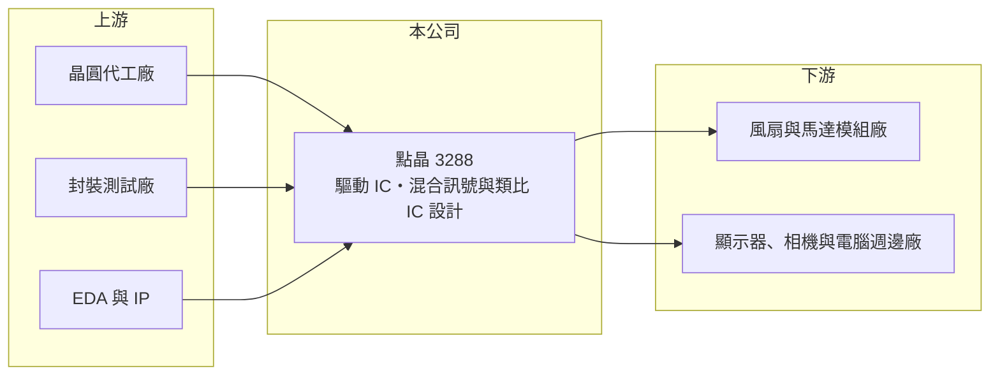

# 3288 點晶

> 上櫃｜[[產業索引-電子零組件業|電子零組件業]]｜上市（櫃）日期 2005/04/15

# 第一章：企業模式與商業藍圖

> [!info] 撰寫說明
> 精簡版，由 Claude 依公開資料整理，架構比照 [[2330台積電]]，資料截至 2026-10-08。來源：櫃買中心開放資料快照（基本資料、2026 年第二季資產負債與損益、本益比殖利率、每月營收）、Goodinfo 經營績效頁、nStock 公司簡介；「混合式訊號暨類比 IC 設計」定位參考 CMoney 新聞標題。公開資料有限，營收比重、客戶與代工夥伴未查得。#待校對

點晶科技（以下簡稱點晶）是一家位於新竹科學園區的小型 [[IC 設計]]公司，專注[[混合訊號IC]]與[[類比IC]]。理解點晶的關鍵在於：它的產品毛利率高達六成以上，符合 IC 設計業的特性，但年營收不到 1 億元，規模太小，研發與管理費用攤提不掉，因此多數年度處於虧損。

- **核心業務：** 點晶成立於 1996 年，2005 年在櫃買中心掛牌，依公司登記，主要從事無刷式風扇馬達驅動晶片、數位相機控制晶片、從屬電腦管理晶片，以及混合數位與類比晶片的研發、生產與銷售。點晶也以 LED 顯示驅動 IC 為人所知（#待校對）。這類晶片負責把數位指令轉換成驅動馬達或發光元件所需的電流與電壓，技術重點在精準度與穩定性。
- **營收結構：** 產品別與應用別的營收比重公開資料未查得。依產品名稱推測，終端應用包括散熱風扇、相機、電腦週邊與顯示裝置，屬於分散的利基市場。點晶採 IC 設計公司常見的委外生產模式，晶圓製造與封裝測試交由外部代工廠，因此本身資產規模很小。
- **營運據點：** 總部位於新竹科學園區。2026 年第二季總資產僅約 1.9 億元，其中流動資產約 1.6 億元，屬於典型的輕資產 IC 設計公司，主要資產是現金、應收帳款與存貨。
- **長期方向：** 點晶的長期課題是擴大營收規模。2020 至 2025 年營收在 0.7 億到 1.2 億元之間，持續萎縮；若無法找到放量的新產品，高毛利只能換來有限的毛利金額，難以支撐研發團隊與上市公司的固定成本。

# 第二章：護城河深度與競爭優勢

點晶在技術上具備 IC 設計的專業能力，但規模不足使這些能力難以轉化為穩定獲利。

- **競爭優勢：** 2022 至 2025 年毛利率維持在 60% 至 67%，代表點晶的晶片具備一定的差異化與定價能力，客戶願意為特定功能付出較高價格。驅動 IC 一旦在客戶的產品中完成[[設計導入]]，在該產品的生命週期內通常不會更換供應商，具有一定的黏著度。不過，這種黏著度只維持一個產品世代，下一代產品仍要重新競爭。
- **主要對手：** LED 顯示驅動 IC 領域的台灣主要對手是 [[3527聚積]]，以及中國大陸的明微電子、集創北方等廠商（#待校對）；馬達驅動與類比 IC 領域則面對 [[6202盛群]]、[[3588通嘉]] 等台灣同業，以及德州儀器、羅姆等國際大廠。這些對手的營收規模都是點晶的數十倍以上，研發資源差距懸殊。
- **觀察重點：** 長期最該追蹤的是營收能否回到 1 億元以上，以及營業費用能否控制在毛利以內。2026 年上半年毛利率約 73.8%，但營業利益仍虧損約 230 萬元，顯示只要營收再增加約一到兩成，就有機會轉為獲利，這是點晶的[[營業槓桿]]所在。

# 第三章：財務體質與盈利規模

資料日期：2026-10-08，表格是撰寫當時的快照；最新月營收、毛利率、累計 EPS 由自動排程寫在本筆記的屬性欄位（月營收、毛利率、累計EPS 等）。#待校對

點晶的財務呈現「高毛利、小營收、多數年度虧損」的樣貌：毛利率高，但營業利益率在 -30% 到 10% 之間劇烈擺動。

| 年度 | 營收（億元） | [[毛利率]] | [[營業利益率]] | EPS（元） | [[ROE]] |
|---|---|---|---|---|---|
| 2021 | 1.11 | 25.6% | -29.4% | -1.48 | -31.8% |
| 2022 | 1.16 | 60.3% | 9.5% | 0.19 | 3.0% |
| 2023 | 0.98 | 66.9% | 4.9% | 0.14 | 2.2% |
| 2024 | 0.82 | 60.6% | -14.0% | -0.35 | -5.3% |
| 2025 | 0.73 | 65.5% | -16.5% | -0.64 | -9.7% |

（來源：Goodinfo 經營績效頁；2020 年營收 1.01 億元、EPS -0.35 元。）

- **營收規模：** 2020 至 2025 年營收由 1.01 億元降到 0.73 億元，年複合成長率約 -6.3%（推算）。2026 年前八月累計營收約 0.48 億元，與 2025 年同期大致持平，尚未看到明顯回升。
- **獲利：** 近五年（2021 至 2025）平均 ROE 約 -8.3%（推算），只有 2022 與 2023 年小幅獲利。2021 年毛利率僅 25.6%，推估與存貨跌價或產品組合有關（#待校對）。2026 年上半年營收約 0.39 億元、營業損失約 230 萬元，靠業外收入約 150 萬元抵銷部分虧損，歸屬母公司淨損約 78 萬元、EPS -0.05 元。
- **財務特色：** 2026 年第二季總資產約 1.92 億元，歸屬母公司權益約 1.07 億元、負債約 0.86 億元。股本 1.638 億元，每股淨值約 6.55 元，低於面額 10 元，代表過去的虧損已侵蝕部分股本，帳上存在[[累積虧損]]。近年未配發現金股利，Goodinfo 統計歷年平均現金股利約 0.26 元，主要來自早年的配發。
- **[[ROIC]] 與 [[WACC]]：** 2025 年營業損失約 0.12 億元（0.73 億元 × -16.5%），虧損年度不計稅盾，以權益 1.07 億元到「權益加全部負債」1.92 億元為投入資本區間，ROIC 約 -6.3% 至 -11.2%（推算）。WACC 以 [[CAPM]] 推估：無風險利率 1.75%、市場風險溢酬 6%、β 假設 1.2（虧損小型 IC 設計股風險較高），權益成本約 9.0%；有息負債應不多，假設負債占一成、稅後負債成本 2%，WACC 約 8.3%（推算）。ROIC 遠低於 WACC，代表目前規模下本業無法創造經濟價值；IC 設計業的固定成本特性，使營收規模成為能否翻轉的唯一關鍵。

# 第四章：總體風險與地緣政治

點晶的風險主要來自規模不足、產品世代更替與大型對手的競爭。

- **產業週期：** 驅動 IC 與類比 IC 的需求跟隨消費電子、電腦週邊與顯示器的景氣循環。下游庫存調整時，客戶會先消化手上晶片庫存，IC 設計公司的訂單減幅往往大於終端銷售減幅。
- **營運風險：** 營收規模小，少數客戶或單一產品的訂單變化就能左右全年損益。研發人力是 IC 設計公司的核心資產，長期虧損可能讓公司難以留住或招募工程師，進一步削弱新產品開發能力。帳上淨值低於股本，若虧損持續，資本結構會持續弱化。
- **其他風險：** 晶圓與封測委外生產，若代工產能吃緊，小型設計公司的投片優先順序較低，可能出現交期與成本壓力。中國大陸驅動 IC 廠商在政策扶植下大舉擴張，持續壓縮中低階產品的價格。

# 專有名詞解析

## 半導體

- **[[IC 設計]]**：只負責晶片的電路設計與銷售，晶圓製造與封測委外代工的商業模式，又稱 Fabless。
- **[[混合訊號IC]]**：在同一顆晶片上同時處理類比訊號與數位訊號的積體電路。
- **[[類比IC]]**：處理電壓、電流、溫度等連續變化訊號的晶片，常見於電源管理與驅動應用。

## 金融

- **[[營業槓桿]]**：固定成本占比高時，營收小幅變動會讓營業利益大幅變動的現象。
- **[[累積虧損]]**：公司歷年虧損累積超過盈餘的部分，會使淨值低於股本。

## 產業

- **[[設計導入]]**：零件供應商的產品被客戶選入新產品設計，量產後在該產品生命週期內持續供貨。

# 核心供應鏈

- 上游：晶圓代工廠、封裝測試廠，以及 EDA 設計軟體（例如 [[CDNS益華電腦]]、[[SNPS新思科技]]）。具體代工夥伴公開資料未查得。
- 下游／客戶：散熱風扇與馬達模組廠、顯示器與 LED 顯示屏廠、相機與電腦週邊製造商（具體客戶公開資料未查得，#待校對）。
- 同業：[[3527聚積]]、[[6202盛群]]、[[3588通嘉]]，以及中國大陸明微電子、集創北方與國際類比 IC 大廠。

## 最新新聞
<!-- news:start（自動產生，請勿手動編輯此範圍） -->
- 2026-10-12 📰 媒體 18:50｜營收速報 - 點晶(3288)9月營收1,120萬元年增率高達107.28％｜[鉅亨網](https://news.cnyes.com/news/id/6628384)
- 2026-10-12 🏛️ 重訊 16:42｜115年09月銀行融資額度與使用情形暨未來三個月 現金收支預估情形｜[觀測站](https://mops.twse.com.tw/mops/#/web/t05st01)

完整紀錄：[[3288點晶 新聞]]
<!-- news:end -->

## 相關連結
- [公開資訊觀測站](https://mopsov.twse.com.tw/mops/web/t05st03?step=1&firstin=1&co_id=3288)
- [Goodinfo](https://goodinfo.tw/tw/StockDetail.asp?STOCK_ID=3288)
- [Yahoo 股市](https://tw.stock.yahoo.com/quote/3288)
- [鉅亨網新聞](https://www.cnyes.com/twstock/3288/news)
