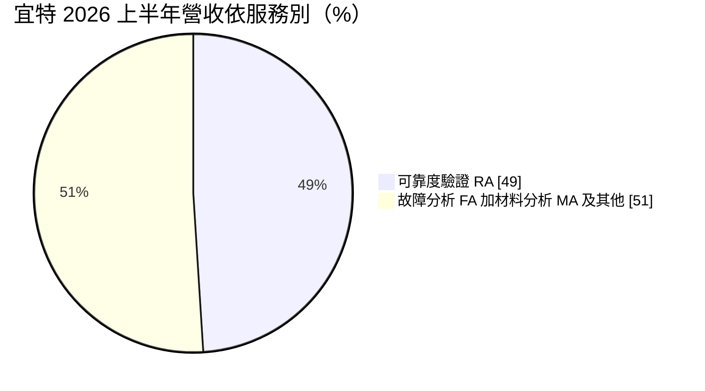
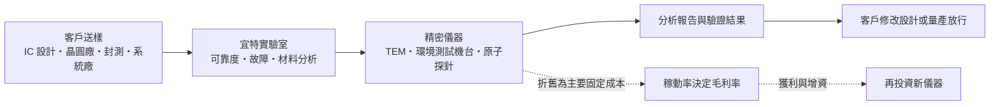
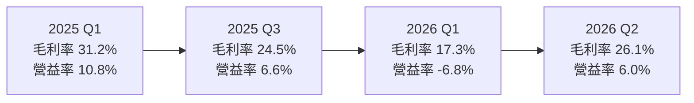
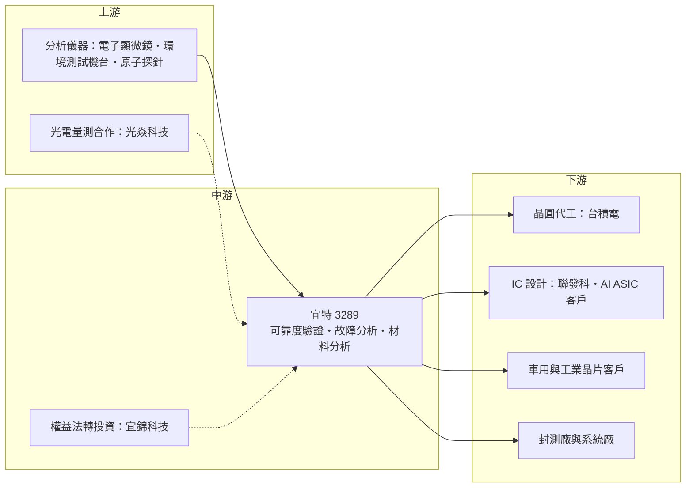

# 3289 宜特

> 上櫃｜[[產業索引-其他電子業|其他電子業]]｜上市（櫃）日期 2004/12/28

# 第一章：企業模式與商業藍圖

> [!info] 撰寫說明
> 本文由 Claude 依公開資料整理，架構比照 [[2330台積電]] 的四章研究，資料截至 2026-10-08。財務數字來源：證交所／櫃買中心開放資料（2026 年第二季財報、基本資料）、Goodinfo 年度經營績效、MoneyDJ 季度財務比率、富果 2026 年第二季法說會摘要、工商時報、財訊；產業描述為整理性內容，尚未逐條比對原始文件。#待校對

在評估單一個股的長期投資價值時，首要步驟是拆解企業的底層獲利邏輯。本章針對宜特科技（股票代號：3289，以下簡稱宜特）的商業模式進行定性分析，說明一家不生產晶片、也不賣設備的實驗室公司，如何在半導體產業裡收取「驗證與除錯」的服務費，以及它在 2026 年切割轉投資事業後回歸驗證本業的意義。

## 一、核心定位：半導體產業的第三方驗證實驗室

宜特成立於 1994 年，創辦人余維斌至今仍擔任董事長兼總經理，2004 年在櫃買中心掛牌。公司的角色可以理解為半導體產業的「健檢中心」：IC 設計公司、晶圓代工廠、封測廠與系統廠把晶片或材料送進宜特的實驗室，由宜特用精密儀器與標準化流程找出晶片的壽命、失效原因與材料結構，再出具報告。宜特不擁有客戶的產品，收入來自每一件委託案的分析與測試費用，屬於典型的技術服務業。

宜特的服務主要分為三類，三者的商業性質不同：

* **[[可靠度驗證]]（RA）：** 把晶片放進高溫、高濕、溫度循環、靜電等嚴苛環境中長時間測試，模擬產品在多年使用後是否會失效。這是宜特最大的業務，2025 年占營收 52%，2026 年上半年占 49%。可靠度驗證多依國際標準進行，案件量大、單價相對穩定，是公司營收的基本盤。
* **[[故障分析]]（FA）：** 晶片出問題時，找出「壞在哪裡、為什麼壞」，常用於新產品開發除錯與量產異常處理。故障分析需要經驗豐富的工程師判讀，技術含量高。
* **[[材料分析]]（MA）：** 用穿透式電子顯微鏡（[[TEM]]）、原子探針等儀器觀察奈米等級的材料結構與成分，主要服務先進製程研發。宜特 2024 年 12 月啟動原子探針斷層掃描的試片製備服務，鎖定 14 埃米等級的超先進製程研發需求。

故障分析與材料分析加上其他服務，2025 年合計占 48%、2026 年上半年占 51%，比重逐步提高，代表宜特的收入正從標準化的可靠度測試往技術門檻更高的分析服務移動。

## 二、終端應用板塊：從車用、消費性到 AI 與矽光子

宜特依服務類型揭露的營收結構如下：

宜特的客戶橫跨整條半導體供應鏈。依使用者整理的供應鏈關係，宜特同時出現在 [[台積電供應鏈]] 的「高階檢測與分析服務」與 [[聯發科供應鏈]] 的「測試介面與高階檢測分析」環節，提供晶片可靠度驗證與分析。公開報導未點名個別客戶比重，但從公司揭露的成長方向可以看出需求來源：

* **車用與工業：** 車用晶片必須通過 AEC-Q100 等[[車規驗證]]，測試項目多、週期長，是可靠度驗證最穩定的需求來源之一。
* **AI 與 [[ASIC]]：** 雲端業者與 IC 設計公司自行開發 AI 晶片，在設計初期與量產前都需要大量驗證。宜特表示已承接多家國內外客戶的 ASIC 驗證委案。
* **先進製程：** 2 奈米及更先進製程導入 [[GAA]] 電晶體與新的原子層沉積（[[ALD]]）材料，材料分析與故障分析的難度與件數同步增加，宜特把 2 奈米及次 2 奈米世代的 ALD 材料驗證列為 2026 年三大方向之一。
* **矽光子與 [[CPO]]：** 共同封裝光學把光學元件與運算晶片封在一起，需要新的光電量測能力。宜特與 [[7728光焱科技]] 合作建立光電驗證能力，並表示已與主要大廠合作，相關新設備預計 2026 年第三季進駐。

## 三、資本轉化邏輯：先買儀器、再靠稼動率回收

實驗室服務的成本結構有一個特色：最大的成本是儀器折舊與工程師薪資，兩者都屬於固定成本。一台高階電子顯微鏡動輒數千萬元，買進後不論案件多寡都要提列折舊。因此稼動率（儀器與人力被使用的程度）決定毛利率高低，案件量一旦跟上，新增的收入大部分可以轉為利潤；反過來，若在需求來臨前先買設備、先招人，毛利率就會被壓低。

宜特 2025 年的表現正是後者的例子。全年營收 48.4 億元創新高，已連續六年成長，但 EPS 由 2024 年的 6.5 元降到 4.81 元，媒體歸因於提前投入高階設備與研發人力，加上現金增資造成的股本稀釋。這說明宜特的獲利循環是「先投資、後收割」，投資人需要看的是新設備是否在一到兩年內被訂單填滿。

## 四、企業長期藍圖：切割宜錦、聚焦驗證本業

* **宜錦改採權益法：** 宜錦科技是宜特轉投資、從事[[晶圓薄化]]等功率半導體後段加工的公司（業務描述待校對）。這類加工需要大量資本投入，過去虧損拖累宜特合併毛利率。依法說會資訊，宜錦自 2026 年 3 月 17 日起不再併入宜特合併報表，改以[[權益法]]認列損益。2026 年第二季宜特毛利率回到 26%，公司認為這是較健康的營運水準。宜特表示目前沒有降低宜錦持股的計畫，宜錦目標在 2026 年第四季達到單月損益兩平。
* **財務結構改善：** 宜特透過現金增資償還借款，負債比率由前一年同期約 60% 降到約 45%，流動比率由 116% 提升到 150%，為之後的設備投資保留彈性。
* **三大技術方向：** 先進製程材料驗證、AI ASIC 驗證、矽光子與 CPO 驗證。這三項都對應半導體產業未來十年的結構性趨勢，案件複雜度高、單價較高，也是宜特把營收結構從可靠度驗證往高階分析移動的主要路徑。

# 第二章：護城河深度與競爭優勢

在長期價值投資中，「護城河」指企業抵禦競爭、維持超額利潤的保護機制。本章分析宜特在第三方驗證分析市場的護城河構成、主要競爭對手，以及這些優勢能在多大程度上轉化為穩定的獲利。

## 一、宜特護城河的核心組成要素

宜特的護城河屬於「窄護城河」，來源是長期累積的客戶信任與服務廣度，而不是獨占技術：

* **1. 驗證資料與客戶流程的黏著度：** 客戶的產品規格書、車規認證文件往往指定由某家實驗室出具報告，更換實驗室代表要重新比對測試條件與歷史數據。尤其車用與工業客戶的驗證週期長達數年，一旦合作就不輕易更換，這讓宜特的可靠度業務有穩定的回頭客。
* **2. 一站式服務的廣度：** 宜特同時提供可靠度驗證、故障分析、材料分析，以及訊號與系統層級的驗證服務。客戶在開發一顆新晶片時，可以把不同階段的需求交給同一家公司，減少溝通成本。依同業汎銓的法說描述，宜特以可靠度與故障分析為主、折舊較低，價格具競爭力。
* **3. 規模與儀器組合：** 第三方實驗室的儀器投資金額大、種類多，新進者很難在短時間內湊齊全套設備並累積判讀經驗。宜特 2025 年營收約 48 億元，是台灣同業中規模較大的一家。

## 二、全球主要競爭對手格局

| 對手 | 定位 | 對宜特的威脅 |
|---|---|---|
| [[3587閎康]] | 材料分析起家，台灣、中國、日本多據點 | 在故障分析與材料分析直接競爭，日本布局較早 |
| [[6830汎銓]] | 專注先進製程材料分析，單價高 | 搶先進製程研發端的高階材料分析案件 |
| Eurofins EAG 等國際實驗室 | 歐美大型檢測集團 | 服務歐美客戶與跨國認證案件 |
| 晶圓廠與封測廠自建實驗室 | 台積電、日月光等內部分析部門 | 大客戶自行處理核心分析，只外包溢出需求 |

## 三、優勢轉化：哪些市場守得住、哪些守不住

* **守得住：** 車用與工業的可靠度驗證，以及需要第三方公正報告的認證案件。這類需求看重報告的公信力與交期，價格敏感度低，而且客戶分散，不容易被單一客戶壓價。
* **守不住：** 先進製程最前端的材料分析。這個領域單價最高，但汎銓與閎康投入更早、儀器更集中，大型晶圓廠也會自行建立分析能力。宜特 2025 年毛利率 27%，低於閎康的 28.5% 與汎銓設定的 30% 以上目標，反映可靠度業務占比較高的產品組合。
* **觀察重點：** 第一，切割宜錦後，毛利率能否穩定在 26% 以上並逐步回到 2024 年約 28% 的水準。第二，CPO 與 AI ASIC 驗證能否在 2027 年後成為新的成長來源。第三，故障分析與材料分析的占比能否持續超過可靠度驗證，這代表宜特的服務是否真的往高附加價值移動。

# 第三章：財務體質與盈利規模

資料日期：2026-10-08。數字取自證交所／櫃買中心開放資料、Goodinfo 年度經營績效、MoneyDJ 季度財務比率與富果法說會摘要，表格是撰寫當時的快照；最新月營收、毛利率、累計 EPS 由自動排程寫在本筆記的屬性欄位（月營收、毛利率、累計EPS 等）。#待校對

財務報表是檢驗護城河是否真實存在的最終標準。本章用多年度的三率、ROE、現金流與資本報酬，檢視宜特在「先投資、後收割」的循環中，獲利品質是否穩定。

## 一、獲利能力的基石：三率

| 年度 | 營收（億元） | [[毛利率]] | [[營業利益率]] | EPS（元） | [[ROE]] |
|---|---|---|---|---|---|
| 2019 | 25.2 | 16.0% | -8.4% | 1.10 | 1.1% |
| 2020 | 30.4 | 27.6% | 7.5% | 2.80 | 5.7% |
| 2021 | 32.1 | 24.9% | 5.9% | 2.02 | 3.4% |
| 2022 | 37.4 | 27.1% | 9.0% | 5.33 | 11.5% |
| 2023 | 38.1 | 26.7% | 8.0% | 5.15 | 9.3% |
| 2024 | 43.5 | 28.0% | 8.5% | 6.50 | 13.8% |
| 2025 | 48.4 | 27.0% | 7.2% | 4.81 | 8.2% |
| 2026 上半年 | 22.7 | 21.9% | -0.1% | 3.08 | 未查得 |

註：2019 至 2025 年取自 Goodinfo；2026 上半年取自櫃買中心開放資料，EPS 含第一季宜錦改採權益法相關的業外收益。

* **[[毛利率]]：** 宜特的毛利率長期落在 25% 至 28% 之間，2019 年的 16% 與 2026 年第一季的 17% 是兩個低點，後者與宜錦虧損及新設備折舊有關。切割宜錦後第二季回到 26.1%，回到長期區間。
* **[[營業利益率]]：** 長期只有 6% 至 9%，代表研發、管理與業務費用占營收的比例偏高。實驗室服務需要大量工程師與業務窗口，費用率不易大幅下降，這是宜特和製造業公司最大的不同。
* **業外與一次性收益：** 2026 年上半年營業利益接近零，但稅後 EPS 達 3.08 元，主要來自第一季的業外收益。評估本業應以營業利益為準，不宜把上半年 EPS 直接年化。

## 二、[[ROE]]：資本效率

宜特近 5 年（2021 至 2025 年）平均 ROE 約 9.2%（推算，取 Goodinfo 各年數字平均），高點是 2024 年的 13.8%。ROE 偏低的原因有兩個：一是營業利益率只有個位數，二是公司多次以現金增資籌措設備資金，股本由 2024 年的 7.44 億元增加到 2025 年的 8.64 億元，股東權益擴大的速度快於獲利成長。營收方面，2019 至 2025 年的年複合成長率約 11.5%（推算），成長性穩定，但尚未轉化為同等幅度的獲利成長。

## 三、資本支出與自由現金流

* **[[CapEx]]：** 宜特的資本支出以高階儀器為主，金額隨技術世代更替而起伏。具體年度金額本次未查得。2026 年的新增投資集中在 CPO 光電驗證設備，預計第三季進駐。
* **[[自由現金流]]：** 實驗室業務的折舊高、營業現金流通常明顯大於稅後淨利，但資本支出也大。宜特近年仰賴現金增資償還借款，代表自由現金流不足以同時支應設備投資與配息（推估）。
* **股利：** 依櫃買中心本益比殖利率資料，近四季現金股利合計約 4.46 元，以 2025 年 EPS 4.81 元計算配發率約九成（推算），配息意願高，但配息水準會隨獲利波動。

## 四、[[ROIC]] 與 [[WACC]]：價值創造利差

* **ROIC（推算）：** 以 2025 年營收 48.4 億元乘營業利益率 7.22%，得營業利益約 3.49 億元，扣除 20% 稅率後稅後營業利益約 2.80 億元。投入資本以 2026 年第二季股東權益 47.5 億元，加上有息負債約 19.5 億元（官方資料未拆分有息負債，以負債總額 38.9 億元的一半推估，含租賃負債）計算，合計約 67 億元，ROIC 約 4.2%。
* **WACC（推算）：** 以 [[CAPM]] 估股權成本：無風險利率 1.75%（台灣 10 年期公債約 1.5% 至 2%），市場風險溢酬 6%，β 取 1.0（同業常見值，未查得公司實際數字），股權成本約 7.75%。稅前負債成本假設 2.5%、稅後 2.0%，以帳面權益占 71%、負債占 29% 加權，WACC 約 6.1%。
* **結論：** 2025 年 ROIC 約 4.2% 低於 WACC 約 6.1%，代表當年的投資尚未替股東創造超額價值。2024 年營業利益率較高時，ROIC 推估接近 WACC。宜特要長期創造價值，關鍵在於切割宜錦後把營業利益率拉回 9% 以上，並讓新購置的高階儀器提高稼動率。

# 第四章：總體風險與地緣政治

任何企業都無法脫離宏觀環境獨立存在。本章分析宜特未來必須面對的地緣政治、產業週期、營運與技術風險。

## 一、地緣政治風險

* **中國市場的定位：** 中國有大量晶片設計公司與晶圓廠，是驗證分析的重要市場，但美國出口管制限制部分高階儀器與先進製程合作，中國也積極扶植本土檢測業者。宜特在中國的布局與合作方式（包括與當地檢測集團的合作，待校對）需要持續觀察。
* **客戶分散到海外：** 台積電、美系 IC 設計公司在美國、日本設廠，量產端的分析需求可能就近在當地實驗室完成。台灣實驗室需要透過跨國據點或研發端案件維持接單。

## 二、產業週期與市場結構風險

* **研發與量產雙週期：** 宜特的需求一半來自新產品研發，一半來自量產的可靠度與異常分析。半導體景氣下行時，量產相關案件會先減少；研發案件較有韌性，但若 IC 設計公司縮減新案，也會受到影響。
* **價格競爭：** 可靠度驗證的技術門檻相對較低，國內外新進者容易以低價搶單。宜特若無法提升故障分析與材料分析比重，毛利率容易被價格戰壓抑。

## 三、營運環境的隱性風險

* **固定成本槓桿：** 儀器折舊與工程師薪資占成本大宗，景氣轉弱時毛利率下滑幅度會大於營收下滑幅度，這在 2026 年第一季營業利益率轉為 -6.8% 時已經看到。
* **宜錦的損益仍會影響業外：** 宜錦改採權益法後不再影響毛利率，但其虧損仍按持股比例認列在業外，宜錦能否如期轉虧為盈仍影響宜特的稅後淨利。
* **人才競爭：** 高階分析工程師的養成需要多年，竹科與南科的半導體大廠也在搶同一批人才，人力成本上升會壓縮利潤。

## 四、科技演進風險

先進製程、[[Chiplet]] 與 3D 堆疊讓晶片結構越來越複雜，第三方分析的需求長期向上，這對宜特是順風。但風險在於技術變化太快：每個新世代都需要新的儀器與方法，若宜特在關鍵技術（例如 CPO 光電量測、原子級材料分析）上落後同業，就可能錯失最有價值的案件。另一方面，大型晶圓廠若把更多分析能力內部化，第三方實驗室能分到的會是較標準化、單價較低的工作。

# 專有名詞解析

## 半導體

- **[[故障分析]]**：晶片失效時找出損壞位置與原因的分析服務，英文縮寫 FA，常用於新產品除錯與量產異常處理。
- **[[材料分析]]**：用電子顯微鏡、質譜等儀器分析奈米等級的材料結構與成分，英文縮寫 MA，主要服務先進製程研發。
- **[[TEM]]**：穿透式電子顯微鏡，以電子束穿透極薄的樣品觀察原子等級結構，是先進製程材料分析的核心儀器。
- **[[GAA]]**：環繞式閘極電晶體，閘極從四面包住通道以降低漏電，是 2 奈米世代接替 FinFET 的電晶體架構。
- **[[ALD]]**：原子層沉積，一次只長一層原子厚度的薄膜，先進製程大量使用，材料特性需要精密分析確認。
- **[[ASIC]]**：特定應用積體電路，為單一用途量身設計的晶片，雲端業者自研的 AI 加速晶片多屬此類。
- **[[CPO]]**：共同封裝光學，把光收發元件與交換器或運算晶片封裝在一起，以縮短電訊號距離並降低耗電。
- **[[晶圓薄化]]**：把晶圓背面研磨到很薄的厚度，常用於功率元件與堆疊封裝，以改善散熱與導電特性。
- **[[Chiplet]]**：小晶片架構，把大型晶片拆成多顆功能小晶片再封裝在一起，可提高良率並混用不同製程。

## 應用

- **[[車規驗證]]**：車用晶片須通過 AEC-Q100 等可靠度測試與車廠認證，流程常需 2 至 3 年，因此轉換成本高。

## 金融

- **[[權益法]]**：持股具重大影響力但未控制的轉投資，不併入營收，只按持股比例把對方損益認列在業外。
- **[[CAPM]]**：資本資產定價模型，以無風險利率加上 β 乘市場風險溢酬估算股東要求的報酬率。
- **[[ROIC]]**：投入資本報酬率，衡量公司用股東與債權人的資金經營本業能賺多少報酬。

## 產業

- **[[可靠度驗證]]**：把產品放在高溫、高濕、溫度循環等嚴苛條件下長時間測試，確認多年使用後不會失效，英文縮寫 RA。

# 核心供應鏈

## 1. 上游：分析儀器與技術夥伴
- 穿透式電子顯微鏡等高階分析儀器：Thermo Fisher、日立高新等國際儀器商（待校對）
- 矽光子與 CPO 光電驗證能力合作：[[7728光焱科技]]

## 2. 中游：宜特本身與轉投資
- 第三方驗證實驗室：可靠度驗證（RA）約占一半營收，故障分析與材料分析合計約占另一半
- 晶圓薄化等功率半導體後段加工：宜錦科技（2026 年 3 月起改採權益法，不再併入合併報表）

## 3. 下游：委託驗證與分析的客戶
- 晶圓代工：[[2330台積電]]（晶片可靠度驗證分析）
- IC 設計：[[2454聯發科]]（晶片可靠度驗證分析）
- 雲端業者與 IC 設計公司自研 AI ASIC：國內外多家，個別名單未公開
- 車用與工業晶片：AEC-Q100 等車規驗證客戶，個別名單未查得

## 4. 同業競爭
- 台灣第三方實驗室：[[3587閎康]]、[[6830汎銓]]
- 國際檢測集團：Eurofins EAG 等
- 晶圓廠與封測廠的內部分析部門

延伸閱讀：[[台積電供應鏈]]、[[聯發科供應鏈]]

## 供應鏈關係
- 供應給 [[2330台積電]]：晶片可靠度驗證分析（台積電供應鏈 › 下游：高階檢測與分析服務）
- 供應給 [[2454聯發科]]：晶片可靠度驗證分析（聯發科供應鏈 › 中游：測試介面與高階檢測分析）

## 最新新聞
<!-- news:start（自動產生，請勿手動編輯此範圍） -->
- 2026-10-18 📰 媒體 03:14｜宜特(3289) 個股概覽 ／ 個股 - 股市｜[CMoney](https://news.google.com/rss/articles/CBMiSkFVX3lxTE1xd2dIUFV4ejF1TmR0UXdvaF9yZVBucTlMdHFWN25MQkVwWW02eFNDZHRkWEk2QkZYLWVvVV91M1FHSzVaTnlJdUdR?oc=5)
- 2026-10-13 📰 媒體 16:57｜《熱門族群》CPO量產推進測試升級 汎銓、閎康、宜特迎新商機｜[富聯網](https://news.google.com/rss/articles/CBMiiAFBVV95cUxPMGpLdmtoYmlBdmVpanRDT20tbDhsak9YdW4tU3Z5V1lSSGRfaVg5NHFONGp3YmlxY2Q0VmJHRjBvdVdsQ0JlR3lmTEFzN3ExeHVNSGJvbnQ1c0tsSFRWSm9uZk5oLWNTX0JScUtoRURjMzJPaGI3cV9zTWlGOTJfX2pDZTZXTklO?oc=5)
- 2026-10-09 📰 媒體 09:38｜《業績-其他電》宜特9月營收為3.59億元，年減21.54%｜[富聯網](https://news.google.com/rss/articles/CBMiiAFBVV95cUxNTnFXRWt2V3FQeVh0NEpvTmtzWktyVE13SUJ0QjlmOVVlVWR4akxhSFk2V0pvQU1DWlNoUlFmdU5Ud1RjSzFPYi1WamlWNTFPdlBYbFJjMFl0NVdwMGFSOEJvdGVFU0tmQjBwbl8xTWVMVC16d3psek90THNybHNtT0NVeWJiaFE2?oc=5)
- 2026-10-09 📰 媒體 02:51｜討論牆 ／ 閎康(3587)、宜特(3289)、汎銓(6830) 誰的成長動能最強？為何業績還沒爆發？｜[LINE TODAY](https://news.google.com/rss/articles/CBMiZEFVX3lxTE1NLVJQTVBLYlFUUVVYcWsxNTZENERqalRzaUV1c1ZFcmh2U3Y3YmFBcUI1eWVZSVFVVmprNUtKLWhiUjJyU0YwaXFtWUxOSkJXMDhqRDl5TTE1YWxISWZXOWRWODg?oc=5)
- 2026-10-08 📰 媒體 18:33｜宜特9月營收月減3.1%｜[TechNews 科技新報](https://news.google.com/rss/articles/CBMifEFVX3lxTE9PNDUwTTlMSVd4WDlKclZDU2hfZFo3OVpsY2JSZzJteUVFN0Q5TjF1Q0JYOWt0OXhBeC1tX0hOWWNFV1VwVHpEWmpaZ2Zhc0JQQlNvYTE2aTcyaW5LbV9leERwQ3pvS1hkWnMyWnZtOHNubEdrSWZPZ1YxQmQ?oc=5)

完整紀錄：[[3289宜特 新聞]]
<!-- news:end -->

## 相關連結
- [公開資訊觀測站](https://mopsov.twse.com.tw/mops/web/t05st03?step=1&firstin=1&co_id=3289)
- [Goodinfo](https://goodinfo.tw/tw/StockDetail.asp?STOCK_ID=3289)
- [Yahoo 股市](https://tw.stock.yahoo.com/quote/3289)
- [鉅亨網新聞](https://www.cnyes.com/twstock/3289/news)
