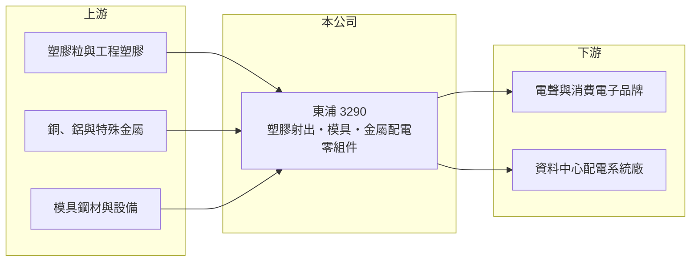

# 3290 東浦

> 上櫃｜[[產業索引-電子零組件業|電子零組件業]]｜上市（櫃）日期 2005/05/19

# 第一章：企業模式與商業藍圖

> [!info] 撰寫說明
> 精簡版，由 Claude 依公開資料整理，架構比照 [[2330台積電]]，資料截至 2026-10-08。來源：櫃買中心開放資料快照（基本資料、2026 年第二季資產負債與損益、本益比殖利率、每月營收）、Goodinfo 經營績效頁、優分析轉載之 2026 年 10 月營運報導。產品別營收比重與主要客戶未查得。#待校對

東浦精密（以下簡稱東浦）原本是一家[[塑膠射出]]與模具廠，2025 年底收購美商 Bi-Link 後，產品線擴展為「塑膠加金屬」，並切入 AI 資料中心的配電零組件。理解東浦的關鍵在於：這筆併購讓公司的規模、產品組合與資產負債表在一年內大幅改變，2026 年是新舊業務整合的第一年。

- **核心業務：** 東浦成立於 1995 年，總部位於桃園蘆竹，2005 年在櫃買中心掛牌。傳統本業是精密塑膠射出成型與模具開發，子公司包括中國的東莞東裕塑膠製品。塑膠射出看似技術門檻不高，但精密電子零件對尺寸公差、外觀與材料特性要求嚴格，模具設計與量產良率才是競爭核心。
- **營收結構：** 依 2026 年 10 月報導，東浦的主要成長來源有二：一是自行開發的高階[[電聲產品]]，客戶在 2026 年上半年完成新舊產品轉換後於第二季恢復出貨；二是 Bi-Link 的 AI 相關產品，包括 AI 資料中心配電系統（[[母線槽]]，Track Busway）的插接箱零組件與架空配電組件，2026 年第三季開始大量出貨。產品別營收比重未查得。
- **營運據點：** 台灣總部在桃園，生產據點包括中國東莞與併入的 Bi-Link（美國，#待校對）。2026 年公司設立泰國子公司，預計投資 6 億泰銖，以區域化生產擴大產能並提高調度彈性；報導也提到併購越南企業，但細節未查得。
- **長期方向：** 東浦的長期策略是整合塑膠與金屬兩條產品線，提高單一客戶的供貨內容與議價能力，並藉 Bi-Link 的客戶基礎拓展全球市場。AI 資料中心的高功率配電需求是這個策略最主要的成長引擎；若能順利整合，東浦將從單純的零件代工廠，轉向具系統零組件能力的供應商。

# 第二章：護城河深度與競爭優勢

東浦的護城河正在重新建構中：舊有的塑膠射出能力屬於窄護城河，併購帶來的配電零組件與客戶關係才是新的競爭基礎。

- **競爭優勢：** 2023 至 2025 年毛利率由 27.4% 升到 30% 以上，明顯高於 2020 至 2022 年約兩成的水準，代表東浦在併購前就已把產品組合往高附加價值的電聲與精密零件移動。Bi-Link 帶來的專利技術與客戶關係在 2026 年第二季已認列為無形資產，配電零組件需要安規認證與長期供貨紀錄，新進者不易取代。
- **主要對手：** 塑膠射出與精密零件領域的對手眾多，包括台灣與中國大陸大量的射出成型廠；電聲產品領域有 [[2439美律]] 等台灣同業。資料中心配電領域的主要競爭者是施耐德、西門子、伊頓等國際電機大廠及其供應鏈，台灣則有 [[1503士電]]、[[1514亞力]] 等重電廠商。東浦的定位是零組件供應商，與這些系統廠商較偏合作而非直接競爭（推估）。
- **觀察重點：** 長期最該追蹤的是本業營業利益率能否回到 2024 至 2025 年 13% 至 15% 的水準。2026 年上半年營收大增但營業利益率只有約 0.1%，顯示併購初期的整合成本、無形資產攤銷與產品轉換壓縮了本業獲利；公司預期 AI 產品放量後毛利率會逐步回升。

# 第三章：財務體質與盈利規模

資料日期：2026-10-08，表格是撰寫當時的快照；最新月營收、毛利率、累計 EPS 由自動排程寫在本筆記的屬性欄位（月營收、毛利率、累計EPS 等）。#待校對

東浦的財務在併購前呈現「營收穩定成長、利潤率逐年提升」的樣貌，2026 年則因併購出現一次性獲利與資產負債表擴張。

| 年度 | 營收（億元） | [[毛利率]] | [[營業利益率]] | EPS（元） | [[ROE]] |
|---|---|---|---|---|---|
| 2021 | 17.2 | 19.9% | 3.9% | 0.77 | 5.4% |
| 2022 | 17.9 | 21.8% | 6.3% | 1.17 | 7.8% |
| 2023 | 18.6 | 27.4% | 11.2% | 1.14 | 6.7% |
| 2024 | 19.7 | 33.0% | 13.5% | 2.02 | 11.4% |
| 2025 | 23.3 | 30.3% | 14.5% | 2.02 | 9.7% |

（來源：Goodinfo 經營績效頁；2020 年營收 16.9 億元、EPS 0.61 元。）

- **營收規模：** 2020 至 2025 年營收由 16.9 億元增至 23.3 億元，年複合成長率約 6.6%（推算），在中小型零組件廠中屬於穩定成長。併購後規模明顯跳升：2026 年前九月營收約 30.0 億元，年增約 83%，已超過 2025 年全年。
- **獲利：** 近五年（2021 至 2025）平均 ROE 約 8.2%（推算），2024 年起提升到一成上下。2026 年上半年 EPS 4.02 元，但其中絕大部分來自業外：營業利益僅約 0.02 億元，業外收入約 3.60 億元，主要是收購 Bi-Link 產生的[[廉價購買利益]]（報導估計約 4.18 億元）。這是一次性收益，不代表本業獲利能力。
- **財務特色：** 2026 年第二季總資產約 63.6 億元，權益約 25.0 億元，負債約 38.6 億元，負債比約 61%，其中非流動負債約 18.9 億元，推估包含併購相關的長期借款。與併購前相比，資產負債表明顯擴大，財務槓桿也提高。最近一次每股現金股利 1.5 元，以 2025 年 EPS 2.02 元計算配發率約 74%（推算）；Goodinfo 統計歷年平均現金股利約 0.49 元，近年配息明顯提高。
- **[[ROIC]] 與 [[WACC]]：** 以 2025 年營業利益約 3.38 億元（23.3 億元 × 14.5%）、稅率 20% 計算，稅後營業利益約 2.70 億元。2025 年平均權益依 ROE 與 EPS 推算約 18.9 億元，以此為投入資本上限情境，ROIC 約 14.3%；若以併購後 2026 年第二季的權益加全部負債 63.6 億元計算，ROIC 只有約 4.2%（推算）。WACC 以 [[CAPM]] 推估：無風險利率 1.75%、市場風險溢酬 6%、β 假設 1.0（零組件股常見值），權益成本約 7.8%；稅後負債成本假設 2%、負債占四成五，WACC 約 5.2%（推算）。併購前 ROIC 明顯高於 WACC，代表本業有創造價值；併購後投入資本大增，能否維持利差，取決於 Bi-Link 的 AI 配電產品能否把獲利放大到與新資本規模相稱。

# 第四章：總體風險與地緣政治

東浦的風險集中在併購整合、財務槓桿上升，以及 AI 基礎建設需求的波動。

- **產業週期：** 電聲產品跟隨消費電子的產品世代更替，客戶換代期間出貨會中斷，2026 年上半年就曾經歷這種空窗。AI 資料中心配電需求雖然長期向上，但雲端業者的資本支出具有週期性，一旦放緩，配電零組件的訂單也會跟著調整。
- **營運風險：** 跨國併購的整合難度高，包括管理文化、生產系統與客戶交接。若 Bi-Link 的產品放量不如預期，併購產生的無形資產與商譽可能面臨減損。負債比升到六成以上，利率上升或現金流不如預期時，財務壓力會比過去大。
- **其他風險：** 生產據點分布在台灣、中國、美國與東南亞，需同時面對美國關稅、中國出口管制與各地法規。塑膠原料與銅、鋁等金屬價格波動會影響成本；營收若以美元計價為主，新台幣升值也會壓縮毛利（#待校對）。

# 專有名詞解析

## 金融

- **[[廉價購買利益]]**：收購價格低於被收購公司可辨認淨資產公允價值時，差額一次認列為收益。
- **[[CAPM]]**：資本資產定價模型，以無風險利率加上 β 乘以市場風險溢酬，估計股東要求的報酬率。

## 產業

- **[[塑膠射出]]**：把加熱融化的塑膠注入模具、冷卻後成型的製程，用於製造各種電子產品外殼與精密零件。
- **[[電聲產品]]**：把電訊號轉換成聲音或把聲音轉換成電訊號的產品，例如揚聲器、耳機與麥克風。
- **[[母線槽]]**：以封閉金屬外殼包覆銅或鋁導體的配電系統，可沿軌道插接取電，常用於資料中心與廠房。

# 核心供應鏈

- 上游：塑膠粒與工程塑膠、銅鋁等金屬材料（例如 [[2002中鋼]] 等鋼材供應商）、模具鋼材與射出成型設備。
- 下游／客戶：電聲與消費電子品牌、AI 資料中心配電系統與架空配電設備廠商（具體客戶公開資料未查得，#待校對）。
- 同業：台灣與中國大陸的精密塑膠射出廠、[[2439美律]]（電聲）、[[1503士電]] 與 [[1514亞力]]（配電設備）。

## 最新新聞
<!-- news:start（自動產生，請勿手動編輯此範圍） -->
- 2026-10-12 📰 媒體 13:33｜東浦精密跨AI應用產品放量出貨 Q3營收11.41億元創新高年增81%｜[鉅亨網](https://news.cnyes.com/news/id/6628017)

完整紀錄：[[3290東浦 新聞]]
<!-- news:end -->

## 相關連結
- [公開資訊觀測站](https://mopsov.twse.com.tw/mops/web/t05st03?step=1&firstin=1&co_id=3290)
- [Goodinfo](https://goodinfo.tw/tw/StockDetail.asp?STOCK_ID=3290)
- [Yahoo 股市](https://tw.stock.yahoo.com/quote/3290)
- [鉅亨網新聞](https://www.cnyes.com/twstock/3290/news)
