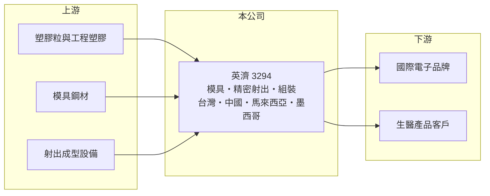

# 3294 英濟

> 上櫃｜[[產業索引-電子零組件業|電子零組件業]]｜上市（櫃）日期 2007/04/27

# 第一章：企業模式與商業藍圖

> [!info] 撰寫說明
> 精簡版，由 Claude 依公開資料整理，架構比照 [[2330台積電]]，資料截至 2026-10-08。來源：櫃買中心開放資料快照（基本資料、2026 年第二季資產負債與損益、本益比殖利率、每月營收）、Goodinfo 經營績效頁、工商時報 2025 年 12 月報導。主要產品與客戶以 Claude 既有認知整理，產品別營收比重未查得。#待校對

英濟（以下簡稱英濟）是一家精密[[塑膠射出]]模具與機構件製造商（#待校對），在台灣、中國、馬來西亞與墨西哥設有生產據點。理解英濟的關鍵在於：它擁有跨國生產網絡與模具技術，但營收在 2020 至 2025 年間縮小約三成，多數年度本業虧損，公司正嘗試從低毛利零件轉向組裝、系統整合與生醫等新領域。

- **核心業務：** 英濟成立於 1991 年，總部位於新北中和，2007 年在櫃買中心掛牌。依 Claude 既有認知，英濟主要提供塑膠模具開發與精密射出成型零件，應用於印表機、消費電子與電腦週邊等產品的外殼與內部機構件（#待校對）。模具是射出成型的核心，好的模具設計決定了零件精度、良率與生產速度。
- **營收結構：** 產品別與客戶別營收比重公開資料未查得。依 2025 年 12 月報導，公司計畫降低低毛利零件的比重，往高附加價值的組裝與系統整合發展，代表過去營收有相當比重來自單純的零件代工。
- **營運據點：** 生產據點分布在台灣、中國、馬來西亞與墨西哥。上海廠因當地政府區域規劃需要搬遷，新廠於 2025 年 12 月動土；公司同時擴大東南亞產能，提供客戶「台灣、中國、馬來西亞、墨西哥以外」的選項，回應客戶把產能移出中國的需求。
- **長期方向：** 英濟正在開發兩個新事業。一是光電與 AI 領域的空間感測與運算技術，已獲經濟部補助；二是生醫領域，與客戶共同開發的藥物與器材結合產品，公司預期 2026 年取得美國許可，並計畫拓展歐洲與澳洲。子公司英錡科技是相關布局之一（#待校對）。這些新事業若成功，可望改善目前偏低的毛利率。

# 第二章：護城河深度與競爭優勢

英濟的護城河主要來自跨國生產布局與模具工程能力，但在價格競爭激烈的零件代工市場中，這些優勢不足以維持穩定獲利。

- **競爭優勢：** 跨四個國家的生產據點，讓英濟能配合國際品牌客戶「就近生產」與分散地緣政治風險的需求，這是許多中小型射出廠做不到的。模具開發需要長期累積的工程經驗，客戶產品從設計階段就與模具廠合作，一旦開模量產，在產品生命週期內轉換供應商的成本不低。生醫產品若取得美國許可，法規認證本身就是很高的進入門檻。
- **主要對手：** 台灣的機構件與塑膠射出同業包括 [[2387精元]]、[[3013晟銘電]]、[[5243乙盛-KY]] 等，中國大陸也有大量模具與射出成型廠以低價競爭。在大型品牌客戶的供應鏈中，英濟也與鴻海等大型代工集團旗下的機構件部門競爭。
- **觀察重點：** 長期最該追蹤的是毛利率能否回到 2020 年約 17% 的水準，以及新事業何時開始貢獻營收。2026 年上半年毛利率只有約 8.1%，營業利益率約 -12.2%，搬遷與轉型的成本仍在侵蝕獲利。

# 第三章：財務體質與盈利規模

資料日期：2026-10-08，表格是撰寫當時的快照；最新月營收、毛利率、累計 EPS 由自動排程寫在本筆記的屬性欄位（月營收、毛利率、累計EPS 等）。#待校對

英濟的財務呈現「營收萎縮、毛利偏低、本業在損益兩平附近」的樣貌：2021 至 2025 年有三年 EPS 為負。

| 年度 | 營收（億元） | [[毛利率]] | [[營業利益率]] | EPS（元） | [[ROE]] |
|---|---|---|---|---|---|
| 2021 | 53.2 | 11.8% | 0.9% | 0.18 | 1.0% |
| 2022 | 48.3 | 10.0% | -1.8% | -1.20 | -7.0% |
| 2023 | 41.4 | 13.5% | -1.1% | -1.00 | -6.1% |
| 2024 | 43.1 | 15.5% | 0.2% | 0.58 | 3.3% |
| 2025 | 35.7 | 14.5% | -1.8% | -0.49 | -3.4% |

（來源：Goodinfo 經營績效頁；2020 年營收 50.9 億元、毛利率 16.9%、EPS 0.65 元。）

- **營收規模：** 2020 至 2025 年營收由 50.9 億元降到 35.7 億元，年複合成長率約 -6.8%（推算）。2026 年前八月累計營收約 22.1 億元，年減約 4.5%，公司預期的「2026 年恢復成長」尚未在營收上反映。
- **獲利：** 近五年（2021 至 2025）平均 ROE 約 -2.4%（推算），長期無法為股東賺取正報酬。2026 年上半年營業損失約 1.79 億元，靠業外收入約 1.02 億元抵銷部分虧損，歸屬母公司淨損約 0.72 億元、EPS -0.54 元。毛利率長期在一成上下，扣掉營業費用後幾乎沒有空間，是本業難以獲利的主因。
- **財務特色：** 2026 年第二季總資產約 54.2 億元，歸屬母公司權益約 23.5 億元、負債約 30.3 億元，負債比約 56%，其中非流動負債約 16.3 億元，推估包含長期借款與租賃負債。流動資產約 35.7 億元，短期流動性尚可。近年未穩定配息，Goodinfo 統計歷年平均現金股利約 0.41 元。
- **[[ROIC]] 與 [[WACC]]：** 2025 年營業損失約 0.63 億元（35.7 億元 × -1.77%），虧損年度不計稅盾，以權益 23.5 億元到「權益加全部負債」54.2 億元為投入資本區間，ROIC 約 -1.2% 至 -2.7%（推算）。WACC 以 [[CAPM]] 推估：無風險利率 1.75%、市場風險溢酬 6%、β 假設 1.0（機構件股常見值），權益成本約 7.8%；稅後負債成本假設 2%、負債占五成，WACC 約 4.9%（推算）。ROIC 為負、低於 WACC，代表近年英濟的投入資本沒有創造經濟價值；新事業與產品組合調整能否把毛利率拉回一成五以上，是翻轉的前提。

# 第四章：總體風險與地緣政治

英濟的風險主要來自低毛利代工的價格壓力、廠房搬遷與轉型執行，以及多國營運的複雜度。

- **產業週期：** 印表機與消費電子的需求成熟甚至衰退，品牌客戶持續壓低零件價格，使機構件代工的營收與毛利長期承壓。終端需求波動也會透過[[長鞭效應]]放大成零件廠的訂單起伏。
- **營運風險：** 上海廠搬遷期間可能出現產能中斷、一次性費用與客戶轉單；新廠完工後折舊增加，若訂單不足，固定成本壓力更重。生醫與空間感測等新事業需要長期投入，法規審查或客戶量產時程若延後，回收期也會拉長。
- **其他風險：** 墨西哥與東南亞據點受美國關稅與貿易協定變化影響，中國據點則面對美中貿易摩擦與地方政策變動。塑膠原料價格與各國工資上漲會影響成本；營收以美元為主時，新台幣升值也會壓縮毛利（#待校對）。

# 專有名詞解析

## 金融

- **[[長鞭效應]]**：終端需求的小幅變動，沿供應鏈往上游傳遞時被逐級放大，造成上游庫存與訂單劇烈波動。
- **[[CAPM]]**：資本資產定價模型，以無風險利率加上 β 乘以市場風險溢酬，估計股東要求的報酬率。

## 產業

- **[[塑膠射出]]**：把加熱融化的塑膠注入模具、冷卻後成型的製程，用於製造各種電子產品外殼與精密零件。

# 核心供應鏈

- 上游：塑膠粒與工程塑膠、模具鋼材、射出成型機與自動化設備。
- 下游／客戶：國際印表機、消費電子與電腦週邊品牌（#待校對），以及生醫產品合作客戶（具體客戶公開資料未查得）。
- 同業：[[2387精元]]、[[3013晟銘電]]、[[5243乙盛-KY]]，以及中國大陸模具與射出成型廠。

## 最新新聞
<!-- news:start -->
<!-- news:end -->

## 相關連結
- [公開資訊觀測站](https://mopsov.twse.com.tw/mops/web/t05st03?step=1&firstin=1&co_id=3294)
- [Goodinfo](https://goodinfo.tw/tw/StockDetail.asp?STOCK_ID=3294)
- [Yahoo 股市](https://tw.stock.yahoo.com/quote/3294)
- [鉅亨網新聞](https://www.cnyes.com/twstock/3294/news)
