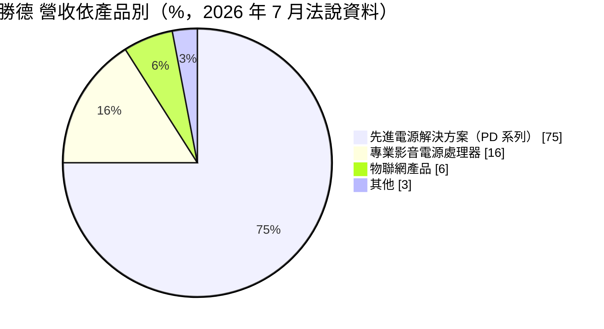
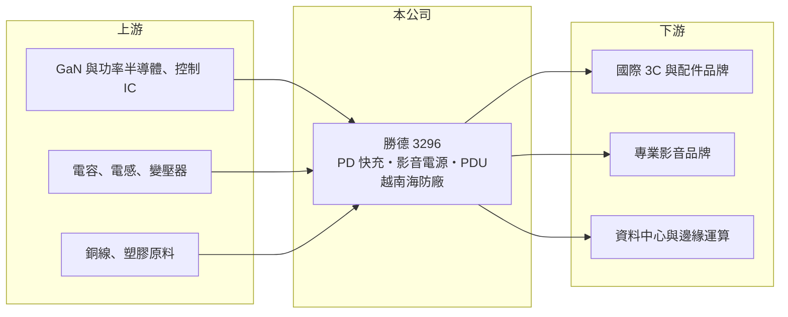

# 3296 勝德

> 上市｜[[產業索引-電子零組件業|電子零組件業]]｜上市（櫃）日期 2007/12/31

# 第一章：企業模式與商業藍圖

> [!info] 撰寫說明
> 精簡版，由 Claude 依公開資料整理，架構比照 [[2330台積電]]，資料截至 2026-10-08。來源：證交所開放資料快照（基本資料、2026 年第二季資產負債與損益、營益分析、股利、每月營收）、Goodinfo 經營績效頁、富果整理之 2026 年 7 月法說會摘要。主要客戶未查得。#待校對

勝德國際（以下簡稱勝德）是一家電源管理產品的設計與製造商，主力是 USB PD 快充、[[突波保護]]與專業影音電源處理器。理解勝德的關鍵在於：它的產品雖然屬於成熟的電源配件市場，但公司以專利與安規能力切入高功率快充、影音與資料中心配電等利基應用，近年也把生產重心移到越南。

- **核心業務：** 勝德成立於 2000 年，總部位於新北中和，2007 年在證交所上市。公司提供從工業設計、機構、電子工程到軟韌體的一站式 [[ODM]]／OEM 服務，設有通過 UL 等國際認證的安規實驗室，累計全球專利超過 480 項。電源配件直接接觸市電，安全認證是進入國際品牌供應鏈的基本門檻。
- **營收結構：** 依 2026 年 7 月法說會資料，先進電源解決方案（PD 系列）占營收 75%，涵蓋 20W 至 240W 的 [[USB PD]] 快充、[[GaN]] 充電器與專利非損耗式突波保護；專業影音電源處理器占 16%，包括機架式電源處理器、自動穩壓器與 EMI/RFI 濾波器；物聯網產品占 6%，其他占 3%。

- **營運據點：** 總部在台灣，越南海防市設有自有廠房，面積約 6.37 萬平方公尺，已完成建置，廠區涵蓋 SMT、DIP、組裝、電源線與塑膠射出，並導入 MES 系統。公司表示越南廠的目的是降低地緣政治風險並擴充產能，同時提高垂直整合與自製率。
- **長期方向：** 勝德把長期成長寄望在三個領域：AI PC 與 USB-C 生態系帶動的高功率快充、資料中心與邊緣運算使用的高功率智慧型 [[PDU]]（60A 至 100A，具遠端監控），以及能源管理與電力監控方案。這些產品的單價與技術門檻都高於一般延長線與充電器。

# 第二章：護城河深度與競爭優勢

勝德的護城河來自專利、安規認證與完整的設計服務能力，屬於窄護城河，主要守在利基市場。

- **競爭優勢：** 480 多項專利與自有安規實驗室，讓勝德能縮短客戶產品的認證時間，這對以品牌為主、沒有自有工廠的國際客戶很有價值。專業影音電源處理器服務的是錄音室、劇院與高階家庭劇院，客戶重視電源純淨度與穩定性，價格敏感度較低，公司定位為高毛利市場。2024 至 2025 年毛利率回到 21% 至 22%，明顯高於 2021 年不到 9% 的低點，顯示產品組合調整有成效。
- **主要對手：** 快充與電源配件領域的台灣對手包括 [[2457飛宏]]、[[6282康舒]]、[[6412群電]]，以及規模大得多的 [[2308台達電]]、[[2301光寶科]]；中國大陸也有大量低價快充廠。專業影音電源領域有美國 Furman、Panamax 等品牌；資料中心 PDU 領域則有 Vertiv、伊頓、施耐德等國際大廠。
- **觀察重點：** 長期最該追蹤的是營收規模能否回到 2021 年約 30 億元的水準，以及越南廠能否讓毛利率穩定在兩成以上。2026 年上半年因 2025 年同期客戶為因應美國關稅提前拉貨，比較基期偏高，毛利率降到約 16.6%、營業利益轉為小幅虧損。

# 第三章：財務體質與盈利規模

資料日期：2026-10-08，表格是撰寫當時的快照；最新月營收、毛利率、累計 EPS 由自動排程寫在本筆記的屬性欄位（月營收、毛利率、累計EPS 等）。#待校對

勝德的財務呈現「營收規模縮小、毛利率改善、獲利剛轉正」的樣貌：2021 至 2023 年連續虧損，2024 年起轉為小幅獲利。

| 年度 | 營收（億元） | [[毛利率]] | [[營業利益率]] | EPS（元） | [[ROE]] |
|---|---|---|---|---|---|
| 2021 | 31.9 | 9.0% | -5.0% | -1.64 | -11.6% |
| 2022 | 25.6 | 14.6% | -3.8% | -0.69 | -5.3% |
| 2023 | 14.9 | 19.5% | -7.5% | -0.91 | -7.3% |
| 2024 | 16.2 | 22.2% | -0.3% | 0.50 | 4.1% |
| 2025 | 16.0 | 21.2% | 3.1% | 0.61 | 4.8% |

（來源：Goodinfo 經營績效頁；2020 年營收 25.1 億元、EPS 0.23 元。2025 年本期淨利約 0.59 億元，與證交所股利資料一致。）

- **營收規模：** 2020 至 2025 年營收由 25.1 億元降到 16.0 億元，年複合成長率約 -8.6%（推算）。2023 年營收腰斬，推估與客戶去庫存及公司主動汰除低毛利訂單有關（#待校對）。2026 年前八月累計營收約 12.0 億元，年增約 11.6%。
- **獲利：** 近五年（2021 至 2025）平均 ROE 約 -3.1%（推算），但趨勢明顯改善：毛利率從 9% 一路升到 21% 以上，營業利益率在 2025 年轉正為 3.1%。2026 年上半年營業損失約 0.15 億元、歸屬母公司淨損約 0.20 億元、EPS -0.20 元，獲利仍不穩定。
- **財務特色：** 2026 年第二季總資產約 22.6 億元、權益約 12.8 億元、負債約 9.9 億元，負債比約 44%，其中非流動負債僅約 0.12 億元，長期借款很少，財務結構保守。2025 年雖有獲利，但未配發現金股利，推估是保留資金支應越南廠建置（#待校對）；Goodinfo 統計歷年平均現金股利約 0.88 元，主要來自早年。
- **[[ROIC]] 與 [[WACC]]：** 以 2025 年營業利益約 0.49 億元（16.0 億元 × 3.09%）、稅率 20% 計算，稅後營業利益約 0.40 億元。有息負債未查得，投入資本以權益 12.8 億元到「權益加全部負債」22.6 億元為區間，ROIC 約 1.7% 至 3.1%（推算）。WACC 以 [[CAPM]] 推估：無風險利率 1.75%、市場風險溢酬 6%、β 假設 1.0（電源零組件股常見值），權益成本約 7.8%；稅後負債成本假設 2%、負債占三成，WACC 約 6.0%（推算）。ROIC 仍低於 WACC，代表勝德尚未回到創造價值的狀態；越南廠與高功率產品能否把營業利益率推升到 8% 以上，是利差轉正的條件。

# 第四章：總體風險與地緣政治

勝德的風險主要來自消費性電源的價格競爭、美國關稅政策，以及新事業的放量時程。

- **產業週期：** 快充與電源配件需求跟隨 PC、手機與消費電子的換機週期，品牌客戶在景氣轉弱時會大幅調整庫存。2025 年客戶因關稅提前拉貨、2026 年又回落，正是政策引發的短期需求波動被[[長鞭效應]]放大的例子。
- **營運風險：** 營收高度集中在 PD 系列（75%），若主要客戶轉單或快充規格世代更替時未能取得新案，營收會明顯下滑。越南廠剛完成建置，產能利用率爬坡期間折舊與學習成本會壓抑毛利。
- **其他風險：** 美國是電源配件的主要市場，關稅與原產地規定變動直接影響客戶下單與定價。GaN 功率元件、銅與塑膠原料價格波動會影響成本；營收以美元計價為主時，新台幣升值會壓縮毛利（#待校對）。

# 專有名詞解析

## 半導體

- **[[GaN]]**：氮化鎵，一種寬能隙半導體材料，用於功率元件可讓充電器更小、效率更高。

## 金融

- **[[長鞭效應]]**：終端需求的小幅變動，沿供應鏈往上游傳遞時被逐級放大，造成上游庫存與訂單劇烈波動。

## 產業

- **[[ODM]]**：原廠委託設計製造，代工廠負責產品設計與生產，品牌商負責銷售。
- **[[USB PD]]**：USB Power Delivery 快充協定，透過 USB-C 介面協商電壓與電流，最高可達 240W。
- **[[突波保護]]**：在電壓瞬間異常升高時保護設備的電路或裝置，常見於延長線與電源處理器。
- **[[PDU]]**：電源分配單元，安裝在機櫃中把電力分配給伺服器等設備，高階款具遠端監控功能。

# 核心供應鏈

- 上游：GaN 與矽功率元件、電源控制 IC（例如 [[3588通嘉]]）、被動元件（例如 [[2327國巨]]、[[2472立隆電]]）、銅線與塑膠原料。
- 下游／客戶：國際 3C 與電源配件品牌、專業影音設備品牌、資料中心與邊緣運算系統商（具體客戶公開資料未查得，#待校對）。
- 同業：[[2457飛宏]]、[[6282康舒]]、[[6412群電]]、[[2308台達電]]、[[2301光寶科]]，以及美國 Furman、Panamax 與 Vertiv、伊頓等 PDU 廠商。

## 最新新聞
<!-- news:start -->
<!-- news:end -->

## 相關連結
- [公開資訊觀測站](https://mopsov.twse.com.tw/mops/web/t05st03?step=1&firstin=1&co_id=3296)
- [Goodinfo](https://goodinfo.tw/tw/StockDetail.asp?STOCK_ID=3296)
- [Yahoo 股市](https://tw.stock.yahoo.com/quote/3296)
- [鉅亨網新聞](https://www.cnyes.com/twstock/3296/news)
