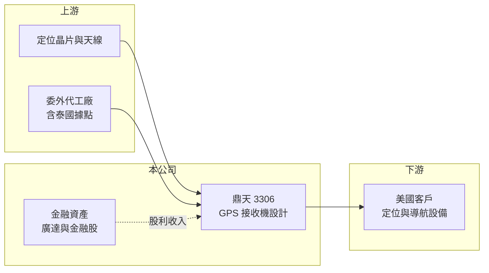

# 3306 鼎天

> 上櫃｜[[產業索引-通信網路業|通信網路業]]｜上市（櫃）日期 2005/07/05

# 第一章：企業模式與商業藍圖

> [!info] 撰寫說明
> 本文由 Claude 依公開資料整理，架構比照 [[2330台積電]] 的四章研究，資料截至 2026-10-08。財務數字來源：Goodinfo 年度經營績效頁、櫃買中心開放資料（基本資料、2026 年第二季資產負債與損益、本益比殖利率）、富果研究 2026 年 6 月法說會整理；產業描述為整理性內容，尚未逐條比對原始文件。#待校對

評估鼎天國際（股票代號：3306，以下簡稱鼎天）時，必須同時看兩件事：一是規模不大的 GPS 接收機本業，二是帳上龐大的金融資產。本章說明這兩部分如何構成鼎天的商業模式。

## 一、核心定位：GPS 接收機專業廠

鼎天成立於 1997 年，2005 年在櫃買中心掛牌，實收資本額約 5.1 億元。公司營收幾乎全部來自 [[GPS]] 接收機，2026 年第一季 GPS 接收機約占營收 86%，低於 2025 年第一季的 95%，其他產品線比重略有提升，但內容未公開。衛星定位接收機需要整合定位晶片、天線與韌體，並依客戶的使用情境（例如車載、戶外或工業設備）調整靈敏度與耗電，屬於少量多樣的利基產品。

## 二、輕資產營運模式

鼎天的生產已全面委外，宜蘭早期的工廠轉為出租，帶來穩定的租金收入。這是典型的[[輕資產]]模式，公司把資源集中在產品設計、客戶服務與供應鏈管理，本身幾乎不需要資本支出。2025 年美中貿易緊張後，公司透過集團合作在泰國設立新的生產據點，回應美國客戶分散產地的要求。

## 三、資產結構：本業之外的大型投資組合

鼎天最特殊的地方在資產負債表。截至 2026 年 3 月底，非流動金融資產約 26.2 億元，主要是 [[2382廣達]] 股票與其他金融股，另有現金與流動金融資產約 5.7 億元，兩者合計遠超過本業所需的營運資金。2025 年股利收入約 1.18 億元，金額甚至大於本業營業損失。法說會資料把股利來源描述為「母公司廣達及金融股」，鼎天與廣達集團的關係細節待校對。換句話說，鼎天的股東權益有很大一部分是一個以廣達股票為主的投資組合，公司價值與廣達股價高度連動。

# 第二章：護城河深度與競爭優勢

在長期價值投資中，「護城河」指企業抵禦競爭、維持超額利潤的保護機制。本章分析鼎天 GPS 本業的競爭位置。

## 一、相對優勢

鼎天在 GPS 接收機累積了長期的設計經驗與美國客戶關係，客戶提前下單、訂單能見度延伸至下半年，顯示合作關係穩定。輕資產模式讓公司在景氣低迷時不必承擔工廠的固定成本，財務上非常保守，股東權益約占總資產九成。

## 二、主要競爭對手

| 對手 | 定位 | 對鼎天的威脅 |
|---|---|---|
| 國際定位設備品牌（如 Garmin、Trimble） | 自有品牌定位產品 | 可自行設計接收機，壓縮代工空間 |
| 定位模組廠（如 u-blox） | 定位晶片與模組 | 模組整合度提高，讓客戶能自行設計接收機 |
| 中國定位產品廠 | 低價接收機與模組 | 在一般規格產品以價格競爭 |

## 三、守得住／守不住／觀察重點

守得住的是既有美國客戶的穩定訂單。守不住的是毛利率，2021 至 2025 年毛利率在 14% 至 34% 之間大幅擺動，營業利益率多數年度接近零，代表 GPS 接收機的定價能力有限，且容易受晶片缺料與成本波動影響。長期觀察重點是非 GPS 產品能否成長、泰國據點能否穩定供貨，以及本業能否如公司目標在 2026 年每季維持獲利。

# 第三章：財務體質與盈利規模

資料日期：2026-10-08，表格是撰寫當時的快照；最新月營收、毛利率、累計 EPS 由自動排程寫在本筆記的屬性欄位（月營收、毛利率、累計EPS 等）。#待校對

財務報表是檢驗護城河是否真實存在的最終標準。本章用五年的三率、ROE 與資本報酬，檢視鼎天的獲利品質。

## 一、多年度經營績效

| 年度 | 營收（新台幣） | [[毛利率]] | [[營業利益率]] | EPS（元） | [[ROE]] |
|---|---|---|---|---|---|
| 2021 | 13.6 億 | 19.5% | 0.28% | 1.05 | 3.32% |
| 2022 | 12.2 億 | 13.9% | -4.75% | 0.25 | 0.81% |
| 2023 | 12.9 億 | 23.9% | 3.02% | 1.83 | 4.34% |
| 2024 | 9.80 億 | 33.6% | 4.24% | 2.93 | 4.78% |
| 2025 | 10.8 億 | 25.3% | -2.77% | 1.95 | 2.94% |
| 2026 上半年 | 5.45 億 | 24.9% | 0.70% | 0.20 | 未查得 |

鼎天的 EPS 主要由[[業外收益]]中的股利收入支撐，例如 2025 年本業虧損約 3,000 萬元，全年 EPS 仍有 1.95 元。2021 至 2025 年平均 ROE 約 3.2%（推算），營收年複合成長率約 -5.6%（推算）。ROE 偏低的主因是股東權益中有大量金融資產，這些資產的報酬以股利計入損益，股價漲跌則多半計入其他綜合損益，不會反映在 EPS。最近一次現金股利為每股 1.7 元，高於 2025 年 EPS 的八成（推算），配息主要來自持股股利。

## 二、[[ROIC]] 與 [[WACC]]：價值創造利差

**ROIC 推算（只計本業）：** 2025 年營業利益約 -0.3 億元（10.8 億 × -2.77%）。2026 年第二季股東權益約 40.4 億元（每股淨值 79.93 元 × 約 5,060 萬股），幾乎沒有有息負債（推估），以全部投入資本計算 ROIC 約 -0.7%（推算）。若扣除約 26 億元非流動金融資產與 5.7 億元現金，本業實際投入資本約 8 億元，ROIC 約 -3%（推算）。

**WACC 推算：** 台灣 10 年期公債 1.75%、市場風險溢酬 6%、β 取 0.8（考量資產以金融股與廣達持股為主，推估），股東權益成本約 6.6%；幾乎無負債，WACC 約 6.6%（推算）。

**結論：** 鼎天的 GPS 本業 ROIC 低於 WACC，2023 至 2024 年本業小幅獲利時也只有個位數報酬，長期而言本業沒有創造價值。公司對股東的價值主要來自投資組合，分析鼎天時應把它看成「小型 GPS 本業加上一籃子上市股票」，並留意兩者的分開評價。

# 第四章：總體風險與地緣政治

任何企業都無法脫離宏觀環境獨立存在。本章分析鼎天長期必須面對的風險。

## 一、投資組合集中風險

非流動金融資產集中在廣達與金融股，公司淨值與股利收入會隨這些股票的股價與配息波動。若廣達或金融業景氣轉弱，鼎天的 EPS 與淨值會同步受影響，而這與 GPS 本業無關。

## 二、本業規模與技術風險

GPS 接收機市場成熟，手機與各類設備內建定位功能後，獨立接收機的需求只剩特定利基應用。定位晶片與模組整合度持續提高，也讓客戶自行設計的門檻下降。IC 缺料時，規模小的鼎天在供應鏈中的議價能力有限。

## 三、地緣政治與客戶集中

主要客戶在美國，美中關稅讓客戶要求移出中國生產，泰國據點的建置與良率是過渡期風險。客戶集中度未公開，但單一大客戶的訂單變化可能造成營收大幅起伏。

# 專有名詞解析

## 應用

- **[[GPS]]**：全球定位系統，由美國營運的衛星導航系統，接收機透過多顆衛星訊號計算所在位置與時間。

## 金融

- **[[業外收益]]**：本業以外的收入，例如投資收益、股利、利息與資產處分利得，波動通常較大。
- **[[ROIC]]**：投入資本報酬率，稅後營業利益除以股東權益與有息負債的合計，衡量本業對所有資金提供者的報酬。
- **[[WACC]]**：加權平均資金成本，依股東權益與負債的比重加權計算的資金成本，ROIC 高於它才代表創造價值。

## 產業

- **[[輕資產]]**：企業不自建大量廠房設備，把生產外包，專注在設計、品牌與銷售的經營模式。

# 核心供應鏈

## 1. 上游：晶片與代工
- 定位晶片、天線與電子零件供應商
- 委外製造夥伴與泰國生產據點

## 2. 中游：鼎天
- GPS 接收機設計與供應鏈管理；持有 [[2382廣達]] 股票等金融資產

## 3. 下游：客戶
- 美國定位與導航設備客戶（公司未揭露具名客戶）

## 最新新聞
<!-- news:start -->
<!-- news:end -->

## 相關連結
- [公開資訊觀測站](https://mopsov.twse.com.tw/mops/web/t05st03?step=1&firstin=1&co_id=3306)
- [Goodinfo](https://goodinfo.tw/tw/StockDetail.asp?STOCK_ID=3306)
- [Yahoo 股市](https://tw.stock.yahoo.com/quote/3306)
- [鉅亨網新聞](https://www.cnyes.com/twstock/3306/news)
