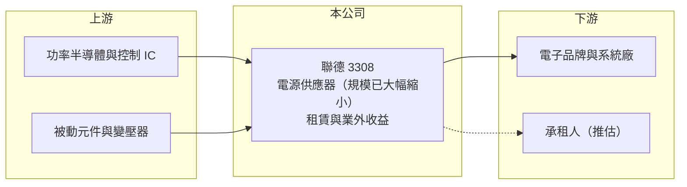

# 3308 聯德

> 上市｜[[產業索引-電子零組件業|電子零組件業]]｜上市（櫃）日期 2008/03/12

# 第一章：企業模式與商業藍圖

> [!info] 撰寫說明
> 精簡版，由 Claude 依公開資料整理，架構比照 [[2330台積電]]，資料截至 2026-10-08。來源：證交所開放資料快照（基本資料、2026 年第二季資產負債與損益、營益分析、股利、每月營收）、Goodinfo 經營績效頁、nStock 公司簡介。公開資料有限，營收大幅縮小的原因、處分事項與未來業務規劃均未查得，以下對轉變原因的描述多為推估。注意：聯德控股-KY（4912）是另一家公司。#待校對

聯德（以下簡稱聯德）登記的本業是交換式[[電源供應器]]的製造與買賣，但 2024 年起營收急遽縮小，2025 年全年營收只有約 800 萬元，2026 年每月營收僅約 50 萬元。理解聯德的關鍵在於：它目前已不是一家以製造營收為主的公司，損益主要由業外收益決定，投資人應把它視為「資產型」或「轉型中」的公司來看待。

- **核心業務：** 聯德成立於 1988 年，總部位於桃園龜山，2008 年在證交所上市。依公司登記，主要經營交換式電源供應器、物聯網雲端伺服器電源、無線充電器、電競高功率電源供應器與電源轉換器等產品的加工製造、買賣及租賃。電源供應器是把市電轉為電子設備可用直流電的關鍵零件，過去是聯德營收的主要來源。
- **營收結構：** 營收由 2023 年約 5.39 億元，降到 2024 年約 0.68 億元、2025 年約 0.08 億元。2026 年前八月累計營收約 417 萬元，每月僅數十萬元，從金額規模與登記中的「租賃」業務推估，目前營收可能以租金或少量貿易為主（#待校對）。
- **營運據點：** 總部位於桃園龜山。2026 年第二季總資產約 21.8 億元，其中流動資產約 14.9 億元，相對於近乎停滯的營收，帳上資產規模明顯偏大，推估包含現金、金融資產或處分資產後取得的款項（#待校對）。
- **長期方向：** 公開資料未查得公司對未來業務的規劃。2023 年 10 月公司曾公告減資相關事項，細節未查得。聯德的長期價值取決於帳上資產如何運用：重新投入新事業、持續發放現金給股東，或作為其他事業的平台，目前都無法從公開資料判斷。

# 第二章：護城河深度與競爭優勢

聯德目前沒有可辨識的營運護城河，評估重點轉為資產價值與管理層的資本配置。

- **競爭優勢：** 以目前的營收規模，聯德在電源供應器市場已不具競爭地位。公司可能仍保有過去累積的電源設計經驗、廠房或土地等資產（#待校對），這些資產的價值才是現階段的主要支撐，評估時應以每股淨值與資產內容為核心，而不是營收或本業利潤。
- **主要對手：** 若回到電源供應器本業，對手包括 [[3078僑威]]、[[3015全漢]]、[[6412群電]]、[[6282康舒]] 與規模大得多的 [[2308台達電]]、[[2301光寶科]]。這些公司都具備數十億到數千億元的營收規模，聯德要重新進入這個市場的難度很高。
- **觀察重點：** 長期最該追蹤的是三件事：公司是否宣布新的營業計畫或併購、帳上資產是否以現金股利或減資方式返還股東，以及業外收益的來源是否可持續。2025 年雖有本期淨利約 0.41 億元，卻未配發現金股利，資金用途值得追蹤。

# 第三章：財務體質與盈利規模

資料日期：2026-10-08，表格是撰寫當時的快照；最新月營收、毛利率、累計 EPS 由自動排程寫在本筆記的屬性欄位（月營收、毛利率、累計EPS 等）。#待校對

聯德的財務數字因本業縮小而高度失真：營業利益率在 2025 年達 -408%，EPS 卻為正，盈餘幾乎全部來自業外。

| 年度 | 營收（億元） | [[毛利率]] | [[營業利益率]] | EPS（元） | [[ROE]] |
|---|---|---|---|---|---|
| 2021 | 3.47 | 8.5% | -10.0% | -0.37 | -3.9% |
| 2022 | 4.07 | 23.3% | 10.9% | 0.28 | 2.9% |
| 2023 | 5.39 | 32.3% | 7.5% | 5.94 | 46.2% |
| 2024 | 0.68 | 23.8% | -51.1% | 0.99 | 5.4% |
| 2025 | 0.08 | 46.6% | -408% | 0.68 | 3.7% |

（來源：Goodinfo 經營績效頁；2020 年營收 3.3 億元、EPS -0.89 元。2023 年 EPS 5.94 元與 ROE 46.2% 遠高於本業水準，推估包含一次性處分利益，待校對。）

- **營收規模：** 2020 至 2023 年營收在 3.3 億到 5.4 億元之間，2024 年起急遽萎縮到幾乎歸零。營收年複合成長率在這種結構性改變下已無參考意義。
- **獲利：** 近五年（2021 至 2025）平均 ROE 約 10.9%（推算），但主要被 2023 年的 46.2% 拉高，扣除該年後平均僅約 2%。2026 年上半年營收約 313 萬元、營業損失約 0.22 億元，業外收入約 0.57 億元，歸屬母公司淨利約 0.31 億元、EPS 0.51 元。這種盈餘結構說明：公司每年的營業費用約需 0.4 億元以上，必須靠業外收益（推估為利息、投資或租賃相關收益）支撐。
- **財務特色：** 2026 年第二季總資產約 21.8 億元、權益約 11.6 億元、負債約 10.2 億元，負債比約 47%，其中非流動負債約 3.9 億元。股本 6.0 億元、每股淨值約 19.33 元。2025 年未配發現金股利，Goodinfo 統計歷年平均現金股利約 0.56 元。對沒有營運的公司而言，負債比接近五成並不尋常，負債的性質（借款、租賃或其他）未查得，值得進一步確認。
- **[[ROIC]] 與 [[WACC]]：** 2025 年營業損失約 0.33 億元（0.08 億元 × -408%），虧損年度不計稅盾，以權益 11.6 億元到「權益加全部負債」21.8 億元為投入資本區間，ROIC 約 -1.5% 至 -2.8%（推算）。WACC 以 [[CAPM]] 推估：無風險利率 1.75%、市場風險溢酬 6%、β 假設 0.8（營運規模小、股價主要反映資產價值），權益成本約 6.6%；稅後負債成本假設 2%、負債占三成，WACC 約 5.2%（推算）。本業 ROIC 為負、低於 WACC，代表現有資本並未投入能創造價值的營運；股東報酬目前完全取決於業外收益與資產處置。

# 第四章：總體風險與地緣政治

聯德的風險不在產業週期，而在於缺乏本業、資訊揭露有限，以及資產運用的不確定性。

- **產業週期：** 由於本業營收已極小，電源供應器產業的景氣循環對聯德的直接影響有限。反過來說，公司也無法享受 AI 伺服器、電競等電源需求成長的紅利。
- **營運風險：** 盈餘依賴[[業外收入]]，而業外收益（利息、投資收益、資產處分）通常不穩定，一旦減少，每年約 0.4 億元以上的營業費用就會直接轉為虧損，逐步侵蝕淨值。公司若進行新投資或併購，也存在執行與估值風險。
- **其他風險：** 公開資訊有限，投資人難以掌握資產的實際內容與價值。若帳上有大量金融資產，市場價格波動與利率變化會影響業外損益；若持有不動產，則受房地產景氣與租約影響（#待校對）。

# 專有名詞解析

## 金融

- **[[業外收入]]**：本業營運以外的收益，例如投資收益、利息、租金與資產處分利益，通常較不穩定。
- **[[CAPM]]**：資本資產定價模型，以無風險利率加上 β 乘以市場風險溢酬，估計股東要求的報酬率。

## 產業

- **[[電源供應器]]**：把交流電轉換成電子設備所需直流電的裝置，品質影響整台設備的安全與穩定。

# 核心供應鏈

- 上游：功率半導體、電源控制 IC 與被動元件（過去本業所需，目前採購規模應已很小）。
- 下游／客戶：電子品牌與系統廠；目前營收來源推估包含租賃收入（#待校對）。
- 同業：[[3078僑威]]、[[3015全漢]]、[[6412群電]]、[[6282康舒]]、[[2308台達電]]、[[2301光寶科]]。

## 最新新聞
<!-- news:start -->
<!-- news:end -->

## 相關連結
- [公開資訊觀測站](https://mopsov.twse.com.tw/mops/web/t05st03?step=1&firstin=1&co_id=3308)
- [Goodinfo](https://goodinfo.tw/tw/StockDetail.asp?STOCK_ID=3308)
- [Yahoo 股市](https://tw.stock.yahoo.com/quote/3308)
- [鉅亨網新聞](https://www.cnyes.com/twstock/3308/news)
