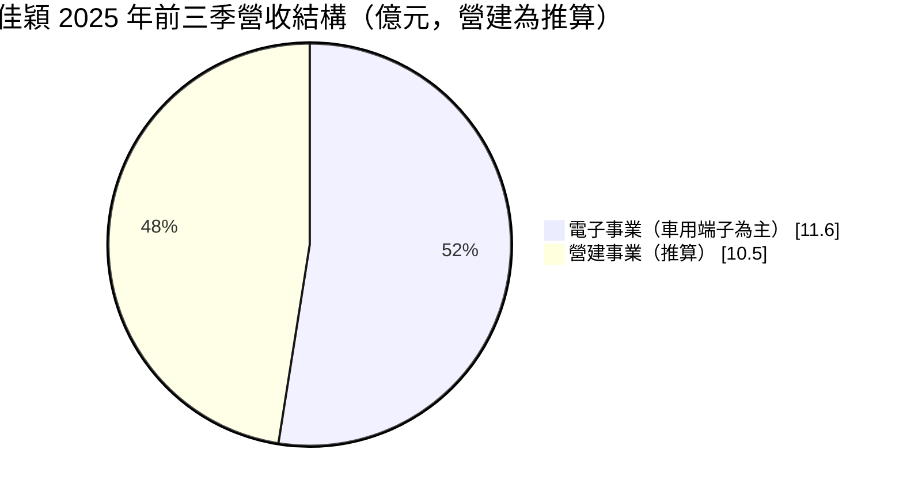
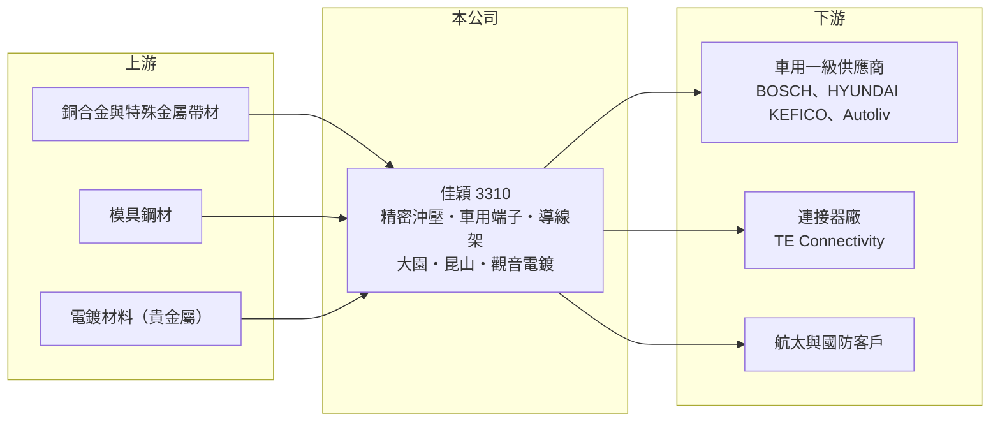

# 3310 佳穎

> 上櫃｜[[產業索引-電子零組件業|電子零組件業]]｜上市（櫃）日期 2008/06/27

# 第一章：企業模式與商業藍圖

> [!info] 撰寫說明
> 精簡版，由 Claude 依公開資料整理，架構比照 [[2330台積電]]，資料截至 2026-10-08。來源：櫃買中心開放資料快照（基本資料、2026 年第二季資產負債與損益、本益比殖利率、每月營收）、Goodinfo 經營績效頁、富果整理之 2025 年 11 月法說會摘要。#待校對

佳穎精密（以下簡稱佳穎）是一家有近 37 年經驗的精密[[沖壓]]廠，主力是車用感測器端子，另有[[導線架]]、航太零件與 AI 連接器端子。理解佳穎的關鍵在於：它的電子本業是長期穩定的車用零件生意，但合併營收中混有一塊正在收尾的營建業務，造成近年營收與負債大幅波動。

- **核心業務：** 佳穎成立於 1988 年，總部位於桃園大園，2008 年在櫃買中心掛牌。精密沖壓是用模具把金屬薄片一次衝壓成精細零件的製程，車用感測器端子對尺寸精度、材料與電鍍品質要求極高，必須通過 [[IATF 16949]] 車用品質系統認證。佳穎的主要產品包括含氧感測器端子、高壓複合端子與電動車[[匯流排]]（Bus Bar），以及用於 LED、光耦合器、功率元件與被動元件的導線架。
- **營收結構：** 依 2025 年 11 月法說資料，車用端子約占電子事業的 85%，車用零組件占電子營收八成以上。2025 年前三季合併營收約 22.1 億元，其中電子事業約 11.6 億元，其餘約 10.5 億元推算為營建收入。

- **營運據點：** 桃園大園廠服務歐洲、東南亞與台灣客戶；中國昆山廠服務中國市場；觀音的佳鼎精密是約兩年前設立的電鍍廠，預計 2026 年開始貢獻營收，讓沖壓與電鍍垂直整合。
- **長期方向：** 公司計畫在兩個建案於 2026 年結案後停止營建業務，專注電子本業。電子事業已有超過 36 個新案在進行，2026 年起陸續導入德國客戶含氧感測器碟形彈簧、韓國客戶電動車匯流排與 AI 連接器端子，2027 至 2028 年再推進雷射焊接含氧感測器端子、NOx 感測器端子與車用域控制器的壓接式端子。管理層預期這些案子可帶來 6 到 8 年的長期成長。

# 第二章：護城河深度與競爭優勢

佳穎的護城河建立在車用認證與長期合作關係上，屬於窄但穩固的護城河。

- **競爭優勢：** 車用感測器端子一旦通過車廠與一級供應商的認證，通常會在整個車型生命週期內持續供貨，轉換成本很高。佳穎的客戶包括 BOSCH、現代集團旗下的 HYUNDAI KEFICO、Autoliv 與 TE Connectivity 等國際大廠，航太與國防沖壓件更與歐洲客戶合作超過 20 年，這類客戶關係需要長時間累積，新進者難以複製。電子事業毛利率由 2020 年約 21% 提升到 2025 年約 24%，公司歸因於高毛利新產品比重增加。
- **主要對手：** 精密沖壓與端子領域的台灣同業包括 [[5285界霖]]（導線架與沖壓）、[[3533嘉澤]]、[[3023信邦]]、[[2392正崴]] 等連接器廠，國際上則有德國與日本的專業沖壓廠。佳穎的定位是供應端子給 BOSCH、TE 這類系統大廠，與連接器品牌廠部分是客戶、部分是競爭者的關係。
- **觀察重點：** 長期最該追蹤的是營建業務結束後，電子事業的營收與利潤率能否撐起整家公司。電子事業 2025 年前三季營收約 11.6 億元，高於 2024 年同期的 10.3 億元，新案若如期在 2027 年量產，電子營收應有機會持續成長。

# 第三章：財務體質與盈利規模

資料日期：2026-10-08，表格是撰寫當時的快照；最新月營收、毛利率、累計 EPS 由自動排程寫在本筆記的屬性欄位（月營收、毛利率、累計EPS 等）。#待校對

佳穎的合併財務同時反映電子本業與營建業務：營建收入依建案完工交屋時點認列，使營收在 14 億到 27 億元之間跳動。

| 年度 | 營收（億元） | [[毛利率]] | [[營業利益率]] | EPS（元） | [[ROE]] |
|---|---|---|---|---|---|
| 2021 | 12.7 | 19.0% | 5.4% | 1.33 | 5.4% |
| 2022 | 15.5 | 19.9% | 7.0% | 2.52 | 10.0% |
| 2023 | 20.7 | 21.5% | 9.3% | 3.81 | 14.0% |
| 2024 | 14.4 | 23.9% | 7.7% | 2.50 | 8.4% |
| 2025 | 26.7 | 23.6% | 11.8% | 3.39 | 12.9% |

（來源：Goodinfo 經營績效頁與富果法說摘要；2020 年營收 10.9 億元、EPS 0.78 元。）

- **營收規模：** 2020 至 2025 年合併營收由 10.9 億元增至 26.7 億元，年複合成長率約 19.6%（推算），但其中包含營建收入，不能視為本業成長率。電子事業較能代表長期趨勢：前三季營收由 2023 年約 11.0 億元、2024 年約 10.3 億元，到 2025 年約 11.6 億元，屬於緩步成長。2026 年前八月累計合併營收約 24.4 億元，年增約 18%。
- **獲利：** 近五年（2021 至 2025）平均 ROE 約 10.1%（推算），2023 與 2025 年營建交屋年度 ROE 較高。2026 年上半年毛利率約 22.6%、營業利益率約 10.0%，歸屬母公司淨利約 1.19 億元、EPS 1.59 元。
- **財務特色：** 2026 年第二季總資產約 66.5 億元，歸屬母公司權益約 18.0 億元、負債約 48.4 億元，負債比高達 73%，其中流動負債約 43.4 億元。這種結構來自營建業務的存貨（建案）與相關借款或預收款，並不代表電子本業高度舉債；公司表示建案結案後將降低負債。最近一次每股現金股利 3.5 元，與 2025 年 EPS 3.39 元相當，配發率約 100%（推算）；Goodinfo 統計歷年平均現金股利約 1.46 元，近年配息明顯提高。
- **[[ROIC]] 與 [[WACC]]：** 以 2025 年營業利益約 3.15 億元（26.7 億元 × 11.8%）、稅率 20% 計算，稅後營業利益約 2.52 億元。有息負債未查得，投入資本以權益 18.0 億元到「權益加全部負債」66.5 億元為區間，ROIC 約 3.8% 至 14.0%（推算），區間很寬是因為營建負債規模大。WACC 以 [[CAPM]] 推估：無風險利率 1.75%、市場風險溢酬 6%、β 假設 1.0（車用零組件股常見值），權益成本約 7.8%；稅後負債成本假設 2%、負債占六成，WACC 約 4.3%（推算）。以權益為基礎的報酬明顯高於資金成本，代表公司整體有創造價值；營建業務退場後，資產負債表縮小，電子本業的資本報酬會更清楚呈現。

# 第四章：總體風險與地緣政治

佳穎的風險主要來自汽車產業週期、新案量產時程，以及營建業務收尾。

- **產業週期：** 車用零件需求跟隨全球汽車產量起伏，車廠減產或庫存調整時，訂單會沿供應鏈放大調整。含氧與 NOx 感測器主要用於燃油與油電混合車，若純電動車滲透速度遠快於預期，傳統感測器端子需求可能長期下滑；公司以電動車匯流排與 AI 連接器端子作為對沖。
- **營運風險：** 營收高度集中在少數國際車用大廠，單一客戶的車型計畫延後或轉單，都會影響數年的營收。36 個新案多數要到 2027 年後才放量，若量產時程延後，成長會落空。營建業務收尾期間，建案銷售與交屋進度也會影響短期損益與負債下降的速度。
- **其他風險：** 銅合金等金屬材料價格波動直接影響成本；電鍍涉及環保法規。中國昆山廠受美中貿易與當地政策影響；營收以外幣計價為主時，匯率變動會影響毛利（#待校對）。

# 專有名詞解析

## 半導體

- **[[導線架]]**：承載晶片並把訊號引出到外部的金屬框架，是傳統封裝的重要材料。

## 應用

- **[[IATF 16949]]**：國際汽車產業的品質管理系統標準，是進入車用供應鏈的基本認證。

## 金融

- **[[CAPM]]**：資本資產定價模型，以無風險利率加上 β 乘以市場風險溢酬，估計股東要求的報酬率。

## 產業

- **[[沖壓]]**：以模具與沖床把金屬板材衝壓成特定形狀零件的製程，適合大量生產精密金屬件。
- **[[匯流排]]**：以銅或鋁排傳導大電流的導體，用於電動車電池模組與配電系統。

# 核心供應鏈

- 上游：銅合金與特殊金屬帶材、模具鋼材、電鍍用貴金屬與化學品。
- 下游／客戶：BOSCH、HYUNDAI KEFICO、Autoliv、TE Connectivity 等車用一級供應商與連接器大廠，以及歐洲航太與國防客戶。
- 同業：[[5285界霖]]、[[3533嘉澤]]、[[3023信邦]]、[[2392正崴]]，以及德國與日本的精密沖壓廠。

## 最新新聞
<!-- news:start -->
<!-- news:end -->

## 相關連結
- [公開資訊觀測站](https://mopsov.twse.com.tw/mops/web/t05st03?step=1&firstin=1&co_id=3310)
- [Goodinfo](https://goodinfo.tw/tw/StockDetail.asp?STOCK_ID=3310)
- [Yahoo 股市](https://tw.stock.yahoo.com/quote/3310)
- [鉅亨網新聞](https://www.cnyes.com/twstock/3310/news)
