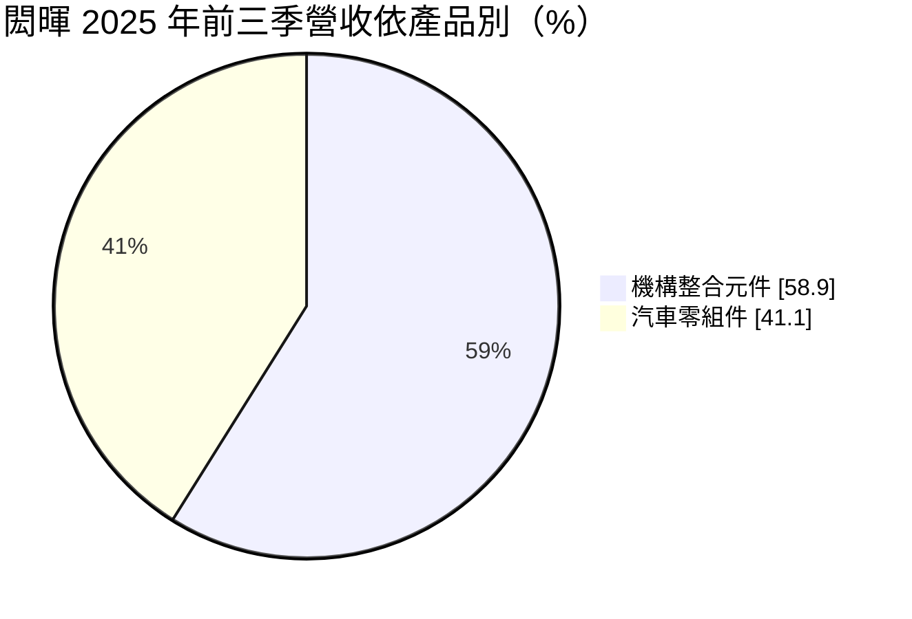
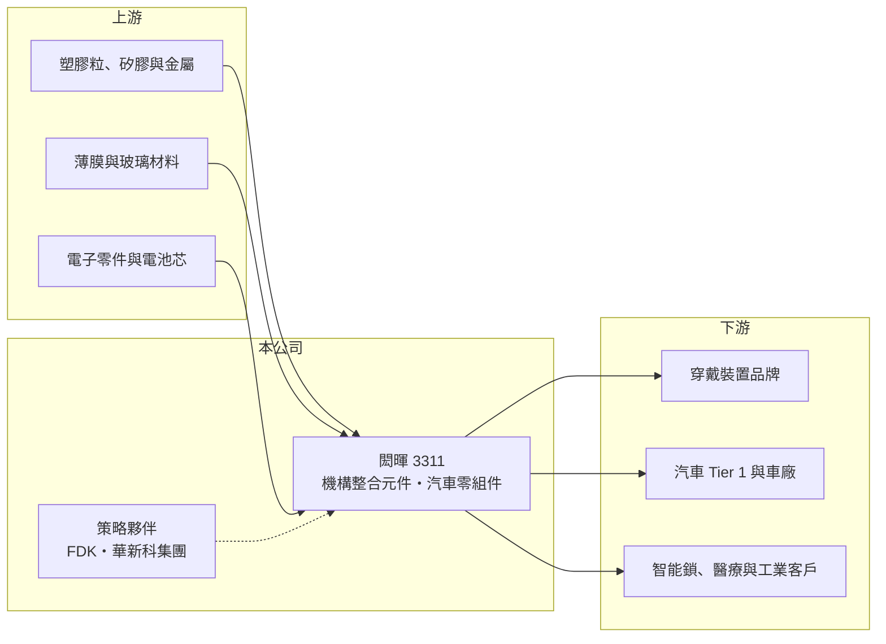

# 3311 閎暉

> 上市｜[[產業索引-通信網路業|通信網路業]]｜上市（櫃）日期 2004/03/08

# 第一章：企業模式與商業藍圖

> [!info] 撰寫說明
> 本文由 Claude 依公開資料整理，架構比照 [[2330台積電]] 的四章研究，資料截至 2026-10-08。財務數字來源：Goodinfo 年度經營績效頁、證交所開放資料（基本資料、2026 年第二季資產負債與損益、營益分析、股利）、富果研究 2025 年 12 月法說會整理、自由時報 2020 年私募報導；產業描述為整理性內容，尚未逐條比對原始文件。#待校對

評估一家機構件廠，要看它的材料與製程能力能延伸到多少種產品，以及集團資源能否帶來新的成長方向。本章說明閎暉實業（股票代號：3311，以下簡稱閎暉）的兩大事業、它在華新科集團中的角色，以及近年往能源產品轉型的方向。

## 一、核心定位：多材料機構整合元件廠

閎暉成立於 2001 年，2004 年上市，實收資本額 10 億元。公司早期以手機與電子產品的按鍵等人機介面元件起家（待校對），目前的核心技術包括熱固性材料機構件、矽膠、塑膠、薄膜內射出成型（[[IMD]]）與玻璃類產品。機構整合元件是電子產品外部與內部的結構、按鍵與外觀件，需要依客戶設計開模、配色並通過耐用度測試，訂單隨客戶產品生命週期延續。

公司在 2020 年辦理私募，[[2492華新科]] 參與後取代 [[2301光寶科]] 成為第一大股東，閎暉自此成為華新科集團的一員。集團關係讓閎暉能和集團內的被動元件與電子零件事業合作，爭取整合型專案。

## 二、產品結構

依 2025 年前三季法說會資料：

* **機構整合元件：** 其中約八成來自[[穿戴裝置]]，另有智能鎖模組、電子裝置與其他消費性產品。穿戴裝置對零件的體積、重量與外觀要求高，是閎暉多材料製程的主要應用。
* **汽車零組件：** 一年前占比接近一半，2025 年因車市放緩降到約四成。公司表示這是市場變化而非策略性退出。

## 三、長期方向：從機構件走向能源產品整合

2025 年閎暉新增對日本電池廠 FDK 的[[權益法]]投資與策略合作，並計畫整合閎暉、FDK 與華新科旗下 Linkstep 的全球據點。公司表示要從機構件供應商轉型為電池、機構件與電控板的能源產品整體解決方案夥伴。同年股本由約 6.8 億元增至 10 億元，推估與這項投資的資金需求相關（推估，待校對）。其他新方向包括無人機產品與玻璃曲面面板，公司規劃 2026 年量產。

# 第二章：護城河深度與競爭優勢

在長期價值投資中，「護城河」指企業抵禦競爭、維持超額利潤的保護機制。本章分析閎暉在機構件市場的競爭位置。

## 一、相對優勢

* **多材料製程：** 同時掌握熱固、矽膠、塑膠、IMD 與玻璃製程，能為客戶提供跨材料的整合方案，減少客戶管理多家供應商的成本。
* **車用與醫療認證：** 汽車與醫療零件需要長時間驗證，導入後通常能維持多年。
* **集團資源：** 華新科集團的客戶網絡與 FDK 的電池技術，讓閎暉有機會切入能源產品這類單價較高的領域。

## 二、主要競爭對手

| 對手 | 定位 | 對閎暉的威脅 |
|---|---|---|
| [[3376新日興]]、[[2474可成]] | 消費電子機構件 | 規模大，與品牌客戶關係深 |
| 中國機構件與矽膠按鍵廠 | 低成本大量生產 | 壓低消費性產品價格 |
| 國際車用零件廠 | 汽車內裝與控制面板 | 在車用領域擁有更完整的 Tier 1 關係 |

## 三、守得住／守不住／觀察重點

守得住的是車用與穿戴裝置的既有專案。守不住的是毛利率，2021 至 2023 年毛利率約 16%，2024 年後降到 11% 至 13%，營業利益率長期在 0% 至 5% 之間，代表機構件的定價能力有限。長期觀察重點是 FDK 合作能否帶來實質營收與較高毛利的能源產品、檳城廠轉型為非車用產品的進度，以及新產品的量產時程。

# 第三章：財務體質與盈利規模

資料日期：2026-10-08，表格是撰寫當時的快照；最新月營收、毛利率、累計 EPS 由自動排程寫在本筆記的屬性欄位（月營收、毛利率、累計EPS 等）。#待校對

財務報表是檢驗護城河是否真實存在的最終標準。本章用五年的三率、ROE 與資本報酬，檢視閎暉的獲利品質。

## 一、多年度經營績效

| 年度 | 營收（新台幣） | [[毛利率]] | [[營業利益率]] | EPS（元） | [[ROE]] |
|---|---|---|---|---|---|
| 2021 | 18.2 億 | 15.8% | 3.16% | 0.94 | 2.76% |
| 2022 | 20.3 億 | 16.5% | 4.91% | 1.47 | 4.04% |
| 2023 | 20.8 億 | 15.8% | 3.87% | 1.75 | 4.60% |
| 2024 | 24.1 億 | 11.6% | 0.57% | 0.81 | 2.06% |
| 2025 | 23.5 億 | 12.5% | 1.81% | 1.67 | 4.22% |
| 2026 上半年 | 11.8 億 | 11.0% | -0.35% | 0.84 | 未查得 |

閎暉的營收從 18 億元成長到 23 至 24 億元，營收年複合成長率約 6.6%（2021 至 2025 年，推算），但獲利率沒有跟上。2021 至 2025 年平均 ROE 約 3.5%（推算），屬於偏低水準。2026 年上半年本業小幅虧損，EPS 0.84 元主要來自約 0.9 億元的業外收入，推估與轉投資收益有關（推估）。股利政策規定稅後淨利提撥不低於三成，2025 年度每股配發現金股利 0.6 元，配息率約四成（推算）。

## 二、[[ROIC]] 與 [[WACC]]：價值創造利差

**ROIC 推算：** 2025 年營業利益約 0.43 億元（23.5 億 × 1.81%），稅後約 0.34 億元。2026 年第二季股東權益約 36.6 億元，負債約 15.5 億元，假設有息負債約 6 億元（推估），投入資本約 42.6 億元，ROIC 約 0.8%（推算）。投入資本中包含 FDK 等權益法投資，若只計本業營運資產，ROIC 會略高，但仍屬低個位數（推估）。

**WACC 推算：** 台灣 10 年期公債 1.75%、市場風險溢酬 6%、β 取機構件同業常見值 0.9，股東權益成本約 7.2%；負債成本 2.5%、稅後 2.0%；權益占投入資本約 86%，WACC 約 6.5%（推算）。

**結論：** 閎暉的 ROIC 長期明顯低於 WACC，本業沒有創造價值。2025 年的資本擴張讓投入資本增加，未來需要 FDK 合作與能源產品帶來顯著的獲利成長，才能讓這筆投資的報酬超過資金成本。

# 第四章：總體風險與地緣政治

任何企業都無法脫離宏觀環境獨立存在。本章分析閎暉長期必須面對的風險。

## 一、終端市場與客戶集中

穿戴裝置占機構整合元件約八成，這類產品高度集中在少數國際品牌，品牌的產品週期與設計變化會直接影響訂單。汽車零組件則受全球車市景氣影響，2025 年的車市放緩已讓汽車比重下降。

## 二、轉型與整合風險

跨國整合閎暉、FDK 與 Linkstep 的據點，涉及不同的企業文化、管理制度與成本結構，整合效益需要時間驗證。能源產品與無人機屬於新領域，技術與客戶都需要重新建立，若進度不如預期，擴大的資本會拖累報酬率。

## 三、成本與匯率

機構件的原料包括塑膠、矽膠與金屬，原料價格上漲時不易完全轉嫁。生產據點分布在馬來西亞、日本、中國與台灣，各地匯率與工資變動都會影響成本。

# 專有名詞解析

## 應用

- **[[IMD]]**：模內裝飾，把印好圖案的薄膜放入模具與塑膠一起射出成型，常用於家電與車用面板外觀件。
- **[[穿戴裝置]]**：戴在身上的電子產品，例如無線耳機、智慧手錶，對零件體積與重量要求高。

## 金融

- **[[權益法]]**：持股約兩成至五成的轉投資，依持股比例認列被投資公司損益的會計方法，收益列在業外。
- **[[ROIC]]**：投入資本報酬率，稅後營業利益除以股東權益與有息負債的合計，衡量本業對所有資金提供者的報酬。
- **[[WACC]]**：加權平均資金成本，依股東權益與負債的比重加權計算的資金成本，ROIC 高於它才代表創造價值。

# 核心供應鏈

## 1. 上游：材料與零件
- 塑膠粒、矽膠、金屬、薄膜與玻璃材料供應商

## 2. 中游：閎暉與集團夥伴
- 大股東：[[2492華新科]]；策略合作：日本 FDK
- 同業：[[3376新日興]]、[[2474可成]]

## 3. 下游：客戶
- 穿戴裝置品牌、汽車 Tier 1、智能鎖與醫療設備客戶（公司未揭露具名客戶）

## 最新新聞
<!-- news:start（自動產生，請勿手動編輯此範圍） -->
- 2026-10-12 📰 媒體 08:51｜營收速報 - 閎暉(3311)9月營收12.12億元年增率高達446.47％｜[鉅亨網](https://news.cnyes.com/news/id/6627795)
- 2026-10-06 🏛️ 重訊 15:59｜係因本公司有價證券於集中交易市場達公布注意交易資訊 標準，故公布相關財務業務等重大訊息，以利投資人區別瞭解｜[觀測站](https://mops.twse.com.tw/mops/#/web/t05st01)

完整紀錄：[[3311閎暉 新聞]]
<!-- news:end -->

## 相關連結
- [公開資訊觀測站](https://mopsov.twse.com.tw/mops/web/t05st03?step=1&firstin=1&co_id=3311)
- [Goodinfo](https://goodinfo.tw/tw/StockDetail.asp?STOCK_ID=3311)
- [Yahoo 股市](https://tw.stock.yahoo.com/quote/3311)
- [鉅亨網新聞](https://www.cnyes.com/twstock/3311/news)
